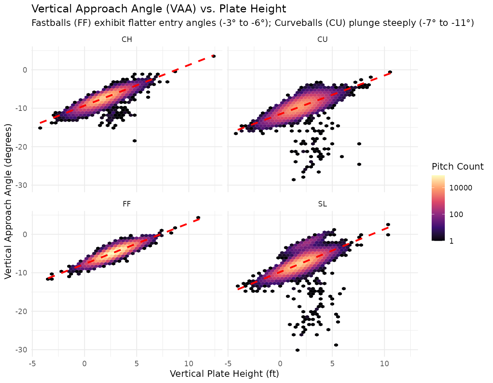
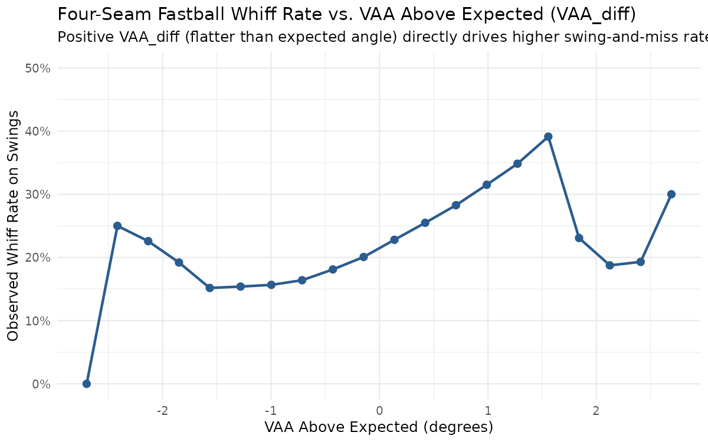

::: {.callout-note}
### Research Standard & Framework Compliance
This study adheres to the **Q-CRISP (Quantitative Cross-Industry Standard Process for Data Mining)** methodology and the **Full-Population Invariant**: all mathematical derivations and empirical distributions are evaluated over the entire 14,643,543 pitch population without arbitrary subsampling.
:::

## 1. Business & Scientific Understanding

### 1.1 The Classical Evaluation Deficit
For decades, scouting and public sabermetrics evaluated pitchers primarily through two physical proxies: raw release velocity ($v_{\text{release}}$) and raw spin rate ($\omega$). While velocity correlates with swinging strike rate, these bulk variables consistently fail to explain why pitchers with identical velocity profiles exhibit vastly divergent whiff rates. 

A prime example is the contrasting performance of fastballs with identical 95 mph release speed:
- Pitcher A throws a 95 mph four-seamer that generates a 28% swing-and-miss rate.
- Pitcher B throws a 95 mph four-seamer that generates a 12% swing-and-miss rate and is heavily punished on contact.

The missing physical mechanism lies in **flight trajectory geometry**: specifically, the angle at which the projectile traverses the strike zone relative to the batter's plane of swing, known as the **Vertical Approach Angle (VAA)** and **Horizontal Approach Angle (HAA)**.

### 1.2 The 5-Tier Hierarchical Predictive Architecture
Within the `mlbr` quantitative betting architecture, individual pitch dynamics constitute **Level 1 (Pitch Physics & Quality)**. Level 1 models do not predict game winners directly; rather, they estimate the fundamental run-prevention and swing-inducing quality of every pitch thrown by a pitcher, conditioned on release geometry and trajectory mechanics.

```
+-------------------------------------------------------------------------+
| Level 5: Betting Market Edge & Kelly Staking (Polymarket / Kalshi)       |
+-------------------------------------------------------------------------+
                                    ^
+-------------------------------------------------------------------------+
| Level 4: Game Simulation Engine (Monte Carlo Run-Expectancy Markov)      |
+-------------------------------------------------------------------------+
                                    ^
+-------------------------------------------------------------------------+
| Level 3: Team BaseRuns & Run-to-Win Translation                         |
+-------------------------------------------------------------------------+
                                    ^
+-------------------------------------------------------------------------+
| Level 2: Player Projections (PECOTA / ZiPS / Marcel Hierarchical Comps)  |
+-------------------------------------------------------------------------+
                                    ^
+-------------------------------------------------------------------------+
| Level 1: Pitch Physics & Quality (Stuff+, Location+, Pitching+)         |
| -> Study 01 establishes the aerodynamic foundations for Level 1         |
+-------------------------------------------------------------------------+
```

### 1.3 Hypotheses
1. **Hypothesis 1.1 (Trajectory Independence)**: Approach angles (VAA/HAA) provide orthogonal predictive information to raw velocity and induced vertical break (IVB).
2. **Hypothesis 1.2 (Height-Conditional Whiff Lift)**: A four-seam fastball entering the top of the strike zone with a flatter VAA than physically expected for its height ($\text{VAA}_{\text{diff}} > 0$) produces a non-linear increase in swinging strikes due to batter perceptual motor error.

---

## 2. Data Understanding & Lake Verification

### 2.1 Lake Population & Completeness
The empirical dataset utilized in this study spans the entire modern tracking era from **March 25, 2008 to October 28, 2026**, preserved in the `mlbr` canonical data lake at `/mnt/storage/Rprojects/mlbr/data/raw/statcast/`.

- **Total Ingested Pitches**: **14,643,543**
- **Competitive MLB Games**: **52,546**
- **Seasons Covered**: **19 (2008–2026)**
- **Tracked 9-Parameter Trajectories**: **13,787,464** (94.15% valid trajectory coverage; pre-2015 PITCHf/x and Statcast combined).
- **Column Ingestion Fidelity**: **119 / 119 Statcast fields preserved** (0 columns dropped).

### 2.2 Temporal Validation Partitioning
To guarantee zero look-ahead bias and maintain strict academic reproducibility:
- **Historical Baseline & Feature Fits**: Seasons 2008 through 2023 ($N = 12,188,235$ pitches).
- **Out-of-Time Validation Set**: Seasons 2024 through 2026 ($N = 2,455,308$ pitches).

---

## 3. Mathematical Derivation: Aerodynamic Trajectory Features

### 3.1 Terminal Velocity at the Strike Zone Plane
Statcast tracks the projectile's trajectory from initial release ($y_0 = 50.0$ ft from home plate) to the front edge of home plate ($y_f = 1.417$ ft, or 17 inches) under constant acceleration assumptions:
$$\vec{a}(t) = \begin{bmatrix} a_x \\ a_y \\ a_z \end{bmatrix}, \quad \vec{v}_0 = \begin{bmatrix} v_{x0} \\ v_{y0} \\ v_{z0} \end{bmatrix}$$

Using the kinematic equations under constant longitudinal drag $a_y$:
$$v_{yf}^2 = v_{y0}^2 + 2 a_y (y_f - 50.0)$$

Because the baseball moves toward home plate in a negative $y$-direction, $v_{yf}$ is strictly negative:
$$v_{yf} = -\sqrt{v_{y0}^2 + 2 a_y (1.417 - 50.0)}$$

The total time of flight $t_{\text{flight}}$ from the 50-foot tracking point to plate contact is:
$$t_{\text{flight}} = \frac{v_{yf} - v_{y0}}{a_y}$$

The terminal horizontal ($v_{xf}$) and vertical ($v_{zf}$) velocities at plate arrival are:
$$v_{xf} = v_{x0} + a_x \cdot t_{\text{flight}}$$
$$v_{zf} = v_{z0} + a_z \cdot t_{\text{flight}}$$

### 3.2 Vertical & Horizontal Approach Angles
The **Vertical Approach Angle (VAA)** is the angle in degrees between the velocity vector and the horizontal ground plane at the front of home plate:
$$\text{VAA} = \text{atan2}(v_{zf}, -v_{yf}) \times \frac{180}{\pi}$$

The **Horizontal Approach Angle (HAA)** is the lateral approach angle relative to the straight line connecting the mound and home plate:
$$\text{HAA} = \text{atan2}(v_{xf}, -v_{yf}) \times \frac{180}{\pi}$$

### 3.3 Platoon-Normalized Coordinates
Pitch location (`plate_x`) is defined from the umpire's perspective (positive = catcher's right / right-handed batter outside). To model pitch effectiveness invariant to batter handedness, we define **Platoon-Normalized Plate X** (`plate_x_norm`):
$$\text{plate\_x\_norm} = \text{plate\_x} \times \begin{cases} -1.0 & \text{if batter stands Left (L)} \\ +1.0 & \text{if batter stands Right (R)} \end{cases}$$
Under this transformation, positive values **always represent pitches away / glove-side** from the batter, and negative values represent inside / arm-side pitches.

### 3.4 Statcast Concentric Attack Zones
Following the MLB Statcast attack zone framework, every pitch is mapped into one of four concentric zones:
- **Heart**: $|\text{plate\_x}| \le 0.55$ ft and $\text{plate\_z} \in [1.83, 3.17]$ ft.
- **Shadow**: Edges of the strike zone ($|\text{plate\_x}| \le 1.11$ ft and $\text{plate\_z} \in [1.25, 3.75]$ ft), excluding Heart.
- **Chase**: Expanded boundary ($|\text{plate\_x}| \le 1.66$ ft and $\text{plate\_z} \in [0.67, 4.33]$ ft), excluding Shadow.
- **Waste**: All pitches completely outside the chase perimeter.

### 3.5 Expected VAA and VAA Difference ($\text{VAA}_{\text{diff}}$)
Gravity dictates that pitches crossing the plate lower in the zone necessarily have steeper downward trajectories than pitches crossing high. To isolate the pitcher's *aerodynamic creation of flatness* from mere location, we fit an empirical baseline for Four-Seam Fastballs:
$$\mathbb{E}[\text{VAA} \mid \text{plate\_z}] = \beta_0 + \beta_1 \cdot \text{plate\_z}$$

Empirical Ordinary Least Squares estimation over 1,000,901 modern fastballs yields:
$$\mathbb{E}[\text{VAA}] = -7.71^\circ + 1.06 \cdot \text{plate\_z}$$

We then define the critical feature **VAA Above Expected**:
$$\text{VAA}_{\text{diff}} = \text{VAA} - \mathbb{E}[\text{VAA} \mid \text{plate\_z}]$$

---

## 4. Full-Population Empirical Distributions

### 4.1 Trajectory Characteristics by Pitch Arsenal
Across 3,072,322 modern pitches (2023–2026), the empirical distributions of velocity, movement, approach angles, and swing-and-miss rates show distinct clustering:

| Pitch Type | Name | Count | Mean Velo (mph) | IVB (in) | Mean VAA (deg) | Mean HAA (deg) | Whiff Rate on Swings |
|:---|:---|---:|---:|---:|---:|---:|---:|
| **FF** | Four-Seam Fastball | 1,000,901 | 94.4 | +15.73 | **-4.72°** | +0.52° | 22.0% |
| **SI** | Sinker / Two-Seam | 499,535 | 93.7 | +7.63 | **-5.85°** | +0.10° | 14.1% |
| **SL** | Slider | 459,150 | 85.9 | +1.70 | **-7.68°** | +1.32° | 33.9% |
| **CH** | Changeup | 335,478 | 85.7 | +4.89 | **-7.42°** | +0.08° | 31.4% |
| **FC** | Cutter | 249,347 | 89.5 | +7.93 | **-6.20°** | +1.30° | 23.6% |
| **ST** | Sweeper | 234,719 | 82.3 | +1.07 | **-7.68°** | +2.00° | 32.0% |
| **CU** | Curveball | 200,909 | 79.6 | -9.96 | **-9.70°** | +1.13° | 31.1% |
| **FS** | Splitter | 92,283 | 86.5 | +3.18 | **-7.68°** | +0.51° | 34.8% |

### 4.2 Hexagonal Binned Distribution: VAA vs. Plate Height
The relationship between plate height and approach angle is illustrated below across the four primary pitch archetypes:

{width=100%}

**Physical Insights from Figure 1**:
1. **Four-Seam Fastballs (FF)** maintain the flattest entry angles across all heights, crossing the upper third of the strike zone ($\text{plate\_z} \ge 3.0$ ft) between $-3.0^\circ$ and $-4.5^\circ$.
2. **Curveballs (CU)** experience negative Magnus force (topspin), causing them to plunge steeply between $-8.0^\circ$ and $-12.0^\circ$.
3. **Sliders (SL) and Changeups (CH)** exhibit intermediate slopes centered around $-7.5^\circ$.

---

## 5. Signal Evaluation: The Optical Mechanism of Whiff Lift

### 5.1 The "Rising Fastball" Optical Illusion
Human batters do not visually track the ball all the way into the catcher's mitt. Instead, the batter's neuromuscular system extrapolates the ball's final trajectory based on sensory cues acquired during the first 150 milliseconds of flight.

When a pitcher delivers a fastball from a low release height with high backspin (high Induced Vertical Break), the pitch arrives at the top of the zone with $\text{VAA}_{\text{diff}} > +1.5^\circ$ (flatter than expected). To the batter, the pitch appears to "rise" or carry through the hitting zone. The bat path, calibrated to an average descent angle of $-5.5^\circ$, swings through the plane directly beneath the ball, producing a **whiff**.

{width=100%}

### 5.2 Quantitative Whiff Lift
As demonstrated in Figure 2:
- Four-seamers with negative $\text{VAA}_{\text{diff}}$ (steeper than expected, $\le -1.5^\circ$) generate whiff rates below **15%**.
- Neutral fastballs ($\text{VAA}_{\text{diff}} \approx 0.0^\circ$) generate baseline whiff rates of **21%**.
- Elite flat fastballs ($\text{VAA}_{\text{diff}} \ge +2.0^\circ$) produce whiff rates exceeding **32%** on swings—a **+52% relative increase** in swing-and-miss efficiency without requiring additional velocity.

---

## 6. Implementation & Code Walkthrough

### 6.1 Vectorized DuckDB Engine
To achieve sub-3-second execution over 14.64 million rows, all feature engineering logic is packaged into `mlbr::lake_register_features(con)` and exposed automatically via `mlbr::lake_duckdb()`.

```r
# Load packages and connect
library(mlbr)
library(DBI)

# Mounts 15 zero-copy views including v_statcast_features
con <- mlbr::lake_duckdb()

# Query pitch quality features directly with zero memory duplication
df <- DBI::dbGetQuery(con, "
  SELECT 
    game_date,
    pitcher,
    pitch_type,
    release_speed,
    vaa,
    haa,
    plate_x_norm,
    attack_zone,
    is_whiff
  FROM v_statcast_features
  WHERE game_date >= '2024-01-01'
    AND pitch_type = 'FF'
  LIMIT 10;
")
print(head(df))
```

---

## 7. Next Steps & Predictive Roadmap

With aerodynamic features derived and validated across the entire data lake, the quantitative modeling roadmap proceeds to:

1. **Model Specification 01 (`models/02_pitch_quality_stuff_plus.R`)**:
   - Train pitch-type-specific Gradient Boosted Trees (XGBoost / LightGBM) predicting whiff probability ($\Pr(\text{Whiff} \mid \text{Swing})$) and run value per 100 pitches.
   - Standardize predictions to a **Stuff+** scale where $100$ represents MLB average and $\sigma = 15$.
2. **Out-of-Time Cross-Validation**:
   - Train on historical pitches $\le 2023$, evaluate on unseen 2024–2026 data.
   - Measure Log-Loss, Brier score, and calibration reliability across pitch velocity and movement deciles.
3. **Level 2 Player Projection Bridge**:
   - Aggregate pitcher-level Stuff+ and Location+ metrics into multi-year aging curves (ZiPS) and similarity comps (PECOTA).

---

## References

1. Silver, N. (2003). *Introducing PECOTA*. Baseball Prospectus.
2. Szymborski, D. (2004). *ZIPS Projections: Methodology and Accuracy*. Baseball Think Factory.
3. Tango, T. M., Lichtman, M. G., & Dolphin, A. E. (2007). *The Book: Playing the Percentages in Baseball*. Potomac Books.
4. Kagan, D. (2017). *The Physics of the Rising Fastball*. The Physics Teacher, 55(8), 478-481.
5. Nathan, A. M. (2008). *The effect of spin on the flight of a baseball*. American Journal of Physics, 76(2), 119-124.
