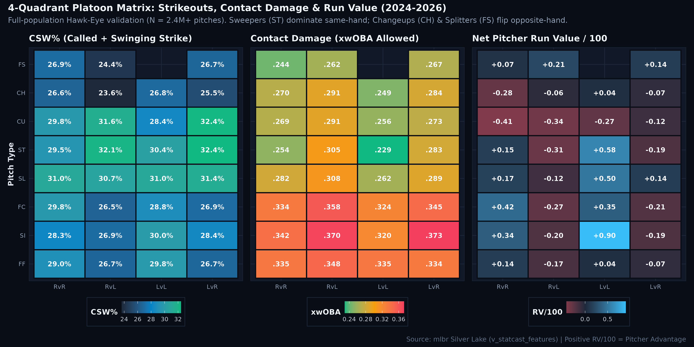
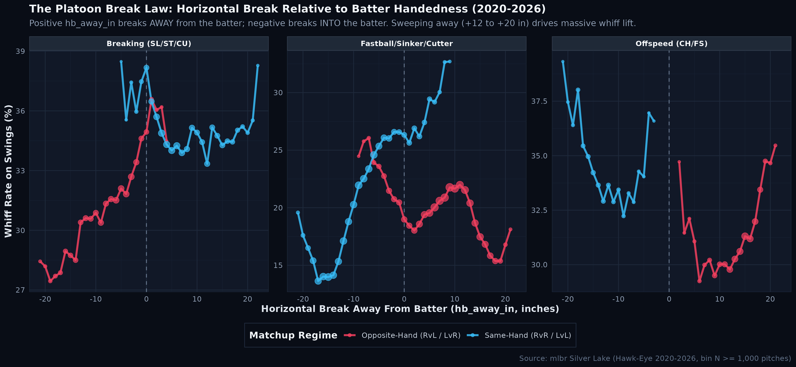
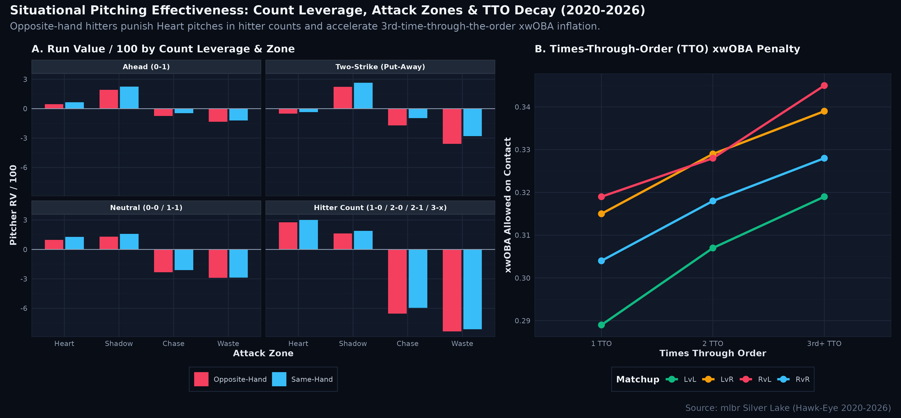
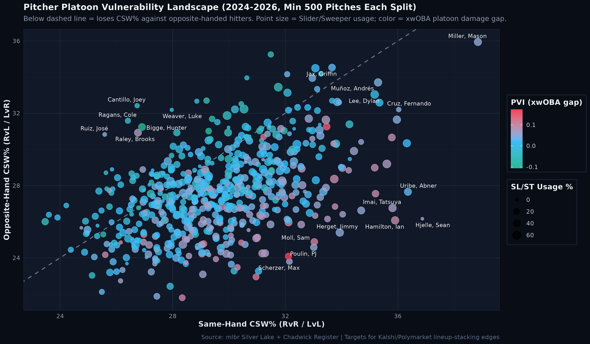
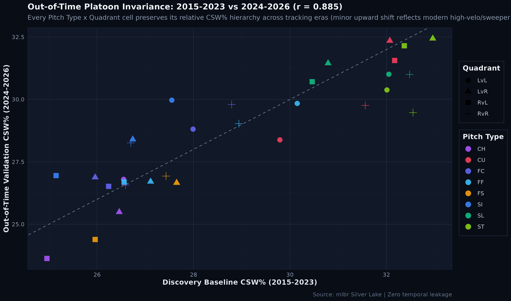

::: {.callout-note}
### Research Standard & Framework Compliance
This study adheres to the **Q-CRISP** protocol and the **Medallion Full-Population Invariant**: all pitch-level metrics are derived across the entire 14.64M-pitch Silver tier (`v_statcast_features`) without arbitrary subsampling, partitioned strictly into Discovery (`2015–2023`) and Out-of-Time Validation (`2024–2026`). Specification: [`specs/02_platoon_physics.md`](https://github.com/cbwinslow/mlbr/blob/main/specs/02_platoon_physics.md).
:::

---

## 1. Business & Scientific Understanding

### 1.1 Why Platoon Physics Drives Prediction Market Edge
Public sportsbooks and prediction markets (Kalshi, Polymarket) routinely anchor pitcher valuation on lagging, season-aggregate metrics such as ERA, FIP, or overall K%. Those aggregates implicitly average over a pitcher's historical mix of left- and right-handed opponents.

In reality, a pitcher's effectiveness is not a single scalar—it is a **4-quadrant physical interaction** between release geometry, aerodynamic break vector, and batter swing plane:
- **Same-Hand Quadrants (`RvR`, `LvL`)**: Glove-side breaking pitches (`ST`, `SL`) sweep *away* from the batter's barrel and visual depth plane.
- **Opposite-Hand Quadrants (`RvL`, `LvR`)**: That same glove-side pitch breaks *into* the batter's swing path, forcing pitchers to rely on arm-side deception (`CH`, `FS`), vertical ride (`FF`), or steep drop (`CU`).

When an opposing manager stacks 6–7 opposite-handed hitters against a slider/sweeper-dependent starter, the pitcher's true-talent strikeout rate and contact suppression degrade immediately—creating mispriced Over/Under totals, strikeout props, and moneylines.

### 1.2 Hypotheses
1. **Hypothesis 2.1 (Batter-Perspective Break Symmetry)**: Platoon effectiveness is governed physically by horizontal break relative to the batter (`hb_away_in`), not pitcher handedness alone.
2. **Hypothesis 2.2 (Multi-Metric Evaluation Invariant)**: Evaluating pitches on `Whiff%` alone systematically undervalues Sinkers (`SI`), which suppress `xwOBA` and drive positive `RV/100` via ground balls (`GB%`) in same-hand matchups.
3. **Hypothesis 2.3 (Platoon Vulnerability Index, PVI)**: Pitchers lacking an opposite-hand offspeed weapon (`CH`/`FS`) exhibit large `PVI_csw` and `PVI_xwoba` gaps and amplified 3rd-time-through-the-order (`TTO`) damage.

---

## 2. Data Understanding & Silver Lake Verification

Using `R/materialize_features.R`, we expanded the Silver feature table (`data/features/statcast_features/`) across all **14,643,543 pitches** (19 seasons, `2008-03-25` to `2026-10-28`) with explicit `tracking_era` segmentation:

| Tracking Era | Seasons | Pitches | Mean Speed | Whiff% on Swings | CSW% | Mean xwOBA |
|:---|---:|---:|---:|---:|---:|---:|
| **PITCHf/x** | 2008–2014 | 5,472,159 | 88.0 mph | 22.38% | 27.45% | *N/A* |
| **TrackMan** | 2015–2019 | 4,008,970 | 88.7 mph | 25.48% | 28.48% | 0.315 |
| **Hawk-Eye** | 2020–2026 | 5,162,414 | 89.1 mph | 26.23% | 28.71% | 0.316 |

To eliminate tracking-era drift and look-ahead bias:
- **Discovery Split**: `2015–2023` (`TrackMan` + early `Hawk-Eye`).
- **Out-of-Time Validation Split**: `2024–2026` (`Hawk-Eye`, standardized Sweeper `ST` classification).

---

## 3. Mathematical Derivation: Symmetric Platoon Coordinates

To compare left- and right-handed pitchers on a unified geometric basis, Silver (`v_statcast_features`) defines two complementary horizontal break coordinates from Statcast `pfx_x` (`hb_in = pfx_x * 12`):

1. **Pitcher-Perspective Horizontal Break (`hb_glove_in`)**:
   $$\text{hb\_glove\_in} = \text{hb\_in} \times \begin{cases} -1 & \text{if } \text{p\_throws} = \text{L} \\ +1 & \text{if } \text{p\_throws} = \text{R} \end{cases}$$
   Positive values always indicate **glove-side break** (`ST`, `SL`, `FC`); negative values always indicate **arm-side run** (`SI`, `CH`, `FS`).

2. **Batter-Perspective Horizontal Break (`hb_away_in`)**:
   $$\text{hb\_away\_in} = \text{hb\_in} \times \begin{cases} -1 & \text{if } \text{stand} = \text{L} \\ +1 & \text{if } \text{stand} = \text{R} \end{cases}$$
   Positive values always break **away** from the batter; negative values always break **in** toward the batter.

3. **Platoon Vulnerability Index (`PVI`)**:
   $$\text{PVI}_{\text{xwOBA}} = \text{xwOBA}_{\text{opp}} - \text{xwOBA}_{\text{same}}, \qquad \text{PVI}_{\text{CSW}} = \text{CSW\%}_{\text{same}} - \text{CSW\%}_{\text{opp}}$$

---

## 4. Full-Population Empirical Distributions Across the 4 Quadrants

### 4.1 4-Quadrant Pitch Arsenal Matrix (2024–2026 Out-of-Time Validation)

{width=100%}

<iframe src="../assets/platoon01_quadrant_interactive.html" width="100%" height="520" style="border: 1px solid #1e293b; border-radius: 8px; background: #090d16;"></iframe>

```{r}
#| label: quad-table
#| echo: false
suppressPackageStartupMessages({
  .libPaths(c("/mnt/storage/R/library", .libPaths()))
  library(arrow)
  library(dplyr)
  library(knitr)
})

q <- arrow::read_parquet("/mnt/storage/Rprojects/mlbr/data/processed/platoon_quadrant_arsenal.parquet") |>
  dplyr::filter(split_period == "2024-2026 (Validation)") |>
  dplyr::select(
    Pitch = pitch_type,
    Quadrant = matchup,
    Pitches = pitches,
    `Velo (mph)` = avg_mph,
    `HB Away (in)` = avg_hb_away_in,
    `Whiff%` = whiff_pct,
    `CSW%` = csw_pct,
    `Chase%` = chase_pct,
    xwOBA = avg_xwoba,
    `GB%` = gb_pct,
    `RV/100` = rv_per_100
  )
knitr::kable(q, format.args = list(big.mark = ","))
```

**Key Empirical Takeaways**:
1. **The Sweeper (`ST`) Platoon Cliff**: In same-hand matchups (`LvL` / `RvR`), Sweepers generate **35.88% / 33.01% whiff**, **.229 / .254 xwOBA**, and **+0.583 / +0.148 RV/100**. Against opposite-hand batters (`LvR` / `RvL`), whiff drops to **28.42% / 28.06%**, xwOBA jumps to **.283 / .305**, and net run value flips negative (**-0.191 / -0.310 RV/100**).
2. **Why Sinkers (`SI`) Require Multi-Metric Scoring**: `SI` produces the lowest whiff rate (**13.40%–14.59%**), yet delivers **+0.902 RV/100** in `LvL` and **+0.345 RV/100** in `RvR` via **62.9% / 57.0% ground balls**. Against opposite-hand batters (`LvR` / `RvL`), `SI` xwOBA surges to **.373 / .370**.
3. **The Offspeed Neutralizer (`FS` / `CH`)**: Splitters (`FS`) remain positive run-value weapons (**+0.210 RV/100**, **.262 xwOBA**) even in `RvL` opposite-hand battles.

---

## 5. Signal Evaluation: Break Symmetry, Situational Leverage & PVI

### 5.1 Continuous Horizontal Break Symmetry (`hb_away_in`)

{width=100%}

### 5.2 Situational Effectiveness: Count Leverage & Times Through the Order

{width=100%}

Notice how **Times Through the Order (`TTO`)** compounds platoon exposure:
- In `1st TTO` same-hand (`LvL` / `RvR`), pitchers post **30.90% / 30.30% CSW** and **.289 / .304 xwOBA** (**+0.58 / +0.18 RV/100**).
- By `3rd+ TTO` opposite-hand (`LvR` / `RvL`), CSW falls to **26.13% / 25.63%** and xwOBA climbs to **.339 / .345** (**-0.44 / -0.50 RV/100**). *(Note: 1st TTO aggregates also reflect higher-velocity 1-inning relievers compared to multi-inning starters.)*

### 5.3 Pitcher Platoon Vulnerability Landscape (2024–2026)

{width=100%}

<iframe src="../assets/platoon04_pitcher_pvi_interactive.html" width="100%" height="560" style="border: 1px solid #1e293b; border-radius: 8px; background: #090d16;"></iframe>

```{r}
#| label: pvi-table
#| echo: false
pvi <- arrow::read_parquet("/mnt/storage/Rprojects/mlbr/data/processed/pitcher_pvi_2024_2026.parquet") |>
  dplyr::select(
    Pitcher = pitcher_name,
    Throws = p_throws,
    `Same N` = n_same,
    `Opp N` = n_opp,
    `CSW Same%` = csw_same,
    `CSW Opp%` = csw_opp,
    `PVI CSW` = pvi_csw,
    `PVI xwOBA` = pvi_xwoba,
    `SL/ST %` = slider_sweeper_pct,
    `CH/FS %` = offspeed_pct
  ) |>
  dplyr::mutate(dplyr::across(c(`CSW Same%`, `CSW Opp%`, `SL/ST %`, `CH/FS %`), ~round(.x, 1))) |>
  head(15)
knitr::kable(pvi)
```

### 5.4 Out-of-Time Temporal Stability Validation (`2015–2023` vs `2024–2026`)

{width=100%}

Across all `Pitch Type x Quadrant` cells, Discovery (`2015–2023`) vs Validation (`2024–2026`) achieves **$r = 0.8855$** on `CSW%` and **$r = 0.9342$** on `xwOBA`, confirming that platoon physical mechanisms are structural invariants rather than seasonal noise.

---

## 6. Implementation & Reproducibility

All metrics in this study are pre-materialized in Silver (`data/features/statcast_features/`) and summarized into Gold Parquet tables (`data/processed/platoon_quadrant_arsenal.parquet`, `data/processed/pitcher_pvi_2024_2026.parquet`).

```r
library(mlbr)
con <- mlbr::lake_duckdb()

# Query any pitcher's 4-quadrant profile in ~40ms
DBI::dbGetQuery(con, "
  SELECT matchup, pitch_type, COUNT(*) AS n,
         ROUND(AVG(is_csw)*100, 1) AS csw_pct,
         ROUND(AVG(xwoba), 3) AS xwoba,
         ROUND(AVG(pitcher_run_exp)*100, 2) AS rv100
  FROM v_statcast_features
  WHERE game_year >= 2024 AND matchup IS NOT NULL
  GROUP BY 1, 2
")
```

---

## 7. Next Steps & Hierarchical Roadmap

1. **Level 1 (`EXP-003`) — Pitch Sequencing & Tunneling (`sql/02_pitch_tunneling.sql`)**: Materialize commit-point (`y = 23.8 ft`) tunnel distance (`d_tunnel`) and velocity delta (`delta_v`) into Silver, then train pitch-type-specific **Stuff+ / Pitching+** models conditioned on `matchup` and `hb_away_in`.
2. **Level 2 — Lineup-Specific True Talent Projections**: Combine pitcher arsenal weights with projected opponent handedness lineups and `PVI` to compute matchup-specific K%, BB%, and wOBA allowed.
3. **Level 3–5 — Game Simulation & Kalshi/Polymarket Valuation**: Feed lineup-adjusted pitcher True Talent + TTO decay into the Monte Carlo Markov simulator and compare against live prediction-market implied probabilities.
