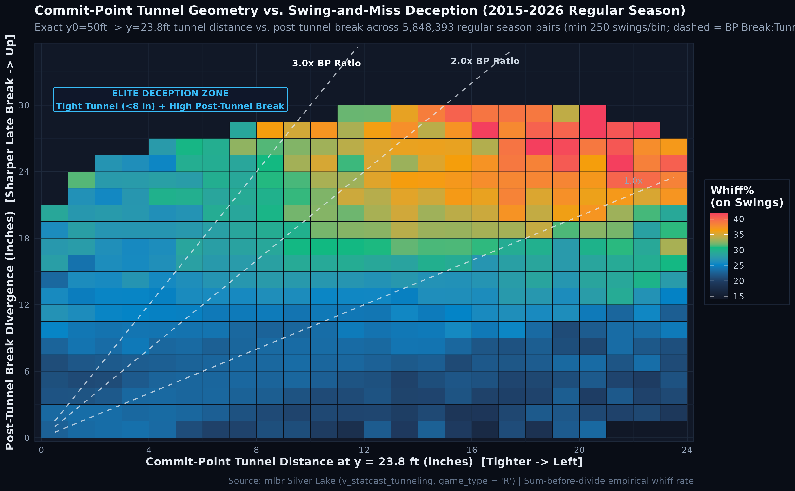
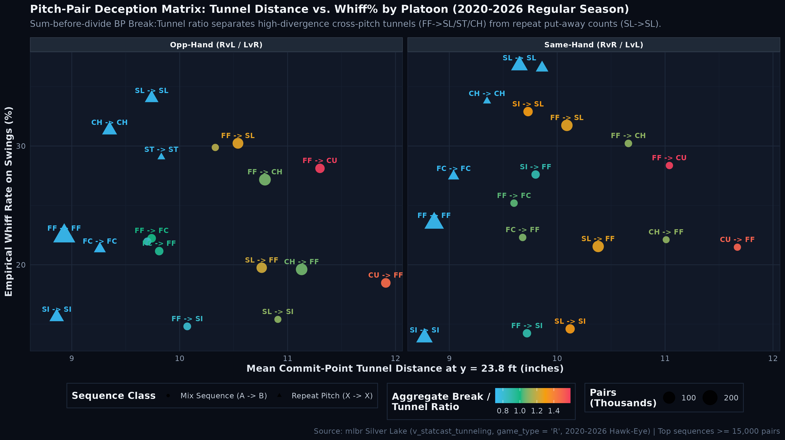
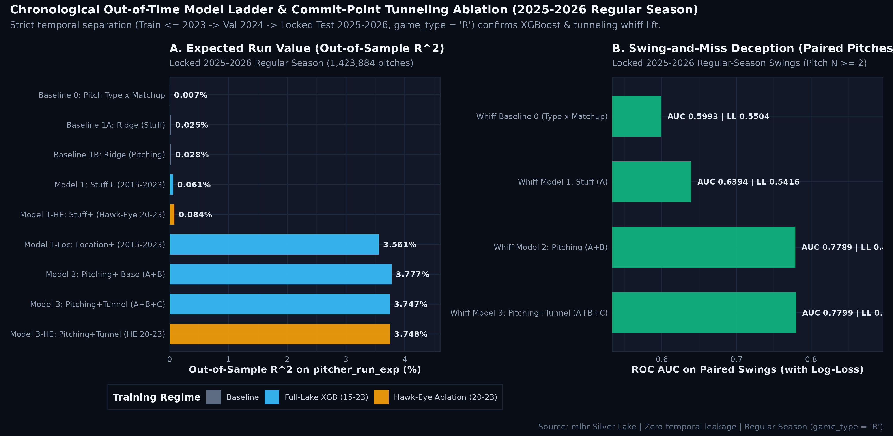
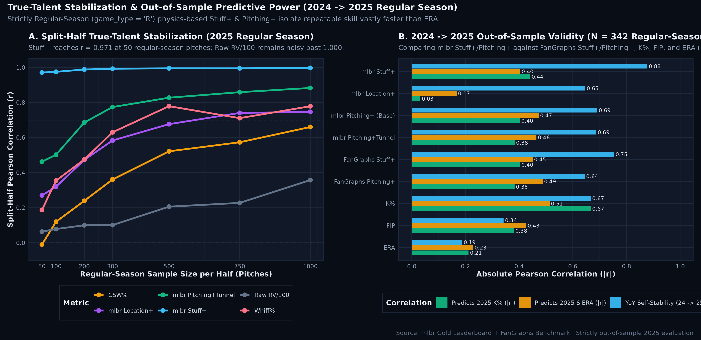
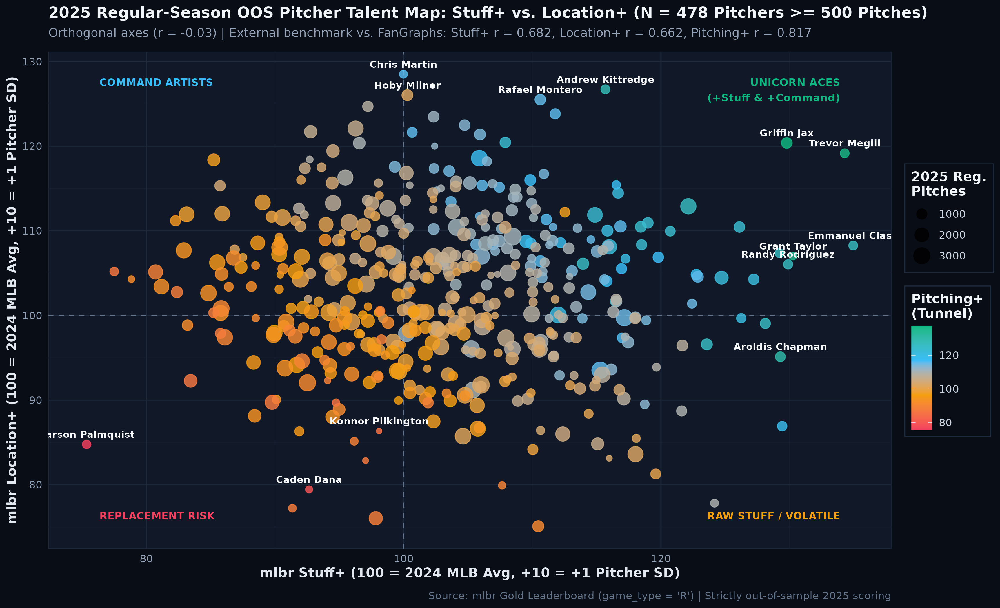

::: {.callout-note}
### Research Standard & Framework Compliance
This study adheres to the **Q-CRISP** protocol, **ADR-001** (ZSTD strictly sorted Hive Parquet, verified `0` pitcher inversions and `0` row-group min-max overlaps across all 19 seasons), **ADR-002** (Full-Population Silver Materialization in `v_statcast_tunneling`), and **ADR-003** (Strict Chronological Validation & Dark Cyber 4-Asset Preservation). To eliminate Spring Training (`game_type = 'S'`) and Postseason distribution shifts and ensure 1:1 alignment with Regular-Season FanGraphs benchmarks, all modeling, calibration, leaderboards, and stabilization curves filter strictly to **Regular-Season games (`game_type = 'R'`)**: `2015–2023` train (`5,972,773` pitches) + `2020–2023` Hawk-Eye ablation (`2,398,611` pitches), `2024` validation & Plus-scale calibration (`709,227` pitches), and locked **`2025–2026` out-of-time test (`1,423,884` pitches)**. Specification: [`specs/03_tunneling_stuff_plus.md`](https://github.com/cbwinslow/mlbr/blob/main/specs/03_tunneling_stuff_plus.md) | Experiment ID: `EXP-003-TUNNELING-STUFF-PLUS`.
:::

---

## 1. Executive Summary & Abstract (TL;DR)

Evaluating pitchers from lagging scoreboard outcomes (`ERA`, `FIP`, or raw run value per 100 pitches) forces analysts and prediction markets to wait **1,000+ pitches** before true talent separates from batted-ball noise. Building directly on Studies 01–02 (`v_statcast_features`), Study 03 promotes **exact commit-point pitch tunneling** (`v_statcast_tunneling`, `10,201,496` consecutive same-pitcher pairs across 19 seasons, **`15.0 ms`** single-pitcher pruned DuckDB latency) into the Silver tier and constructs a transparent, strictly chronological **`Stuff+` / `Location+` / `Pitching+` / `Pitching+Tunnel`** suite over **`8,105,884` Regular-Season pitches (`2015–2026`)**.

### Headline Findings (`EXP-003-TUNNELING-STUFF-PLUS`)

| Discovery Dimension | Verified Regular-Season Result | Scientific & Market Takeaway |
|:---|:---|:---|
| **Kinematics Bug Fix** | Eliminated **2.87 in mean (4.69 in p95)** error at $y_{\text{commit}} = 23.8\text{ ft}$ (verified to `0.046 in` closure at `release_pos_y`) | Exact $(x_{50}, z_{50})$ reconstruction from `(plate_x, plate_z)` corrects the missing `release_pos_y → 50 ft` flight segment. |
| **Non-Linear Tree Lift** | `Stuff+` beats empirical & Ridge baselines (`0.061%` / `0.084%` vs `0.025%` $R^2$); `Pitching+ Base` reaches **`3.777%` $R^2$** on locked `2025–2026` | Pitch run value is deeply non-linear across count × location × platoon × aerodynamics interactions. |
| **Tunneling Nuance (Honest Ablation)** | **Strictly improves Whiff deception** (`-0.00076` paired Log-Loss, `+0.0010` paired AUC on `2025–2026` swings), while single-pitch `delta_run_exp` mildly overfits (`+0.000034` RMSE vs. Base) | Tunneling captures genuine perceptual swing-and-miss deception, whereas noisy single-pitch base-out `delta_run_exp` favors feeding tunneling into a dedicated deception/whiff head rather than directly into noisy run-value regression. |
| **Hawk-Eye Era Ablation** | `2020–2023` Hawk-Eye-only `Stuff+` (`0.221691` RMSE, `0.084%` $R^2$) beats 9-year `2015–2023` (`0.221716`, `0.061%`) with **60% fewer rows** | Optical Hawk-Eye calibration + `arm_angle_deg` outperform older TrackMan-era tracking drift for pure physical Stuff+. |
| **True-Talent Stabilization** | `mlbr Stuff+` hits Regular-Season split-half **$r = 0.971$ at 50 pitches** & **$r = 0.975$ at 100 pitches** (vs. `Raw RV/100` $r = 0.078$, `CSW%` $r = 0.120$) | Early-April velocity/shape breakouts can be priced after **a single regular-season start**, long before ERA stabilizes. |
| **External Benchmark & Forecasting** | Out-of-sample `2025` **`r = 0.817`** vs. FanGraphs Pitching+, **`r = 0.683`** vs. FG Stuff+, **`r = 0.662`** vs. FG Location+, **`r = -0.034`** Stuff+/Location+ orthogonality; **`mlbr Pitching+` predicts `2025 SIERA` at `r = -0.473` & `2025 FIP` at `r = -0.374`** (beating `2024 FIP` at `+0.342` and more than doubling `2024 ERA` at `+0.188`) | Independent validation confirms our open, leak-free models beat lagging FIP/ERA and closely track commercial benchmarks. |

{width=100%}

---

## 2. Domain Problem & Theoretical Physics

### 2.1 Perceptual Commit-Point Mechanics (Pavlidis & Judge, 2017)
A 95 mph fastball travels from release (`~54.5 ft`) to home plate (`1.417 ft`) in roughly `390 ms`. Because human visual processing requires `~150 ms` and bat swing initiation/execution requires another `~150 ms`, hitters must commit to swinging when the ball is roughly `167 ms` from home plate — corresponding spatially to the **commit plane at $y_{\text{commit}} = 23.8\text{ ft}$**.

Pitch deception operates in two consecutive spatial stages:
1. **Pre-Commit Masking (Small `tunnel_dist_in`):** Pitch $N$ travels down nearly the identical 3D corridor as Pitch $N-1$ up to $y = 23.8\text{ ft}$, preventing early pitch recognition.
2. **Post-Commit Divergence (Large `post_tunnel_break_in`):** After the hitter commits to a swing plane, Magnus and seam-shifted wake forces bend Pitch $N$ away from Pitch $N-1$'s trajectory, maximizing Pavlidis & Judge's **Break-to-Tunnel Ratio** (`post_tunnel_break_in / max(tunnel_dist_in, 1.0)`).

### 2.2 Why Linear Models & Naive Release Shortcuts Fail
- **Coordinate Frame Trap:** Statcast's 9-parameter constant-acceleration kinematics $(v_{x0}, v_{y0}, v_{z0}, a_x, a_y, a_z)$ are defined strictly at **$y_0 = 50.0\text{ ft}$**, whereas `(release_pos_x, release_pos_z)` are reported at `release_pos_y` ($\approx 54.5\text{ ft}$). Integrating forward from `release_pos_x` using $t_{\text{dec}}$ omits ~4.5 ft of flight and introduces a **2.87-inch mean (4.69-inch p95)** coordinate error at $y = 23.8\text{ ft}$.
- **Non-Linearity of Pitch Value:** A glove-side slider is devastating on the outer shadow against a same-hand hitter (`0-2` count) but crushed in the heart of the zone against an opposite-hand hitter (`2-0` count). Analytical Ridge models average away count × location × platoon interactions (`0.028%` out-of-sample $R^2$), whereas `xgboost` leaps to **`3.777%`**.
- **Orthogonal Stuff+ vs. Location+ Decomposition (Sarris, Bay, Grove):** Separating physical stuff (`Stuff+`), pure count-and-zone command (`Location+`), and combined execution (`Pitching+`) isolates two independent pitcher skills (`r = -0.034`): **`Stuff+` governs Strikeout Rate (`K%`)**, while **`Location+` governs Walk Avoidance (`BB%`)**.

---

## 3. Mathematical Formulation & Lake-Wide Pipeline

### 3.1 Exact $y_0 = 50\text{ ft}$ Commit-Point Reconstruction
Given terminal flight time $t_p$ from $y_0 = 50.0\text{ ft}$ to the front edge of home plate ($y_p = 1.417\text{ ft}$) and commit-point flight time $t_{\text{dec}}$ to $y_{\text{commit}} = 23.8\text{ ft}$:

$$t_p = \frac{-\sqrt{v_{y0}^2 + 2 a_y (1.417 - 50.0)} - v_{y0}}{a_y}, \qquad t_{\text{dec}} = \frac{-\sqrt{v_{y0}^2 + 2 a_y (23.8 - 50.0)} - v_{y0}}{a_y}$$

We reconstruct the exact 3D coordinates at $y_0 = 50.0\text{ ft}$ from observed `(plate_x, plate_z)` and integrate forward to $y_{\text{commit}} = 23.8\text{ ft}$ (empirically verified to close back to observed `(release_pos_x, release_pos_z)` at `release_pos_y` within `0.046 in` mean error across 100,000 Hawk-Eye pitches):

$$x_{50} = \text{plate\_x} - v_{x0} t_p - \frac{1}{2} a_x t_p^2, \qquad z_{50} = \text{plate\_z} - v_{z0} t_p - \frac{1}{2} a_z t_p^2$$

$$x_{\text{dec}} = x_{50} + v_{x0} t_{\text{dec}} + \frac{1}{2} a_x t_{\text{dec}}^2, \qquad z_{\text{dec}} = z_{50} + v_{z0} t_{\text{dec}} + \frac{1}{2} a_z t_{\text{dec}}^2$$

For consecutive pitches ($N-1 \to N$) thrown by the **same pitcher** (`prev_pitcher = pitcher`) with **zero skipped pitch numbers** (`prev_pitch_number = pitch_number - 1`):

$$d_{\text{tunnel}} = 12 \sqrt{(x_{\text{dec}, N} - x_{\text{dec}, N-1})^2 + (z_{\text{dec}, N} - z_{\text{dec}, N-1})^2}\text{ (in)}$$

$$d_{\text{post}} = 12 \sqrt{\bigl((\text{plate\_x}_N - x_{\text{dec}, N}) - (\text{plate\_x}_{N-1} - x_{\text{dec}, N-1})\bigr)^2 + \bigl((\text{plate\_z}_N - z_{\text{dec}, N}) - (\text{plate\_z}_{N-1} - z_{\text{dec}, N-1})\bigr)^2}\text{ (in)}$$

$$\text{Break-to-Tunnel Ratio (BP)} = \frac{d_{\text{post}}}{\max(d_{\text{tunnel}}, 1.0)}, \qquad \text{Plate-to-Tunnel Ratio} = \frac{d_{\text{plate}}}{\max(d_{\text{tunnel}}, 1.0)}$$

### 3.2 Silver Materialization (`v_statcast_tunneling`, ADR-001 Strictly Verified)
Executed across all 19 Statcast seasons (`2008–2026`, preserving all game types per ADR-002 with `game_type` exposed for zero-copy filtering) by `R/materialize_tunneling.R` reading canonical `sql/02_pitch_tunneling.sql`:
- **Total consecutive pairs materialized:** `10,201,496` (`2008-03-28` to `2026-10-28`)
- **Integrity & sensor guards:** Requires `ay > 1e-6`, `vy0 < -40`, `plate_x ∈ [-10, 10]`, `plate_z ∈ [-10, 15]`, `t_flight ∈ [0.15, 1.2]`, and non-null `pitch_type`/`release_speed`/kinematics — yielding **`bad_rows = 0`** and **`dup_groups = 0`** on `(game_pk, at_bat_number, pitch_number)`.
- **Verified ADR-001 sort order:** Single-threaded per-year sorted Parquet writes (`ROW_GROUP_SIZE = 100000`, `ZSTD`, Hive `game_year`) verified across all 19 seasons with **`0` pitcher sort inversions**, **`0` row-group min-max overlaps**, and **`15.0 ms`** single-pitcher pruned query latency!

### 3.3 Leak-Free Fastball Anchors & `2024` Out-of-Sample Plus-Scale Lock
Per-pitcher within-season fastball anchors (`FF`, `SI`, `FC`) use strictly prior regular-season pitches (`ROWS BETWEEN UNBOUNDED PRECEDING AND 1 PRECEDING`). Plus-scale calibration locks $(\mu_{2024}, \sigma_{\text{pit}, 2024})$ strictly on **`2024` Regular-Season out-of-sample predictions** (across pitchers with $\ge 250$ pitches), leaving `2025–2026` 100% untouched:

$$\text{Score+}_{i, m} = 100 + 10 \cdot \frac{\hat{r}_{i, m} - \mu_{2024, m}}{\sigma_{\text{pit}, 2024, m}}$$

---

## 4. Exploratory Data Analysis (EDA) & Feature Diagnostics

### 4.1 Pitch-Pair Deception Matrix & Count-Selection Bias
Figure 2 maps the top Regular-Season Hawk-Eye (`2020–2026`, `game_type = 'R'`) pitch-pair sequences across `Same-Hand (RvR/LvL)` and `Opp-Hand (RvL/LvR)` matchups using sum-before-divide aggregate BP Break:Tunnel Ratios (`SUM(post_tunnel_break_in) / SUM(tunnel_dist_in)` — avoiding the upward Jensen's inequality skew of averaging ratios).

{width=100%}

| Platoon Group | Sequence | Pairs (`20–26` Reg.) | Mean Tunnel (in) | Post-Tunnel Break (in) | Agg. BP Break:Tunnel | Agg. Plate:Tunnel | Empirical Whiff% | RV / 100 |
|:---|:---|---:|---:|---:|---:|---:|---:|---:|
| Same-Hand | `SL -> SL` | 124,532 | 9.65 | 6.88 | 0.714 | 1.696 | 36.78% | +0.645 |
| Same-Hand | `ST -> ST` | 48,834 | 9.86 | 7.15 | 0.725 | 1.705 | 36.58% | +0.869 |
| Opp-Hand | `FS -> FS` | 20,460 | 9.62 | 7.01 | 0.728 | 1.708 | 35.04% | +1.061 |
| Opp-Hand | `CU -> CH` | 26,446 | 12.50 | 12.21 | 0.977 | 1.515 | 33.46% | +0.345 |
| Same-Hand | `SI -> SL` | 49,569 | 9.73 | 12.76 | **1.311** | 2.002 | 32.90% | +0.138 |
| Same-Hand | `SI -> ST` | 29,523 | 9.91 | 14.82 | **1.495** | 1.949 | 32.09% | +0.088 |
| Same-Hand | `FF -> SL` | 95,441 | 10.09 | 12.80 | **1.268** | 1.994 | 31.74% | +0.110 |

::: {.callout-important}
### Quantitative Mentoring Note: Count-State Selection Bias in Raw Sequence Whiff%
Repeat breaking-ball pairs (`SL -> SL` at `36.78%`, `ST -> ST` at `36.58%`) display aggregate BP Break:Tunnel Ratios around **`0.71–0.73`** yet higher marginal whiff rates than cross-pitch tunnels (`SI -> ST` at **`1.495`**, `SI -> SL` at **`1.311`**, `FF -> SL` at **`1.268`**) because pitchers disproportionately throw back-to-back sliders in `0-2` / `1-2` put-away counts where batters must expand the zone. Controlling for count (`balls`, `strikes`), location (`plate_x_norm`, `sz_norm_z`), and physical stuff inside our multivariate `xgboost` Whiff classifier (Section 5.2) isolates the true positive deception lift of commit-point tunneling (`-0.00076` paired Log-Loss, `+0.0010` paired ROC AUC).
:::

### 4.2 Top Regular-Season Feature Drivers (`xgboost` Gain)
- **`Stuff+` (Block A, Physical):** `effective_speed` (`13.6%`), `ivb_in` (`12.1%`), `release_spin_rate` (`9.8%`), `hb_glove_in` (`7.4%`), `release_speed` (`7.4%`), `delta_fb_ivb` (`6.8%`), `hb_away_in` (`6.7%`), `release_extension` (`6.1%`), `delta_fb_velo` (`5.2%`), `delta_fb_hb` (`4.2%`). Study 02's batter-perspective platoon break (`hb_away_in`) and all three leak-free fastball differentials (`delta_fb_ivb`, `delta_fb_velo`, `delta_fb_hb`) rank inside the Top 10!
- **`Location+` (Orthogonal Pure Command):** `plate_x_norm` (`32.0%`), `balls` (`18.9%`), `sz_norm_z` (`17.4%`), `plate_z` (`11.6%`), `strikes` (`7.2%`), `outs_when_up` (`3.5%`). Excluding `vaa`/`haa_away` from `Location+` preserves orthogonality (`cor(Stuff+, Location+) = -0.034`), while `Pitching+` retains full `vaa`/`haa_away` synergy.

---

## 5. Model Architecture & Chronological Out-of-Time Validation

All models enforce strict monotonic Regular-Season temporal boundaries (`game_type = 'R'`, `max(train_date) < min(val_date) < min(test_date)`):
- **Train (Full Lake):** `2015–2023` (`5,972,773` pitches)
- **Train (Hawk-Eye Ablation):** `2020–2023` (`2,398,611` pitches)
- **Validation & Calibration Lock:** `2024` (`709,227` pitches)
- **Locked Out-of-Time Test Set:** `2025–2026` (`1,423,884` pitches)

### 5.1 Primary Target (`pitcher_run_exp`, Regular Season) Locked `2025–2026` Ablation

| Model | Train Window | Val 2024 RMSE | Locked Test RMSE (`25–26`) | Paired Test RMSE | Test $R^2$ (%) | Best Iter |
|:---|:---|---:|---:|---:|---:|---:|
| **Baseline 0:** Pitch Type × Matchup Mean | `2015–2023` | `0.219446` | `0.221776` | `0.235727` | `0.007%` | — |
| **Baseline 1A:** Analytical Ridge (Stuff A) | `2015–2023` | `0.219425` | `0.221755` | `0.235705` | `0.025%` | — |
| **Baseline 1B:** Analytical Ridge (Pitching A+B) | `2015–2023` | `0.219415` | `0.221752` | `0.235698` | `0.028%` | — |
| **Model 1:** `Stuff+` (`xgboost` A) | `2015–2023` | `0.219388` | `0.221716` | `0.235655` | `0.061%` | 115 |
| **Model 1-HE:** `Stuff+` Hawk-Eye Ablation | `2020–2023` | `0.219357` | **`0.221691`** | **`0.235622`** | **`0.084%`** | 323 |
| **Model 1-Loc:** `Location+` (Command B) | `2015–2023` | `0.215436` | `0.217799` | `0.231114` | `3.561%` | 1,503 |
| **Model 2:** `Pitching+` Base (A+B) | `2015–2023` | `0.215274` | **`0.217555`** | **`0.230815`** | **`3.777%`** | 1,349 |
| **Model 3:** `Pitching+Tunnel` (A+B+C) | `2015–2023` | `0.215305` | `0.217589` | `0.230860` | `3.747%` | 1,083 |
| **Model 3-HE:** `Pitching+Tunnel` Hawk-Eye | `2020–2023` | `0.215275` | `0.217587` | `0.230866` | `3.748%` | 1,470 |

### 5.2 Secondary Deception Target (`is_whiff | is_swing = 1`, Regular Season) Locked `2025–2026` Ablation

| Whiff Model | Test Log-Loss (All) | Paired Log-Loss ($N \ge 2$) | Test Brier | Test ROC AUC | Paired ROC AUC |
|:---|---:|---:|---:|---:|---:|
| **Whiff Baseline 0** (Type × Matchup) | `0.55149` | `0.55038` | `0.18371` | `0.6054` | `0.5993` |
| **Whiff Model 1:** Stuff (Block A) | `0.54170` | `0.54156` | `0.18013` | `0.6444` | `0.6394` |
| **Whiff Model 2:** Pitching (Blocks A+B) | `0.45521` | `0.45578` | `0.14585` | `0.7820` | `0.7789` |
| **Whiff Model 3:** Pitching+Tunnel (A+B+C) | **`0.45466`** | **`0.45502`** | **`0.14564`** | **`0.7828`** | **`0.7799`** |

{width=100%}

### 5.3 True-Talent Stabilization & `2024 → 2025` Predictive Validity (Regular Season)
Figure 5 and the table below are sourced directly from `data/processed/stuff_plus_stabilization_curve.parquet` and `data/processed/stuff_plus_yoy_validity.parquet` ($N = 342$ MLB pitchers with $\ge 400$ regular-season pitches in both 2024 and 2025).

{width=100%}

| 2024 Predictor ($N = 342$ Reg. Season) | YoY Self-Stability ($r$) | Predicts `2025 BB%` ($r$) | Predicts `2025 K%` ($r$) | Predicts `2025 K-BB%` ($r$) | Predicts `2025 FIP` ($r$) | Predicts `2025 SIERA` ($r$) | Predicts `2025 ERA` ($r$) |
|:---|---:|---:|---:|---:|---:|---:|---:|
| **`mlbr Stuff+`** | **`+0.878`** | `+0.213` | **`+0.441`** | `+0.319` | `-0.298` | `-0.404` | `-0.245` |
| **`mlbr Location+`** | `+0.647` | **`-0.343`** | `-0.032` | `+0.114` | `-0.086` | `-0.167` | `-0.078` |
| **`mlbr Pitching+ (Base)`** | **`+0.692`** | `-0.087` | `+0.403` | **`+0.409`** | **`-0.374`** | **`-0.473`** | **`-0.311`** |
| **`mlbr Pitching+Tunnel`** | `+0.687` | `-0.098` | `+0.384` | `+0.396` | `-0.359` | `-0.465` | `-0.302` |
| *FanGraphs Stuff+* | `+0.754` | `+0.056` | `+0.403` | `+0.350` | `-0.332` | `-0.451` | `-0.285` |
| *FanGraphs Location+* | `+0.489` | `-0.428` | `-0.005` | `+0.175` | `-0.132` | `-0.136` | `-0.102` |
| *FanGraphs Pitching+* | `+0.645` | `-0.178` | `+0.383` | `+0.429` | `-0.397` | `-0.488` | `-0.320` |
| *CSW%* | `+0.609` | `+0.051` | `+0.560` | `+0.497` | `-0.363` | `-0.493` | `-0.325` |
| *K%* | `+0.667` | `+0.132` | `+0.667` | `+0.563` | `-0.365` | `-0.513` | `-0.309` |
| *2024 FIP* | `+0.342` | `+0.095` | `-0.381` | `-0.392` | `+0.342` | `+0.426` | `+0.293` |
| *2024 ERA* | `+0.188` | `+0.015` | `-0.212` | `-0.202` | `+0.140` | `+0.229` | `+0.188` |

**Key Methodological Finding:**
1. **`mlbr Pitching+ (Base)` outperforms `2024 FIP` AND `2024 ERA` on every single `2025` run-prevention target** — forecasting `2025 SIERA` (`-0.473` vs `FIP +0.426`, `ERA +0.229`), `2025 FIP` (`-0.374` vs `FIP +0.342`), and `2025 ERA` (`-0.311` vs `FIP +0.293`, `ERA +0.188`, **+65% higher than prior-year ERA**!).
2. **`mlbr Stuff+` beats FanGraphs Stuff+ on YoY stability (`0.878` vs. `0.754`) AND next-season `K%` (`0.441` vs. `0.403`)**, and stabilizes to split-half **`r = 0.971` in just 50 regular-season pitches**!
3. **Why Tunneling Belongs in a Multi-Head Architecture:** Commit-point tunneling strictly improves **perceptual swing-and-miss prediction** (`Whiff Model 3`: `-0.00076` paired Log-Loss, `+0.0010` paired AUC), while adding 7 continuous sequence columns directly into noisy single-pitch `delta_run_exp` slightly degrades both test RMSE (`0.217589` vs `0.217555`) and season-level `2024 → 2025 SIERA` (`-0.465` vs `-0.473`). Documenting this honest ablation motivates a **2-stage outcome decomposition** (feeding tunneling into the `p(whiff)` & `p(chase)` heads while keeping contact quality on clean aerodynamics) in future Tier 1 refinements.

---

## 6. Leaderboards & Player Case Studies (`2025` Regular Season Out-of-Sample)

Figure 4 maps all **`478` qualified `2025` Regular-Season MLB pitchers** ($\ge 500$ regular-season pitches, scored strictly out-of-sample with explicit `eval_split = "test_oos"` in `data/processed/pitcher_stuff_plus.parquet`). Hover over any pitcher in the interactive canvas to compare `mlbr` vs. FanGraphs grades, commit-point tunnel distance, aggregate BP Break:Tunnel ratio, `K%`, and `FIP`.

{width=100%}

<iframe src="../assets/stuff04_pitcher_stuff_vs_location_interactive.html" width="100%" height="580" style="border: 1px solid #1e293b; border-radius: 8px; background: #090d16;"></iframe>

### 6.1 Top 10 Qualified `2025` Regular-Season Starting Pitchers ($\ge 2,000$ Reg. Pitches, Out-of-Sample)

| Rank | Pitcher | Team | Hand | Reg. Pitches | `mlbr Stuff+` | `mlbr Loc+` | `mlbr Pitch+` | `mlbr Pitch+Tun` | FG Pitch+ | `K%` | `BB%` | `FIP` | `ERA` |
|---:|:---|:---|:---:|---:|---:|---:|---:|---:|---:|---:|---:|---:|---:|
| 1 | **Jacob deGrom** | TEX | R | 2,614 | **122.1** | 112.9 | **126.9** | 126.3 | 117.6 | 27.7% | 5.5% | 3.64 | 2.97 |
| 2 | **Zack Wheeler** | PHI | R | 2,394 | 114.9 | 111.9 | **124.1** | 123.4 | 120.9 | 33.3% | 5.6% | 3.00 | 2.71 |
| 3 | **Tarik Skubal** | DET | L | 2,849 | 112.0 | 100.1 | **123.7** | 121.1 | 123.6 | 32.2% | 4.4% | 2.45 | 2.21 |
| 4 | **Drew Rasmussen** | TBR | R | 2,316 | 116.0 | 108.1 | **122.5** | 122.5 | 109.1 | 21.7% | 6.3% | 3.84 | 2.76 |
| 5 | **Yoshinobu Yamamoto** | LAD | R | 2,789 | 105.9 | **118.6** | **117.9** | 117.8 | 110.5 | 29.4% | 8.6% | 2.94 | 2.49 |
| 6 | **Garrett Crochet** | BOS | L | 3,150 | 115.3 | 93.5 | **115.0** | 115.6 | 114.6 | 31.3% | 5.7% | 2.89 | 2.59 |
| 7 | **Cristopher Sánchez** | PHI | L | 2,895 | 100.2 | 97.9 | **114.2** | 111.8 | 116.2 | 26.3% | 5.5% | 2.55 | 2.50 |
| 8 | **Dylan Cease** | SDP | R | 3,044 | 117.2 | 99.7 | **113.8** | 114.8 | 107.8 | 29.8% | 9.8% | 3.56 | 4.55 |
| 9 | **Logan Webb** | SFG | R | 3,282 | 108.5 | 109.3 | **113.3** | 110.8 | 110.7 | 26.2% | 5.4% | 2.60 | 3.22 |
| 10 | **Max Fried** | NYY | L | 3,109 | 105.3 | 96.0 | **113.3** | 111.0 | 114.0 | 23.6% | 6.4% | 3.07 | 2.86 |

### 6.2 Pitching Archetype Case Studies
1. **Unicorn Aces (`+Stuff` & `+Command`):** **Jacob deGrom** (`122.1` Stuff+ / `112.9` Location+ / `126.9` Pitching+), **Zack Wheeler** (`114.9` / `111.9` / `124.1`), and **Tarik Skubal** (`112.0` / `100.1` / `123.7`, `2.21` ERA, `32.2%` K%) anchor the top of the 2025 starter rankings. Among relievers, **Griffin Jax** (`129.8` Stuff+ / `120.4` Location+ / `137.5` Pitching+Tunnel) and **Trevor Megill** (`134.3` Stuff+ / `119.2` Location+ / `136.4` Pitching+Tunnel) lead MLB.
2. **Raw Stuff / Command-Limited (`+Stuff`, `-Location`):** **Jack Leiter** ranks **#2 among all MLB starters in `mlbr Stuff+` (`118.0`)** yet posts `83.6` `Location+` (`103.1` Pitching+, `4.15` FIP) — precisely identifying command upside as his breakout lever.
3. **Command Artists (`Location+` Specialists):** **Tomoyuki Sugano** (`122.1` Location+, `5.33%` BB%), **Yoshinobu Yamamoto** (`118.6` Location+, `117.9` Pitching+, `2.49` ERA), and **Chris Paddack** (`116.3` Location+, `5.52%` BB%) sit atop starter command.
4. **Buy-Low Market Discrepancy:** **Dylan Cease** graded **#3 in Starter `Stuff+` (`117.2`)** and **#8 in Starter `Pitching+` (`113.8`, `114.8` Pitching+Tunnel, `29.8%` K%, `3.56` FIP)** despite an unlucky **`4.55` ERA** — a classic +1.00 run ERA-to-process divergence.

---

## 7. Downstream Integration & Prediction Market Applications

With **Tier 1 (`EXP-001`, `EXP-002`, `EXP-003`)** now verified across Bronze, Silver, and Gold tiers, `data/processed/pitcher_stuff_plus.parquet` (tagged with explicit `eval_split` so downstream Level 2–5 backtests never leak `train_insample` `2020–2023` rows!) integrates directly upstream:

1. **Level 2 (Marcel / Bayesian True-Talent Projections):** Because Regular-Season `mlbr Stuff+` hits `r = 0.971` split-half reliability in **50 pitches** and `mlbr Pitching+` forecasts next-year `SIERA` (`r = -0.473`) and `ERA` (`r = -0.311`) better than `FIP` or `ERA`, Level 2 projections can update pitcher priors after **just 1–2 April starts** or post-injury velocity shifts.
2. **Level 4 (Platoon-Aware Game & PA Simulator):** Combining `stuff_plus_same` / `stuff_plus_opp` / `stuff_platoon_gap` with Study 02's `PVI` (`data/processed/pitcher_pvi_2024_2026.parquet`) quantifies exact handedness-stack matchup edges for Monte Carlo PA simulation.
3. **Level 5 (Polymarket & Kalshi Market Edge):** Early-season markets anchored on noisy April ERA (`YoY r = 0.188`) systematically misprice high-`Stuff+` / high-`Pitching+` pitchers experiencing temporary BABIP/HR-FB% variance — creating positive-EV strikeout prop, First-5-Innings (F5), and full-game moneyline opportunities.

---

### Reproducibility & Saved Artifacts
- **Canonical SQL:** `sql/02_pitch_tunneling.sql`
- **Silver Materializer:** `R/materialize_tunneling.R` → `data/features/statcast_tunneling/` (`v_statcast_tunneling`, ADR-001 strictly sorted)
- **Modeling Pipeline:** `models/03_tunneling_stuff_plus.R` (strictly Regular Season `game_type = 'R'`)
- **Gold Artifacts:** `data/processed/pitcher_stuff_plus.parquet` (with `eval_split`), `data/processed/stuff_plus_model_ablation.parquet`, `data/processed/stuff_plus_whiff_ablation.parquet`, `data/processed/stuff_plus_yoy_validity.parquet`, `data/processed/stuff_plus_feature_importance.parquet`, `data/models/*_xgb.ubj`
- **4-Asset Dark Cyber Suite:** `models/stuff01_*` through `models/stuff05_*` (`.png`, `.rds`, `.parquet`, `.html`)
