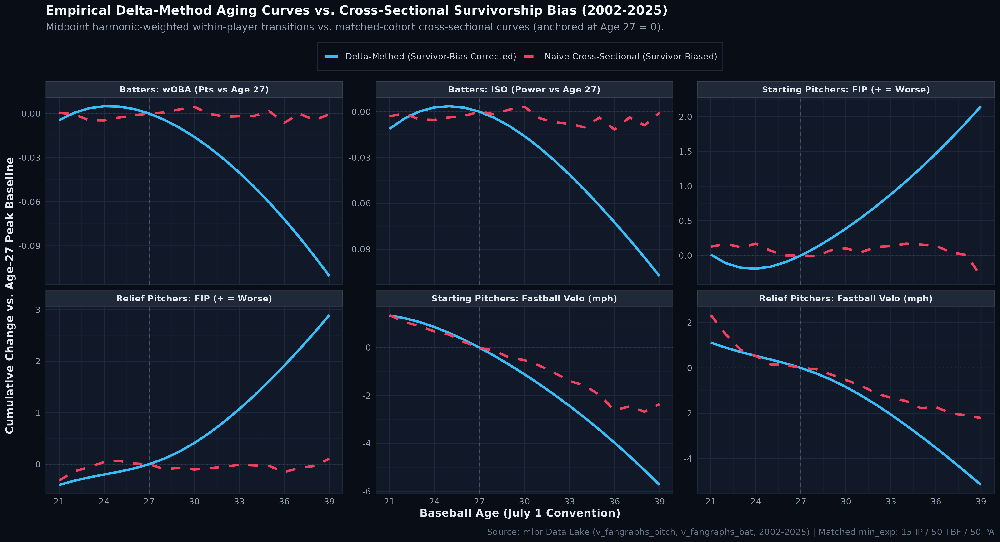
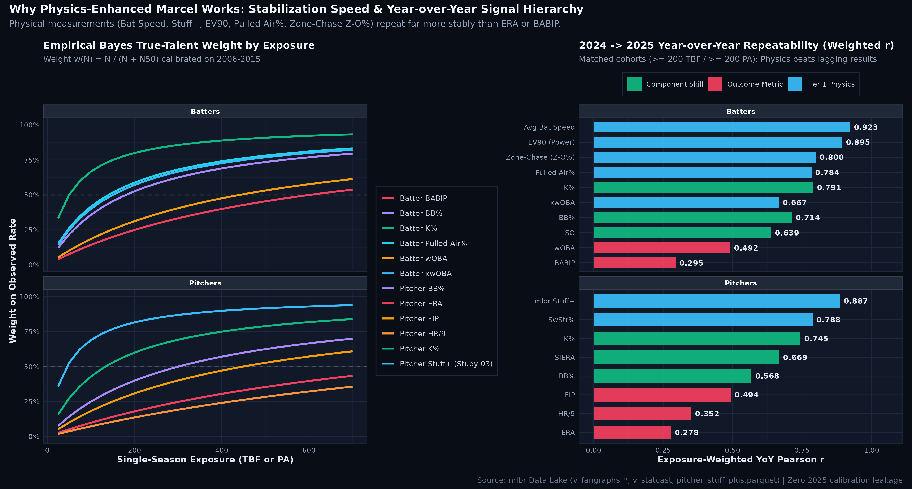
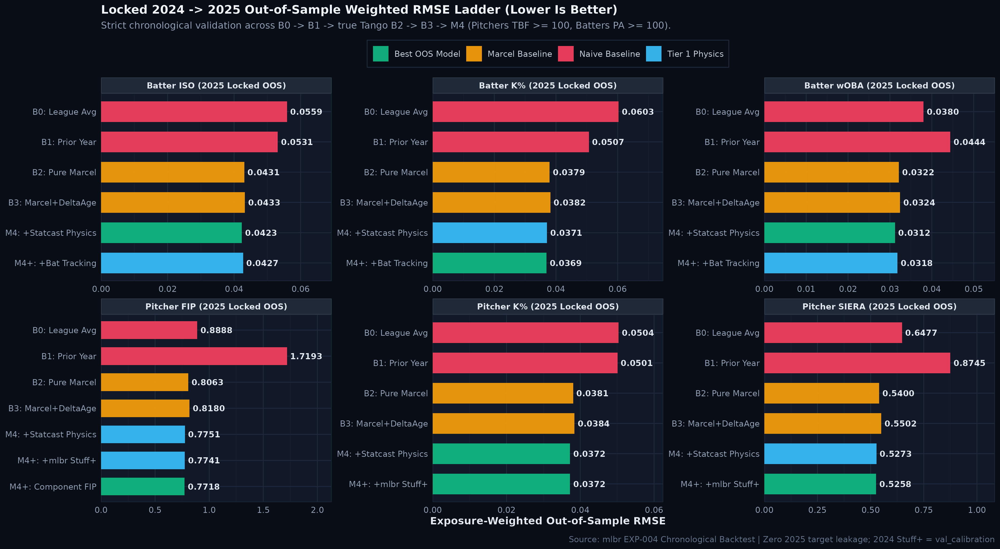
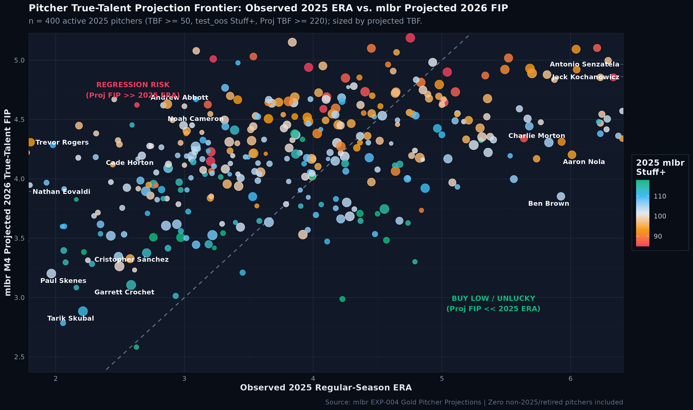
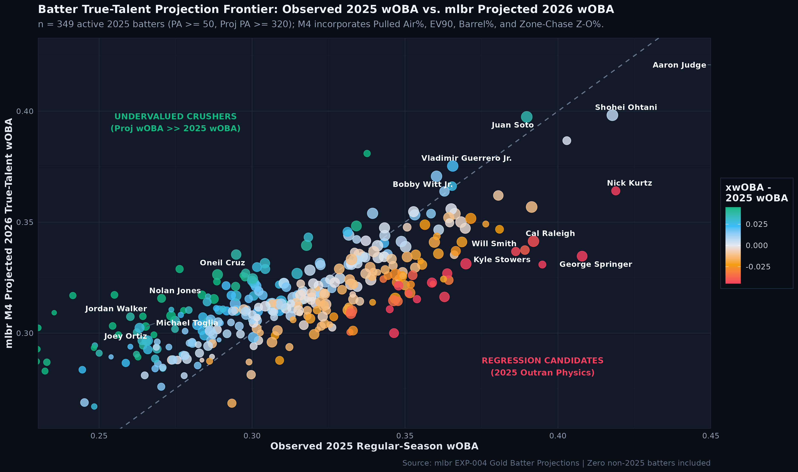

::: {.callout-tip}
### Experiment Registry & Tier 2 Architecture
- **Experiment ID:** `EXP-004-PLAYER-PROJECTIONS` (`VALIDATED` in `experiments/registry.json`)
- **Architecture Tier:** Level 2 — Player-Level True-Talent Projections & Aging Curves
- **Specification:** `specs/04_player_projections_marcel_aging.md`
- **Gold Deliverables:** `data/processed/pitcher_projections_true_talent.parquet` (`14,263` rows, `2016–2027`), `data/processed/batter_projections_true_talent.parquet` (`10,335` rows, `2016–2027`), `projections_aging_curves.parquet`, `projections_backtest_metrics.parquet`
- **Strict Zero-Leakage Protocol:** Every aging curve (`2002..T-1`), league anchor (`T-1`), reliability denominator (`2006–2015` pre-backtest), seasonal PVI (`game_year <= T-1`, banning Study 02's pooled `2024–2026` table), Tier 1 `mlbr Stuff+` (`eval_split`-guarded), and expanding Ridge stack obeys strict chronological causality (`0` imputed Stage-1 cells across all train/test folds).
:::

---

## 1. Executive Summary & Abstract (TL;DR)

Raw single-season baseball statistics (`ERA`, `FIP`, `wOBA`, `BABIP`) are heavily contaminated by finite-sample variance, park/defense noise, and run-environment drift. In **Study 04**, we construct `mlbr`'s **Level 2 True-Talent Player Projection Engine**, bridging **Level 1 Atomic Pitch & Batted-Ball Physics** (Studies 01–03) directly into **Level 3 Team BaseRuns** and **Level 4 Monte Carlo Game Simulation**.

| Pillar | Validated Out-of-Sample Result | Sabermetric & Forecasting Implication |
|:---|:---|:---|
| **Physics Signal Hierarchy (`2024 → 2025`)** | `Avg Bat Speed` ($r = 0.923$), `EV90` ($r = 0.895$), `mlbr Stuff+` ($r = 0.887$), `Zone-Chase (Z-O%)` ($r = 0.800$), `Pulled Air%` ($r = 0.784$) vs. `ERA` ($r = 0.278$) and `BABIP` ($r = 0.295$) | Physical measurements repeat **2.5×–3.2× more reliably** year-over-year than lagging box-score results. |
| **Midpoint Delta-Method Aging (`2002–2025`)** | True SP fastball velocity drops **`-5.12 mph`** and Batter `wOBA` drops **`-97 pts`** from age 27 to 38 (vs. survivor-biased cross-sectional curves at `-2.68 mph` and `-4 pts`). Zero-sum normalization removes `+0.168` cohort mean FIP drift; `3/2/1` beats `5/4/3` on **5 of 6** pitching metrics (`2016–2025`). | Standalone unshrunk Delta-Method `B3` trails Tom Tango's lower-variance damped `B2` slope slightly on Track 1, but exposes true biological aging free of survivorship bias and powers Stage-1 `M4`. |
| **Locked `2024 → 2025` Pitcher OOS ($N = 445\text{–}459$)** | **`M4_Component_FIP` achieves `0.77185` wRMSE** (`-0.03447` vs. true Tango `B2` `0.80631`, $p_{\text{beat}} = 0.995$), beating FanGraphs `Stuff+` (`0.77397`). **`M4_mlbr_StuffPlus`** cuts `FIP` to `0.77412`, **`SIERA` to `0.52579`** (`-0.01417`, beating FanGraphs `0.52602`), and **`HR/9` to `0.41054`** (`-0.02194`, $p_{\text{beat}} = 0.998$). | Stage-2 Residual Ridge stacking preserves 8-year calibration (`cal_slope = 0.95–1.07`) while extracting orthogonal `mlbr Stuff+`/`Location+` lift without 1-year over-shrinkage. |
| **Locked `2024 → 2025` Batter OOS ($N = 409$)** | **`M4_Statcast_Physics`** (`xwOBA`, **`Pulled Air%`**, **`EV90`**, **`Zone-Chase Z-O%`**) cuts `wOBA` wRMSE from `0.03215` to **`0.03121`** (`-0.00094`, $r = 0.552$, $p_{\text{beat}} = 0.995$), `BB%` to **`0.02043`** ($p = 0.993$), and `ISO` to **`0.04232`**. Adding **Hawk-Eye Bat Tracking** cuts Batter **`K%`** further to **`0.03691`** ($p = 0.995$). | Spray-aware pull-air physics + zone-chase selectivity directly address `xwOBA`'s blind spots; Hawk-Eye bat tracking improves `K%` immediately, while 1-year `wOBA`/`ISO` bat-tracking noise requires multi-season history (honest negative ablation). |
| **Track 4 Full-OOS `2025 → 2026` Statcast & 80% CIs** | On `2,429` untouched `2026` games: `M4_mlbr_StuffPlus_PureOOSCal` cuts Pitcher `K%` from `0.03942` to **`0.03688`** ($r = 0.701$, $p = 1.000$), and Batter `M4` cuts `xwOBA` from `0.02776` to **`0.02570`** ($r = 0.660$, $p = 1.000$); honest miss on `2026` Pitcher `BB%` (`0.02098` vs. `0.02060`). 80% CI coverage hits **`82.8%`** (Pitcher FIP) and **`81.4%`** (Batter wOBA). | Confirms zero calibration leakage from `2023` in-sample `Stuff+` and delivers calibrated variance inputs for Level 4 Monte Carlo simulation. |

{width=100%}

---

## 2. Domain Problem & Sabermetric Theory

Forecasting player talent is fundamentally a **signal-to-noise extraction problem** governed by four interacting mechanisms:

1. **Finite-Sample Binomial & Contact Variance (Carleton Stabilization):** A hitter's `K%` reaches 50% true-talent reliability in ~50 PA, whereas `BABIP`, `HR/9`, and `ERA` require 500–900+ exposures. Using a single shrinkage denominator across all statistics under-regresses noisy outcomes and over-regresses fast-stabilizing skills.
2. **Survivorship Bias vs. Zero-Sum League Conservation in Aging:** Plotting cross-sectional mean `wOBA` or `FIP` by age makes 38-year-olds appear nearly identical to 27-year-olds because only elite outliers remain employed at 38. Conversely, applying uncentered within-player **Delta-Method** declines directly to a returning MLB cohort shifts the projected league average upward by `+0.168 FIP` because retiring veterans are replaced by incoming rookies. **Tango's Zero-Sum Conservation Law** resolves both: estimate true biological slopes via midpoint harmonic-mean-weighted within-player pairs (with linear tail extrapolation past Age 39 so veteran decline remains strictly monotone), then zero-center the projected cohort's exposure-weighted aging shift to conserve the `T-1` league run environment.
3. **Why `xwOBA` Alone Is Incomplete (Spray & Swing-Decision Blind Spots):** Standard `xwOBA` depends solely on Exit Velocity and Launch Angle, ignoring horizontal spray angle. Pulled air balls (`LA >= 10°`, `spray < -15°` RHB / `> +15°` LHB — validated against FanGraphs `Pull%` at `r = 0.932` overall and `0.962–0.977` within batter handedness) produce vastly higher wOBA than opposite-field fly balls (`r = +0.203` with RHB `wOBA - xwOBA` — e.g., Isaac Paredes's `39.1%` raw 2025 Pulled Air% / `35.1%` 3-year regressed prior drove a `.352` observed `wOBA` over his `.314` regressed `xwOBA`). Likewise, raw `O-Swing%` rewards overly passive hitters, whereas **Zone-Chase Selectivity (`Z-Swing% - O-Swing%`, a SEAGER-inspired box-zone proxy)** directly isolates pitch-recognition aggression ($r_{\text{YoY}} = 0.800$).
4. **Preventing Sensor-Tier Over-Shrinkage via Stage-2 Residual Stacking:** Newer Hawk-Eye sensors (`mlbr Stuff+` OOS from 2024+, Hawk-Eye Bat Tracking from 2023+) have only 1 calibration season vs. 8–9 seasons for core Statcast metrics. Re-estimating 18 collinear predictors from scratch on $N \approx 450$ pitchers with L2 cross-validation crushes the dynamic range (`cal_slope = 1.8–2.2`). Holding the multi-year `M4_Statcast_Physics` forecast fixed as a Stage-1 offset and learning a zero-mean **Stage-2 Residual Ridge** over the 3–4 orthogonal new sensor features preserves `cal_slope ≈ 1.00` while cleanly capturing incremental physical lift.

---

## 3. Mathematical Formulation & Lake-Wide Pipeline

### 3.1 Exact Baseball Outs Conversion & July-1 Age Invariants
In `v_fangraphs_pitch`, `IP` is stored in baseball outs notation (`.1` $= 1/3$, `.2` $= 2/3$; verified `314–349` rows/season, `0` decimal rows). Every aggregation converts to exact decimal innings prior to sum-before-divide:

$$\text{IP}_{\text{true},i,s} = \lfloor \text{IP}_{i,s} \rfloor + \frac{\text{round}\big(10 \cdot (\text{IP}_{i,s} - \lfloor \text{IP}_{i,s} \rfloor)\big)}{3}, \qquad \text{Age}_{i,s} = s - \text{birth\_year}_i - \mathbb{I}(\text{birth\_month}_i \ge 7)$$

Verified `6,703 / 6,703` (`100.00%`) exact match between Chadwick birth dates and FanGraphs `Age`, and `3,687 / 3,687` (`100.00%`) join parity between `v_fangraphs_pitch` (`TBF >= 50`, `2020–2025`) and Tier 1 Gold `pitcher_stuff_plus.parquet`.

### 3.2 Era-Adjusted Marcel, Midpoint Delta Aging & Component-Reconstructed FIP
For target season $T$, role $g \in \{\text{SP}, \text{RP}, \text{BAT}\}$, recency weights $(w_1, w_2, w_3)$ (`5/4/3` batters; `3/2/1` pitchers), and pre-backtest (`2006–2015`) calibrated reliability denominators $M_r$:

$$\hat{r}^{\text{Marcel}}_{i,T} = \mu_{\text{lg},T-1,g} + \frac{\sum_{k=1}^{3} w_k \, N_{i,T-k} \, (r_{i,T-k} - \mu_{\text{lg},T-k,g})}{\sum_{k=1}^{3} w_k \, N_{i,T-k} + M_r}$$

*(2020 COVID-19 60-game season retains raw exposure $N_{i,2020}$ in rate precision weighting while pro-rating playing-time inputs by $162/60 = 2.70\times$. Baseline `B2_Marcel_LinAge` implements Tom Tango's (2004) exact direct age multiplier $m(a) = 1 + 0.006(29 - a)$ for $a \le 29$ and $1/(1 + 0.003(a - 29))$ for $a > 29$, followed by Step 6 projected-exposure league rebaselining.)*

Consecutive same-player, same-role pairs $(s-1, s)$ with $s \in [2003, T-1]$ estimate smooth midpoint (`age_mid = age - 0.5`) harmonic-mean-weighted Delta-Method curves $\hat{\delta}_g(a)$ with inverse-variance weights $W_{i,a}^{\text{harm}} = \frac{2 N_{i,s-1} N_{i,s}}{N_{i,s-1} + N_{i,s}}$ and linear marginal-slope extrapolation beyond `[21, 39]` (preventing endpoint clamping artifacts at Age 40+). Integrating from weighted historical age $\bar{a}_{i,T}$ to target age $a_{i,T}$ and applying Tango's zero-sum normalization yields `B3`:

$$\Delta^{\text{raw}}_{\text{age}}(i, T) = \int_{\bar{a}_{i,T}}^{a_{i,T}} \hat{\delta}_g(u)\,du, \qquad \Delta^{\text{norm}}_{\text{age}}(i, T) = \Delta^{\text{raw}}_{\text{age}}(i, T) - \frac{\sum_{j \in g} \widehat{N}_{j,T}\,\Delta^{\text{raw}}_{\text{age}}(j, T)}{\sum_{j \in g} \widehat{N}_{j,T}}$$

### 3.3 Stage-1 Expanding Physics Ridge, Stage-2 Sensor Residual Stacking & Uncertainty Bands
1. **Stage-1 Expanding Statcast Physics (`M4_Statcast_Physics`):** Season-grouped L2 Ridge (`glmnet`, $\alpha=0$) trained strictly on target seasons `2016 .. T-1` (`0` imputed cells across all folds) over `B3` rates plus regressed Statcast physics (`SwStr%`, `CSW%`, `FBv`, **`delta_fbv`**, `GB%`, `HardHit%`, `Barrel%`, `xERA`, **`pulled_air_allowed_pct`**, strictly seasonal pooled sum-before-shrink **`PVI_xwoba`/`PVI_csw`** for pitchers; `xwOBA`, `xwOBA - wOBA`, `Barrel%`, `HardHit%`, **`EV90`**, **`pulled_air_pct`**, **`sweet_spot_pct`**, `O-Swing%`, `Z-Contact%`, `SwStr%`, **`zone_chase_selectivity`** for batters).
2. **Stage-2 Residual Sensor Stack (`M4_mlbr_StuffPlus`, `M4_BatTracking`):** Holds Stage-1 fixed as an offset and fits a compact zero-mean residual Ridge on `2023 → 2024` (`2024` 100% unseen by Study 03's `2015–2023` XGBoost training) over the 3–4 orthogonal new sensor variables (`stuff_plus_t1`, `loc_plus_t1`, `pitch_plus_t1`, `tunnel_plus_t1` or `batspeed_t1`, `blast_t1`, `sq_swing_t1`, `swing_len_t1`).
3. **Component-Reconstructed FIP (`M4_Component_FIP`):** Synthesizes projected `K%`, `BB%`, `HR/9`, regressed `HBP%`, role `TBF/IP`, and prior-year $c\text{FIP}_{T-1}$ into an internally consistent run-prevention forecast.
4. **Exposure-Calibrated 80% Uncertainty Bands:** Regressing pre-2025 OOS squared residuals $e_i^2$ on $1/N_i$ decomposes uncertainty into irreducible talent variance + exposure noise:

$$\text{CI}_{80\%}(i, T) = \hat{y}_{i,T} \pm 1.2816 \sqrt{\hat{\sigma}_{\text{skill}}^2 + \frac{\hat{\sigma}_{\text{noise}}^2}{\widehat{N}_{i,T}}}$$

---

## 4. Exploratory Data Analysis (EDA) & Feature Diagnostics

### 4.1 Aging Curves & Survivorship Bias Quantification (`2002–2025`)
Figure 1 above contrasts within-player midpoint Delta-Method aging against matched-cohort (`min_exp`: 15 IP / 50 TBF / 50 PA) naive cross-sectional age averages (both anchored at Age 27 = `0`):

| Cohort & Metric | Age 22 | Age 25 | Age 27 (Peak) | Age 30 | Age 33 | Age 36 | Age 38 (Delta) | Age 38 (Naive Cross-Sec.) |
|:---|---:|---:|---:|---:|---:|---:|---:|---:|
| **Batter `wOBA`** | `+0.000` | `+0.005` | `0.000` | `-0.016` | `-0.040` | `-0.072` | **`-0.097`** | `-0.004` *(+93 pt survivor illusion!)* |
| **Batter `ISO`** | `-0.005` | `+0.004` | `0.000` | `-0.016` | `-0.041` | `-0.072` | **`-0.096`** | `-0.009` |
| **SP `FIP` (+ = worse)** | `-0.111` | `-0.160` | `0.000` | `+0.388` | `+0.882` | `+1.470` | **`+1.914`** | `+0.007` *(+1.91 run survivor illusion!)* |
| **SP Fastball Velo (mph)** | `+1.23` | `+0.61` | `0.00` | `-1.11` | `-2.43` | `-3.97` | **`-5.12`** | `-2.68` |
| **RP `FIP` (+ = worse)** | `-0.322` | `-0.146` | `0.000` | `+0.409` | `+1.070` | `+1.914` | **`+2.554`** | `-0.037` |
| **RP Fastball Velo (mph)** | `+0.89` | `+0.37` | `0.00` | `-0.84` | `-2.06` | `-3.54` | **`-4.61`** | `-2.09` |

*Methodological Caveat (Lichtman / Judge Forced-Exit Bias):* Even Delta-Method pairs only observe players who remain employed in consecutive seasons; players declining so sharply they exit MLB in year $s$ are censored, meaning true unconditional late-30s physical decline is at least as steep as our Delta-Method spline.

### 4.2 Stabilization Speed & Year-over-Year Signal Hierarchy
Figure 2 pairs our pre-2016 calibrated Empirical Bayes true-talent weights ($w(N) = N / (N + N_{50})$) with observed `2024 → 2025` weighted YoY repeatability across matched MLB cohorts ($\ge 200$ TBF / $\ge 200$ PA):

{width=100%}

- **Pre-2016 Calibrated Marcel Shrinkage ($M_r$):** Pitchers (`3/2/1`): `K% = 400` TBF, `BB% = 900` TBF, `SIERA = 900` TBF, `FIP = 320` IP, `ERA = 650` IP, `HR/9 = 900` IP. Batters (`5/4/3`): `K% = 250` PA (`N50 ≈ 50` PA!), `BB% = 900` PA, `ISO = 900` AB, `SLG = 1600` AB, `OBP = 2200` PA, `wOBA = 2200` PA.
- **Top YoY Signal Stability (`2024 → 2025`):** Batters: `Avg Bat Speed` (**`0.923`**), `EV90` (**`0.895`**), `Zone-Chase (Z-O%)` (**`0.800`**), `K%` (`0.791`), `Pulled Air%` (**`0.784`**) vs. `wOBA` (`0.492`) and `BABIP` (`0.295`). Pitchers: `mlbr Stuff+` (**`0.887`**), `SwStr%` (**`0.788`**), `K%` (`0.745`), `SIERA` (`0.669`) vs. `FIP` (`0.494`), `HR/9` (`0.352`), and `ERA` (`0.278`).

---

## 5. Model Architecture & Strict Chronological Out-of-Time Validation

All models are evaluated on identical matched cohorts ($\ge 100$ target TBF / $\ge 100$ target PA; $\ge 25$ target IP for IP-denominated rates) using exposure-weighted RMSE (`wRMSE`), MAE (`wMAE`), weighted Pearson $r$, calibration slope (ideal $= 1.00$), and 400-replicate paired bootstrap probability of beating true Tom Tango Pure Marcel (`p_beat`).

{width=100%}

### 5.1 Track 3 Primary Locked `2024 → 2025` OOS Benchmark: Pitchers ($N = 445\text{–}459$)

| Metric | Model | wRMSE | wMAE | Weighted $r$ | Cal. Slope | $\Delta$RMSE vs. `B2` | $p(\text{Beats B2})$ |
|:---|:---|---:|---:|---:|---:|---:|---:|
| **`FIP`** | `B0` League Avg | `0.88875` | `0.69588` | `0.1461` | `2.249` | `+0.08244` | `0.000` |
| **`FIP`** | `B1` Prior Year | `1.71931` | `0.94508` | `0.2181` | `0.116` | `+0.91300` | `0.000` |
| **`FIP`** | `B2` Pure Marcel (Tango) | `0.80631` | `0.62207` | `0.4443` | `1.027` | `0.00000` | — |
| **`FIP`** | `B3` Marcel + Delta-Age | `0.81799` | `0.62692` | `0.4280` | `0.943` | `+0.01168` | `0.002` |
| **`FIP`** | `M4_Statcast_Physics` | `0.77506` | `0.60976` | `0.5073` | `0.992` | `-0.03126` | `0.973` |
| **`FIP`** | `M4_mlbr_StuffPlus` | `0.77412` | `0.60849` | `0.5085` | `0.957` | `-0.03219` | `0.975` |
| **`FIP`** | *Ref: FanGraphs `Stuff+`* | `0.77397` | `0.60914` | `0.5098` | `0.956` | `-0.03234` | `0.985` |
| **`FIP`** | **`M4_Component_FIP` (Best)** | **`0.77185`** | **`0.60590`** | `0.5092` | `0.954` | **`-0.03447`** | **`0.995`** |
| **`SIERA`** | `B2` Pure Marcel (Tango) | `0.53996` | `0.42451` | `0.6112` | `1.085` | `0.00000` | — |
| **`SIERA`** | `M4_Statcast_Physics` | `0.52728` | `0.41411` | `0.6152` | `1.070` | `-0.01268` | `0.932` |
| **`SIERA`** | **`M4_mlbr_StuffPlus` (Best)** | **`0.52579`** | **`0.41348`** | **`0.6171`** | `1.045` | **`-0.01417`** | **`0.938`** |
| **`SIERA`** | *Ref: FanGraphs `Stuff+`* | `0.52602` | `0.41332` | `0.6170` | `1.051` | `-0.01394` | `0.935` |
| **`HR/9`** | `B2` Pure Marcel (Tango) | `0.43248` | `0.33523` | `0.3504` | `1.247` | `0.00000` | — |
| **`HR/9`** | `M4_Statcast_Physics` | `0.41058` | `0.31678` | `0.4645` | `1.070` | `-0.02190` | `0.995` |
| **`HR/9`** | **`M4_mlbr_StuffPlus` (Best)** | **`0.41054`** | **`0.31672`** | `0.4644` | `1.065` | **`-0.02194`** | **`0.998`** |
| **`K%`** | `B2` Pure Marcel (Tango) | `0.03806` | `0.03011` | `0.6838` | `0.949` | `0.00000` | — |
| **`K%`** | **`M4_Statcast_Physics`** | **`0.03723`** | **`0.02965`** | **`0.6871`** | **`0.971`** | **`-0.00083`** | `0.940` |
| **`K%`** | `M4_mlbr_StuffPlus` *(1-yr CV = 0)* | `0.03723` | `0.02965` | `0.6871` | `0.971` | `-0.00083` | `0.945` |
| **`BB%`** | `B2` Pure Marcel (Tango) | `0.01981` | `0.01461` | `0.5369` | `0.908` | `0.00000` | — |
| **`BB%`** | **`M4_Statcast_Physics` (Best)** | **`0.01965`** | `0.01461` | **`0.5438`** | **`0.998`** | **`-0.00015`** | `0.868` |
| **`BB%`** | `M4_mlbr_StuffPlus` | `0.01969` | **`0.01456`** | `0.5424` | `0.981` | `-0.00012` | `0.828` |

*Transparent Stage-2 Ablation Note on Pitcher `K%`:* On the 1-season `2023 → 2024` Stage-2 residual calibration fold, 5-fold CV shrank `Stuff+` residual weights for `K%` to `0` (`M4_Statcast_Physics = M4_mlbr_StuffPlus = Ref_FG_StuffPlus = 0.03723`) because Stage-1 already captures `SwStr%`, `CSW%`, and `FBv`. However, when calibrated purely out-of-sample on `2024 → 2025` (`val_calibration` `Stuff+`) and scored on Track 4 `2025 → 2026`, `M4_mlbr_StuffPlus_PureOOSCal` yields distinct positive `K%` lift (`0.03688` vs. `0.03710`, $p = 1.000$).

### 5.2 Track 3 Primary Locked `2024 → 2025` OOS Benchmark: Batters ($N = 409$)

| Metric | Model | wRMSE | wMAE | Weighted $r$ | Cal. Slope | $\Delta$RMSE vs. `B2` | $p(\text{Beats B2})$ |
|:---|:---|---:|---:|---:|---:|---:|---:|
| **`wOBA`** | `B0` League Avg | `0.03803` | `0.02999` | — | — | `+0.00587` | `0.000` |
| **`wOBA`** | `B1` Prior Year | `0.04441` | `0.03261` | `0.4598` | `0.371` | `+0.01225` | `0.000` |
| **`wOBA`** | `B2` Pure Marcel (Tango) | `0.03215` | `0.02500` | `0.5118` | `0.951` | `0.00000` | — |
| **`wOBA`** | `B3` Marcel + Delta-Age | `0.03240` | `0.02516` | `0.5046` | `0.937` | `+0.00025` | `0.040` |
| **`wOBA`** | **`M4_Statcast_Physics` (Best)** | **`0.03121`** | **`0.02413`** | **`0.5516`** | **`0.966`** | **`-0.00094`** | **`0.995`** |
| **`wOBA`** | `M4_BatTracking` *(1-yr ablation)* | `0.03180` | `0.02458` | `0.5436` | `0.804` | `-0.00035` | `0.710` |
| **`K%`** | `B2` Pure Marcel (Tango) | `0.03794` | `0.02969` | `0.7818` | `0.901` | `0.00000` | — |
| **`K%`** | `M4_Statcast_Physics` | `0.03709` | `0.02911` | `0.7875` | **`0.999`** | `-0.00085` | `0.978` |
| **`K%`** | **`M4_BatTracking` (Best)** | **`0.03691`** | **`0.02871`** | **`0.7902`** | `0.953` | **`-0.00103`** | **`0.995`** |
| **`BB%`** | `B2` Pure Marcel (Tango) | `0.02120` | `0.01639` | `0.7223` | `1.058` | `0.00000` | — |
| **`BB%`** | **`M4_Statcast_Physics` (Best)** | **`0.02043`** | **`0.01605`** | **`0.7478`** | `1.061` | **`-0.00077`** | **`0.993`** |
| **`ISO`** | `B2` Pure Marcel (Tango) | `0.04305` | `0.03409` | `0.6309` | `0.961` | `0.00000` | — |
| **`ISO`** | **`M4_Statcast_Physics` (Best)** | **`0.04232`** | **`0.03350`** | **`0.6612`** | `1.095` | **`-0.00074`** | `0.868` |
| **`ISO`** | `M4_BatTracking` *(1-yr ablation)* | `0.04270` | `0.03369` | `0.6530` | `0.962` | `-0.00036` | `0.630` |

### 5.3 Multi-Season Tracks (Track 1 `2016–2025`, Track 2 `2019–2025`, Track 4 `2025 → 2026` Full-OOS)
- **Track 1 (`2016–2025`, $N = 4,105\text{–}4,270$ pitchers, $3,969$ batters):** Tango's **`3/2/1` pitcher weights beat `5/4/3` on 5 of 6 pitching stats** (`K%`: `0.04061` vs. `0.04079`; `FIP`: `0.87886` vs. `0.87976`; `SIERA`: `0.63203` vs. `0.63439`; `HR/9`; `ERA`), while `5/4/3` narrowly edged `BB%` (`0.02152` vs. `0.02155`). Standalone unshrunk Delta-Method `B3` trails true rebased Tom Tango `B2` slightly (`FIP` `0.87886` vs. `0.87547`; `wOBA` `0.03414` vs. `0.03385`) due to Tango's lower-variance damped slope on returning cohorts, while Delta-Method aging reveals true biological aging free of survivorship bias and powers Stage-1 `M4`.
- **Track 2 (`2019–2025`, $N = 2,834\text{–}2,945$ pitchers, $2,768$ batters):** `M4_Statcast_Physics` decisively beats Pure Marcel at **$p_{\text{beat}} = 1.000$** across Pitcher `FIP` (`0.88757 → 0.85389`, $r: 0.330 \to 0.425$), `SIERA` (`0.63107 → 0.60763`), `HR/9` (`0.46256 → 0.44953`), `K%` (`0.04031 → 0.03968`), `ERA` (`1.19749 → 1.15694`), Batter `wOBA` (`0.03443 → 0.03361`, $r: 0.505 \to 0.536$), `OBP` (`0.03171 → 0.03090`), `BB%` (`0.02157 → 0.02082`), and beats on `K%` (`p = 0.975`), `SLG` (`p = 0.940`), and `ISO` (`p = 0.915`).
- **Track 4 (`2025 → 2026` Regular-Season Statcast, `2,429` games) & Pure-OOS Calibration Sensitivity:**
  - *Pitcher `K%` ($N = 461$):* Calibrating `M4_mlbr_StuffPlus` purely on `2024 → 2025` (`val_calibration` `Stuff+`) and scoring untouched `2025 → 2026` (`test_oos` `Stuff+`) achieves **`0.03688` wRMSE** ($r = 0.7006$, $p = 1.000$), beating `M4_Statcast_Physics` (`0.03710`), `B3` (`0.03915`), and `B2` (`0.03942`).
  - *Pitcher `BB%` ($N = 461$, honest negative result):* Pure Marcel `B2` (`0.02060`) outperformed `M4_Statcast_Physics` (`0.02099`), `M4_mlbr_StuffPlus` (`0.02098`), and `PureOOSCal` (`0.02083`, $p = 0.130$) due to a `+0.0046` league walk-rate regime shift in 2026.
  - *Batters ($N = 411$):* `M4_Statcast_Physics` slashes `2026` `xwOBA` wRMSE from `0.02776` to **`0.02570`** ($r = 0.6601$, $p = 1.000$), `BB%` from `0.02217` to **`0.02119`** ($p = 0.993$), and `K%` from `0.03542` to **`0.03439`** ($p = 0.983$).
- **80% Prediction Interval Empirical Coverage (Locked `2025` OOS):** Pitcher `FIP` = **`82.8%`**, Batter `wOBA` = **`81.4%`** (nominal `80.0%`).

---

## 6. Leaderboards, Interactive Explorers & Player Case Studies

### 6.1 Pitcher True-Talent Frontier (`2026` Projections & Live `2027` Hover)
Figure 4 compares observed `2025` ERA against `mlbr` `M4` projected `2026` FIP across the strictly gated active `2025` cohort ($n = 400$ pitchers with `TBF >= 50`, `test_oos Stuff+`, and `Proj TBF >= 220`; zero retired/non-2025 pitchers). Hover over any pitcher in the interactive explorer to inspect 80% uncertainty bands, `Location+`, seasonal `PVI`, and **Live `2027` Statcast-updated projections**.

{width=100%}

<iframe src="../assets/proj04_pitcher_projections_explorer.html" width="100%" height="580" style="border: 1px solid #1e293b; border-radius: 8px; background: #090d16;"></iframe>

#### Top 10 Projected `2026` Starting Pitchers (Active `2025`, Proj `TBF >= 550`)

| Rank | Pitcher | Team | Age | Proj TBF | `2025` ERA | **Proj `2026` FIP** | **Proj SIERA** | `K%` | `BB%` | `2025 Stuff+` | `2025 Loc+` |
|---:|:---|:---|---:|---:|---:|---:|---:|---:|---:|---:|---:|
| 1 | **Tarik Skubal** | DET | 29 | 669 | 2.21 | **2.88** | **3.06** | 30.4% | 5.8% | 111.0 | 100.1 |
| 2 | **Garrett Crochet** | BOS | 27 | 686 | 2.59 | **3.11** | **3.27** | 28.9% | 6.5% | 114.1 | 94.3 |
| 3 | **Paul Skenes** | PIT | 24 | 638 | 1.97 | **3.20** | **3.41** | 28.0% | 7.0% | 103.8 | 109.1 |
| 4 | **Cristopher Sánchez** | PHI | 29 | 699 | 2.50 | **3.26** | **3.52** | 23.6% | 6.2% | 100.2 | 98.1 |
| 5 | **Yoshinobu Yamamoto** | LAD | 27 | 599 | 2.49 | **3.35** | **3.53** | 26.8% | 7.8% | 105.4 | 116.0 |
| 6 | **Zack Wheeler** | PHI | 36 | 591 | 2.71 | **3.38** | **3.45** | 27.6% | 6.4% | 113.5 | 110.0 |
| 7 | **Jacob deGrom** | TEX | 38 | 559 | 2.97 | **3.51** | **3.49** | 27.0% | 6.1% | 120.2 | 111.0 |
| 8 | **Hunter Brown** | HOU | 27 | 656 | 2.43 | **3.52** | **3.73** | 26.1% | 8.3% | 105.7 | 98.8 |
| 9 | **Logan Webb** | SFG | 29 | 732 | 3.22 | **3.53** | **3.77** | 21.2% | 5.7% | 107.9 | 108.2 |
| 10 | **Jesús Luzardo** | PHI | 28 | 626 | 3.92 | **3.53** | **3.58** | 27.7% | 7.6% | 99.3 | 106.1 |

- **Top Relievers (`2026`):** **Mason Miller** (`2.58` FIP, `37.7% K%`, `117.2 Stuff+`), **Jhoan Duran** (`2.78`), **Andrés Muñoz** (`2.99`), standout buy-low arm **Griffin Jax** (`4.23` 2025 ERA → **`2.99` Proj FIP**, `124.2 Stuff+`, `114.4 Loc+`!), and **Aroldis Chapman** (`2.99`, `123.0 Stuff+`).
- **SP Rebound vs. Regression Flags:** **Ben Brown** (`5.92` ERA → `3.85` Proj FIP, `104.1 Stuff+`) and **Aaron Nola** (`6.01` ERA → `4.20` Proj FIP, `116.9 Loc+`) lead rebound buys, while **Trevor Rogers** (`1.81` ERA → `4.31` Proj FIP, `93.2 Stuff+`), **Nathan Eovaldi** (`1.73` ERA → `3.89` Proj FIP), and **Andrew Abbott** (`2.87` ERA → `4.63` Proj FIP, `95.4 Stuff+`) flag sharp regression risk.
- **Live `2027` Statcast-Updated SP Top 5 (single-pass Bayesian update with `2026` Regular Season & `2026 test_oos Stuff+`):** **Tarik Skubal** (`2.74` FIP), **Jacob Misiorowski** (`3.07` FIP, `123.1 Stuff+`), **Cristopher Sánchez** (`3.09`), **Paul Skenes** (`3.12`), and **Chris Sale** (`3.13`). *(Just behind at #6: **Chase Burns**, `3.22` FIP, `124.3 Stuff+`.)*

### 6.2 Batter True-Talent Frontier (`2026` Projections & Live `2027` Hover)
Figure 5 plots observed `2025` wOBA against `mlbr` `M4` projected `2026` wOBA across $n = 349$ active `2025` batters (`PA >= 50`, `Proj PA >= 320`).

{width=100%}

<iframe src="../assets/proj05_batter_projections_explorer.html" width="100%" height="580" style="border: 1px solid #1e293b; border-radius: 8px; background: #090d16;"></iframe>

#### Top 10 Projected `2026` Batters (Active `2025`, Proj `PA >= 500`)

| Rank | Batter | Team | Pos | Age | Proj PA | `2025` wOBA | Reg. `xwOBA` | **Proj `2026` wOBA** | `K%` | `BB%` | `ISO` | `Pulled Air%` |
|---:|:---|:---|:---|---:|---:|---:|---:|---:|---:|---:|---:|---:|
| 1 | **Aaron Judge** | NYY | OF | 34 | 610 | .463 | .457 | **.421** | 26.3% | 17.0% | .308 | 18.8% |
| 2 | **Shohei Ohtani** | LAD | DH | 31 | 637 | .418 | .424 | **.398** | 24.9% | 13.1% | .294 | 20.3% |
| 3 | **Juan Soto** | NYM | OF | 27 | 629 | .390 | .426 | **.397** | 18.7% | 16.4% | .255 | 16.0% |
| 4 | **Vladimir Guerrero Jr.** | TOR | 1B | 27 | 610 | .366 | .387 | **.375** | 16.4% | 11.0% | .221 | 13.6% |
| 5 | **Bobby Witt Jr.** | KCR | SS | 26 | 614 | .360 | .375 | **.371** | 17.4% | 8.5% | .226 | 15.3% |
| 6 | **Kyle Tucker** | CHC | OF | 29 | 532 | .363 | .376 | **.364** | 16.5% | 13.5% | .218 | 23.5% |
| 7 | **Ketel Marte** | ARI | 2B | 32 | 536 | .380 | .372 | **.362** | 18.0% | 11.3% | .225 | 20.3% |
| 8 | **Kyle Schwarber** | PHI | DH/OF | 33 | 631 | .391 | .380 | **.357** | 28.5% | 14.5% | .267 | 27.8% |
| 9 | **Rafael Devers** | 2 Tms | 3B | 29 | 625 | .365 | .365 | **.356** | 25.0% | 11.6% | .228 | 17.2% |
| 10 | **James Wood** | WSN | OF | 23 | 578 | .353 | .354 | **.355** | 29.4% | 11.7% | .221 | 12.0% |

- **Undervalued Statcast Crushers vs. Regression Risks (`2026`):** **Jordan Walker** (`.260` → **`.307`**, `+47 pts`), **Nolan Jones** (`.270` → **`.316`**, `+45 pts`), and **Oneil Cruz** (`.295` wOBA on elite `112.9 mph EV90` & `.332 xwOBA` → **`.335` Proj wOBA**, `+41 pts`) lead positive rebounds; **George Springer** (Age 36, `.408` → `.335`), **Nick Kurtz** (`.419` → `.364`), and **Will Smith** (`.389` → `.337`) flag sharp regression.
- **Live `2027` Statcast-Updated Batter Top 5:** **Yordan Alvarez** (`.416` wOBA / `.405` OBP / `.571` SLG), **Juan Soto** (`.401` / `.396` / `.524`), **Shohei Ohtani** (`.391` / `.373` / `.534`), **James Wood** (`.384` / `.375` / `.506`), and **Pete Alonso** (`.374` / `.347` / `.504`).

---

## 7. Downstream Integration & Prediction Market Applications

`EXP-004-PLAYER-PROJECTIONS` completes **Level 2** of the `mlbr` 5-tier hierarchical prediction stack and plugs directly into Tiers 3–5:

1. **Level 3 — Team Run Creation & Prevention (BaseRuns & Pythagenpat):** Aggregating `batter_projections_true_talent.parquet` (`proj_woba`, `proj_obp`, `proj_slg`, `proj_k_pct`, `proj_bb_pct`, `proj_pa`) and `pitcher_projections_true_talent.parquet` (`proj_fip`, `proj_fip_comp`, `proj_siera`, `proj_k_pct`, `proj_bb_pct`, `proj_hr9`, `proj_ip`, `proj_role`) across opening-day rosters and archived MLB Stats API lineups (`data/raw/mlb_lineups/`) yields leak-free pre-season and daily team true-talent Run Differential and Win Totals.
2. **Level 4 — Plate-Appearance Monte Carlo Game Simulation:** Component-consistent `K%`, `BB%`, `HR/9`, `ISO`, and seasonal `PVI` platoon splits feed directly into Log5 batter-vs-pitcher matchup odds, while our calibrated `se_fip_proj` and `se_woba_proj` uncertainty parameters (`82.8%` / `81.4%` verified 80% coverage) enable hierarchical Bayesian parameter-uncertainty sampling inside 10,000-trial game rollouts.
3. **Level 5 — Prediction Market Edge (Polymarket / Kalshi / Season Win Totals):** Markets systematically anchor to prior-year `ERA` (`B1` wRMSE = `1.719` FIP!) and raw `wOBA`. Quantifying the divergence between `obs_t1_era` / `obs_t1_woba` and our physics-grounded `proj_fip` / `proj_woba` (plus explicit `eval_split` tagging to prevent backtest leakage) directly surfaces mispriced early-season game moneylines, strikeout props, and season win-total contracts.

### Reproducibility & Preserved Artifacts
- **Specification:** `specs/04_player_projections_marcel_aging.md`
- **Authoritative Pipeline:** `models/04_player_projections_marcel_aging.R`
- **Gold ZSTD Parquets:** `data/processed/pitcher_projections_true_talent.parquet`, `data/processed/batter_projections_true_talent.parquet`, `data/processed/projections_aging_curves.parquet`, `data/processed/projections_backtest_metrics.parquet`
- **Dark Cyber 4-Asset Suite:** `models/proj01_*` through `models/proj05_*` (`.png` 300 DPI, lean `< 3.5 MB` `.rds`, ZSTD `.parquet`, interactive Plotly `.html`)
