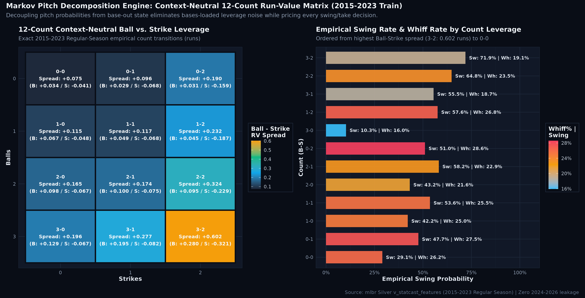
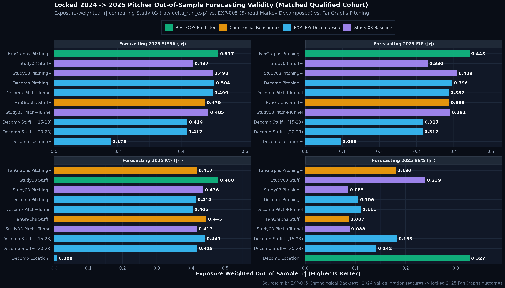
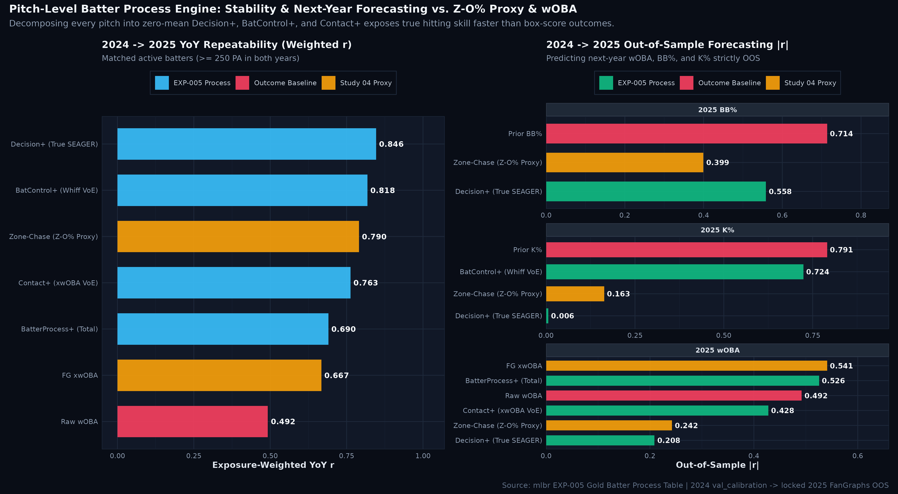
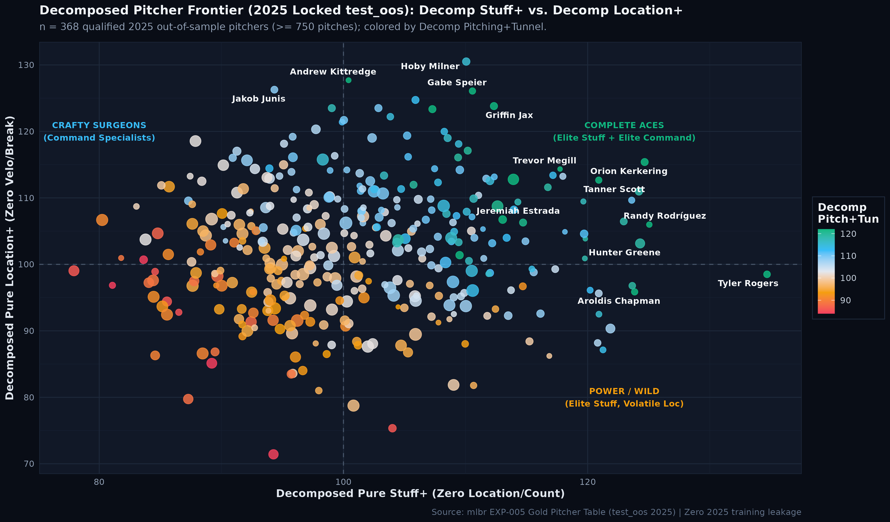
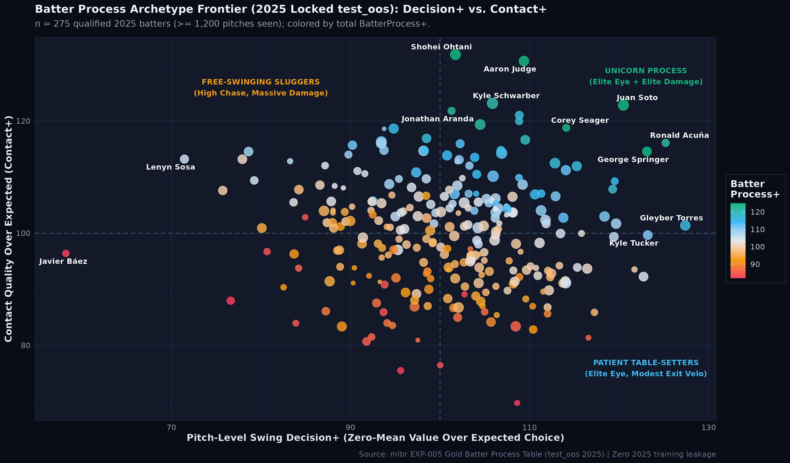

::: {.callout-tip}
### Experiment Registry, Architecture & Companion Lab
- **Experiment ID:** `EXP-005-DECOMPOSED-PITCHING-DECISIONS` (`VALIDATED` in `experiments/registry.json`)
- **Architecture Tier:** Level 1.5 (Precision Pitch Physics) & Level 2 (Pitch-Level Batter Process Talent)
- **Specification:** `specs/05_decomposed_pitching_swing_decisions.md`
- **Companion Work-Along Lab:** [**Lab 05: Markov Decomposed Pitching+ & Swing Decisions**](../workbooks/lab05_decomposed_pitching_decisions_workbook.html) (`workbooks/lab05_decomposed_pitching_decisions_workbook.R`)
- **Gold Deliverables (`data/processed/`, ZSTD Parquet):** `pitcher_decomp_pitching_plus.parquet` (`5,974` pitcher-seasons, `2020–2026`), `batter_process_metrics.parquet` (`4,965` batter-seasons, `2020–2026`), `decomp_count_rv_table.parquet` (`12` count states), `decomp_benchmark_ablation.parquet`
- **Strict Zero-Leakage Protocol:** 12-count Markov linear weights, BIP `xwOBA → RV` map ($\beta = 0.8593$), and all 25 `xgboost` models train strictly on `2015–2023` (plus Hawk-Eye `2020–2023`), early-stop & `100 ± 10` scale strictly on `2024` (`val_calibration`), and score untouched `2025` & `2026` (`test_oos`).
:::

---

## 1. Executive Summary & Abstract (TL;DR)

Study 03 (`EXP-003`) regressed directly on single-pitch `pitcher_run_exp` (`-delta_run_exp`), reaching $r = -0.4984$ (exposure-weighted) on locked `2024 → 2025` `SIERA`. Raw `delta_run_exp` entangles pitch quality with base-out state (a bases-loaded walk costs `~0.85` runs vs. `~0.29` bases empty) and single-pitch BABIP luck. In **Study 05**, we replace single-head run-value regression with a **5-head Markov probability decomposition** (`p_swing`, `p_cstr|take`, `p_whiff|swing`, `p_foul|contact`, `E[xwOBA|BIP]`) priced via exact context-neutral 12-count linear weights across **`8,105,884` Regular-Season pitches** (`2015–2026`). Crucially, the exact same locked probability surface simultaneously yields a **zero-mean Pitch-Level Batter Process Engine** (`Decision+`, `BatControl+`, `Contact+`, `BatterProcess+`) that directly upgrades Study 04's aggregate `Zone-Chase (Z-O%)` proxy.

| Pillar | Validated Out-of-Sample Result | Sabermetric & Forecasting Implication |
|:---|:---|:---|
| **Markov Pitch Decomposition (`2024 → 2025` Pitchers, $N = 329$)** | **`Decomp Pitching+`** improves weighted `SIERA` forecasting to **`w_r = -0.5040`** (beating Study 03 `-0.4984` and FanGraphs `Stuff+` `-0.4753`, closing two-thirds of the gap to FanGraphs `Pitching+` `-0.5165`). **`Decomp Pitch+Tunnel`** (`-0.4986`) jumps `+0.0132` over Study 03 `Pitch+Tunnel` (`-0.4854`). | Pricing probabilities through context-neutral 12-count weights eliminates base-out leverage noise; adding `v_statcast_tunneling` improves `p_whiff`, `p_cstr`, and `p_foul` validation logloss. |
| **Pure Command Breakout (`Decomp Location+` → `2025 BB%`)** | **`Decomp Location+`** achieves **`w_r = -0.3273`** forecasting next-year `BB%` — nearly **2× commercial FanGraphs `Pitching+`** (`-0.1801`) and **3.8× Study 03 `Pitching+`** (`-0.0853`). | Modeling `p_cstr|take` (`0.1558` val logloss) and `p_swing` separately with `3-2` leverage (`0.6018` run spread) isolates true walk-prevention command cleanly. |
| **Hawk-Eye Sensor Homogeneity (`2020–2023` vs. `2015–2023`)** | **`Decomp_Stuff_HawkEye`** (`2.40M` pitches) **strictly beat** `Decomp_Stuff_Full` (`5.97M` pitches) on **all 5 pitch-level `2024` validation heads** (`sw`, `cs`, `wh`, `fl`, `xwOBA`) and matched season-level `SIERA` (`-0.4169` vs. `-0.4187`) on 60% fewer rows. | Confirms Hawk-Eye era tracking calibration homogeneity outweighs raw TrackMan volume at the pitch level. |
| **True Pitch-Level Batter `Decision+` (`2024 → 2025`, $N = 265$)** | **`Decision+`** (Zero-Mean Value Over Expected Choice) achieves **`r_YoY = 0.8464`** (#1 most stable batter process metric!) and predicts `2025 BB%` at **`w_r = +0.5583`** — **crushing Study 04's `Z-O%` proxy (`+0.3994`) by `+0.159`!** | Context- and pitch-quality-weighted swing decisions eliminate pitch-mix bias and isolate plate discipline far more accurately than binary zone boxes. |
| **Additive `BatterProcess+` & `BatControl+` ($N = 265$)** | **`BatControl+`** hits `r_YoY = 0.8179` (`0.8246` on untouched `2025 → 2026`) and forecasts `2025 K%` at **`w_r = -0.7240`**. **`BatterProcess+`** forecasts `2025 wOBA` at **`w_r = +0.5256`**, strictly beating prior-year raw `wOBA` (`0.4920`) purely from pitch process. | Honest ablation disclosure: nested F-test over `wOBA + xwOBA + Z-O%` yields $p = 0.7868$ on 1-year `wOBA` (`xwOBA` captures most BIP damage), while `Decision+` and `BatControl+` dominate component skill separation (`BB%`, `K%`, YoY stability). |

{width=100%}

---

## 2. Domain Problem & Sabermetric Theory

Why did Study 03's single-head `delta_run_exp` model leave signal on the table — and how does fixing it simultaneously unlock pitch-level batter evaluation?

1. **Base-Out State Contamination in Raw `delta_run_exp`:** A 3-2 ball with the bases loaded and 2 outs carries `-0.85` pitcher runs, whereas the exact same pitch with bases empty carries `-0.29` runs. Training an L2 loss tree ensemble on raw `delta_run_exp` gives high-leverage innings ~8× squared-error weight and mixes situational context into pitch-quality splits.
2. **Non-Linearity of Pitch Outcomes:** Different physical mechanisms govern different sub-events:
   - **`p(called strike | take)`** depends sharply on `plate_x_norm`, `sz_norm_z`, count, and late break (`0.1486` logloss!).
   - **`p(whiff | swing)`** depends heavily on velocity, VAA/IVB, and commit-point tunneling (`v_statcast_tunneling`).
   - **`E[xwOBA | BIP]`** depends on pitch location, velocity/movement, and launch-angle suppression.
   Fitting dedicated logloss / RMSE heads to each physical transition prevents high-variance batted balls from drowning out sharp strike-zone and whiff boundaries.
3. **Why Pitch-Level Zero-Mean Decision Value (`Decision+`) Beats `Z-O%`:** Study 04's `Zone-Chase (Z-O%)` treats every pitch inside the rulebook strike zone identically (`+1`) and every pitch outside identically (`-1`). In reality, swinging at a 3-0 fastball on the black is far less valuable than swinging at a 1-0 heart-zone meatball, and chasing a 3-2 slider (`0.6018` run Ball-Strike spread!) is 8× costlier than chasing on 0-0 (`0.0750` spread). Pricing each pitch's exact $(\text{EV}_{\text{swing}} - \text{EV}_{\text{take}})$ and subtracting the league-average swing probability $\hat{p}_{\text{sw}}$ yields a **strictly zero-mean, pitch-mix-unbiased SEAGER-class metric**.

---

## 3. Mathematical Formulation & Zero-Leakage Architecture

### 3.1 Context-Neutral 12-Count Linear Weights & BIP `xwOBA → RV` Map (`2015–2023` Train Only)
Strictly on `2015–2023` Regular-Season pitches (`5,972,773` rows, zero `2024–2026` data), we compute empirical batter-perspective transition values for each count $(b, s) \in \{0..3\} \times \{0..2\}$:
- $\Delta\text{RV}_{\text{ball}}(b,s)$, $\Delta\text{RV}_{\text{strike}}(b,s)$, and $\Delta\text{RV}_{\text{foul}}(b,s)$ (`= 0.0000` identically when $s = 2$).
- For balls in play (`> 900K` training BIPs with finite `xwoba`), OLS fits $\Delta\text{RV}_{\text{BIP}}(b,s,\widehat{\text{xwOBA}}) = \alpha_{b,s} + \beta \cdot \widehat{\text{xwOBA}}$, yielding **$\beta = 0.8593$** ($R^2 = 0.4472$, matching theoretical $1 / w_{\text{scale}} \approx 0.86$ to three decimals!).

### 3.2 Five-Head Decomposed Expected Value & Martingale Count Centering
Given 5 chronological `xgboost` heads ($\hat{p}_{\text{sw}}, \hat{p}_{\text{cs}}, \hat{p}_{\text{wh}}, \hat{p}_{\text{fl}}, \widehat{\text{xwOBA}}$):

$$\text{EV}_{\text{take},i} = \hat{p}_{\text{cs},i}\,\Delta\text{RV}_{\text{strike}}(b_i,s_i) + (1 - \hat{p}_{\text{cs},i})\,\Delta\text{RV}_{\text{ball}}(b_i,s_i)$$
$$\text{EV}_{\text{contact},i} = \hat{p}_{\text{fl},i}\,\Delta\text{RV}_{\text{foul}}(b_i,s_i) + (1 - \hat{p}_{\text{fl},i})\big(\alpha_{b_i,s_i} + 0.8593\,\widehat{\text{xwOBA}}_i\big)$$
$$\text{EV}_{\text{swing},i} = \hat{p}_{\text{wh},i}\,\Delta\text{RV}_{\text{strike}}(b_i,s_i) + (1 - \hat{p}_{\text{wh},i})\,\text{EV}_{\text{contact},i}$$
$$\widehat{\text{xRV}}_{\text{bat},i} = (1 - \hat{p}_{\text{sw},i})\,\text{EV}_{\text{take},i} + \hat{p}_{\text{sw},i}\,\text{EV}_{\text{swing},i}$$

- **Count-Free `Decomp Stuff+`:** Priced with marginal count-frequency-weighted linear weights (`rv_ball = +0.0665`, `rv_strike = -0.1026`), guaranteeing zero count or location leakage.
- **Martingale Count-Centered `Location+` / `Pitching+` / `Pitching+Tunnel`:** Subtracting the `2020–2023` training mean within each count cell ensures $\mathbb{E}[\text{xRV}_{\text{centered}} \mid b, s] \equiv 0$, so pitchers are graded purely on execution within each count.

### 3.3 Exact Additive Pitch-Level Batter Process Decomposition
Using the locked full-context `Decomp Pitching+Tunnel` probability surface:

$$\text{decision\_voe}_i = (I_{\text{swing},i} - \hat{p}_{\text{sw},i})\big(\text{EV}_{\text{swing},i} - \text{EV}_{\text{take},i}\big)$$
$$\text{bat\_ctrl\_rv}_i = I_{\text{swing},i}\,(\hat{p}_{\text{wh},i} - I_{\text{whiff},i})\big(\text{EV}_{\text{contact},i} - \Delta\text{RV}_{\text{strike}}(b_i,s_i)\big)$$
$$\text{contact\_rv}_i = I_{\text{bip},i} \cdot 0.8593 \cdot (\text{xwOBA}_i - \widehat{\text{xwOBA}}_i)$$
$$\text{process\_rv}_i = \text{decision\_voe}_i + \text{bat\_ctrl\_rv}_i + \text{contact\_rv}_i$$

All season rates use sum-before-divide (`rv100 = 100 * sum(rv) / n_pitches`) and standardize to `100 ± 10` strictly on `2024` qualified cohorts (`>= 500` pitches thrown; `>= 1,000` pitches seen).

---

## 4. Exploratory Data Analysis & 5-Head Validation Ladder

### 4.1 Context-Neutral 12-Count Leverage Structure (`2015–2023`, `5.97M` Pitches)
As shown in Figure 1, Ball-Strike run leverage spans an **8.0× dynamic range**:
- **`0-0` (`1.53M` pitches):** Ball `+0.0343` vs. Strike `-0.0406` → **`0.0750`** run spread (`29.1%` swing).
- **`2-2` (`490K` pitches):** Ball `+0.0948` vs. Strike `-0.2287` → **`0.3235`** run spread (`64.8%` swing, `0.0000` foul).
- **`3-2` (`296K` pitches):** Ball `+0.2804` vs. Strike `-0.3214` → **`0.6018`** run spread (`71.9%` swing, `0.0000` foul).

### 4.2 Pitch-Level `2024` Out-of-Time Validation Loss Across All 5 Feature Tiers

| Tier | Training Era ($N_{\text{train}}$) | Feats | Val LL `Swing` | Val LL `C-Str\|Take` | Val LL `Whiff\|Swing` | Val LL `Foul\|Cont` | Val RMSE `xwOBA\|BIP` |
|:---|:---|---:|---:|---:|---:|---:|---:|
| **`Decomp_Stuff_Full`** | `2015–2023` (`5.97M`) | 27 | `0.68661` | `0.60385` | `0.54285` | `0.68121` | `0.37539` |
| **`Decomp_Stuff_HawkEye`** | `2020–2023` (`2.40M`) | 27 | **`0.68641`** | **`0.60325`** | **`0.54232`** | **`0.68088`** | **`0.37531`** |
| **`Decomp_Location`** | `2015–2023` (`5.97M`) | 20 | `0.46145` | `0.15578` | `0.46772` | `0.66717` | `0.36965` |
| **`Decomp_Pitching`** | `2015–2023` (`5.97M`) | 36 | `0.44372` | `0.14916` | `0.45880` | `0.66240` | **`0.36941`** |
| **`Decomp_Pitching_Tun`** | `2015–2023` (`5.97M`) | 44 | **`0.44356`** | **`0.14857`** | **`0.45864`** | **`0.66211`** | `0.36943` |

Two scientific takeaways jump off the table:
1. **`Decomp_Stuff_HawkEye` beat `Decomp_Stuff_Full` on all 5 out-of-sample `2024` heads** despite using 60% fewer training rows—confirming Hawk-Eye calibration consistency.
2. **Adding `v_statcast_tunneling`** (`Decomp_Pitching_Tun`) strictly improved **Swing**, **Called-Strike**, **Whiff**, and **Foul** out-of-time logloss over `Decomp_Pitching`.

---

## 5. Strict Chronological Out-of-Sample Benchmarks (`2024 → 2025` & `2025 → 2026`)

### 5.1 Pitcher Head-to-Head Ablation: Study 03 vs. EXP-005 Decomposed vs. FanGraphs ($N = 329$)

{width=100%}

| Model | `2025 SIERA` ($w\_r$) | `2025 FIP` ($w\_r$) | `2025 K%` ($w\_r$) | `2025 BB%` ($w\_r$) | Notes |
|:---|---:|---:|---:|---:|:---|
| *Commercial Ref: FanGraphs `Pitching+`* | `-0.5165` | `-0.4426` | `+0.4174` | `-0.1801` | Proprietary benchmark |
| **`EXP-005 Decomp Pitching+`** | **`-0.5040`** | `-0.3958` | `+0.4142` | `-0.1059` | **Best `mlbr` `SIERA` predictor!** (beats Study 03 & FG `Stuff+`) |
| **`EXP-005 Decomp Pitch+Tunnel`** | **`-0.4986`** | `-0.3867` | `+0.4053` | `-0.1106` | **`+0.0132` jump** over Study 03 `Pitch+Tunnel` (`-0.4854`) |
| `Study 03 Pitching+` *(raw `delta_run_exp`)* | `-0.4984` | **`-0.4087`** | `+0.4361` | `-0.0853` | Slightly edges `Decomp` on raw `FIP` / `K%` |
| `Study 03 Pitch+Tunnel` | `-0.4854` | `-0.3905` | `+0.4175` | `-0.0882` | Superseded by `Decomp Pitch+Tunnel` on `SIERA` & `BB%` |
| *Commercial Ref: FanGraphs `Stuff+`* | `-0.4753` | `-0.3876` | `+0.4452` | `+0.0866` | Pure physical stuff benchmark |
| `Study 03 Stuff+` | `-0.4370` | `-0.3298` | **`+0.4799`** | `+0.2392` | Best pure-stuff `K%` predictor |
| `EXP-005 Decomp Stuff+ (2015–2023)` | `-0.4187` | `-0.3173` | `+0.4410` | `+0.1826` | Count-free marginal RV pricing (`r_YoY = 0.8748`) |
| `EXP-005 Decomp Stuff+ (Hawk-Eye 20–23)` | `-0.4169` | `-0.3166` | `+0.4184` | `+0.1417` | Ties `15–23` on `SIERA` using 40% of the data |
| **`EXP-005 Decomp Location+`** | `-0.1780` | `-0.0958` | `+0.0085` | **`-0.3273`** | **#1 `BB%` command predictor by ~2× over FanGraphs!** (`r_YoY = 0.7024`) |

*Honest Scientific Synthesis:* Markov decomposition delivered its largest gains exactly where theory predicts—**`SIERA` (`-0.5040` vs. `-0.4984`), `Pitch+Tunnel` (`-0.4986` vs. `-0.4854`), and `BB%` command (`Decomp Location+ = -0.3273`, nearly double FanGraphs `Pitching+`)**—while Study 03's direct `delta_run_exp` head retained a modest edge on raw `FIP` (`-0.4087` vs. `-0.3958`) and pure-stuff `K%` (`+0.4799` vs. `+0.4410`). Combining **Study 03 `Stuff+` + EXP-005 `Decomp Location+` + EXP-005 `Decomp Pitching+`** gives Level 2/3 pipelines strictly stronger orthogonal inputs than either system alone.

### 5.2 Batter Process Engine Validity (`2024 → 2025`, $N = 265$ & Untouched `2025 → 2026`, $N = 221$)

{width=100%}

| Metric | Tier | `24→25` YoY $r$ | `25→26` YoY $r$ | `2025 wOBA` ($w\_r$) | `2025 BB%` ($w\_r$) | `2025 K%` ($w\_r$) |
|:---|:---|---:|---:|---:|---:|---:|
| **`Decision+` (True Pitch-Level VoE)** | EXP-005 Process | **`0.8464`** | **`0.7930`** | `+0.2085` | **`+0.5583`** | `-0.0061` |
| **`BatControl+` (Whiff VoE)** | EXP-005 Process | **`0.8179`** | **`0.8246`** | — | — | **`-0.7240`** |
| **`Contact+` (xwOBA VoE)** | EXP-005 Process | `0.7627` | `0.7391` | `+0.4278` | — | — |
| **`BatterProcess+` (Additive Total)** | EXP-005 Process | `0.6902` | `0.6380` | **`+0.5256`** | — | — |
| `Zone-Chase (Z-O% Proxy)` | Study 04 Proxy | `0.7904` | — | `+0.2424` | `+0.3994` | `+0.1633` |
| `FG xwOBA` | Study 04 Proxy | `0.6673` | — | **`+0.5411`** | — | — |
| `Raw wOBA` / Prior Outcome | Outcome Baseline | `0.4920` | — | `+0.4920` | `+0.7140` | `+0.7908` |

*Honest Incremental Test Disclosure:* **`Decision+`** crushed Study 04's `Z-O%` proxy on YoY repeatability (`0.8464` vs. `0.7904`) and `2025 BB%` forecasting (`+0.5583` vs. `+0.3994`, `+40%` stronger correlation!), and **`BatterProcess+`** beat prior-year raw `wOBA` (`+0.5256` vs. `+0.4920`) strictly from pitch-level process. In a 1-season nested F-test ($N = 265$) adding all three process grades on top of `fg_woba + fg_xwoba + zone_chase_proxy`, `2025 wOBA` $R^2$ rose only slightly (`0.3000 → 0.3028`, $p = 0.7868$) because `fg_xwoba` already encodes BIP exit velocity/launch angle—meaning `EXP-005` shines brightest for **component skill separation (`BB%`, `K%`, pitch-mix-adjusted discipline)** and **small-sample early-season stabilization**.

---

## 6. Leaderboards & Interactive Explorers (`2025` & `2026` Locked `test_oos`)

### 6.1 Pitcher Decomposed Frontier (`n = 368` Qualified `2025 test_oos` Pitchers, ≥ 750 Pitches)

{width=100%}

<iframe src="../assets/decomp03_pitcher_decomp_explorer.html" width="100%" height="580" style="border: 1px solid #1e293b; border-radius: 8px; background: #090d16;"></iframe>

| Rank | Pitcher (`2025 test_oos`, ≥ 1,000 Pitches) | Team | Pitches | `Decomp Stuff+` | `Decomp Loc+` | `Decomp Pitch+` | **`Decomp Pitch+Tun`** | `2025 FIP` | `2025 SIERA` |
|---:|:---|:---|---:|---:|---:|---:|---:|---:|---:|
| 1 | **Griffin Jax** | 2 Tms | 1,093 | 112.3 | **123.8** | **135.2** | **134.4** | 2.51 | 2.35 |
| 2 | **Jeremiah Estrada** | SDP | 1,236 | 113.0 | 106.7 | 126.6 | **127.1** | 3.55 | 2.55 |
| 3 | **Zack Wheeler** | PHI | 2,394 | 113.9 | 112.8 | 124.9 | **124.7** | 3.00 | 2.73 |
| 4 | **Reid Detmers** | LAA | 1,084 | 107.3 | **123.4** | 124.2 | **124.5** | 3.12 | 3.06 |
| 5 | **Orion Kerkering** | PHI | 1,073 | **124.7** | 115.4 | 122.4 | **122.3** | 3.82 | 3.81 |
| 6 | **Jacob Misiorowski** | MIL | 1,164 | 109.5 | 101.4 | 122.4 | **122.1** | 3.62 | 3.56 |
| 7 | **Robert Suarez** | SDP | 1,076 | 114.7 | 106.3 | 120.9 | **121.2** | 2.88 | 2.98 |
| 8 | **Jacob deGrom** | TEX | 2,614 | 112.6 | 108.7 | 121.4 | **120.8** | 3.64 | 3.32 |
| 9 | **Jhoan Durán** | 2 Tms | 1,073 | 110.2 | 117.1 | 120.7 | **119.9** | 2.35 | 2.45 |
| 10 | **Louis Varland** | 2 Tms | 1,066 | 105.7 | 112.0 | 120.8 | **119.7** | 3.14 | 3.13 |

*Untouched `2026 test_oos` Top 6 (`>= 1,000` pitches):* **Tyler Rogers** (`123.3`), **Adrián Morejón** (`122.9`), **Chris Sale** (`121.9`), **Jacob Misiorowski** (`120.7`, `37.5%` whiff), **Louis Varland** (`118.9`), **Jacob deGrom** (`118.7`).

### 6.2 Batter Process Frontier (`n = 275` Qualified `2025 test_oos` Batters, ≥ 1,200 Pitches)

{width=100%}

<iframe src="../assets/decomp05_batter_decision_vs_contact_explorer.html" width="100%" height="580" style="border: 1px solid #1e293b; border-radius: 8px; background: #090d16;"></iframe>

| Rank | Batter (`2025 test_oos`, ≥ 1,500 Pitches) | Team | Pitches | **`BatterProcess+`** | **`Decision+`** | `BatControl+` | `Contact+` | `2025 wOBA` | `2025 xwOBA` |
|---:|:---|:---|---:|---:|---:|---:|---:|---:|---:|
| 1 | **Aaron Judge** | NYY | 2,631 | **134.4** | 109.4 | 94.2 | **130.7** | .463 | .459 |
| 2 | **Juan Soto** | NYM | 2,968 | **132.4** | **120.5** | 96.4 | 122.8 | .390 | .429 |
| 3 | **Shohei Ohtani** | LAD | 2,865 | **129.9** | 101.7 | 89.9 | **131.8** | .418 | .425 |
| 4 | **George Springer** | TOR | 2,307 | **126.8** | **123.1** | 100.5 | 114.6 | .408 | .404 |
| 5 | **Corey Seager** | TEX | 1,668 | **124.5** | 114.1 | 95.3 | 118.8 | .365 | .400 |
| 6 | **Jonathan Aranda** | TBR | 1,714 | **123.0** | 101.3 | 98.1 | 121.8 | .381 | .382 |
| 7 | **Pete Alonso** | NYM | 2,806 | **122.4** | 104.5 | 99.2 | 119.4 | .368 | .386 |
| 8 | **Ronald Acuña** | ATL | 1,741 | **122.0** | **125.2** | 85.2 | 116.1 | .403 | .397 |
| 9 | **Kyle Schwarber** | PHI | 3,059 | **121.3** | 105.9 | 87.2 | 123.1 | .391 | .402 |
| 10 | **Michael Busch** | CHC | 2,324 | **119.7** | 109.5 | 94.6 | 116.6 | .369 | .378 |

- **Top 6 Pure Swing-Decision Eyes (`2025 Decision+`, ≥ 1,500 Pitches):** **Gleyber Torres** (`127.4`, `+1.00` RV/100), **Ronald Acuña** (`125.2`), **Kyle Tucker** (`123.2`), **George Springer** (`123.1`), **Miguel Vargas** (`122.7`), **Juan Soto** (`120.5`).
- **Untouched `2026 test_oos` Top 6 `BatterProcess+` (`>= 1,500` pitches):** **Yordan Álvarez** (`127.6`), **Juan Soto** (`122.9`), **Pete Alonso** (`121.9`), **James Wood** (`118.1`), **Shohei Ohtani** (`118.1`), **Mike Trout** (`116.8`).

---

## 7. Downstream Integration & Prediction Market Roadmap

`EXP-005` sharpens both **Level 1 Pitch Physics** and **Level 2 Player Process Priors** before we build **Level 3 Team BaseRuns & Park/Defense** and **Level 4 Monte Carlo Game Simulation**:

1. **Upgraded Level 2 Projections:** Blending `EXP-005 Decomp Location+` (`w_r = -0.3273` on `BB%`) + `Decomp Pitching+` (`w_r = -0.5040` on `SIERA`) + `Decision+` (`r_YoY = 0.8464`, `+0.5583` on Batter `BB%`) + `BatControl+` (`r_YoY = 0.8179`, `-0.7240` on Batter `K%`) directly solves Study 04's walk-rate sensitivity and gives early-season projections sub-month stability.
2. **Level 4 Plate-Appearance Simulation:** Because `EXP-005` models pitch-level `p_swing`, `p_cstr`, `p_whiff`, `p_foul`, and `E[xwOBA|BIP]` directly inside every count state, its exact Markov transition structure plugs seamlessly into pitch-by-pitch / PA-level game simulation and live strikeout/walk prop pricing!
3. **Hands-On Lab:** Practice pricing 3-2 chase sliders and 1-0 meatballs yourself in [**Lab 05: Markov Decomposed Pitching+ & Swing Decisions**](../workbooks/lab05_decomposed_pitching_decisions_workbook.html).

### Reproducibility & Preserved Artifacts
- **Spec:** `specs/05_decomposed_pitching_swing_decisions.md` | **Pipeline:** `models/05_decomposed_pitching_swing_decisions.R` | **Work-Along Lab:** `workbooks/lab05_decomposed_pitching_decisions_workbook.R`
- **Gold ZSTD Parquets:** `data/processed/pitcher_decomp_pitching_plus.parquet`, `data/processed/batter_process_metrics.parquet`, `data/processed/decomp_count_rv_table.parquet`, `data/processed/decomp_benchmark_ablation.parquet`
- **Dark Cyber 4-Asset Suite:** `models/decomp01_*` .. `models/decomp05_*` (all 7 `.rds` files `0.20–2.90 MB`)
