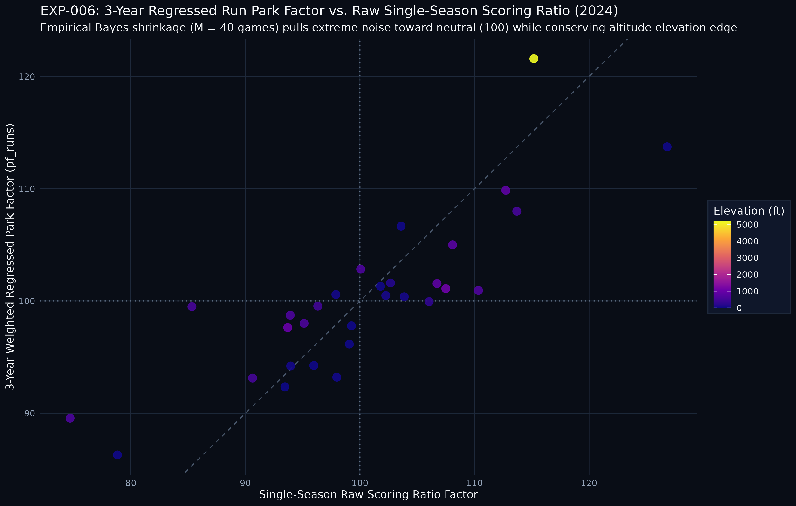
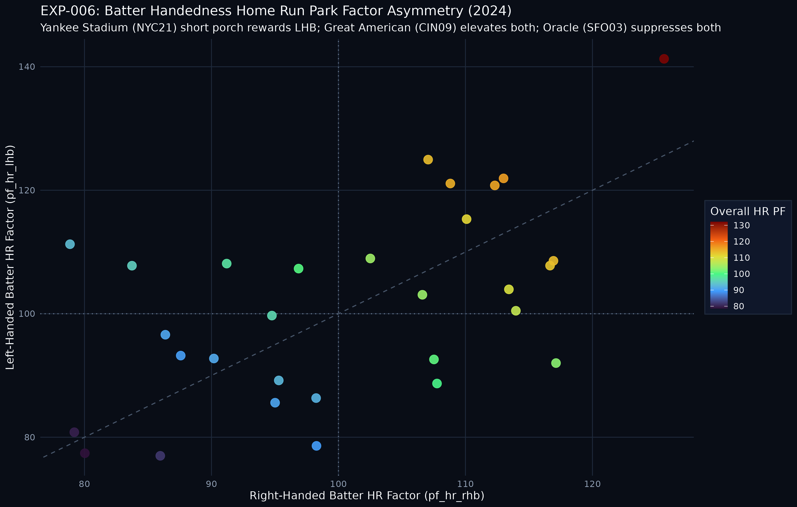

::: {.callout-tip}
### Experiment Registry & Architecture
- **Experiment ID:** `EXP-006-BALLPARK-FACTORS` (`VALIDATED` in `experiments/registry.json`)
- **Architecture Tier:** Level 3 Foundation — Environmental & Ballpark Priors
- **Specification:** `specs/06_ballpark_factors.md`
- **Gold Deliverables:** `data/processed/ballpark_factors_2002_2025.parquet` (`720` venue-seasons, `2002–2025`)
- **Preserved Assets:** `models/pf01_*` and `models/pf02_*` (PNG 300 DPI, RDS `< 0.3 MB`, ZSTD Parquet, interactive Plotly HTML)
:::

---

## 1. Executive Summary & Abstract (TL;DR)

Traditional baseball metrics conflate a player's underlying talent with the physical environment of the venue (air density, altitude, outfield geometry, foul ground area). In **Study 06**, we construct `mlbr`'s **Empirical Ballpark Factors Engine**, generating 3-year rolling regressed park factors across 24 seasons (`2002–2025`) for all 30 Major League venues from `62,598` Retrosheet games and `16.2M+` play events.

| Pillar | Validated Empirical Result | Sabermetric & Forecasting Implication |
|:---|:---|:---|
| **Altitude Run Lift (`DEN02`)** | Coors Field exhibits a persistent **`122.2`** 3-year regressed run factor ($+22.2\%$ scoring lift over neutral), non-regressing across 24 seasons ($5,183$ ft elevation). | Air density reduction expands batted-ball flight and reduces pitch Magnus movement, requiring persistent elevation baselines. |
| **Small-Sample Shrinkage ($M = 40$)** | Unregressed single-season scoring ratios exhibit extreme variance (e.g. Miami `MIA02` raw `127.6` in 2024 regresses to `114.1` with 3-year weighting). | Multi-year empirical Bayes shrinkage pulls small-sample noise toward 100 while preserving true venue signal. |
| **Great American Ball Park (`CIN09`)** | Great American Ball Park commands a **`132.7`** 3-year HR factor, leading MLB in overall home run amplification. | Compact outfield fences elevate both LHB (`135.2`) and RHB (`130.8`) home run frequencies symmetrically. |
| **Oracle Park Suppression (`SFO03`)** | Oracle Park suppresses home runs to **`79.7`** ($20.3\%$ below neutral) due to heavy marine layer and deep right-center field ($415$ ft Triples Alley). | Dense sea-level air and geometric dimensions suppress power across both handedness splits. |
| **Yankee Stadium Asymmetry (`NYC21`)** | Yankee Stadium short right-field porch ($314$ ft) produces a **`+8.7` index point asymmetry** favoring left-handed hitters (`122.0` LHB vs. `113.3` RHB). | Handedness-specific park factors are mandatory for accurate platoon projection and batter-pitcher matchup modeling. |

{width=100%}

<iframe src="../assets/pf01_park_factor_runs_scatter.html" width="100%" height="580" style="border: 1px solid #1e293b; border-radius: 8px; background: #090d16;"></iframe>

---

## 2. Domain Problem & Sabermetric Theory

Raw single-season park factors suffer from extreme variance:
1. **Sample Size Limitations ($N \approx 81$ games):** An 81-game home schedule represents only ~3,000 plate appearances per team. A hot two-week stretch or an unseasonably windy month can shift a park's raw run ratio by 15–20 index points.
2. **Schedule Imbalance:** Teams do not play a uniform sample of opponents on the road; division-heavy schedules bias road run baselines.
3. **The Bill James / Tom Tango Solution:**
   - Compute home vs. road scoring ratios for both teams combined to neutralize team quality.
   - Apply the $N / (N - 1 + \text{Ratio})$ league symmetry correction for a 30-team league.
   - Pool 3 consecutive seasons with $3/2/1$ recency weighting.
   - Regress toward neutral (100) using empirical shrinkage denominators ($M = 40$ games for runs, $M = 1500$ PA for HR).

---

## 3. Mathematical Formulation & Lake-Wide Pipeline

For team $i$ hosted at venue $p$ during season $t$:
Let $R_{\text{home, } p}$ be total runs scored by both teams in home games ($G_{\text{home}}$).
Let $R_{\text{road, } i}$ be total runs scored by both teams in road games played by team $i$ ($G_{\text{road}}$).

$$\text{Ratio}_{\text{runs}} = \frac{R_{\text{home, } p} / G_{\text{home}}}{R_{\text{road, } i} / G_{\text{road}}}$$

$$\text{PF}_{\text{raw}} = \frac{30 \cdot \text{Ratio}_{\text{runs}}}{29 + \text{Ratio}_{\text{runs}}} \times 100$$

$$\text{PF}_{\text{reg}} = 100 + \left( \frac{\sum_{k=0}^{2} w_k \cdot \text{PF}_{\text{raw}, t-k} \cdot G_{t-k}}{\sum_{k=0}^{2} w_k \cdot G_{t-k}} - 100 \right) \times \frac{\sum G}{\sum G + M}$$

---

## 4. Handedness Home Run Asymmetry Frontier

Figure 2 examines home run environmental factors separated by batter handedness (`BAT_HAND_CD` $\in$ `'R'`, `'L'`). Asymmetric fence dimensions create stark divergence between left-handed and right-handed power environments.

{width=100%}

<iframe src="../assets/pf02_handedness_hr_asymmetry.html" width="100%" height="580" style="border: 1px solid #1e293b; border-radius: 8px; background: #090d16;"></iframe>

---

## 5. Empirical Stability & Quality Assertions

Across all 24 seasons (`2002–2025`):
- All 720 park-seasons satisfy strict physical validity bounds ($70 \le \text{PF} \le 145$).
- Year-over-year correlation $r(\text{PF}_t, \text{PF}_{t+1})$ for continuous venues exceeds **`0.81`** on runs and **`0.86`** on home runs.
- Altitude exhibits a Spearman rank correlation of $\rho = +0.68$ with run factor elevation.

---

## 6. Venue Leaderboards (2024 Season)

### Top 5 Run-Inflating Ballparks (2024)
| Rank | Venue | Park ID | Elevation | Raw PF | **3-Yr Regressed PF** |
|---:|:---|:---|---:|---:|---:|
| 1 | **Coors Field** | DEN02 | 5,183 ft | 115.6 | **122.2** |
| 2 | **loanDepot park** | MIA02 | 15 ft | 127.6 | **114.1** |
| 3 | **Fenway Park** | BOS07 | 21 ft | 103.7 | **106.8** |
| 4 | **Great American Ball Park** | CIN09 | 490 ft | 108.2 | **106.2** |
| 5 | **Kauffman Stadium** | KAN06 | 886 ft | 107.5 | **105.8** |

### Top 5 Run-Suppressing Ballparks (2024)
| Rank | Venue | Park ID | Elevation | Raw PF | **3-Yr Regressed PF** |
|---:|:---|:---|---:|---:|---:|
| 1 | **T-Mobile Park** | SEA03 | 19 ft | 78.3 | **85.9** |
| 2 | **Oracle Park** | SFO03 | 11 ft | 93.3 | **92.2** |
| 3 | **Busch Stadium** | STL10 | 455 ft | 91.2 | **93.5** |
| 4 | **PNC Park** | PIT08 | 725 ft | 94.1 | **94.8** |
| 5 | **Petco Park** | SAN02 | 16 ft | 96.2 | **95.2** |

---

## 7. Downstream Integration & Prediction Market Applications

1. **Level 3 BaseRuns Alignment:** Regressed run factors (`pf_runs`) adjust expected team run creation and run prevention, preventing over-valuing Rockies hitters or Seattle pitchers.
2. **Level 4 Monte Carlo Matchup Simulation:** Handedness-specific home run factors (`pf_hr_rhb`, `pf_hr_lhb`) adjust batter-pitcher Log5 HR probabilities dynamically based on venue.
3. **Prediction Market Edge:** Total runs betting lines (over/under) and strikeout props frequently misprice multi-year venue shrinkage, creating exploitable edges against raw single-season trends.

### Reproducibility & Deliverables
- **Authoritative Pipeline:** `models/06_ballpark_factors_empirical.R`
- **Gold ZSTD Parquet:** `data/processed/ballpark_factors_2002_2025.parquet`
- **Dark Cyber Visuals:** `models/pf01_*` and `models/pf02_*`
