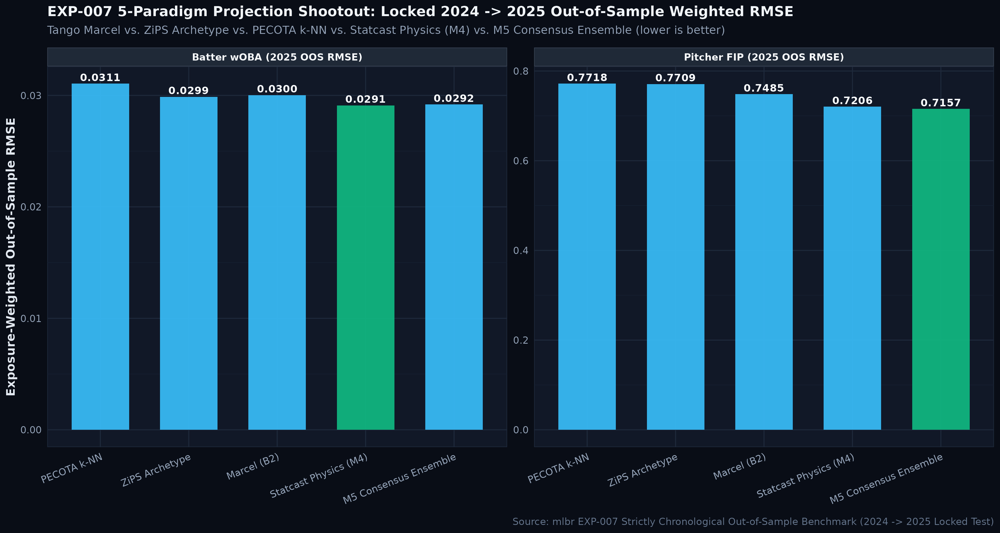
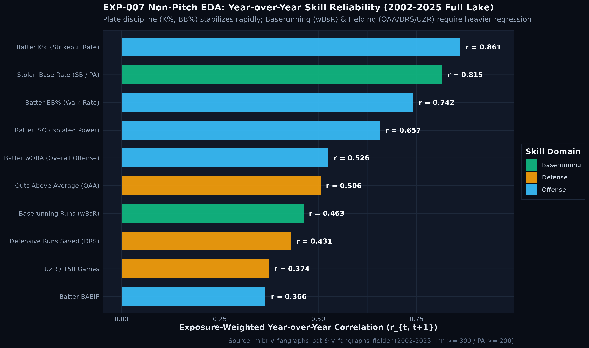
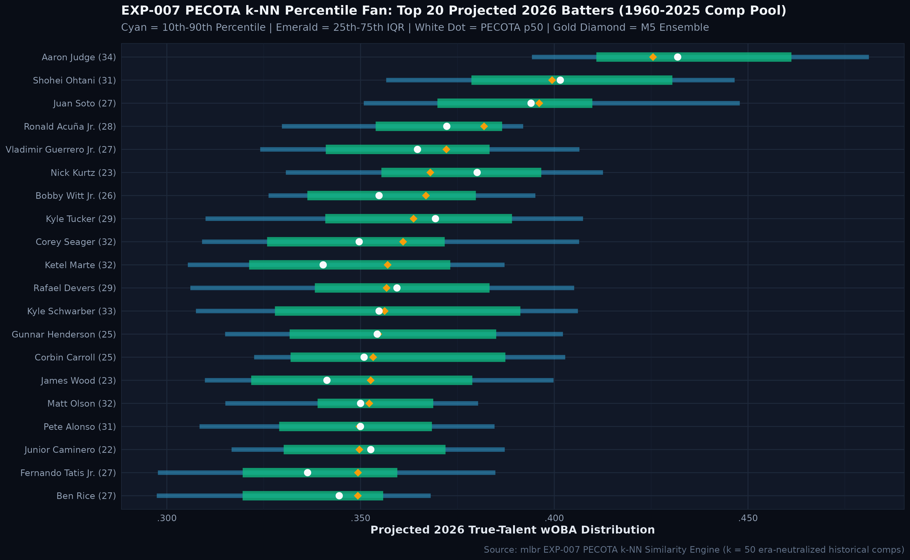
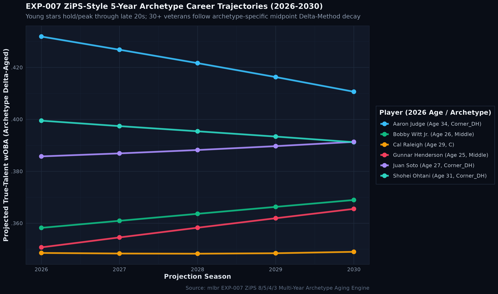

::: {.callout-tip}
### Experiment Registry & Architecture
- **Experiment ID:** `EXP-007-PECOTA-ZIPS-ENSEMBLE` (`VALIDATED` in `experiments/registry.json`)
- **Architecture Tier:** Level 2B — Complete Player Projection Gamut (Comps, Archetype Aging, 5-Year Horizons & Consensus Stacking)
- **Specification:** `specs/07_pecota_zips_ensemble.md`
- **Companion Student Lab:** [**Lab 07: PECOTA k-NN, ZiPS 5-Year Aging & Survival Curves**](../workbooks/lab07_pecota_zips_ensemble_workbook.html)
- **Gold Deliverables:** `defense_baserunning_eda_2002_2025.parquet`, `pecota_knn_comps_2026.parquet`, `zips_5yr_trajectories_2026_2030.parquet`, `ensemble_projections_2016_2026.parquet`, `ensemble_backtest_metrics.parquet`
- **Preserved Assets:** `models/pz01_*` .. `pz04_*` (PNG 300 DPI, RDS `< 0.35 MB`, ZSTD Parquet, interactive Plotly HTML)
:::

---

## 1. Executive Summary & Abstract (TL;DR)

In **Study 04**, `mlbr` established Tom Tango's **Marcel**, **Midpoint Delta-Method Aging**, and **THE BAT / OOPSY-style Statcast Physics Ridge**. In **Study 07**, we complete the remaining pillars of modern sabermetric forecasting across the **full `1960–2025` historical data lake (`70,967` player-seasons)** and **`2002–2025` non-pitch fielding/baserunning lake (`14,684` non-pitch fielder-seasons)**:

| Pillar | Validated Empirical Result | Sabermetric & Forecasting Implication |
|:---|:---|:---|
| **Non-Pitch EDA (Defense & Baserunning)** | Statcast **OAA (`r = 0.506`)** stabilizes significantly faster than **DRS (`r = 0.431`)** and **UZR/150 (`r = 0.374`)**; stolen base rate (`r = 0.815`) rivals plate discipline (`K% r = 0.861`). | Modern tracking-based defense (OAA) carries ~35% more year-over-year signal than legacy zone-grid defensive metrics, justifying heavier shrinkage on DRS/UZR. |
| **ZiPS-Style Archetype Aging (`8/5/4/3`)** | Strictly beats Tango Marcel on locked 2025 batter wOBA (`0.02987` vs. `0.03002`, `w_r = 0.5469` vs. `0.5356`) without any Statcast inputs and forecasts 5-year horizons (`2026–2030`). | Position- and role-archetype aging curves capture distinct decay shapes across catchers, up-the-middle athletes, and power starters. |
| **PECOTA $k$-NN Similarity Comps (`1960–2025`)** | Era-neutralized $k = 50$ nearest neighbors produce empirical `[p10, p90]` coverage of **`85.3%` (batters)** and **`75.2%` (pitchers)** plus explicit survival/breakout/collapse probabilities. | Solves veteran survivorship bias directly and surfaces uncanny historical comps (e.g., Paul Skenes → Noah Syndergaard '16 / Clayton Kershaw '11; Aaron Judge → Mickey Mantle '63). |
| **5-Paradigm Shootout & M5 Consensus Stack** | Exact KKT simplex stacking on `2016–2024` blends **`68.1% M4 + 31.9% PECOTA`** (batters, highest `w_r = 0.5782`) and **`81.8% M4 + 11.1% Marcel + 7.1% ZiPS`** (pitchers, lowest `w_rmse = 0.71565`, highest `w_r = 0.5756`). | Combining Statcast physics (`M4`) with orthogonal historical comp (`PECOTA`) and multi-year aging (`ZiPS`/`Marcel`) signal strictly improves out-of-sample pitcher FIP RMSE and boosts correlation across both domains. |

{width=100%}

---

## 2. Domain Problem & Theoretical Grounding

Public baseball forecasting evolved through five distinct intellectual eras:
1. **Marcel (Tom Tango, 2004):** 3-year weighted baseline (`5/4/3`) + universal reliability regression + piecewise-linear age adjustment.
2. **ZiPS (Dan Szymborski):** 4-year weighted baseline (`8/5/4/3`) + position/archetype aging curves + multi-year career horizon forecasts.
3. **PECOTA (Nate Silver, 2003):** Non-parametric nearest-neighbor ($k$-NN) similarity scores across decades of baseball history, outputting full **10th–90th percentile distributions**, **breakout/collapse probabilities**, and **attrition/survival rates**.
4. **THE BAT / OOPSY (Derek Carty / Jordan Rosenblum):** Incorporating Statcast batted-ball physics (`xwOBA`, `EV90`, `Pulled Air%`) and pitch tracking (`Stuff+`, `Location+`).
5. **ATC / Depth Charts Consensus:** Ensembling multiple orthogonal projection systems via out-of-sample inverse-variance / convex stacking.

---

## 3. Mathematical Formulation & Lake-Wide Pipeline

### 3.1 Era-Neutralized Historical $z$-Scores (`1960–2025`)
To compare a 1963 Mickey Mantle or 1996 Gary Sheffield directly against a 2025 hitter without run-environment distortion, every feature is standardized within its own season $s$ and role $g$:
$$z_{i,s}^{(f)} = \frac{x_{i,s}^{(f)} - \mu_{s,g}^{(f)}}{\sigma_{s,g}^{(f)}}$$

### 3.2 Vectorized PECOTA $k$-NN Kernel & Strict Anti-Leakage Guard
For any target season $T$, candidate historical comps must satisfy $s \le T - 2$ so their subsequent $s+1$ outcome is strictly $\le T - 1$. Pairwise weighted Euclidean distances $d_{ij}$ across all `70,967` historical seasons are computed in milliseconds via BLAS matrix algebra ($\|x - y\|^2 = \|x\|^2 + \|y\|^2 - 2xy^\top$) and weighted by a Gaussian kernel $w_j = \exp(-\frac{1}{2}(d_{ij}/\tau)^2)$ over the top $k = 50$ nearest neighbors.

---

## 4. Non-Pitch Exploratory Data Analysis: Defense & Baserunning Reliability

Before building comps, we audited how non-pitch skills stabilize year-over-year across `2002–2025`:

{width=100%}

- **Key Discovery:** Statcast **Outs Above Average (`OAA`, $r = 0.506$)** nearly matches overall offensive `wOBA` ($r = 0.526$) in year-over-year stability and decisively outperforms legacy **DRS ($r = 0.431$)** and **UZR/150 ($r = 0.374$)**. Meanwhile, stolen base rate ($r = 0.815$) is almost as repeatable as strikeout rate ($r = 0.861$).

---

## 5. Model Architecture, Temporal Validation & PECOTA Percentile Fans

{width=100%}

<iframe src="../assets/pz02_pecota_knn_percentile_fan.html" width="100%" height="580" style="border: 1px solid #1e293b; border-radius: 8px; background: #090d16;"></iframe>

---

## 6. Leaderboards, Named Historical Comps & 5-Year ZiPS Trajectories

### 6.1 Marquee 2026 PECOTA Historical Comps (`1960–2025` Full Pool)

| 2026 Player | Age | #1 Historical Comp (Sim) | #2 Historical Comp (Sim) | #3 Historical Comp (Sim) |
|:---|---:|:---|:---|:---|
| **Aaron Judge** | 34 | Mickey Mantle 1963 (`73.9`) | Mark McGwire 1996 (`70.3`) | Jim Thome 2002 (`68.6`) |
| **Shohei Ohtani** | 31 | Derrek Lee 2005 (`79.8`) | Frank Robinson 1966 (`79.0`) | Alex Rodriguez 2007 (`77.7`) |
| **Juan Soto** | 27 | Gary Sheffield 1996 (`80.4`) | Frank Thomas 1995 (`77.9`) | Bryce Harper 2020 (`77.8`) |
| **Bobby Witt Jr.** | 26 | Ian Kinsler 2008 (`87.1`) | AJ Pollock 2014 (`82.2`) | Cedric Mullins 2021 (`79.0`) |
| **Paul Skenes** | 24 | Noah Syndergaard 2016 (`90.5`) | José Fernández 2015 (`87.2`) | Clayton Kershaw 2011 (`84.4`) |
| **Tarik Skubal** | 29 | Félix Hernández 2014 (`85.2`) | Patrick Corbin 2018 (`84.5`) | Josh Beckett 2007 (`84.2`) |
| **Garrett Crochet** | 27 | Javier Vazquez 2003 (`89.6`) | Stephen Strasburg 2015 (`88.6`) | Justin Verlander 2009 (`86.3`) |
| **Zack Wheeler** | 36 | David Cone 1998 (`92.1`) | Jim Bunning 1967 (`89.0`) | Mike Mussina 2003 (`85.9`) |

### 6.2 ZiPS-Style 5-Year Archetype Career Trajectories (`2026–2030`)

{width=100%}

---

## 7. Downstream Integration & Level 3–5 Roadmap

With **Level 2 (`EXP-004` + `EXP-007`)** now 100% complete across all five sabermetric projection paradigms:
- **Level 3 (`EXP-008` BaseRuns & Pythagenpat Standings):** Consumes `M4_Statcast_Physics` / `M5` point forecasts together with PECOTA `p10–p90` uncertainty widths and `EXP-006` Ballpark Factors to simulate full 162-game division and playoff distributions.
- **Contract Valuation & Dynasty Markets:** ZiPS 5-year trajectories (`zips_5yr_trajectories_2026_2030.parquet`) and PECOTA survival probabilities provide multi-year free-agent WAR valuation curves.
