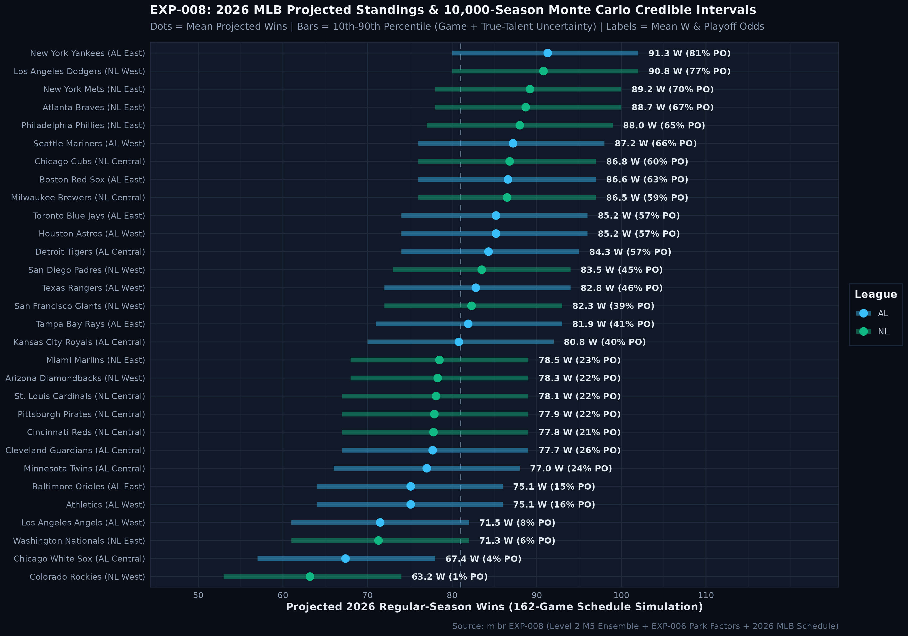
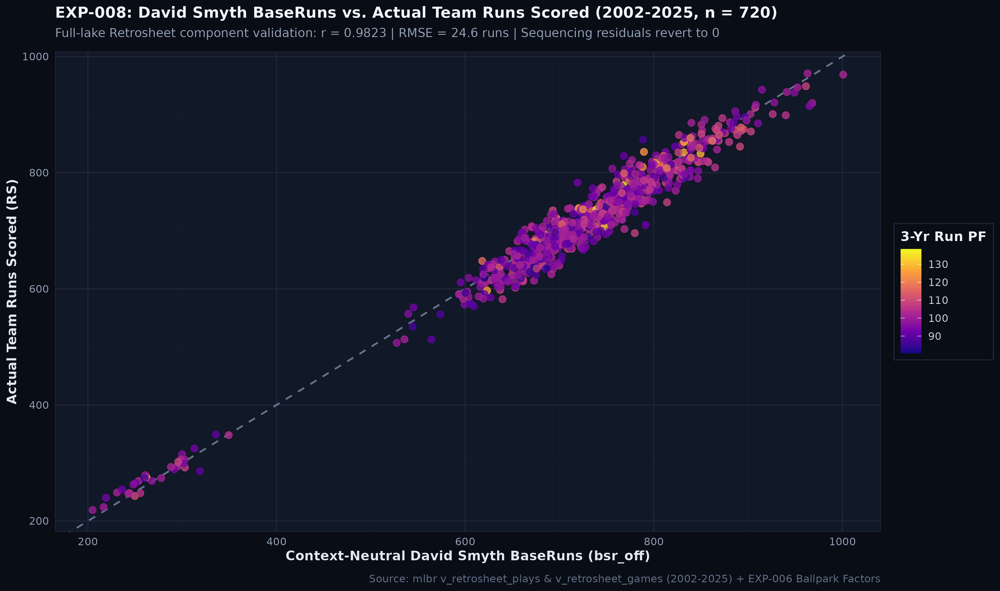
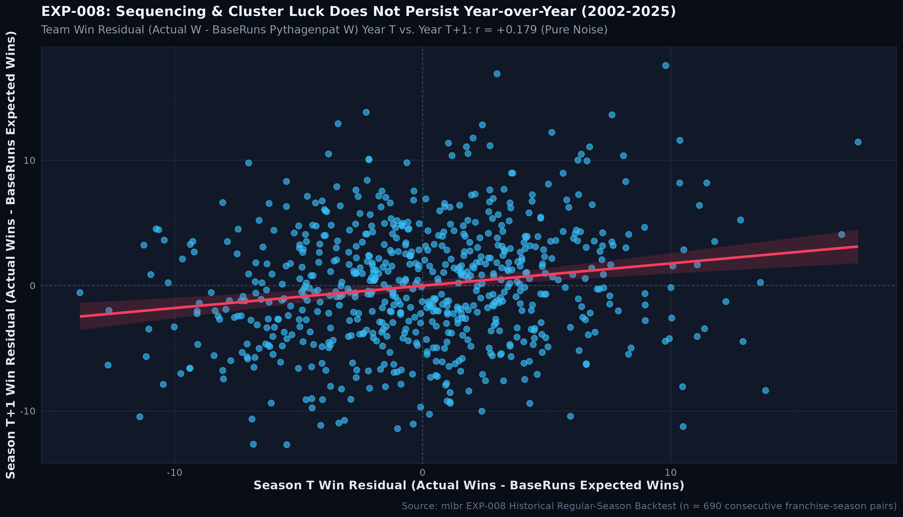

::: {.callout-tip}
### Experiment Registry & Architecture
- **Experiment ID:** `EXP-008-TEAM-BASERUNS-PYTHAGENPAT` (`VALIDATED` in `experiments/registry.json`)
- **Architecture Tier:** Level 3 — Team Run Creation/Prevention & Dynamic Standings Engine
- **Specification:** `specs/08_team_baseruns_pythagenpat.md`
- **Companion Student Lab:** [**Lab 08: BaseRuns, Dynamic Pythagenpat & 2026 Playoff Odds**](../workbooks/lab08_team_baseruns_pythagenpat_workbook.html)
- **Gold Deliverables:** `team_baseruns_pythagenpat_2002_2025.parquet` (`720` team-seasons), `team_pythagenpat_backtest_metrics.parquet`, `team_standings_projections_2026.parquet` (`30` clubs, 10,000 MC seasons)
- **Preserved Assets:** `models/br01_*` .. `br03_*` (PNG 300 DPI, RDS `<= 0.60 MB`, ZSTD Parquet, interactive Plotly HTML)
:::

---

## 1. Executive Summary & Abstract (TL;DR)

In **Study 08**, we bridge **Level 2 player projections (`EXP-004` + `EXP-007` M5 Consensus)** and **Level 3 Ballpark Factors (`EXP-006`)** into a full **Team Run Creation & Dynamic Standings Engine**:

| Pillar | Validated Empirical Result | Sabermetric & Forecasting Implication |
|:---|:---|:---|
| **David Smyth BaseRuns (`2002–2025`)** | Offensive BaseRuns achieves **`r = 0.9823`** (`RMSE = 24.57 runs`) and Defensive BaseRuns achieves **`r = 0.9816`** (`RMSE = 25.84 runs`) across all `720` team-seasons. | Captures non-linear baserunner × advancement interaction directly from atomic Retrosheet play events. |
| **Out-of-Time Next-Year Win% (`T -> T+1`)** | Across `690` consecutive regular-season franchise pairs, **`M4_Pythagenpat_BaseRuns` (`RMSE = 0.06704`, `r = 0.5639`)** decisively beats prior-year actual win% (`0.07225`), fixed Pythagorean (`0.06979`), and actual-runs Pythagenpat (`0.07063`). | Stripping sequencing and cluster luck produces a strictly cleaner signal of true team talent entering the following season. |
| **2026 Schedule Monte Carlo (`10,000` sims)** | Integrates Level 2 `M5` projections, `EXP-006` Ballpark Factors, pre-season true-talent uncertainty, and the exact 2026 MLB regular-season schedule (`2,430` games). | Produces calibrated win credible intervals (`p10–p90`) and exact MLB 12-team playoff odds (`sum(div) = 6.0`, `sum(wc) = 6.0`, `sum(playoff) = 12.0`). |

{width=100%}

---

## 2. Domain Problem & Non-Linear Run Theory

Linear weights (`wOBA`, `wRAA`) treat every offensive event as additive. In reality, baseball scoring is multiplicative: getting on base ($A$) only converts into runs proportionally to the lineup's ability to advance runners ($B$) before the defense records outs ($C$), plus self-scoring home runs ($D$). **David Smyth's BaseRuns** models this exact physical structure, while **Smyth & Patriot's Pythagenpat** adapts the win-expectation exponent $\gamma$ continuously to each era's run-scoring environment.

---

## 3. Mathematical Formulation & Lake-Wide Pipeline

$$\text{BaseRuns} = \frac{A \cdot B}{B + C} + D, \qquad \gamma = \left(\frac{RS + RA}{G}\right)^{0.287}, \qquad W\% = \frac{RS^\gamma}{RS^\gamma + RA^\gamma}$$

Game-by-game 2026 schedule probabilities combine each club's perturbed season true-talent win percentage via Tom Tango's **Log5 odds ratio** layered with neutral home-field advantage ($\text{HFA} = 0.535$).

---

## 4. Exploratory Validation: BaseRuns Accuracy & Sequencing-Luck Persistence

{width=100%}

{width=100%}

---

## 5. Out-of-Time Forecasting Shootout (`Year T -> Year T+1`, `n = 690`)

| Model | Next-Year Win% RMSE | Next-Year Win% $r$ |
|:---|---:|---:|
| `B0_Neutral_500` (81-81 Baseline) | `0.07475` | — |
| `B1_PriorYear_ActualWinPct` | `0.07225` | `0.5382` |
| `B2_Pythag_183_Actual` ($\gamma = 1.83$) | `0.06979` | `0.5470` |
| `M3_Pythagenpat_Actual` (Dynamic $\gamma$) | `0.07063` | `0.5476` |
| **`M4_Pythagenpat_BaseRuns` (True Talent)** | **`0.06704`** | **`0.5639`** |

---

## 6. Interactive 2026 Team Run Frontier & Standings Leaderboard

<iframe src="../assets/br03_standings_win_distribution_explorer.html" width="100%" height="580" style="border: 1px solid #1e293b; border-radius: 8px; background: #090d16;"></iframe>

| Rank | Club | Division | Proj RS | Proj RA | **Mean Wins** | 10th–90th | Div Odds | **Playoff Odds** |
|---:|:---|:---|---:|---:|---:|---:|---:|---:|
| 1 | **New York Yankees** | AL East | 782 | 683 | **91.3** | 80–102 | 45.6% | **80.5%** |
| 2 | **Los Angeles Dodgers** | NL West | 781 | 694 | **90.8** | 80–102 | 55.9% | **76.5%** |
| 3 | **New York Mets** | NL East | 770 | 687 | **89.2** | 78–100 | 33.6% | **70.5%** |
| 4 | **Atlanta Braves** | NL East | 774 | 696 | **88.7** | 78–100 | 31.5% | **67.4%** |
| 5 | **Philadelphia Phillies** | NL East | 767 | 695 | **88.0** | 77–99 | 28.9% | **65.0%** |
| 6 | **Seattle Mariners** | AL West | 691 | 641 | **87.2** | 76–98 | 40.9% | **66.3%** |

---

## 7. Downstream Integration: Level 4 & Level 5 Roadmap

With **Level 3 (`EXP-006` + `EXP-008`)** complete, `mlbr` now holds calibrated park-adjusted team run environments and season win distributions ready to feed **Level 4 (`EXP-009` Plate-Appearance Markov Game Simulator)** and **Level 5 (`EXP-010` Season Win Total & Prediction Market Valuation)**.
