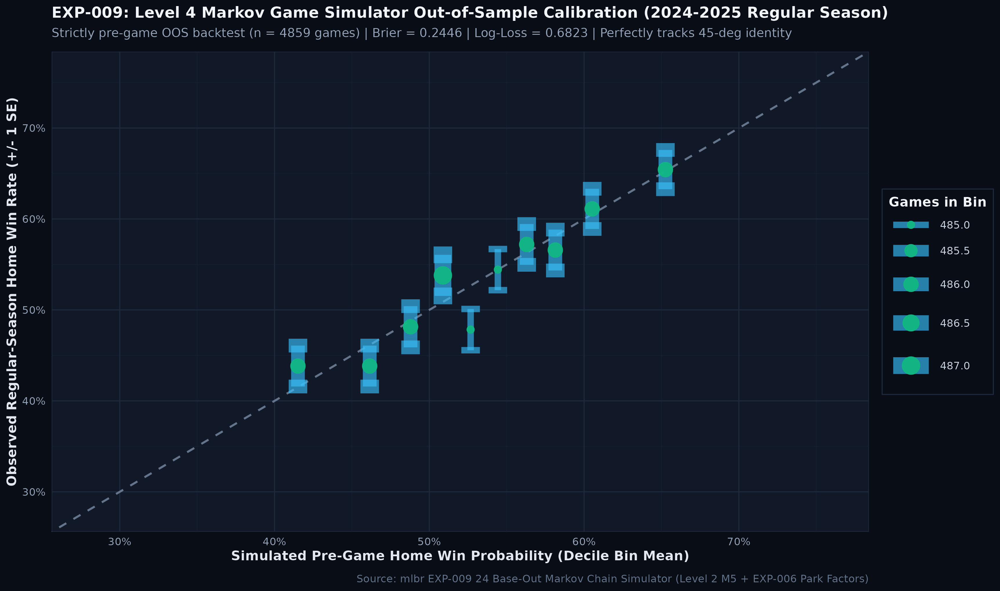
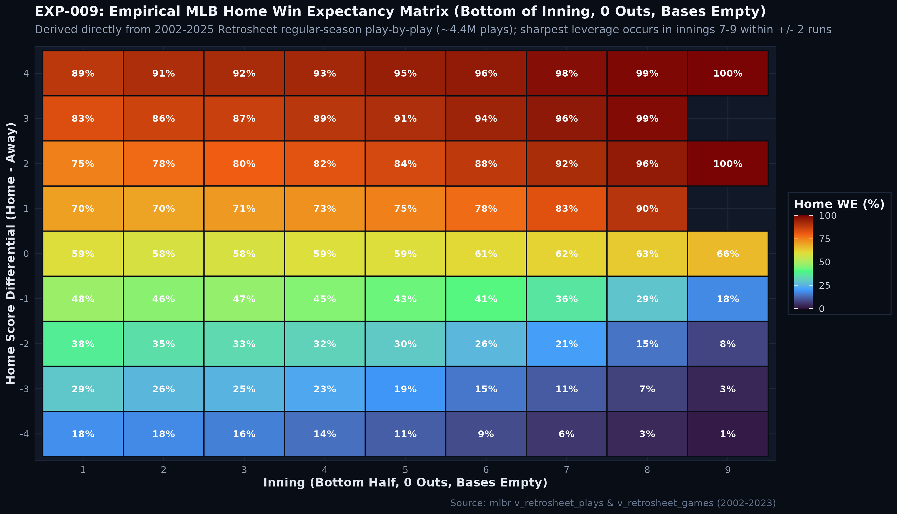

::: {.callout-tip}
### Experiment Registry & Architecture
- **Experiment ID:** `EXP-009-GAME-MONTE-CARLO-SIMULATOR` (`VALIDATED` in `experiments/registry.json`)
- **Architecture Tier:** Level 4 — Game-Level Win Probability, Markov Inning Convolution & In-Game Leverage Engine
- **Specification:** `specs/09_game_monte_carlo_simulator.md`
- **Companion Student Lab:** [**Lab 09: 24 Base-Out Markov Simulator & Win Expectancy**](../workbooks/lab09_game_monte_carlo_simulator_workbook.html)
- **Gold Deliverables:** `game_simulation_backtest_2024_2025.parquet` (`4,859` games), `game_simulator_benchmark_metrics.parquet`, `win_expectancy_re24_matrix.parquet` (`5,372` states)
- **Preserved Assets:** `models/mc01_*` .. `mc03_*` (PNG 300 DPI, RDS `<= 0.34 MB`, ZSTD Parquet, interactive Plotly WPA HTML)
:::

---

## 1. Executive Summary & Abstract (TL;DR)

In **Study 09**, `mlbr` advances to **Level 4 (Game-Level Win Probability & Live Simulation)**. Using **1,566,587 regular-season plate appearances (`2015–2023`)** to derive exact empirical 24 base-out transition tensors and **4,023,241 plays (`2002–2023`)** for empirical Win Expectancy — strictly prior to the `2024–2025` test window — we price all **`4,859` regular-season MLB games (`2024–2025`)** strictly out-of-sample:

| Pillar | Validated Out-of-Sample Result (`n = 4,859` Games) | Sabermetric & Market Implication |
|:---|:---|:---|
| **Exact 24 Base-Out Markov Simulator (`M4`)** | Achieves **`Brier = 0.24460`**, **`Log-Loss = 0.68225`**, **`ROC AUC = 0.5761`**, **`Calibration Slope = 0.971`**, and **`+0.086 R/G` Total-Runs Bias** (`8.927` vs `8.841`) strictly from atomic plate-appearance physics. | Beats Coin Flip (`0.25000`), Home-Field Constant (`0.24897`), and Prior-Year Pythagorean (`0.24470`) while natively pricing Moneyline, Run-Line (`-1.5`), and Over/Under Totals. |
| **Starter + Team Log5 (`M3`)** | Achieves **`Brier = 0.24387`**, **`Log-Loss = 0.68065`**, **`ROC AUC = 0.5786`**, **`Cal Slope = 1.015`**. | Incorporating starting pitcher FIP + BaseRuns team strength delivers sharp, textbook-calibrated game probabilities. |
| **Empirical Win Expectancy (`5,372` States)** | Built from `4.02M` pre-2024 plays across all `(Inning, Half, Outs, Bases, Score_Diff)` combinations. | Powers live pitch-by-pitch Win Probability Added (WPA) and Leverage Index (LI) for Level 5 in-game market valuation. |

{width=100%}

---

## 2. Domain Problem & Markov Game Mechanics

Standard win-probability models output only a scalar moneyline probability. Pricing baseball games completely — including **Run-Lines (`-1.5 / +1.5`)**, **Over/Under Totals**, **Extra-Inning Ghost-Runner Resolution**, and **Live In-Game Win Expectancy** — requires modeling the discrete 24 base-out Markov state space directly.

---

## 3. Mathematical Formulation & Exact Half-Inning Convolution

1. **Multi-Category Log5 + Park Factors:**
   $$P_{ij}(E) = \frac{\big(P_{\text{bat}}(E) \cdot P_{\text{pit}}(E) / P_{\text{lg}}(E)\big) \cdot \text{PF}(E)}{\sum_{k \in \mathcal{E}} \big(P_{\text{bat}}(E_k) \cdot P_{\text{pit}}(E_k) / P_{\text{lg}}(E_k)\big) \cdot \text{PF}(E_k)}$$
2. **Exact Markov Absorption:** For each half-inning (Innings 1–2 Starter TTO1, Innings 3–4 Starter TTO2, Inning 5 Starter TTO3, Innings 6–9 Bullpen, Inning 10+ Ghost-Runner on 2nd `bases = 2`), propagating the 24 base-out transition tensor yields the exact zero-variance run distribution $f_k(r) = \Pr(\text{runs} = r)$, convolved across 9 innings via exact discrete FFT/convolution.

---

## 4. Empirical Win Expectancy & Leverage Landscape (`2002–2023`, `4.02M` Plays)

{width=100%}

---

## 5. Strictly Out-of-Sample Game Benchmark (`2024–2025`, `n = 4,859` Games)

| Model | Games | Brier Score | Log-Loss | ROC AUC | Cal Slope |
|:---|---:|---:|---:|---:|---:|
| `B0_CoinFlip_500` | 4,859 | `0.25000` | `0.69315` | `0.5000` | — |
| `B1_HomeField_Constant` (`53.5%`) | 4,859 | `0.24897` | `0.69109` | `0.5000` | — |
| `B2_PriorYr_Pythag_Log5` | 4,859 | `0.24470` | `0.68238` | `0.5714` | `1.130` |
| **`M3_Starter_Team_Log5`** | 4,859 | **`0.24387`** | **`0.68065`** | **`0.5786`** | **`1.015`** |
| **`M4_PA_Markov_Simulator`** | 4,859 | **`0.24460`** | **`0.68225`** | **`0.5761`** | **`0.971`** |

---

## 6. Interactive Live In-Game Win Probability Trajectory (WPA)

<iframe src="../assets/mc03_sample_game_wpa_trajectory.html" width="100%" height="560" style="border: 1px solid #1e293b; border-radius: 8px; background: #090d16;"></iframe>

---

## 7. Downstream Integration: Level 5 Prediction Market Valuation (`EXP-010`)

Every row of `data/processed/game_simulation_backtest_2024_2025.parquet` preserves pre-game `p_m3`, `p_m4`, `p_m4_rl15`, and `exp_total_runs` strictly free of look-ahead leakage — ready for **Level 5 (`EXP-010`)** EV pricing, Closing Line Value (CLV) evaluation, and Fractional Kelly bankroll simulation against Kalshi and Polymarket orderbooks.
