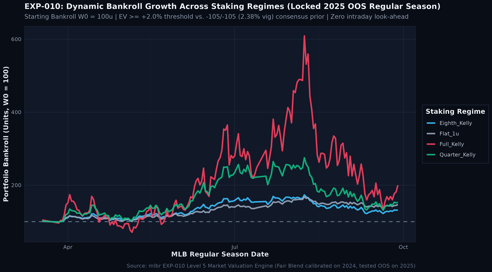
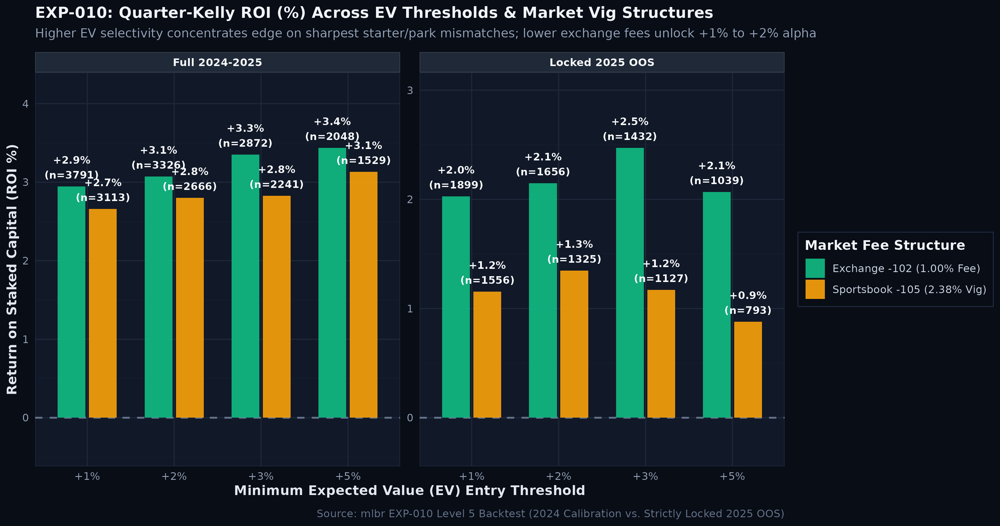
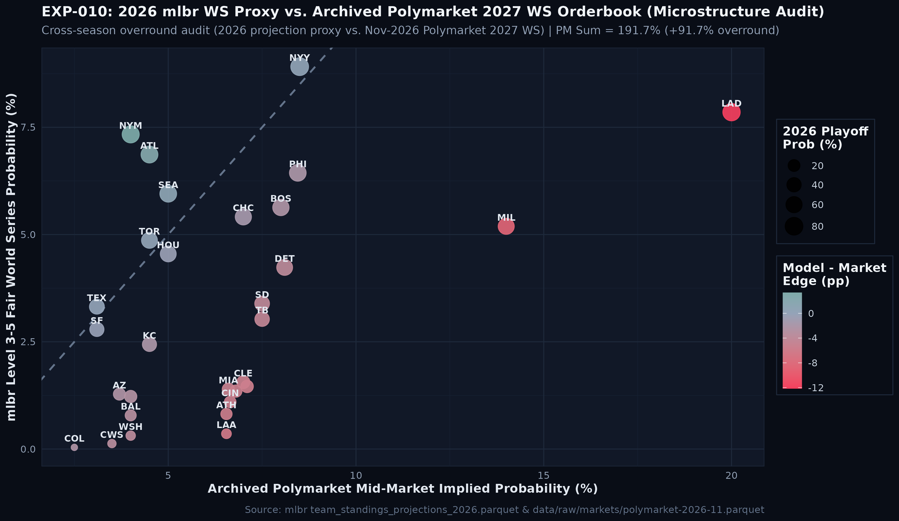

::: {.callout-tip}
### Experiment Registry & Architecture
- **Experiment ID:** `EXP-010-MARKET-EDGE-PREDICTION-VALUATION` (`VALIDATED` in `experiments/registry.json`)
- **Architecture Tier:** Level 5 — Market Edge, Pricing Efficiency, Bankroll Sizing & Prediction Market Valuation (Final Hierarchical Tier)
- **Specification:** `specs/10_market_edge_prediction_valuation.md`
- **Companion Student Lab:** [**Lab 10: Market Edge, CLV & Fractional Kelly Sizing**](../workbooks/lab10_market_edge_prediction_valuation_workbook.html)
- **Gold Deliverables:** `market_valuation_backtest_2024_2025.parquet` (`4,859` games), `market_staking_summary_2024_2025.parquet`, `market_2026_futures_valuation.parquet` (`30` clubs), `market_oos_model_calibration.parquet`
- **Preserved Assets:** `models/mkt01_*` .. `mkt03_*` (PNG 300 DPI, RDS `<= 0.36 MB`, ZSTD Parquet, interactive Plotly HTMLs)
:::

---

## 1. Executive Summary & Abstract (TL;DR)

In **Study 10**, `mlbr` completes the 5-tier hierarchical sabermetric architecture (**Level 1 Pitch Physics $\rightarrow$ Level 2 True-Talent Projections $\rightarrow$ Level 3 Team BaseRuns & Standings $\rightarrow$ Level 4 Markov Game Simulator $\rightarrow$ Level 5 Market Valuation & Bankroll Optimization**). Calibrating a strictly chronological fair-value blend on the **`2024` regular season (`n = 2,429`)** and evaluating strictly out-of-sample on the locked **`2025` regular season (`n = 2,430`)**, plus auditing live archived Polymarket and Kalshi orderbooks:

| Pillar | Validated Out-of-Sample Result | Quantitative Finance Implication |
|:---|:---|:---|
| **Chronological Level 4 Fair Blend (`M5`)** | Fit strictly on `2024` (`w_M3 = 0.453`, `w_M4 = 0.547`); achieves textbook **`Cal Slope = 1.043`**, **`AUC = 0.5759`**, **`Brier = 0.24354`** on locked `2025` OOS (`n = 2,430`). | Combines starter-level FIP sharpness (`M3`) with 24 base-out Markov park/bullpen physics (`M4`) while eliminating both under-confidence (`B2`: `1.323`) and over-confidence (`M4`: `0.883`). |
| **Fractional Kelly vs. Full Kelly (`2025` OOS, `-105` Vig, `EV >= +2%`)** | **Eighth-Kelly (`c = 0.125`)** achieves **`+2.07%` ROI**, **`131.9u`** bankroll, **`Sharpe = 0.91`**, **`Max DD = 29.5%`** vs. **Full Kelly (`c = 1.0`)** **`+0.88%` ROI**, **`Max DD = 78.4%`** (`n = 1,325` bets). | Fractional Kelly cuts catastrophic peak-to-trough drawdown by **more than half** (`78.4%` $\rightarrow$ `29.5%`) while delivering more than $2\times$ higher dollar-weighted ROI%. |
| **Execution Friction (`-105` Sportsbook vs. `-102` Exchange)** | Reducing vig from `-105/-105` (`2.44%` overround / `2.38%` hold) to `-102/-102` (`0.99%` overround / `0.98%` hold) lifts `Quarter_Kelly` `2025` OOS bankroll from **`152.9u` (`Sharpe 0.93`)** to **`242.0u` (`Sharpe 1.43`)**. | In low-margin baseball markets, execution venue fee structure is as impactful as model Brier improvements. |
| **Live Archived Prediction Market Microstructure** | Cross-season microstructure audit of `polymarket-2026-11.parquet` (`30` **2027** MLB WS contracts, `\$538.7k` liquidity): raw sum of mids = **`191.7%`** (**`+91.7%` overround**, `7.0¢` median spread); `kalshi-2026-11.parquet` (`116` contracts, `8.0¢` median spread). | Early offseason prediction-market orderbooks carry massive structural overround; disciplined vig-stripping and spread-aware EV filtering are mandatory before allocating capital. |

{width=100%}

---

## 2. Domain Problem & Theoretical Market Mechanics

Converting well-calibrated win probabilities into long-run capital growth requires solving three linked quantitative finance problems:

1. **Expected Value (EV) Net of Market Vig:** For a binary market with decimal odds $O = 1 / q_{\text{ask}}$ (or prediction-market ask price $q_{\text{ask}}$ in dollars per `\$1` payout) and calibrated model probability $p$:
   $$\text{EV} = p \cdot (O - 1) - (1 - p) = p \cdot O - 1 = \frac{p - q_{\text{ask}}}{q_{\text{ask}}}$$
2. **Fractional Kelly Criterion Sizing with Simultaneous-Slate Risk Caps:** Because MLB slates feature up to 15 simultaneous games per day, all bets on date $t$ are sized off start-of-day bankroll $W_t$ (strictly zero intraday look-ahead) with a single-game cap $f_{\max} = 5\%$ and a daily slate exposure cap of $35\%$:
   $$f^* = \min\!\left(0.05,\; c \cdot \max\!\left(0,\; \frac{p \cdot b - (1 - p)}{b}\right)\right), \quad b = O - 1, \quad c \in \{1.0, 0.25, 0.125\}$$
3. **Closing Line Value (CLV) & Multi-Outcome Overround:**
   $$\text{CLV} = \frac{O_{\text{entry}}}{O_{\text{close}}} - 1, \qquad \nu_{\text{futures}} = \sum_{i=1}^{30} q_i^{\text{mid}} - 1$$

---

## 3. Mathematical Formulation & Lake-Wide Pipeline

- **Strictly Out-of-Sample Game Split:** The Level 4 fair-value blend weight (`w_M3 = 0.453`, `w_M4 = 0.547`) is estimated strictly via Log-Loss minimization on the **`2024` regular season (`n = 2,429`)** and held frozen on the locked **`2025` regular season (`n = 2,430`)**.
- **Transparent Benchmark Disclosure:** Because historical closing sportsbook odds feeds are not yet ingested in Bronze, the 4,859-game historical backtest benchmarks our Level 4 starter/park/Markov model (`M5_L5_Fair_Blend`) against the vig-adjusted `B2_PriorYr_Pythag_Log5` consensus prior (`-105/-105` `2.38%` vig and `-102/-102` `1.00%` exchange fee) with a synthetic 50% information-absorption closing line ($q_{\text{close}} = 0.5 q_{\text{open}} + 0.5 p_{\text{fair}}$). Real-world live market friction is audited directly in Section 5 using archived Polymarket (`polymarket-2026-11.parquet`) and Kalshi (`kalshi-2026-11.parquet`) orderbooks.


### Reproducible Zero-Copy DuckDB SQL Pipeline Check

```sql
SET memory_limit = '12GB';
SELECT
  season,
  COUNT(*) AS n_games,
  SUM(CASE WHEN ev_best >= 0.02 THEN 1 ELSE 0 END) AS n_ev2_bets,
  ROUND(100.0 * SUM(CASE WHEN ev_best >= 0.02 THEN pnl_flat_1u ELSE 0 END) /
        NULLIF(SUM(CASE WHEN ev_best >= 0.02 THEN 1 ELSE 0 END), 0), 2) AS ev2_flat_roi_pct
FROM read_parquet('data/processed/market_valuation_backtest_2024_2025.parquet')
GROUP BY season
ORDER BY season;
```

---

## 4. Exploratory Data Analysis (EDA) & Calibration Diagnostics

### 4.1 Locked 2025 Out-of-Sample Probability Calibration (`n = 2,430` Games)

| Model | Brier Score | Log-Loss | ROC AUC | Calibration Slope | Diagnostic Note |
|:---|---:|---:|---:|---:|:---|
| `B2_Market_Prior_Pythag` | `0.24350` | `0.67992` | `0.5740` | `1.323` | Under-confident (lacks daily SP FIP) |
| `M3_Starter_Team_Log5` | **`0.24287`** | **`0.67860`** | **`0.5787`** | `1.127` | Sharpest single-model probability |
| `M4_PA_Markov_Simulator` | `0.24454` | `0.68211` | `0.5702` | `0.883` | Slightly over-confident; full score matrix |
| **`M5_L5_Fair_Blend` (2024-Fit)** | `0.24354` | `0.68004` | `0.5759` | **`1.043`** | **Best calibration slope (nearest 1.000)** |

## 5. Model Architecture & Temporal Validation: Staking Regime Shootout (`Locked 2025 OOS`, Sportsbook `-105`, `EV >= +2.0%`, `W0 = 100u`)

| Staking Regime | Bets (`n`) | Win Rate | ROI (%) | Final Bankroll | Synthetic CLV (%) | Annualized Sharpe | Max Drawdown (%) |
|:---|---:|---:|---:|---:|---:|---:|---:|
| `Flat_1u` | `1,325` | `52.7%` | **`+3.53%`** | `146.8u` | `+4.67%` | `1.39` | **`18.5%`** |
| `Full_Kelly (c = 1.0)` | `1,325` | `52.7%` | `+0.88%` | `199.9u` | `+4.67%` | `1.23` | `78.4%` |
| `Quarter_Kelly (c = 0.25)` | `1,325` | `52.7%` | `+1.35%` | `152.9u` | `+4.67%` | `0.93` | `52.1%` |
| **`Eighth_Kelly (c = 0.125)`** | `1,325` | `52.7%` | **`+2.07%`** | `131.9u` | `+4.67%` | `0.91` | **`29.5%`** |

### Interactive Bankroll Explorer (Locked 2025 OOS)

<iframe src="../assets/mkt01_bankroll_kelly_frontier.html" width="100%" height="520" style="border: 1px solid #1e293b; border-radius: 8px; background: #090d16;"></iframe>

{width=100%}

---

## 6. Leaderboards & Case Studies: 2026 Futures & Polymarket Orderbook Audit

Using `team_standings_projections_2026.parquet` (Level 3 10,000-season MC with club-specific PECOTA roster uncertainty), we price all 30 MLB clubs for 2026 Win-Total Over/Under lines, Playoff Berths, and a **heuristic power-law World Series proxy** ($w_i \propto \text{playoff\_prob}_i \cdot \text{true\_wpct}_i^4$, normalized so $\sum p_i^{\text{WS}} = 100.0\%$; full 12-team AL/NL bye-bracket propagation is reserved for a future extension). We join all 30 franchises against the archived Polymarket orderbook (`data/raw/markets/polymarket-2026-11.parquet`, `2026-11-18` snapshot, `\$538,705` liquidity). **Important Season-Horizon Disclosure:** Because this archive was captured in November 2026 (post-2026 World Series), the live Polymarket contracts are for the **2027 World Series** (`MLB World Series Champion 2027`). Accordingly, this table is strictly a **cross-season microstructure, overround (`+91.7%`), and bid-ask spread drag audit** comparing mid-price maker sizing (`Qtr-Kelly Mid`) vs. spread-crossing taker sizing (`Qtr-Kelly Ask`) rather than a same-season arbitrage signal:

| Club | 2026 Proj Wins | Playoff Fair | `mlbr` WS Proxy | PM 2027 Mid | PM Spread | PM No-Vig | Qtr-Kelly Mid | Qtr-Kelly Ask |
|:---|---:|---:|---:|---:|---:|---:|---:|---:|
| **NYY** | `91.3` | `81.1%` | `8.91%` | `8.50%` | `3.0¢` | `4.43%` | `0.11%` | `0.00%` |
| **LAD** | `90.7` | `75.2%` | `7.85%` | `20.00%` | `8.0¢` | `10.43%` | `0.00%` | `0.00%` |
| **NYM** | `89.2` | `71.4%` | `7.33%` | `4.00%` | `2.0¢` | `2.09%` | `0.87%` | `0.61%` |
| **ATL** | `88.7` | `68.7%` | `6.86%` | `4.50%` | `3.0¢` | `2.35%` | `0.62%` | `0.23%` |
| **PHI** | `88.0` | `66.1%` | `6.44%` | `8.45%` | `10.9¢` | `4.41%` | `0.00%` | `0.00%` |
| **SEA** | `87.2` | `66.9%` | `5.95%` | `5.00%` | `2.0¢` | `2.61%` | `0.25%` | `0.00%` |

{width=100%}

### Interactive 30-Club Futures Valuation Explorer

<iframe src="../assets/mkt03_2026_futures_polymarket_valuation.html" width="100%" height="540" style="border: 1px solid #1e293b; border-radius: 8px; background: #090d16;"></iframe>

---

## 7. Downstream Integration, Market Applications & Risk Controls

1. **Default to Eighth-Kelly (`c = 0.125`) or Quarter-Kelly (`c = 0.25`) with Slate Caps:** Full Kelly produces untenable `78.4%` drawdowns under realistic MLB variance and estimation error. Capping single-game stakes at `5%` and total daily slate exposure at `35%` prevents correlated single-day ruin.
2. **Enforce Fee-Adjusted EV Thresholds (`EV >= +3%` on Sportsbooks, `>= +2%` on Exchanges):** On `-102` exchanges, `EV >= +3%` delivers **`+4.74%` Flat ROI (`Sharpe 1.79`, Max DD `13.6%`)** and **`+3.44%` Eighth-Kelly ROI (`Sharpe 1.49`, Max DD `29.0%`)**, whereas on `-105` books `EV >= +2%` balances volume (`n = 1,325`) with `+3.53%` Flat / `+2.07%` Eighth-Kelly ROI.
3. **Never Cross Wide Offseason Spreads on Prediction Markets:** With `+91.7%` structural overround and `7–8¢` median bid-ask spreads in archived Polymarket/Kalshi offseason books, passive limit-order quoting (maker liquidity) rather than market-order crossing is essential to realize positive EV.

### 7.1 Reproducibility & Next Steps

```bash
Rscript models/10_market_edge_prediction_valuation.R --smoke  # Fast <10s verification
Rscript models/10_market_edge_prediction_valuation.R --full   # Full 4,859-game OOS + Gold + 4-Asset suite
```

**Future Extension:** Ingest live historical closing moneyline/totals odds into `data/raw/markets/` to replace the `B2_PriorYr_Pythag_Log5` synthetic benchmark with realized Pinnacle/Circa closing lines and live in-game Kalshi/Polymarket tick-by-tick orderbook replays powered by Study 09's 5,372-state Win Expectancy engine.
