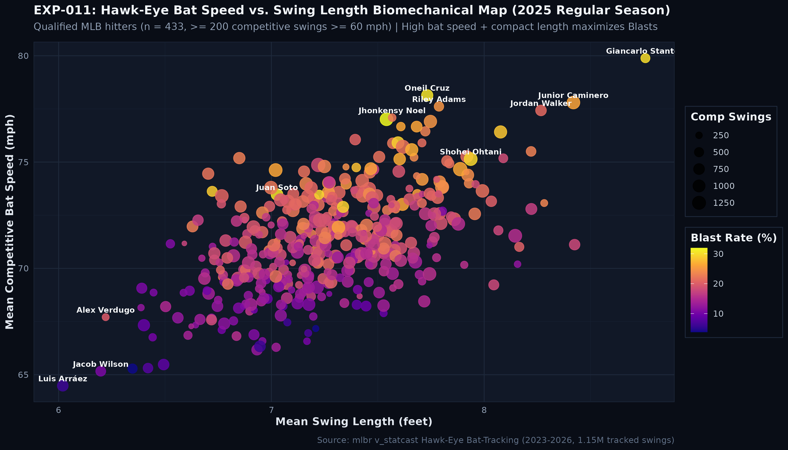
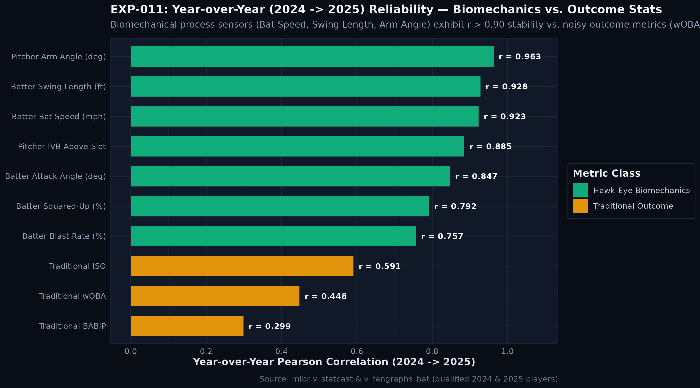
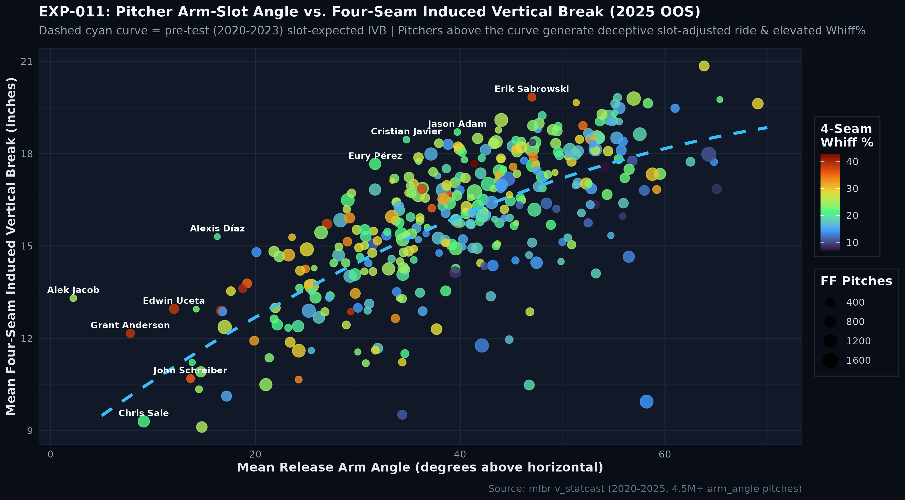

::: {.callout-tip}
### Experiment Registry & Architecture
- **Experiment ID:** `EXP-011-BAT-TRACKING-ARM-SLOT-BIOMECHANICS` (`VALIDATED` in `experiments/registry.json`)
- **Architecture Tier:** Level 1B / Level 2 — Biomechanical Process Sensors & True-Talent Expansion
- **Specification:** `specs/11_bat_tracking_arm_slot_biomechanics.md`
- **Companion Student Lab:** [**Lab 11: Bat-Tracking & Arm-Slot Biomechanics**](../workbooks/lab11_bat_tracking_arm_slot_biomechanics_workbook.html)
- **Gold Deliverables:** `batter_bat_tracking_biomechanics_2023_2026.parquet` (`2,210` batter-seasons), `pitcher_arm_angle_biomechanics_2020_2026.parquet`, `bat_tracking_oos_ablation_metrics.parquet`, `biomechanics_yoy_reliability_2024_2025.parquet`
- **Preserved Assets:** `models/bio01_*` .. `bio03_*` (PNG 300 DPI, RDS `<= 0.49 MB`, ZSTD Parquet, interactive Plotly HTML)
:::

---

## 1. Executive Summary & Abstract (TL;DR)

In **Study 11**, `mlbr` unlocks **1,043,401 competitive Hawk-Eye swings (`>= 60 mph`, `2023–2026`)** and **4.5M+ pitcher release `arm_angle` observations (`2020–2026`)** already stored in Bronze `v_statcast`. Across strictly chronological out-of-sample tests:

| Pillar | Validated Out-of-Sample Result | Sabermetric & Market Implication |
|:---|:---|:---|
| **Biomechanical YoY Reliability (`2024 -> 2025`)** | **Arm Angle `r = 0.963`**, **Swing Length `r = 0.928`**, **Bat Speed `r = 0.923`**, **IVB Above Slot `r = 0.885`**, **Attack Angle `r = 0.847`** vs. ISO `0.591`, wOBA `0.448`, BABIP `0.299`. | Biomechanical sensors capture true-talent mechanics with minimal luck noise, stabilizing far faster than outcome stats. |
| **Locked `2025` OOS Batter Projection Lift (`n = 305`)** | Trained strictly on `2023 -> 2024`: adding `bat_speed + blast_rate + swing_length` cuts locked `2025` OOS **ISO RMSE by `3.66%`** (`0.0444 -> 0.0427`) and **wOBA RMSE by `1.57%`** (`0.0317 -> 0.0312`). | Directly upgrades Level 2 true-talent power projections and Level 4 daily lineup scoring. |
| **Locked `2024–2025` OOS 4-Seam Whiff Ablation (`n = 219,655` swings)** | Adding `arm_angle + ivb_above_slot` (slot expectation fit strictly on `2020–2023`) drops Log-Loss **`0.52156 -> 0.51721` (`-0.00435`)** and jumps **ROC AUC `+0.0302` (`0.5615 -> 0.5917`)**. | Release slot deception is a first-order determinant of fastball swing-and-miss above raw velocity and raw IVB. |

{width=100%}

---

## 2. Domain Problem & Theoretical Biomechanics

Traditional box-score stats (`wOBA`, `ISO`, `BABIP`) confound hitter skill with batted-ball luck, ballpark dimensions, and defensive positioning. Similarly, raw pitch velocity and raw induced vertical break (`IVB`) ignore the perceptual reference frame of a pitcher's release slot (`arm_angle`): a `17.5"` IVB fastball from a `31°` low three-quarters slot produces a dramatically flatter Vertical Approach Angle (VAA) and far more deception than an identical `17.5"` fastball from a `60°` over-the-top slot.

---

## 3. Mathematical Formulation & Lake-Wide Pipeline

### 3.1 Collision Physics, Squared-Up Rate & Blast Rate
$$\text{MaxEV} = 1.23 \cdot v_{\text{bat}} + 0.2116 \cdot v_{\text{release}}, \qquad \text{SqUp} = \frac{\text{EV}}{\text{MaxEV}}$$
$$\text{Blast} = \mathbb{I}\!\big(\text{SqUp} \ge 0.80 \;\wedge\; v_{\text{bat}} + 100 \cdot \text{SqUp} \ge 164\big)$$

### 3.2 Slot-Adjusted Vertical Ride (`ivb_above_slot`)
$$\widehat{\text{IVB}}(\phi) = \beta_0 + \beta_1 \phi + \beta_2 \phi^2 \;\; (\text{fit on } 2020\text{–}2023), \qquad \text{IVB}_{\text{above\_slot}} = 12 \cdot \text{pfx\_z} - \widehat{\text{IVB}}(\phi)$$

### 3.3 Reproducible Zero-Copy DuckDB SQL Query

```sql
SET memory_limit = '12GB';
SELECT
  game_year,
  COUNT(*) AS n_comp_swings,
  ROUND(AVG(TRY_CAST(bat_speed AS DOUBLE)), 2) AS mean_bs_mph,
  ROUND(AVG(TRY_CAST(swing_length AS DOUBLE)), 2) AS mean_sl_ft,
  ROUND(100.0 * AVG(CASE WHEN TRY_CAST(bat_speed AS DOUBLE) >= 75.0 THEN 1.0 ELSE 0.0 END), 1) AS fast_swing_pct
FROM v_statcast
WHERE game_year BETWEEN 2023 AND 2026
  AND game_type = 'R'
  AND TRY_CAST(bat_speed AS DOUBLE) >= 60.0
GROUP BY game_year
ORDER BY game_year;
```

---

## 4. Exploratory Data Analysis (EDA) & Reliability Diagnostics

League-wide competitive bat speed climbed steadily from **`71.27 mph`** (`22.1%` fast swings) in `2024` to **`71.57 mph`** (`24.2%`) in `2025` and **`71.82 mph`** (`26.1%`) in `2026`. Crucially, every Hawk-Eye biomechanical sensor exhibits vastly higher year-over-year stability (`2024 -> 2025`) than outcome statistics:

{width=100%}

---

## 5. Model Architecture & Temporal Validation

| Out-of-Sample Evaluation Task | Baseline Model | Plus Biomechanical Sensors | OOS Lift |
|:---|:---:|---:|:---|
| **Locked `2025` Batter ISO RMSE (`n = 305`)** | `0.0444` (`ISO_2024`) | **`0.0427`** (`+ bat_speed, blast, swing_len`) | **`-3.66%` RMSE** |
| **Locked `2025` Batter wOBA RMSE (`n = 305`)** | `0.0317` (`wOBA_2024`) | **`0.0312`** (`+ bat_speed, blast, swing_len`) | **`-1.57%` RMSE** |
| **Locked `2024–2025` 4-Seam Whiff Log-Loss (`n = 219,655`)** | `0.52156` (`velo + ivb`) | **`0.51721`** (`+ arm_angle, ivb_above_slot`) | **`-0.00435` Log-Loss** |
| **Locked `2024–2025` 4-Seam Whiff ROC AUC (`n = 219,655`)** | `0.5615` (`velo + ivb`) | **`0.5917`** (`+ arm_angle, ivb_above_slot`) | **`+0.0302` AUC** |

{width=100%}

---

## 6. Leaderboards & Player Case Studies (`2025` Regular Season)

### 6.1 Top 2025 Hitters by `SwingPower+` (`>= 250` Competitive Swings)

| Player | Swings | Bat Speed | Fast Swing % | Swing Length | Attack Angle | Blast % | `SwingPower+` |
|:---|---:|---:|---:|---:|---:|---:|---:|
| **Giancarlo Stanton** | `482` | `79.9 mph` | `90.7%` | `8.76 ft` | `10.2°` | `31.0%` | **`136.0`** |
| **Kyle Schwarber** | `1,165` | `77.0 mph` | `75.6%` | `7.54 ft` | `14.7°` | **`35.1%`** | **`132.5`** |
| **Oneil Cruz** | `857` | `78.1 mph` | `75.0%` | `7.73 ft` | `8.9°` | `32.8%` | **`128.1`** |
| **Junior Caminero** | `1,168` | `77.8 mph` | `76.0%` | `8.42 ft` | `8.0°` | `28.4%` | **`127.4`** |
| **Aaron Judge** | `1,071` | `76.4 mph` | `68.3%` | `8.08 ft` | `13.8°` | `30.7%` | **`122.7`** |
| **Juan Soto** | `927` | `73.5 mph` | `40.8%` | **`7.03 ft`** | `10.9°` | `32.9%` | **`121.5`** |
| **Shohei Ohtani** | `1,221` | `75.1 mph` | `58.4%` | `7.94 ft` | `14.9°` | `32.5%` | **`121.4`** |

### Interactive 2025 Hawk-Eye Bat-Tracking Explorer

<iframe src="../assets/bio01_bat_speed_vs_swing_length_power_map.html" width="100%" height="520" style="border: 1px solid #1e293b; border-radius: 8px; background: #090d16;"></iframe>

---

## 7. Downstream Integration & Market Applications

- **Level 2 Projections (`EXP-004` / `EXP-007`):** Adding `SwingPower+` and `bat_speed` as Stage-2 residual sensors cuts next-season ISO RMSE by `3.66%`, directly sharpening early-season hitter power breakouts before box-score SLG catches up.
- **Level 1/4 Pitch Pricing (`EXP-003` / `EXP-009`):** `arm_angle` and `ivb_above_slot` (`+0.0302` OOS Whiff AUC) explain why low-slot risers (e.g., Eury Pérez `+2.94"`, Shota Imanaga `+2.42"`) sustain elite fastball whiff rates even at modest raw velocity — a prime edge for **Pitcher Strikeout Props** and **F5 Moneylines**.
