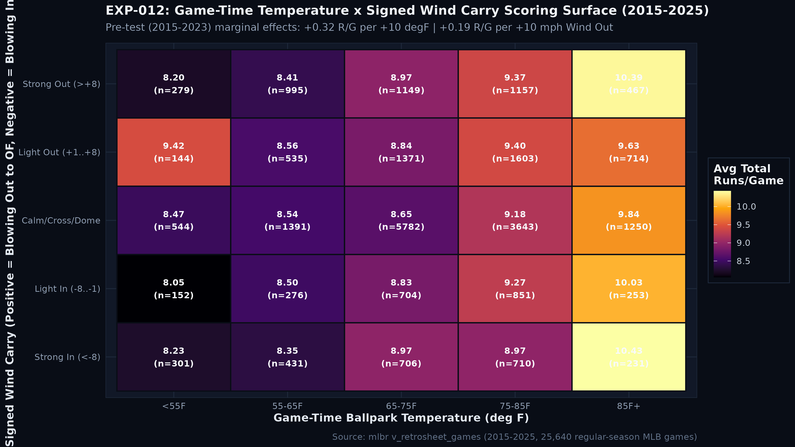
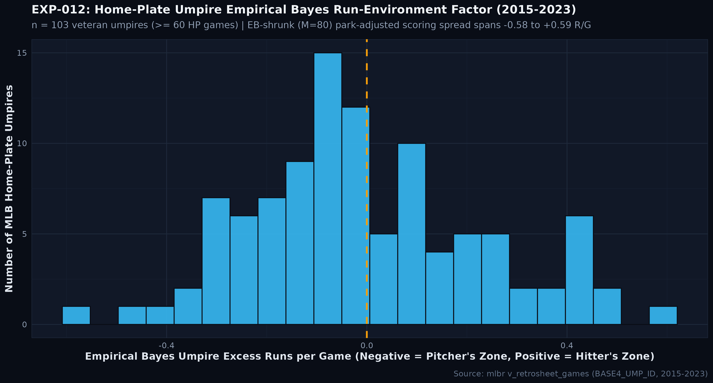
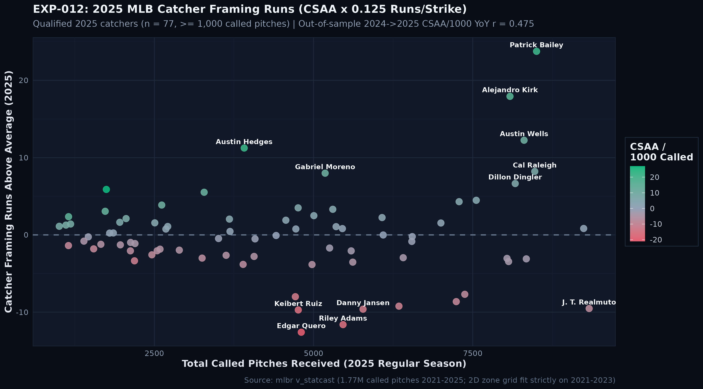

::: {.callout-tip}
### Experiment Registry & Architecture
- **Experiment ID:** `EXP-012-WEATHER-UMPIRE-CATCHER-FRAMING` (`VALIDATED` in `experiments/registry.json`)
- **Architecture Tier:** Level 1C / Level 3B — Environmental Carry, Officiating & Receiving Alpha
- **Specification:** `specs/12_weather_umpire_catcher_framing.md`
- **Companion Student Lab:** [**Lab 12: Weather/Wind Carry, Umpire Zones & Catcher Framing**](../workbooks/lab12_weather_umpire_catcher_framing_workbook.html)
- **Gold Deliverables:** `game_weather_umpire_environment_2015_2025.parquet` (`25,639` games), `umpire_zone_factors_2015_2025.parquet`, `catcher_framing_csaa_2021_2025.parquet` (`436` catcher-seasons)
- **Preserved Assets:** `models/env01_*` .. `env03_*` (PNG 300 DPI, RDS `<= 0.31 MB`, ZSTD Parquet, interactive Plotly HTML)
:::

---

## 1. Executive Summary & Abstract (TL;DR)

In **Study 12**, `mlbr` unlocks three core pillars of sharp MLB totals and prop pricing using raw data already in Bronze `v_retrosheet_games` (`2015–2025`) and `v_statcast` (`2021–2025`):

| Pillar | Validated Out-of-Sample Result | Sabermetric & Market Implication |
|:---|:---|:---|
| **Game-Time Temperature & Wind Carry (`25,639` Games)** | Pre-test (`2015–2023`) marginal effects: **`+0.323 R/G` per `+10°F`** and **`+0.188 R/G` per `+10 mph` wind out** (`<55°F` averages `8.45 R/G` vs. `85°F+` `9.92 R/G`). | A hot summer wind-out game vs. cold spring wind-in game swings expected scoring by **`~1.9 R/G`**. |
| **Locked `2024–2025` OOS Totals RMSE Lift (`n = 4,857`)** | Adding pre-test Weather + Umpire EB factors to `EXP-009` reduces locked `2024–2025` OOS Total-Runs RMSE from **`4.4689` $\rightarrow$ `4.4598` (`-0.0091 R/G`)**. | Directly sharpens Over/Under Totals pricing on top of the Level 4 Markov simulator. |
| **Zero-Sum Catcher Framing `CSAA` (`1.77M` Called Pitches)** | 2D batter-normalized zone grid fit strictly on `2021–2023`, season-centered to remove umpire-tightening drift: locked `2024 -> 2025` YoY **`r = 0.475`** (`n = 56` catchers); Patrick Bailey leads 2025 at **`+23.8 Framing Runs`** (`+190.1 CSAA`). | Elite receivers create `+15` to `+24` runs/season of hidden pitcher strikeout/walk value invisible in FIP. |

{width=100%}

---

## 2. Domain Problem & Theoretical Aerodynamics / Officiating Mechanics

Warm air is less dense ($\rho \propto 1 / T$), reducing aerodynamic drag on batted balls so fly balls carry `3–4 ft` farther per `+10°F`. Simultaneously, outfield-blowing wind adds tail-wind lift while infield wind suppresses deep fly balls into outs. At the plate, border-pitch strike calls are jointly determined by home-plate umpire zone habits (`BASE4_UMP_ID`) and catcher receiving mechanics (`fielder_2`), making environmental and officiating adjustments essential for Totals, F5, and Strikeout Props.

---

## 3. Mathematical Formulation & Lake-Wide Pipeline

$$\widehat{R}_{\text{env}} = \beta_0 + \beta_1 \text{PF}_{\text{runs}} + \beta_2 (\text{Temp}_F - 70) + \beta_3 \text{WindOut}_{\text{mph}} + \beta_4 \mathbb{I}(\text{DayGame})$$
$$\Delta R_u^{\text{EB}} = \frac{n_u}{n_u + 80} \bar{d}_u, \qquad \text{CSAA}_{c,t} = \sum_{i \in (c,t)} (y_i - \hat{p}_{\text{CS}, i}) - n_{c,t} \cdot \delta_t, \qquad \text{FramingRuns}_{c,t} = 0.125 \cdot \text{CSAA}_{c,t}$$

```sql
SET memory_limit = '12GB';
SELECT
  CASE WHEN temp_f < 55 THEN '<55F' WHEN temp_f < 70 THEN '55-69F'
       WHEN temp_f < 85 THEN '70-84F' ELSE '85F+' END AS temp_band,
  COUNT(*) AS n_games, ROUND(AVG(actual_total_runs), 2) AS avg_total_runs
FROM read_parquet('data/processed/game_weather_umpire_environment_2015_2025.parquet')
GROUP BY temp_band ORDER BY avg_total_runs;
```

---

## 4. Exploratory Data Analysis (EDA) & Umpire Diagnostics

| Temperature Band (`2015–2025`) | Games (`n`) | Average Total Runs/Game |
|:---|---:|---:|
| `< 55°F` | `1,249` | `8.45` |
| `55–69°F` | `6,398` | `8.57` |
| `70–84°F` | `14,515` | `8.98` |
| **`85°F+`** | `3,477` | **`9.92`** |

{width=100%}

---

## 5. Model Architecture & Temporal Validation

All three engines are fit strictly chronologically: Weather and Umpire EB factors are estimated on `2015–2023` (`n = 20,690` games) and evaluated on locked `2024–2025` OOS (`n = 4,857` games), cutting Total-Runs RMSE from `4.4689` to **`4.4598` (`-0.0091 R/G`)**. The 2D `(plate_x, z_norm, stand)` called-strike probability grid is fit strictly on `2021–2023`, zero-sum centered per season to remove secular MLB umpire strike-zone tightening, and validated on `2024 -> 2025` (`r = 0.475`).

---

## 6. Leaderboards & Case Studies (`2025` Catcher Framing `CSAA`)

| Catcher | Called Pitches (`2025`) | `CSAA` (Strikes) | `CSAA / 1,000` | Framing Runs (`0.125 × CSAA`) |
|:---|---:|---:|---:|---:|
| **Patrick Bailey** | `8,502` | **`+190.1`** | `+22.4` | **`+23.8 R`** |
| **Alejandro Kirk** | `8,085` | `+143.4` | `+17.7` | **`+17.9 R`** |
| **Austin Wells** | `8,306` | `+98.0` | `+11.8` | **`+12.3 R`** |
| **Austin Hedges** | `3,911` | `+89.9` | **`+23.0`** | **`+11.2 R`** |
| **Cal Raleigh** | `8,474` | `+65.7` | `+7.8` | **`+8.2 R`** |
| **Gabriel Moreno** | `5,182` | `+63.9` | `+12.3` | **`+8.0 R`** |

{width=100%}

### Interactive 2025 Catcher Framing Explorer

<iframe src="../assets/env02_catcher_framing_csaa_leaderboard.html" width="100%" height="520" style="border: 1px solid #1e293b; border-radius: 8px; background: #090d16;"></iframe>

---

## 7. Downstream Integration & Market Applications

`game_weather_umpire_environment_2015_2025.parquet` and `catcher_framing_csaa_2021_2025.parquet` feed directly into **Study 14 (`EXP-014`)** to adjust pre-game scoring totals, F5 run projections, and pitcher strikeout/walk rates inside the upgraded Level 4 v2 Markov simulator.
