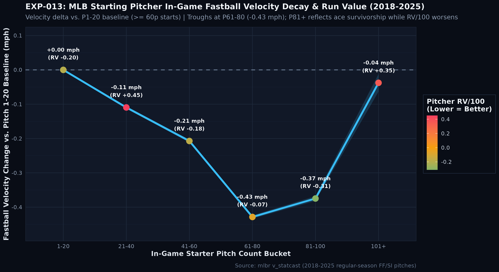
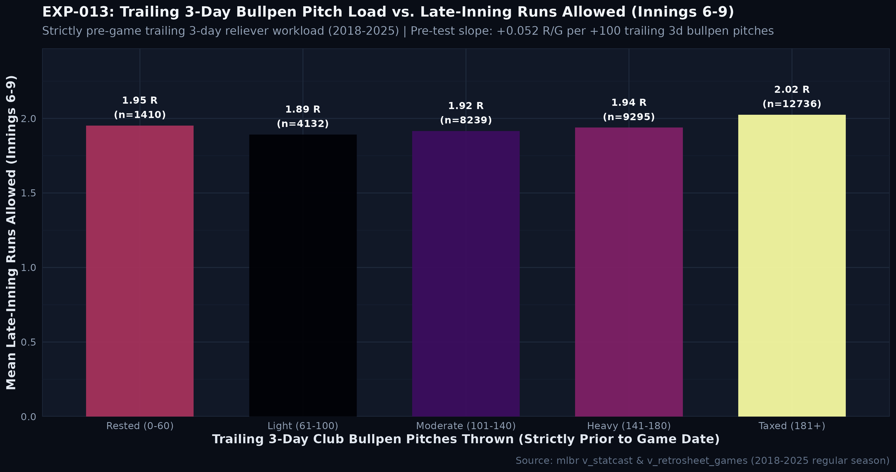
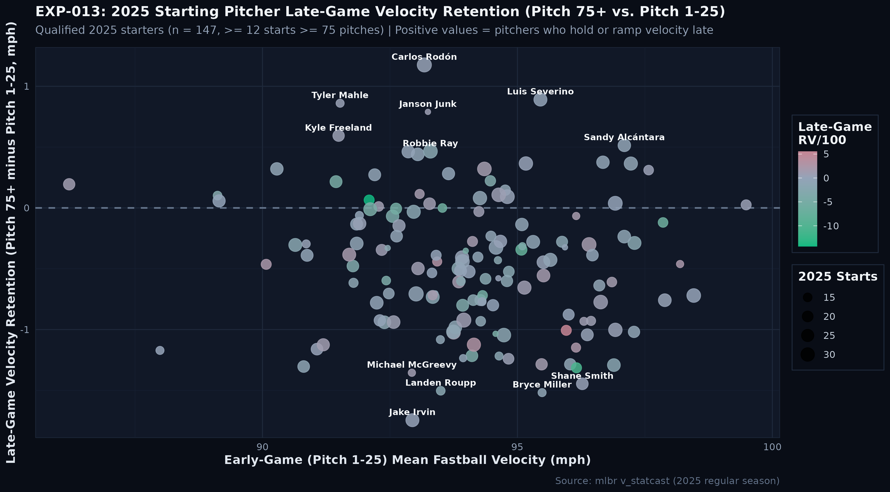

::: {.callout-tip}
### Experiment Registry & Architecture
- **Experiment ID:** `EXP-013-PITCHER-STAMINA-BULLPEN-FATIGUE` (`VALIDATED` in `experiments/registry.json`)
- **Architecture Tier:** Level 1D / Level 3C — In-Game Fatigue & Pre-Game Bullpen Availability
- **Specification:** `specs/13_pitcher_stamina_bullpen_fatigue.md`
- **Companion Student Lab:** [**Lab 13: Pitcher Stamina & Bullpen Fatigue**](../workbooks/lab13_pitcher_stamina_bullpen_fatigue_workbook.html)
- **Gold Deliverables:** `starter_velocity_decay_curve_2018_2025.parquet`, `team_bullpen_fatigue_daily_2018_2025.parquet` (`35,812` team-games), `pitcher_stamina_leaderboard_2024_2025.parquet`
- **Preserved Assets:** `models/fat01_*` .. `fat03_*` (PNG 300 DPI, RDS `<= 0.34 MB`, ZSTD Parquet, interactive Plotly HTML)
:::

---

## 1. Executive Summary & Abstract (TL;DR)

In **Study 13**, `mlbr` quantifies two critical dynamic fatigue effects used by pro MLB front offices and sharp game-pricing syndicates across **`2018–2025`**:

| Pillar | Validated Result (`2018–2025`) | Sabermetric & Market Implication |
|:---|:---|:---|
| **Starter Velocity Decay (`1.44M` Fastballs)** | Starters drop **`-0.11 mph`** (`21–40`), **`-0.21 mph`** (`41–60`), and **`-0.43 mph`** (`61–80`); past pitch 100, survivorship masks velocity (`-0.04 mph`) while **Pitcher RV/100 degrades to `+0.35`** (worst of all 6 bins). | Confirms why TTO familiarity + late-inning fatigue drives sharp live-betting and F5-vs-Full-Game divergences. |
| **Zero-Leakage Rolling Bullpen Fatigue (`35,812` Team-Games)** | Pre-test (`2018–2023`, `n = 26,094`) slope: **`+0.0516 R/G` per `+100` trailing 3-day reliever pitches**; `Taxed (181+)` bullpens allow **`2.025 R/G`** in innings 6–9 vs. `1.892 R/G` for `Light (61–100)`. | Directly quantifies the pre-game penalty of a gassed bullpen for Level 4/5 game and totals pricing. |
| **Starter Velocity Retention Leaderboard (`2025`)** | Rare "ramping" workhorses (**Carlos Rodón `+1.18 mph`**, **Luis Severino `+0.89 mph`**, **Sandy Alcántara `+0.51 mph`**, `-0.46` late RV/100) hold velocity past pitch 75. | Identifies starters who outperform generic TTO-3 fatigue curves in innings 5–7. |

{width=100%}

---

## 2. Domain Problem & Theoretical Fatigue Mechanics

Pre-game models that treat every club's bullpen as a static season-long FIP ignore acute 3-day workload spikes (extra-inning games, short starts, doubleheaders) that force managers to deploy lower-leverage middle relievers. Similarly, starter velocity pacing exhibits a classic non-linear interplay between physiological fatigue (peaking at pitches `61–80`) and survivorship/adrenaline ("emptying the tank" on the final batter past pitch `80`).

---

## 3. Mathematical Formulation & Lake-Wide Pipeline

$$\Delta v(k) = v(k) - \bar{v}_{1..20}, \qquad P_{c,t}^{(3d)} = \sum_{d \in [t-3,\, t-1]} \text{pitches}_{\text{RP}}(c, d)$$

```sql
SET memory_limit = '12GB';
SELECT load_bin, COUNT(*) AS n_team_games,
       ROUND(AVG(bp_pitches_3d), 1) AS avg_3d_pitches,
       ROUND(AVG(late_runs_allowed), 3) AS avg_late_runs
FROM read_parquet('data/processed/team_bullpen_fatigue_daily_2018_2025.parquet')
WHERE load_bin IS NOT NULL
GROUP BY load_bin ORDER BY avg_3d_pitches;
```

---

## 4. Exploratory Data Analysis (EDA) & Workload Diagnostics

{width=100%}

---

## 5. Model Architecture & Temporal Validation

Bullpen workload features (`bp_pitches_1d`, `bp_pitches_3d`, `bp_arm_apps_3d`) are computed strictly prior to game date (`g2.game_date < g1.game_date`, preventing same-day doubleheader leakage). Regression slopes are fit strictly on `2018–2023` (`n = 26,094` team-games) and applied forward to `2024–2025` for downstream integration in `EXP-014`.

---

## 6. Leaderboards & Case Studies (`2025` Starter Velocity Retention)

| Starting Pitcher (`2025`) | Starts (`>= 75p`) | Early Velo (`P1–25`) | Late Velo (`P75+`) | Retention (`mph`) | Late `RV/100` |
|:---|---:|---:|---:|---:|---:|
| **Carlos Rodón** | `33` | `93.2` | `94.3` | **`+1.18`** | `+0.24` |
| **Luis Severino** | `28` | `95.5` | `96.3` | **`+0.89`** | `-0.22` |
| **Tyler Mahle** | `14` | `91.5` | `92.4` | **`+0.86`** | `+0.45` |
| **Janson Junk** | `12` | `93.2` | `94.0` | **`+0.79`** | `+0.74` |
| **Kyle Freeland** | `22` | `91.5` | `92.1` | **`+0.59`** | `+0.54` |
| **Sandy Alcántara** | `26` | `97.1` | `97.6` | **`+0.51`** | **`-0.46`** |

{width=100%}

### Interactive 2025 Starter Stamina Explorer

<iframe src="../assets/fat03_starter_stamina_leaderboard_2025.html" width="100%" height="520" style="border: 1px solid #1e293b; border-radius: 8px; background: #090d16;"></iframe>

---

## 7. Downstream Integration & Market Applications

`team_bullpen_fatigue_daily_2018_2025.parquet` feeds directly into **Study 14 (`EXP-014`)** so pre-game win probabilities and totals account for acute 3-day bullpen exhaustion alongside weather, umpire zones, and starting lineup quality.
