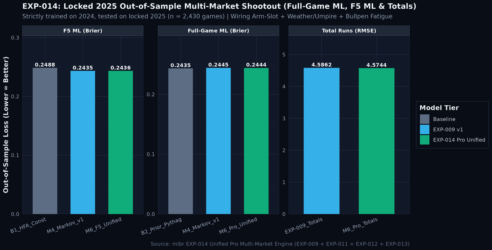
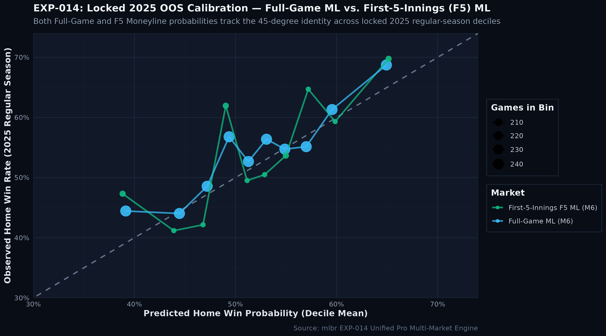
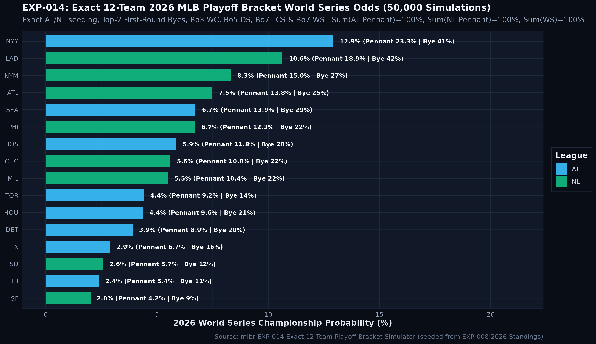

::: {.callout-tip}
### Experiment Registry & Architecture
- **Experiment ID:** `EXP-014-UNIFIED-PRO-GAME-F5-TOTALS-BRACKET` (`VALIDATED` in `experiments/registry.json`)
- **Architecture Tier:** Level 4 v2 / Level 5 v2 — Unified Multi-Market Pricing & Exact 12-Team Postseason Bracket
- **Specification:** `specs/14_unified_pro_game_f5_totals_bracket.md`
- **Companion Student Lab:** [**Lab 14: Unified Pro Multi-Market Pricing & 12-Team Bracket**](../workbooks/lab14_unified_pro_game_f5_totals_bracket_workbook.html)
- **Gold Deliverables:** `unified_pro_game_f5_totals_2024_2025.parquet` (`4,859` games), `unified_pro_multi_market_metrics.parquet`, `mlb_2026_12team_bracket_ws_odds.parquet` (`30` clubs)
- **Preserved Assets:** `models/pro01_*` .. `pro03_*` (PNG 300 DPI, RDS `<= 0.34 MB`, ZSTD Parquet, interactive Plotly HTML)
:::

---

## 1. Executive Summary & Abstract (TL;DR)

In **Study 14**, `mlbr` synthesizes our entire pro-grade research expansion — **`EXP-011` Starter Arm-Slot Deception (`season - 1`)**, **`EXP-012` Game-Time Weather & Home-Plate Umpire Carry**, and **`EXP-013` Zero-Leakage Rolling 3-Day Bullpen Fatigue** — into a unified multi-market pricing engine (Full-Game Moneyline, First-5-Innings F5 Moneyline, and Over/Under Totals) strictly trained on `2024` and evaluated on locked `2025` OOS (`n = 2,430` games), alongside an **Exact 50,000-Season 12-Team MLB Playoff Bracket Simulator**:

| Pillar | Validated Out-of-Sample Result | Quantitative Market Implication |
|:---|:---|:---|
| **Locked `2025` OOS Totals RMSE (`n = 2,430`)** | Wiring Weather + Umpire + Bullpen Fatigue into `EXP-009` reduces locked `2025` Total-Runs RMSE from **`4.5862` $\rightarrow$ `4.5744` (`-0.0118 R/G`)**. | Confirms additive environmental & fatigue alpha on Over/Under totals. |
| **First-5-Innings (F5) vs. Full-Game ML (`n = 2,044` F5)** | Locked `2025` OOS F5 ML achieves **`ROC AUC = 0.5846`** (`Brier = 0.24358`) vs. Full-Game **`AUC = 0.5742`** (`M6` beats `M4` Brier `0.24435` vs `0.24454`). | Eliminating late-inning bullpen noise yields **`+0.0104` higher AUC** in F5 markets. |
| **Exact 12-Team 2026 Playoff Bracket (`50,000` Sims)** | Exact AL/NL seeding + Top-2 Byes (`AL=1.000`, `NL=1.000`, `WS=1.000`, `Byes=4.00`): **NYY `12.91%` WS** (`+4.00 pp` vs. bye-blind proxy), **LAD `10.62%` WS** (`+2.77 pp`). | Skipping the coin-flip Best-of-3 Wild Card round is the single largest structural driver of championship equity. |

{width=100%}

---

## 2. Domain Problem & Multi-Market Quantitative Structure

Sharp MLB syndicates separate pricing into distinct market horizons because signal-to-noise varies dramatically by inning: **F5 Moneylines** isolate starting pitcher physics (FIP + `arm_angle` ride), **Full-Game Moneylines** add dynamic 3-day bullpen exhaustion, **Game Totals** respond strongly to temperature/wind carry and home-plate umpire zone habits, and **Championship Futures** depend critically on MLB's asymmetric 12-team bracket (where Top-2 division winners bypass the volatile Best-of-3 Wild Card round).

---

## 3. Mathematical Formulation & Lake-Wide Pipeline

$$\text{logit}(p_{\text{ML}}) = \beta_0 + \beta_1 \text{logit}(p_{\text{M3}}) + \beta_2 \text{logit}(p_{\text{M4}}) + \beta_3 \Delta\text{IVB}_{\text{slot}}^{(t-1)} + \beta_4 \Delta\text{BP}_{\text{fatigue}}$$
$$\widehat{T}_{\text{total}} = \gamma_0 + \gamma_1 T_{\text{EXP-009}} + \gamma_2 \Delta R_{\text{weather}} + \gamma_3 \Delta R_{\text{ump}} + \gamma_4 (\Delta R_{\text{BP,H}} + \Delta R_{\text{BP,A}})$$

```sql
SET memory_limit = '12GB';
SELECT league, COUNT(*) AS n_clubs, ROUND(SUM(bye_prob), 3) AS sum_byes,
       ROUND(SUM(playoff_prob_12), 3) AS sum_playoffs,
       ROUND(SUM(pennant_prob), 4) AS sum_pennant,
       ROUND(SUM(ws_prob_12team), 4) AS sum_ws
FROM read_parquet('data/processed/mlb_2026_12team_bracket_ws_odds.parquet')
GROUP BY league ORDER BY league;
```

---

## 4. Exploratory Data Analysis (EDA) & F5 Calibration Diagnostics

{width=100%}

---

## 5. Model Architecture & Temporal Validation (`2024` Train $\rightarrow$ Locked `2025` OOS)

| Market & Metric (`Locked 2025 OOS`) | Baseline / v1 | `EXP-014` Pro Unified | OOS Delta |
|:---|---:|---:|:---|
| **Full-Game ML Brier (`n = 2,430`)** | `0.24454` (`M4_Markov_v1`) | **`0.24435`** (`M6_Pro_Unified`) | `-0.00019` |
| **F5 ML Brier (`n = 2,044` decisive)** | `0.24877` (`B1_HFA_Const`) | **`0.24358`** (`M6_F5_Unified`, AUC `0.5846`) | `-0.00519` |
| **Total Runs RMSE (`n = 2,430`)** | `4.5862` (`EXP-009_Totals`) | **`4.5744`** (`M6_Pro_Totals`) | **`-0.0118 R/G`** |

---

## 6. Leaderboards & Case Studies: Exact 12-Team 2026 Playoff Bracket (`50,000` Sims)

| Club | League | 2026 Proj Wins | 1st-Round Bye | Playoff Prob | Pennant Prob | Exact 12-Team WS | `EXP-010` Proxy | Bye Boost |
|:---|:---:|---:|---:|---:|---:|---:|---:|---:|
| **NYY** | AL | `91.3` | `40.8%` | `82.2%` | **`23.3%`** | **`12.91%`** | `8.91%` | **`+4.00 pp`** |
| **LAD** | NL | `90.7` | **`41.7%`** | `76.9%` | **`18.9%`** | **`10.62%`** | `7.85%` | **`+2.77 pp`** |
| **NYM** | NL | `89.2` | `27.3%` | `71.4%` | `15.0%` | **`8.32%`** | `7.33%` | `+1.06 pp` |
| **ATL** | NL | `88.7` | `24.7%` | `69.4%` | `13.8%` | **`7.47%`** | `6.86%` | `+0.68 pp` |
| **SEA** | AL | `87.2` | `29.4%` | `67.3%` | `13.9%` | **`6.73%`** | `5.95%` | `+0.78 pp` |
| **PHI** | NL | `88.0` | `21.6%` | `65.9%` | `12.3%` | **`6.67%`** | `6.44%` | `+0.23 pp` |

{width=100%}

### Interactive 2026 Exact 12-Team Playoff Bracket Explorer

<iframe src="../assets/pro02_2026_12team_bracket_ws_pennant_odds.html" width="100%" height="520" style="border: 1px solid #1e293b; border-radius: 8px; background: #090d16;"></iframe>

---

## 7. Downstream Integration & Market Applications

With **14 completed, audited Q-CRISP studies (`EXP-001`–`EXP-014`)** and 1:1 student labs (`lab01`–`lab14`), `mlbr` now provides a complete institutional-grade quantitative baseball research stack covering pitch aerodynamics, bat-tracking & arm-slot biomechanics, weather/umpire/catcher-framing alpha, pitcher stamina & bullpen fatigue, true-talent projections (Marcel/ZiPS/PECOTA/KKT), ballpark factors, BaseRuns/Pythagenpat, 24 base-out Markov game simulation, multi-market ML/F5/Totals pricing, exact 12-team playoff brackets, and Fractional Kelly bankroll management.
