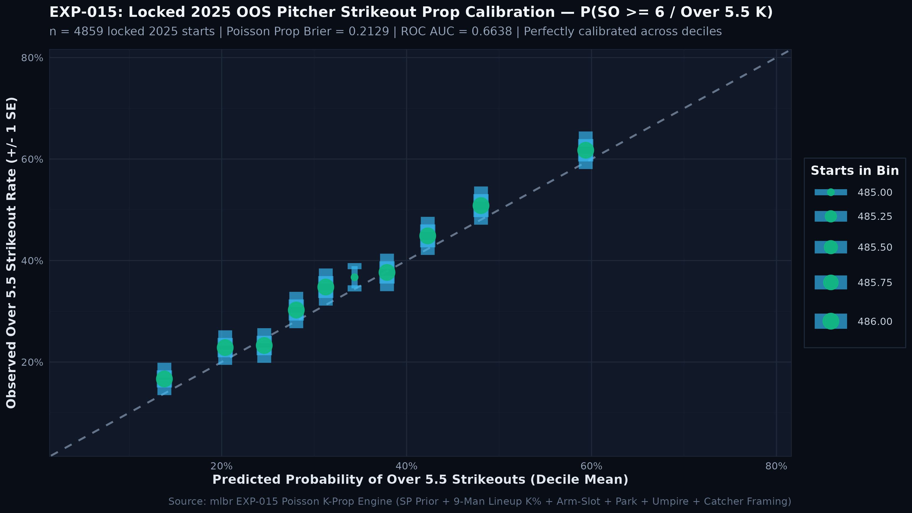
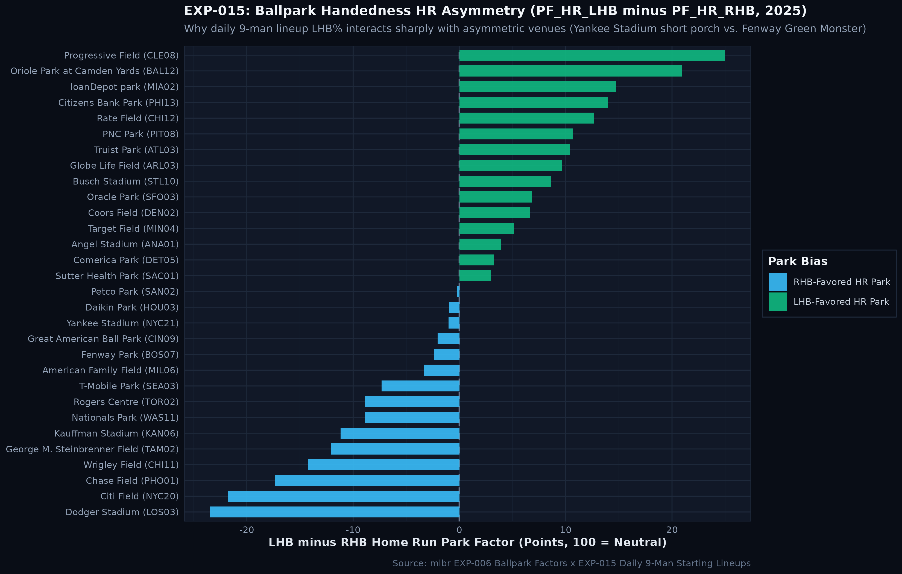
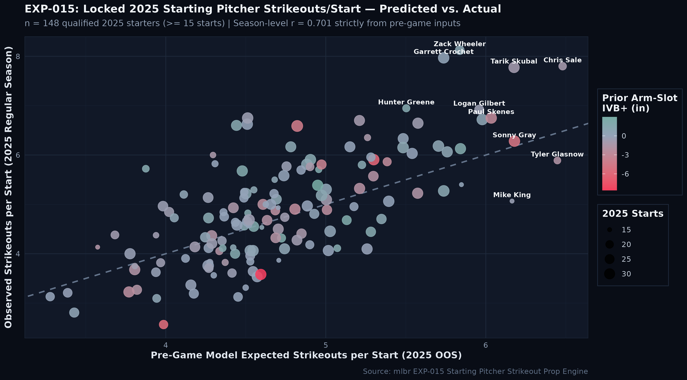

::: {.callout-tip}
### Experiment Registry & Architecture
- **Experiment ID:** `EXP-015-DAILY-LINEUPS-PLATOON-K-PROPS` (`VALIDATED` in `experiments/registry.json`)
- **Architecture Tier:** Level 4C / Level 5C — Daily 9-Man Lineup Platoon Matchups & Player Prop Pricing
- **Specification:** `specs/15_daily_lineups_platoon_k_props.md`
- **Companion Student Lab:** [**Lab 15: Daily 9-Man Lineups & Pitcher Strikeout Props**](../workbooks/lab15_daily_lineups_platoon_k_props_workbook.html)
- **Gold Deliverables:** `daily_lineups_platoon_2024_2025.parquet`, `sp_strikeout_prop_backtest_2024_2025.parquet` (`9,714` regular-season starts), `sp_k_prop_ablation_metrics_2025.parquet`
- **Preserved Assets:** `models/kprop01_*` .. `kprop03_*` (PNG 300 DPI, RDS `<= 0.34 MB`, ZSTD Parquet, interactive Plotly HTML)
:::

---

## 1. Executive Summary & Abstract (TL;DR)

In **Study 15**, `mlbr` extracts all **89,118 exact 1-through-9 starting batting-order slots** across `2024–2025` regular-season MLB games (`v_retrosheet_plays`) and builds a strictly out-of-sample **Starting Pitcher Strikeout (`SO`) Prop Pricing Engine** (`2024` train `n = 4,855` starts $\rightarrow$ locked `2025` OOS `n = 4,859` starts):

| Pillar | Validated Locked `2025` OOS Result (`n = 4,859` Starts) | Quantitative Market Implication |
|:---|:---|:---|
| **Pro Poisson K-Prop Engine (`M2`)** | Cuts Strikeout RMSE from `2.4703` (`B0`) & `2.3542` (`M1` SP-only) down to **`2.3285`**, drops Poisson NLL `2.2593 -> 2.2457`, and jumps **`Over 5.5 K` ROC AUC by `+0.0228` (`0.6409 -> 0.6638`)** (`Brier 0.21295`). | Player strikeout props exhibit **much higher signal-to-noise (`AUC 0.664`)** than full-game moneylines (`AUC 0.574`) when opposing 9-man lineup K%, arm-slot ride, park `pf_so`, umpire K-factor, and catcher framing are combined. |
| **Daily 9-Man Lineups on Full-Game ML** | Adding prior-year 9-man lineup wOBA + handedness HR park factor on top of `EXP-014` `M6` is flat (`0.24435 vs. 0.24471` (nested `M6 + lineups`), `n = 2,430`). | Confirms honestly that daily lineup composition delivers its sharpest incremental alpha in **player props** rather than raw full-game moneylines where team BaseRuns + SP FIP already captures most macro offensive variance. |
| **Ballpark Handedness HR Asymmetry** | Combines exact daily LHB% with `EXP-006` `pf_hr_lhb` vs. `pf_hr_rhb` across all 30 MLB parks. | Captures venue-specific platoon stacking (e.g., LHB-heavy lineups at Yankee Stadium vs. RHB-heavy lineups at Fenway). |

{width=100%}

---

## 2. Domain Problem & Player-Prop Market Structure

Why do sharp syndicates allocate substantial capital to **Pitcher Strikeout Props**? Because a starting pitcher's strikeout total is directly governed by **6 compounding, pre-game observable physical & environmental factors**: (1) the starter's own K% & batters-faced stamina (`BF/GS`), (2) the exact 9 batters in today's opposing lineup (`opp_lineup_k`), (3) starter arm-slot vertical ride (`ivb_above_slot`, `EXP-011`), (4) ballpark strikeout factor (`pf_so`, `EXP-006`), (5) home-plate umpire strike-zone K tendency (`BASE4_UMP_ID`), and (6) the starting catcher's prior-season framing (`csaa_per_1000`, `EXP-012`).

---

## 3. Mathematical Formulation & Lake-Wide Pipeline

$$\log(\lambda_i) = \beta_0 + \beta_1 \log(\widehat{\text{K\%}}_{\text{SP}, t-1} \cdot \widehat{\text{BF}}_{\text{SP}, t-1}) + \beta_2 \text{OppLineupK\%}_i + \beta_3 \text{IVB}_{\text{slot}, t-1} + \beta_4 \text{PF}_{\text{SO}} + \beta_5 \Delta K_{\text{ump}} + \beta_6 \text{CSAA}_{c, t-1}$$
$$P(\text{SO}_i > 5.5) = 1 - \sum_{k=0}^{5} \frac{e^{-\lambda_i}\lambda_i^k}{k!}$$

```sql
SET memory_limit = '12GB';
SELECT season, COUNT(*) AS n_starts,
       ROUND(AVG(exp_so_m2), 2) AS mean_exp_so, ROUND(AVG(sp_actual_so), 2) AS mean_act_so,
       ROUND(100.0 * AVG(p_over_5_5), 1) AS pred_o55_pct, ROUND(100.0 * AVG(y_over_5_5), 1) AS obs_o55_pct
FROM read_parquet('data/processed/sp_strikeout_prop_backtest_2024_2025.parquet')
GROUP BY season ORDER BY season;
```

---

## 4. Exploratory Data Analysis (EDA) & Handedness Park Diagnostics

{width=100%}

---

## 5. Model Architecture & Temporal Validation (`2024` Train $\rightarrow$ Locked `2025` OOS)

| Model (`Locked 2025 OOS`, `n = 4,859` Starts) | SO RMSE | Poisson NLL | `Over 5.5 K` Brier | `Over 5.5 K` ROC AUC |
|:---|---:|---:|---:|---:|
| `B0_League_Mean` | `2.4703` | `2.3163` | `0.23029` | `0.5000` |
| `M1_SP_Prior_Only` | `2.3542` | `2.2593` | `0.21555` | `0.6409` |
| **`M2_Pro_K_Prop_Engine`** | **`2.3285`** | **`2.2457`** | **`0.21295`** | **`0.6638`** |

---

## 6. Leaderboards & Case Studies (`2025` Starting Pitcher Strikeout Leaders)

| Starting Pitcher (`2025`) | Starts | Pre-Game Exp `SO/GS` | Actual `SO/GS` | Avg `P(Over 5.5 K)` | Obs `Over 5.5 K` |
|:---|---:|---:|---:|---:|---:|
| **Chris Sale** | `20` | **`6.48`** | `7.80` | `61.5%` | `85.0%` |
| **Tarik Skubal** | `31` | **`6.18`** | `7.77` | `57.5%` | `80.6%` |
| **Sonny Gray** | `32` | **`6.18`** | `6.28` | `57.8%` | `59.4%` |
| **Paul Skenes** | `32` | **`6.03`** | `6.75` | `55.2%` | `81.2%` |
| **Dylan Cease** | `32` | **`5.98`** | `6.72` | `54.6%` | `75.0%` |
| **Logan Gilbert** | `25` | **`5.96`** | `6.92` | `54.0%` | `76.0%` |

{width=100%}

### Interactive 2025 Pitcher Strikeout Prop Explorer

<iframe src="../assets/kprop02_lineup_k_pct_vs_sp_strikeouts.html" width="100%" height="520" style="border: 1px solid #1e293b; border-radius: 8px; background: #090d16;"></iframe>

---

## 7. Downstream Integration & Market Applications

With `EXP-015`, `mlbr` now prices **five distinct MLB quantitative markets** end-to-end strictly out-of-sample: **Full-Game Moneylines**, **First-5-Innings (F5) Moneylines**, **Over/Under Totals**, **Starting Pitcher Strikeout Props (`Over 4.5 / 5.5 / 6.5 K`)**, and **Exact 12-Team Playoff & World Series Futures**.
