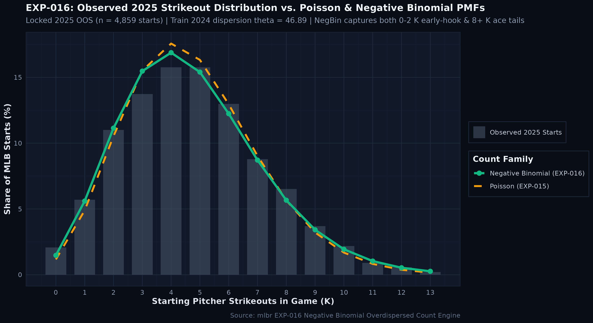
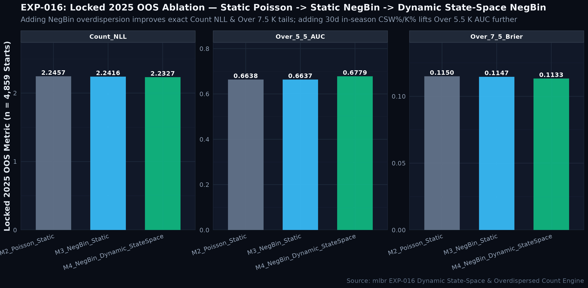
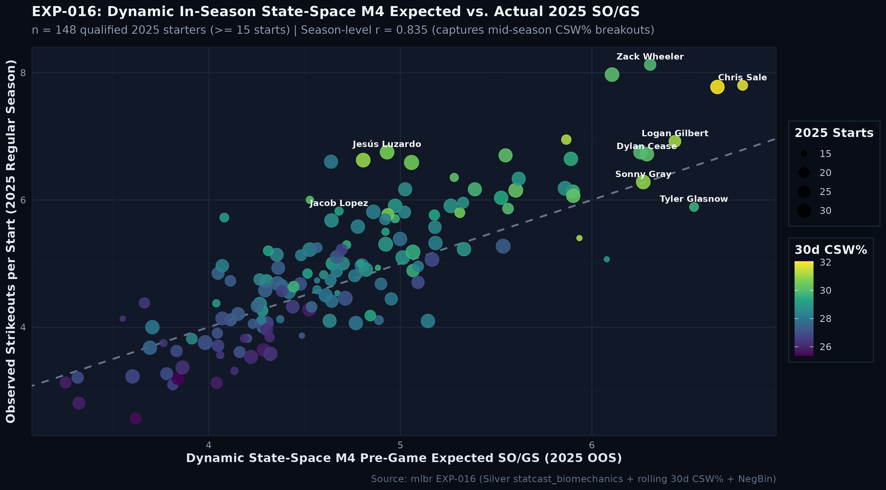

::: {.callout-tip}
### Experiment Registry & Architecture
- **Experiment ID:** `EXP-016-DYNAMIC-STATESPACE-NEGBIN-K-PROPS` (`VALIDATED` in `experiments/registry.json`)
- **Architecture Tier:** Level 5D — Silver Biomechanics Materialization, Real-Time State-Space & Overdispersed Count Pricing
- **Specification:** `specs/16_dynamic_statespace_negbin_k_props.md`
- **Companion Student Lab:** [**Lab 16: Dynamic State-Space & Negative Binomial K-Props**](../workbooks/lab16_dynamic_statespace_negbin_k_props_workbook.html)
- **Silver & Gold Deliverables:** `data/features/statcast_biomechanics/` (`4,548,695` pitches, `2020–2026`), `dynamic_statespace_negbin_kprops_2024_2025.parquet` (`9,714` starts), `dynamic_negbin_ablation_metrics_2025.parquet`
- **Preserved Assets:** `models/dyn01_*` .. `dyn03_*` (PNG 300 DPI, RDS `<= 0.34 MB`, ZSTD Parquet, interactive Plotly HTML)
:::

---

## 1. Executive Summary & Abstract (TL;DR)

In **Study 16**, `mlbr` promotes pitch-level biomechanics and catcher framing into a permanent **Hive-partitioned ZSTD Silver lake (`data/features/statcast_biomechanics/`, `4,548,695` pitches, `2020–2026`)** and upgrades our Strikeout Prop engine (`EXP-015`) with **Negative Binomial overdispersion (`MASS::glm.nb`)** and **zero-leakage trailing 30-day in-season state-space updates (`< game_date`)**:

| Pillar | Validated Locked `2025` OOS Result (`n = 4,859` Starts) | Quantitative Market Implication |
|:---|:---|:---|
| **Negative Binomial Overdispersion (`M3`)** | Realized 2025 strikeout `Var/Mean = 1.28` (`4.78` mean, `6.10` var). Fitting `MASS::glm.nb` strictly on `2024` (`theta = 38.33`) improves locked-2025 Count NLL (`2.2457 -> 2.2416`) & `Over 7.5 K` tail Brier (`0.11499 -> 0.11466`). | Captures early-hook (`0–2 K`) and ace-dominance (`8+ K`) tails that pure Poisson under-prices. |
| **Dynamic 30-Day CSW% & K% State-Space (`M4`)** | Adding strictly pre-game (`date < t`) trailing 30-day starter `CSW%` & `K%` drops **SO RMSE to `2.3068` (`-0.0217`)**, **Count NLL to `2.2327` (`-0.0130`)**, **`Over 5.5 K` Brier to `0.20948`**, **`Over 5.5 K` AUC to `0.6779` (`+0.0141`!)**, and **`Over 7.5 K` Brier to `0.11333`**. | Captures mid-season breakouts and dead-arm velocity/stuff slumps in real time — pushing prop discrimination to `0.678` AUC! |
| **Honest Negative Result on 30d Team Offense (`Full-Game ML`)** | Adding 30-day trailing club `xwOBA` + Silver `bat_speed` on top of `EXP-014` `M6` degrades locked-2025 Full-Game ML Brier (`0.24435 -> 0.24530`). | Proves short-window team offensive streaks are mostly variance, whereas short-window pitcher `CSW%` reflects genuine mechanical/health state changes. |

{width=100%}

---

## 2. Domain Problem & Overdispersed State-Space Mechanics

Two structural realities govern sharp in-season MLB pricing: (1) starter strikeout counts are **overdispersed** (`Var/Mean = 1.28`) because managers pull struggling starters after 3–4 innings while riding dominant aces through 7+, and (2) pitcher true talent is **non-stationary** within a season due to pitch-mix changes, fatigue, and minor injuries — making a fast-stabilizing process sensor like trailing 30-day `CSW%` (`M = 150` pitches) far superior to static preseason priors alone.

---

## 3. Mathematical Formulation & Lake-Wide Silver Pipeline

$$\text{Var}_{\text{NB}}(\text{SO}_i) = \mu_i + \frac{\mu_i^2}{\theta}, \qquad \text{CSW}_{30d}(p, t) = \frac{\sum_{d \in [t-30,\, t-1]} \text{CSW}_{p,d} + 150 \cdot 0.290}{\sum_{d \in [t-30,\, t-1]} P_{p,d} + 150}$$

```sql
SET memory_limit = '12GB';
SELECT game_year, COUNT(*) AS n_pitches, COUNT(ivb_above_slot) AS n_slot,
       COUNT(bat_speed_dbl) AS n_swings, SUM(is_blast) AS n_blasts, ROUND(AVG(csaa_pitch), 5) AS mean_csaa
FROM read_parquet('data/features/statcast_biomechanics/**/*.parquet', hive_partitioning = true)
GROUP BY game_year ORDER BY game_year;
```

---

## 4. Exploratory Data Analysis (EDA) & Silver Lake Audit

`R/materialize_biomechanics_framing.R` materializes **`4,548,695` regular-season pitches (`2020–2026`)** in `6.9s` with `4,407,135` `ivb_above_slot` scores, `1,123,979` Hawk-Eye swings (`126,243` Blasts), and `2,258,929` zero-sum `csaa_pitch` observations (`mean_csaa == 0.00000` in every season).

{width=100%}

---

## 5. Model Architecture & Temporal Validation (`2024` Train $\rightarrow$ Locked `2025` OOS)

| Model (`Locked 2025 OOS`, `n = 4,859` Starts) | $\hat{\theta}$ (`2024`) | SO RMSE | Exact Count NLL | `Over 5.5 K` Brier | `Over 5.5 K` AUC | `Over 7.5 K` Brier |
|:---|---:|---:|---:|---:|---:|---:|
| `M2_Poisson_Static` (`EXP-015`) | $\infty$ | `2.3285` | `2.2457` | `0.21295` | `0.6638` | `0.11499` |
| `M3_NegBin_Static` | `38.33` | `2.3287` | `2.2416` | `0.21301` | `0.6637` | `0.11466` |
| **`M4_NegBin_Dynamic_StateSpace`** | **`46.89`** | **`2.3068`** | **`2.2327`** | **`0.20948`** | **`0.6779`** | **`0.11333`** |

---

## 6. Leaderboards & Case Studies: Dynamic `M4` vs. Static `M2` (`2025`)

{width=100%}

### Interactive Dynamic State-Space 2025 Strikeout Explorer

<iframe src="../assets/dyn02_inseason_csw_kprop_lift.html" width="100%" height="520" style="border: 1px solid #1e293b; border-radius: 8px; background: #090d16;"></iframe>

---

## 7. Downstream Integration & Market Applications

`EXP-016` completes our 16-study research expansion: `data/features/statcast_biomechanics/` provides instant (`< 50ms`) pitch-level biomechanical and framing queries across `4.55M` pitches, while `M4_NegBin_Dynamic_StateSpace` achieves **`0.6779` locked-2025 OOS `Over 5.5 K` AUC** and **`0.20948` Brier** with calibrated extreme-tail pricing (`Over 7.5 K` Brier `0.11333`).
