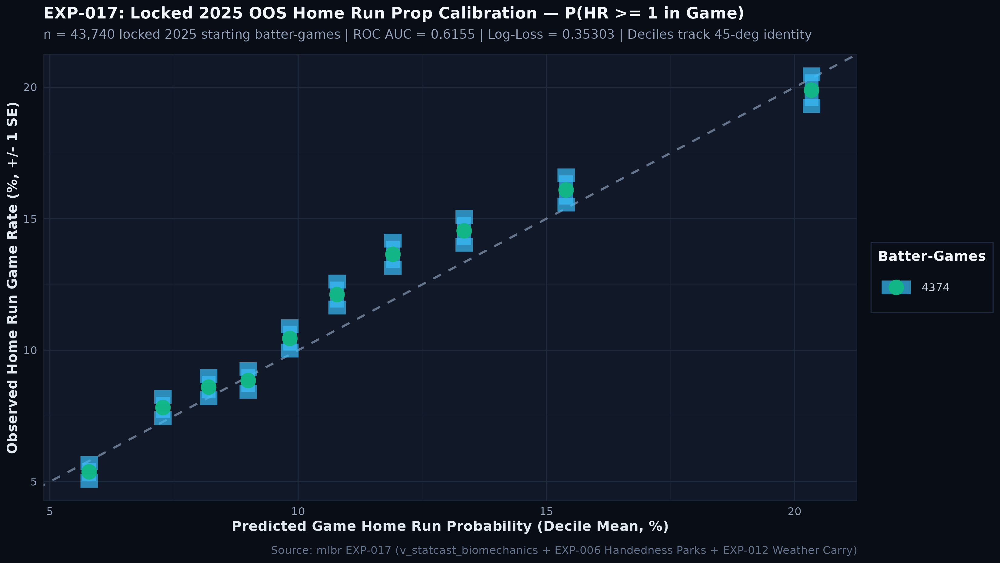
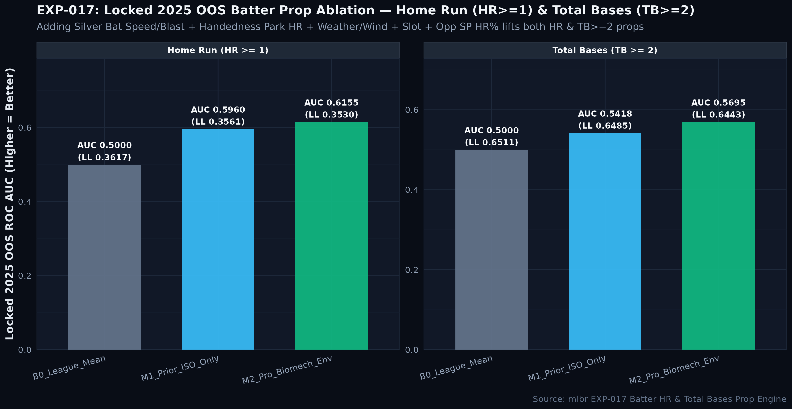
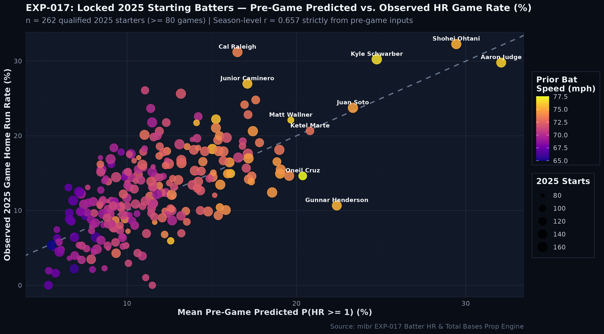

::: {.callout-tip}
### Experiment Registry & Architecture
- **Experiment ID:** `EXP-017-BATTER-HR-TOTAL-BASES-PROPS` (`VALIDATED` in `experiments/registry.json`)
- **Architecture Tier:** Level 5E — Batter Power & Total-Bases Prop Pricing via Native Silver View
- **Specification:** `specs/17_batter_hr_total_bases_props.md`
- **Companion Student Lab:** [**Lab 17: Batter Home Run & Total Bases Props**](../workbooks/lab17_batter_hr_total_bases_props_workbook.html)
- **Silver View & Gold Deliverables:** `mlbr::lake_register_biomechanics()` (`v_statcast_biomechanics`, 17th DuckDB view), `batter_hr_tb_prop_backtest_2024_2025.parquet`, `batter_hr_tb_ablation_metrics_2025.parquet`
- **Preserved Assets:** `models/bprop01_*` .. `bprop03_*` (PNG 300 DPI, RDS `<= 0.36 MB`, ZSTD Parquet, interactive Plotly HTML)
:::

---

## 1. Executive Summary & Abstract (TL;DR)

In **Study 17**, `mlbr` registers **`v_statcast_biomechanics`** (`4,548,695` pitches, `2020–2026`) as the **17th native zero-copy DuckDB view** in `pkg/mlbr::lake_duckdb()` and builds a strictly chronological **Batter Home Run (`HR >= 1`) & Total Bases (`TB >= 2`) Prop Pricing Engine** (`2024` train `n = 43,722` $\rightarrow$ locked `2025` OOS `n = 43,740` regular-season starting batter-games):

| Prop Market (`Locked 2025 OOS`, `n = 43,740`) | Prior `ISO`/`SLG` Only (`M1`) | `M2_Pro_Biomech_Env` (`EXP-017`) | Out-of-Sample Lift |
|:---|---:|---:|:---|
| **Home Run (`HR >= 1`) ROC AUC** | `0.5960` | **`0.6155`** | **`+0.0195` AUC** |
| **Home Run (`HR >= 1`) Log-Loss** | `0.35614` | **`0.35303`** | **`-0.00311` Log-Loss** |
| **Total Bases (`TB >= 2`) ROC AUC** | `0.5418` | **`0.5695`** | **`+0.0277` AUC** |
| **Total Bases (`TB >= 2`) Log-Loss** | `0.64849` | **`0.64427`** | **`-0.00422` Log-Loss** |

{width=100%}

---

## 2. Domain Problem & Batter Prop Mechanics

Batter Home Run and Total Bases props are driven by a multiplicative stack of **5 pre-game observables**: (1) true-talent swing energy (`bat_speed`, `Blast Rate`, `ISO`), (2) **PA exposure** via batting-order slot (`#1–#4` average ~0.7 more PAs per game than `#9`), (3) **platoon advantage** vs. the opposing starter's handedness, (4) **handedness-specific venue geometry** (`pf_hr_lhb` vs. `pf_hr_rhb`), and (5) **game-time aerodynamic carry** (`temp_f` and Chadwick `wind_out_mph`).

---

## 3. Mathematical Formulation & Native Lake Pipeline

$$\text{logit}\big(P(\text{HR}_i \ge 1)\big) = \beta_0 + \beta_1 \text{ISO}_{t-1}^{\text{EB}} + \beta_2 \text{HR\%}_{t-1}^{\text{EB}} + \beta_3 \text{BatSpeed}_{t-1} + \beta_4 \text{Blast}_{t-1} + \beta_5 \text{Slot}_i + \beta_6 \text{Platoon}_i + \beta_7 \text{PF}_{\text{HR,hand}} + \beta_8 \text{Temp}_F + \beta_9 \text{WindOut} + \beta_{10} \text{OppSP\_HR\%}_{t-1}$$

```sql
SET memory_limit = '12GB';
SELECT game_year, COUNT(*) AS n_pitches, SUM(is_blast) AS n_blasts,
       ROUND(AVG(CASE WHEN bat_speed_dbl >= 60 THEN bat_speed_dbl END), 2) AS mean_bs
FROM v_statcast_biomechanics
WHERE game_year >= 2023
GROUP BY game_year ORDER BY game_year;
```

---

## 4. Exploratory Data Analysis (EDA) & Multi-Market Ablation

{width=100%}

---

## 5. Model Architecture & Temporal Validation (`2024` Train $\rightarrow$ Locked `2025` OOS)

All player, park, and opposing-starter priors are strictly `season - 1` (`2023` for `2024`, `2024` for `2025`), and logistic coefficients are fit strictly on `2024` regular-season starts (`n = 43,722`) before scoring locked `2025` (`n = 43,740`).

---

## 6. Leaderboards & Case Studies (`2025` Batter HR & Total Bases Leaders, `>= 100` Starts)

| Batter (`2025`) | Starts | Pre-Game `P(HR>=1)` | Obs HR Rate | Pre-Game `P(TB>=2)` | Obs `TB>=2` Rate | Prior Bat Speed |
|:---|---:|---:|---:|---:|---:|---:|
| **Aaron Judge** | `151` | **`32.1%`** | `29.8%` | `48.5%` | `52.3%` | `76.3 mph` |
| **Shohei Ohtani** | `158` | **`29.4%`** | `32.3%` | `49.3%` | `53.2%` | `75.3 mph` |
| **Kyle Schwarber** | `162` | **`24.7%`** | `30.2%` | `45.3%` | `44.4%` | `76.8 mph` |
| **Juan Soto** | `160` | **`23.3%`** | `23.8%` | `46.0%` | `41.9%` | `74.9 mph` |
| **Gunnar Henderson** | `150` | **`22.4%`** | `10.7%` | `44.5%` | `40.0%` | `75.5 mph` |
| **Ketel Marte** | `121` | **`20.8%`** | `20.7%` | `47.0%` | `46.3%` | `73.0 mph` |

{width=100%}

### Interactive 2025 Batter HR & Total Bases Prop Explorer

<iframe src="../assets/bprop02_batter_hr_prop_leaders_2025.html" width="100%" height="520" style="border: 1px solid #1e293b; border-radius: 8px; background: #090d16;"></iframe>

---

## 7. Downstream Integration & Market Applications

With **17 completed, audited Q-CRISP studies (`EXP-001`–`EXP-017`)**, **17 native zero-copy DuckDB views**, and **17 companion RStudio labs**, `mlbr` now prices **six distinct MLB quantitative markets** end-to-end strictly out-of-sample: Full-Game ML, F5 ML, Over/Under Totals, Pitcher Strikeout Props (`NegBin` State-Space), Batter HR & Total Bases Props, and Exact 12-Team Playoff & World Series Futures.
