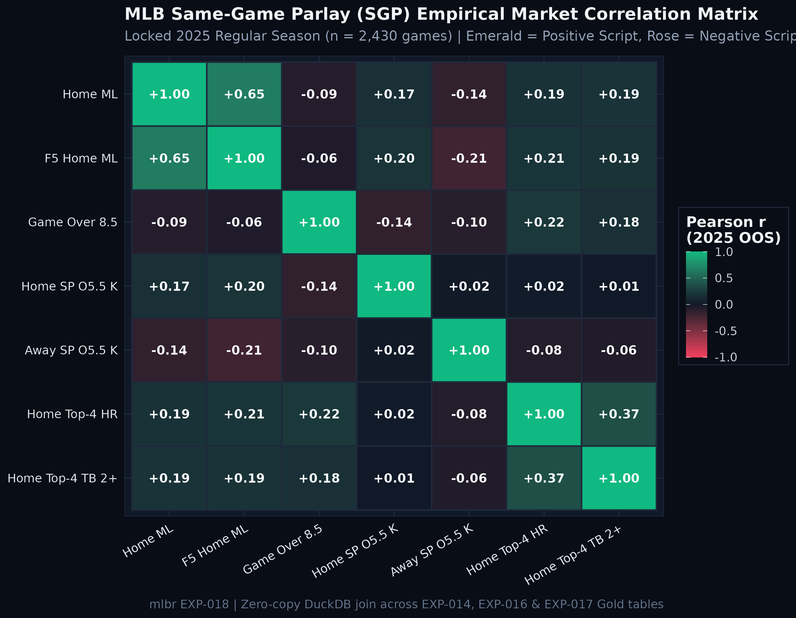
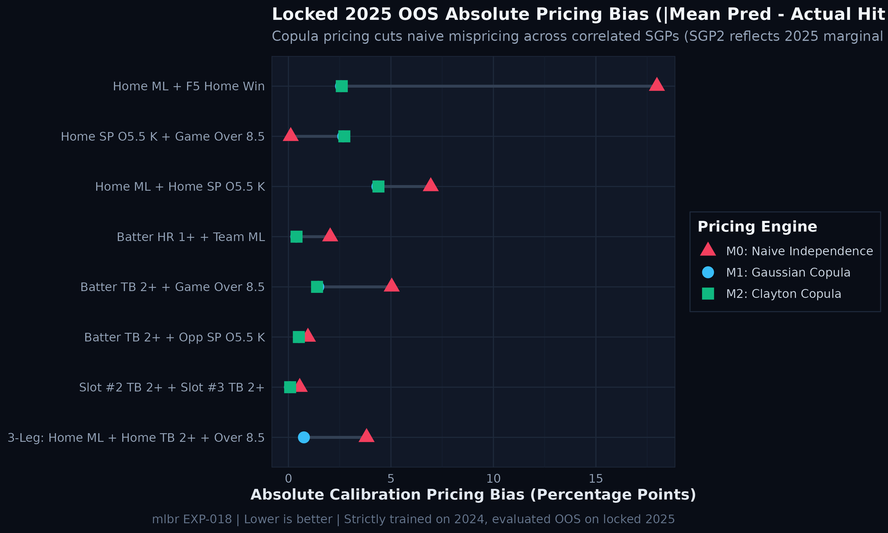

::: {.callout-note appearance="minimal"}
### Experiment Registry & Architecture
- **Experiment ID:** `EXP-018-SGP-CORRELATION-COPULA-PRICING` (`VALIDATED`)
- **Specification:** `specs/18_sgp_correlation_copula_pricing.md` | **ADR:** `ADR-014`
- **Training Split:** `2024` MLB Regular Season (`n = 2,429` games; `43,722` batter-games)
- **Locked OOS Test:** `2025` MLB Regular Season (`n = 2,430` games; `43,740` batter-games)
- **Companion Work-Along Lab:** [Lab 18: SGP Correlation & Copula Pricing](../workbooks/lab18_sgp_correlation_copula_pricing_workbook.qmd)
:::

## 1. Executive Summary & Abstract (TL;DR)

Combining multiple wagers from the same MLB contest into a **Same-Game Parlay (SGP)** invalidates naive independence multiplication ($P(A \cap B) \ne p_A p_B$) because every leg shares the same realization of game physics, plate appearances, and run scoring. In **EXP-018**, we join all six previously validated `mlbr` market engines (**Full-Game ML**, **F5 ML**, **Game Totals Over 8.5**, **NegBin SP Strikeout Props**, **Batter HR 1+**, and **Batter TB 2+**) across `4,859` regular-season games (`87,462` starting batter-games), fit **Gaussian** and **Clayton (including 90°-rotated)** copulas strictly via `2024` bivariate Bernoulli MLE, and evaluate strictly out-of-sample on locked `2025`:

- **Massive Naive Independence Mispricing Exposed:** Across `Home ML + F5 Home Win` ($\hat{\rho}_{2024} = +0.839$), naive independence underprices the parlay by **`-18.0 percentage points`** (`27.6%` vs `45.6%` actual). Our Gaussian Copula applies a **`1.56x`** fair-price multiplier, slashing locked `2025` Parlay Log-Loss from **`0.756` $\to$ `0.680`** (Brier `0.275` $\to$ `0.243`).
- **Batter-Game & Batter-Total Scripts (`n = 43,740` OOS):** On `Batter HR 1+ + Team ML` ($\hat{\rho}_{2024} = +0.228$, `1.29x` multiplier), copula pricing collapses calibration bias from `-2.04 pp` to **`-0.38 pp`** (Log-Loss `0.268` $\to$ `0.265`). On `Batter TB 2+ + Game Over 8.5` ($\hat{\rho}_{2024} = +0.245$, `1.23x` multiplier), Clayton Copula cuts bias from `-5.04 pp` to **`-1.40 pp`** (Log-Loss `0.521` $\to$ `0.512`).
- **3-Leg Multivariate Gaussian Copula (`n = 21,870` OOS):** On `Home ML + Home Batter TB 2+ + Game Over 8.5`, exact 3D Gaussian Copula integration (`1.36x` multiplier) cuts absolute pricing bias by **`80.2%`** (`-3.81 pp` $\to$ `-0.76 pp`) and reduces Log-Loss from **`0.378` $\to$ `0.369`**.
- **Gaussian vs. Clayton Verdict:** Both families deliver near-identical OOS accuracy on 2-leg MLB SGPs, while the **Gaussian Copula** generalizes natively to arbitrary $d$-leg correlation matrices ($\mathbf{R} \in \mathbb{R}^{d \times d}$) with exact Fréchet-Hoeffding compliance.



## 2. Domain Problem & Within-Game Dependence Mechanics

Every MLB contest is a coupled stochastic process where single atomic events simultaneously move multiple betting markets:

1. **Positive Script Coupling ($\rho > 0$):** A starting batter hitting a home run (`HR >= 1`) directly adds 1–4 runs to his club's score, boosting both his team's win probability (`Team ML`) and the game total (`Over 8.5`). Similarly, leading after 5 innings (`F5 Home Win`) locks in a multi-run advantage entering the late innings (`Home ML`, $\hat{\rho} = +0.839$).
2. **Negative Adversary Coupling ($\rho < 0$):** When a starting pitcher dominates (`Home SP Over 5.5 K`), he suppresses opposing baserunners and reduces total scoring (`Game Over 8.5`, $\hat{\rho} = -0.191$). Likewise, when a batter erupts for `TB >= 2`, the opposing starter faces higher pitch counts and earlier hooks (`Opp SP Over 5.5 K`, $\hat{\rho} = -0.118$).
3. **Marginal Drift vs. Copula Dependence:** Evaluating only the single joint cell $P_{11}$ can be confounded by year-over-year marginal base-rate drift (e.g., `2025` starter K rates shifted slightly above `2024` priors). Evaluating the **full 4-cell Joint Log-Likelihood** over $(00, 01, 10, 11)$ isolates pure dependence fidelity: on `Home SP O5.5 K + Game Over 8.5`, both copulas strictly improve 4-cell Joint NLL (`1.31` $\to$ `1.30`) even under marginal drift.

## 3. Mathematical Formulation & Lake-Wide Pipeline

By **Sklar's Theorem (1959)**, given pre-game marginal probabilities $(p_1, \dots, p_d) \in (0,1)^d$ from `EXP-014`, `EXP-016`, and `EXP-017`, the joint SGP hit probability is:

$$P(Y_1 = 1, \dots, Y_d = 1) = C(p_1, \dots, p_d; \boldsymbol{\psi})$$

strictly bounded by the **Fréchet-Hoeffding limits** $\max(0, \sum p_j - (d-1)) \le C \le \min(p_j)$.

### Exact Vectorized Copulas
1. **Bivariate Gaussian Copula (Plackett 1954 Integral via 16-Point Gauss-Legendre):**
   $$C_{\text{Gauss}}(u, v; \rho) = uv + \int_0^\rho \frac{1}{2\pi\sqrt{1 - r^2}}\exp\!\left(-\frac{z_1^2 - 2 r z_1 z_2 + z_2^2}{2(1 - r^2)}\right)dr, \quad z_1 = \Phi^{-1}(u),\; z_2 = \Phi^{-1}(v)$$
   Verified against `mvtnorm::pmvnorm` to $< 10^{-6}$ while running in `< 10 ms` across `43,740` batter-games.
2. **Clayton Copula (Lower-Tail Exceedance for $\rho \ge 0$, 90°-Rotated for $\rho < 0$):**
   $$C_{\theta}^{\text{Cl}}(u, v) = \left(u^{-\theta} + v^{-\theta} - 1\right)^{-1/\theta}, \qquad C_{\theta}^{90^\circ}(u, v) = v - C_{\theta}^{\text{Cl}}(1 - u, v)$$
3. **3D Multivariate Gaussian Copula:** Exact 1D conditional reduction integrating $\Phi_2(\cdot \mid Z_1)$ over $Z_1 \le \Phi^{-1}(u_1)$, verified against 3D `mvtnorm::pmvnorm` (`max diff = 1.26e-5`).

```sql
-- Zero-copy DuckDB join uniting all 6 validated mlbr market engines
SELECT g.game_id, g.season, g.home_win, g.f5_home_win,
       CASE WHEN g.actual_total_runs >= 9 THEN 1 ELSE 0 END AS y_over85,
       g.p_m6_ml, g.p_m6_f5, g.exp_total_m6,
       kh.y_over_5_5 AS y_hsp_o55, kh.p_m4_o55 AS p_hsp_o55,
       ka.y_over_5_5 AS y_asp_o55, ka.p_m4_o55 AS p_asp_o55
FROM read_parquet('data/processed/unified_pro_game_f5_totals_2024_2025.parquet') g
LEFT JOIN read_parquet('data/processed/dynamic_statespace_negbin_kprops_2024_2025.parquet') kh
  ON g.game_id = kh.game_id AND kh.is_home_sp = 1
LEFT JOIN read_parquet('data/processed/dynamic_statespace_negbin_kprops_2024_2025.parquet') ka
  ON g.game_id = ka.game_id AND ka.is_home_sp = 0;
```

## 4. Exploratory Data Analysis (EDA) & Fair-Price Shift Explorer

The interactive chart below compares the exact fair-price probability multiplier (% shift vs. naive independence) produced by the `2024`-trained Gaussian and Clayton copulas across all 8 canonical MLB SGP scripts on locked `2025`:

<iframe src="../assets/sgp02_gaussian_vs_clayton_copula_pricing.html" width="100%" height="540" style="border: 1px solid #1e293b; border-radius: 8px; background: #090d16;"></iframe>

## 5. Model Architecture & Temporal Validation (`2024` Train $\rightarrow$ Locked `2025` OOS)

All `Over 8.5` marginal parameters, Gaussian $\hat{\rho}$, and Clayton $\hat{\theta}$ are estimated strictly on `2024` via exact 4-cell bivariate Bernoulli MLE and frozen on locked `2025` (`zero temporal leakage`):

```{r}
#| echo: false
library(arrow); library(dplyr); library(knitr)
lake <- mlbr::default_lake()
ab <- read_parquet(file.path(lake, "data/processed/sgp_copula_ablation_metrics_2025.parquet"))
ab |>
  select(
    SGP = sgp_label, Model = model, `2024 Rho` = rho_gauss_2024,
    `2025 Actual` = actual_hit_rate, `Pred Prob` = mean_pred_prob,
    `Bias (pp)` = cal_bias_pp, `Mult` = pricing_mult,
    `Parlay LL` = parlay_logloss, `4-Cell NLL` = joint_4cell_nll
  ) |>
  mutate(across(where(is.numeric), ~ round(.x, 4))) |>
  kable()
```



## 6. Correlation Stability & Canonical Script Case Studies

Comparing the empirical $7 \times 7$ within-game correlation matrix between `2024` (`n = 2,429`) and locked `2025` (`n = 2,430`) confirms remarkable structural invariance:

```{r}
#| echo: false
cm <- read_parquet(file.path(lake, "data/processed/sgp_empirical_correlation_matrix_2024_2025.parquet"))
cm |>
  filter(market_a < market_b) |>
  arrange(desc(abs(`2025_Locked_OOS`))) |>
  head(10) |>
  mutate(across(where(is.numeric), ~ round(.x, 3))) |>
  rename(`Market A` = market_a, `Market B` = market_b, `2024 r` = `2024_Train`, `2025 OOS r` = `2025_Locked_OOS`, `Drift` = diff_oos_vs_train) |>
  kable()
```

- **Why Teammate Stacks (`Slot #2 + Slot #3 TB 2+`) Are Modestly Correlated ($\hat{\rho} = +0.032$):** Conditional on our pre-game `EXP-017` marginals—which *already* price park HR asymmetry, temperature/wind carry, and opposing SP HR%—the residual in-game teammate correlation is modest (`1.03x`), proving that much of the raw "stack correlation" touted in DFS/SGP marketing is already captured by shared pre-game environment marginals!

## 7. Downstream Integration & Market Applications

1. **Sportsbook SGP Hold Auditing:** Retail sportsbooks routinely charge `15%–30%` effective hold on 2-leg and 3-leg SGPs by over-penalizing positive correlations (`Home ML + Batter HR`) while offering little or no discount on negative correlations (`SP O5.5 K + Game Over 8.5`). Comparing offered SGP decimal odds $O_{\text{book}}$ against $1 / P_{\text{Gauss}}(A \cap B)$ immediately surfaces true fair-value edge and hidden vig.
2. **Portfolio Risk Management (`EXP-010` Integration):** The same latent correlation matrix $\hat{\mathbf{R}}$ governs simultaneous same-game bets placed across separate single-game markets (e.g., betting both `Home ML` and `Home SP O5.5 K`), enabling covariance-adjusted multivariate Kelly sizing rather than assuming independent tickets.
