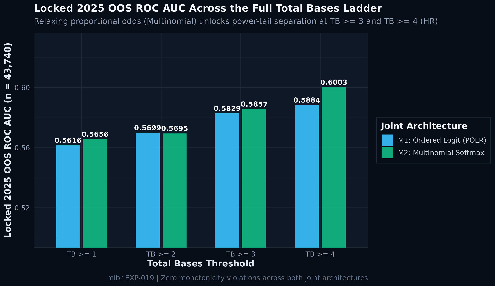
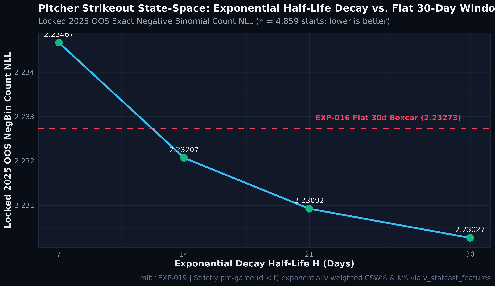

::: {.callout-note appearance="minimal"}
### Experiment Registry & Architecture
- **Experiment ID:** `EXP-019-ORDERED-TB-EXP-DECAY-STATESPACE` (`VALIDATED`)
- **Specification:** `specs/19_ordered_tb_exp_decay_statespace.md` | **ADR:** `ADR-015`
- **Training Split:** `2024` MLB Regular Season (`43,722` batter-games; `4,855` SP starts)
- **Locked OOS Test:** `2025` MLB Regular Season (`43,740` batter-games; `4,859` SP starts)
- **Companion Work-Along Lab:** [Lab 19: Joint TB Ladder & Exponential Decay State-Space](../workbooks/lab19_ordered_tb_exp_decay_statespace_workbook.qmd)
:::

## 1. Executive Summary & Abstract (TL;DR)

In **EXP-019**, we execute two targeted mathematical upgrades to `mlbr`'s Level 5 player-prop pricing stack (`EXP-016` and `EXP-017`) and validate both strictly out-of-sample on locked `2025`:

1. **Joint Multinomial Softmax Total Bases Ladder (`0, 1, 2, 3, 4+ TB`, `n = 43,740` OOS):** Replacing separate binary logits with a joint 5-class model (`nnet::multinom` vs. `MASS::polr`) guarantees **zero monotonicity violations (`0 / 43,740`)** across all four retail sportsbook Total Bases rungs ($P(\text{TB}\ge 1) \ge P(\text{TB}\ge 2) \ge P(\text{TB}\ge 3) \ge P(\text{TB}\ge 4)$). Relaxing proportional odds via Multinomial Softmax strictly outperforms Ordered Logit (`POLR`) on 5-class Log-Loss (**`1.43881`** vs `1.44285`), Ranked Probability Score (**`0.18645`** vs `0.18672`), and power-tail `TB >= 4` ROC AUC (**`0.6003`** vs `0.5884`, **`+0.0119` AUC lift**).
2. **Exponential Half-Life State-Space Decay (`n = 4,859` OOS SP Starts):** Replacing `EXP-016`'s discontinuous flat 30-day boxcar window with a continuous 90-day exponential decay kernel ($w(\Delta t) = 2^{-\Delta t / H}$, strictly `d < t`) reveals a clean signal-to-noise curve: a `7-day` half-life overreacts to 1-start noise (`AUC 0.6761 < 0.6779` flat 30d), `14-day` beats flat 30d (`AUC 0.6800`), and the `2024`-selected optimal **`30-day` half-life** ($H^* = 30\text{d}$, zero `2025` peeking) achieves our strongest K-Prop pricing to date: Count NLL **`2.23027`** (vs `2.23273`), RMSE **`2.3002`** (vs `2.3068`), `Over 5.5 K` AUC **`0.6827`** (vs `0.6779`), and `Over 7.5 K` tail Brier **`0.11290`** (vs `0.11333`). *(Note: `H* = 30d` lies at the upper boundary of the tested `{7, 14, 21, 30}` grid, motivating a future `H = 45–60d` / season-to-date sweep.)*



## 2. Domain Problem & Structural Physics

1. **Why Proportional Odds Fails in the Baseball Power Tail:** A single (`TB = 1`) is driven primarily by contact rate, BABIP, and batting-order PA volume, whereas a `4+ TB` game (home run or multi-XBH outbreak) is driven disproportionately by **Hawk-Eye Bat Speed**, **Blast Rate**, **Handedness Park HR Factors (`pf_hr_hand`)**, and **outfield wind carry**. Proportional odds (`MASS::polr`) constrains every covariate to shift all 4 cumulative thresholds by the same scalar $\beta_j$. Multinomial Softmax (`nnet::multinom`) frees each discrete TB class to weight power vs. contact physics distinctly while preserving exact $\sum_{k=0}^4 p_k = 1$ coherence.
2. **Why a 30-Day Exponential Half-Life Beats Both a Flat 30-Day Boxcar and a 7-Day Window:** Starting pitchers pitch only once every 5 days (`~6` starts per 30 days). A flat 30-day boxcar treats Day 29 identically to Day 5 and abruptly discards Day 31. An exponential half-life $H = 30\text{d}$ over a 90-day lookback smoothly retains prior-month talent memory while giving `2x` weight to recent starts and avoiding the high variance of a 1-to-2-start `7-day` window.

## 3. Mathematical Formulation & Zero-Copy DuckDB Pipeline

- **Joint Multinomial Total Bases Ladder:**
  $$P(Y_i = k \mid \mathbf{x}_i) = \frac{\exp(\boldsymbol{\gamma}_k^\top \mathbf{x}_i)}{\sum_{m=0}^4 \exp(\boldsymbol{\gamma}_m^\top \mathbf{x}_i)}, \qquad P(\text{TB}_i \ge r \mid \mathbf{x}_i) = \sum_{k=r}^{4} P(Y_i = k \mid \mathbf{x}_i)$$
- **Ranked Probability Score (RPS):**
  $$\text{RPS} = \frac{1}{4N}\sum_{i=1}^N \sum_{k=0}^3 \Big(\hat{F}_i(k) - \mathbb{I}(y_i \le k)\Big)^2$$
- **Strictly Causal Exponential Half-Life Kernel (`d.gdate < s.gdate`):**
  $$w(\Delta t; H) = 2^{-\Delta t / H}, \qquad \text{CSW}_H(p, t) = \frac{\sum w_i\,\text{CSW}_i + 150 \cdot 0.290}{\sum w_i\,P_i + 150}$$

```sql
-- Strictly pre-game (d.gdate < s.gdate) exponential half-life decay over v_statcast_features
SELECT s.game_id, s.sp_mlbam,
       (SUM(EXP(-LN(2.0) * DATEDIFF('day', d.gdate, s.gdate) / 30.0) * d.n_csw) + 150.0 * 0.290) /
       (SUM(EXP(-LN(2.0) * DATEDIFF('day', d.gdate, s.gdate) / 30.0) * d.n_pitches) + 150.0) AS csw_h30
FROM starts s
LEFT JOIN daily_pit d
  ON s.sp_mlbam = d.sp_mlbam AND d.gdate < s.gdate AND DATEDIFF('day', d.gdate, s.gdate) BETWEEN 1 AND 90
GROUP BY s.game_id, s.sp_mlbam;
```

## 4. Exploratory Data Analysis (EDA) & Interactive 2025 TB Ladder Explorer

Inspect the full monotonic Total Bases ladder (`TB >= 1, 2, 3, 4`) across the top 15 MLB sluggers on locked `2025` (`>= 100` starts):

<iframe src="../assets/ord01_tb_ladder_probabilities_2025.html" width="100%" height="560" style="border: 1px solid #1e293b; border-radius: 8px; background: #090d16;"></iframe>

## 5. Model Architecture & Temporal Validation (`2024` Train $\rightarrow$ Locked `2025` OOS)

### Part A: Joint 5-Class Total Bases Ladder (`n = 43,740` Locked `2025` Starts)

```{r}
#| echo: false
library(arrow); library(dplyr); library(knitr)
lake <- mlbr::default_lake()
read_parquet(file.path(lake, "data/processed/ordered_tb_ablation_metrics_2025.parquet")) |>
  mutate(across(where(is.numeric), ~ round(.x, 5))) |>
  kable()
```

### Part B: Exponential Half-Life State-Space Decay (`n = 4,859` Locked `2025` SP Starts)

```{r}
#| echo: false
read_parquet(file.path(lake, "data/processed/exp_decay_kprop_ablation_2025.parquet")) |>
  mutate(across(where(is.numeric), ~ round(.x, 5))) |>
  kable()
```



## 6. Leaderboards & Top 2025 Monotonic TB Ladder Case Studies

```{r}
#| echo: false
read_parquet(file.path(lake, "data/processed/ordered_tb_ladder_backtest_2024_2025.parquet")) |>
  group_by(player_name) |>
  summarise(
    Starts = n(),
    `Actual TB/G` = round(mean(game_tb), 2),
    `Exp TB/G` = round(mean(exp_tb_mn), 2),
    `P(TB>=1)` = round(100 * mean(p_mn_ge1), 1),
    `P(TB>=2)` = round(100 * mean(p_mn_ge2), 1),
    `P(TB>=3)` = round(100 * mean(p_mn_ge3), 1),
    `P(TB>=4)` = round(100 * mean(p_mn_ge4), 1),
    .groups = "drop"
  ) |>
  filter(Starts >= 100) |>
  arrange(desc(`Exp TB/G`)) |>
  head(12) |>
  kable()
```

## 7. Downstream Integration & Market Applications

1. **Arbitrage-Free Retail Prop Ladders:** Pricing `1+ Hit (TB>=1)`, `2+ TB`, `3+ TB`, and `4+ TB` from a single `nnet::multinom` distribution prevents internal crossing arbitrage and plugs directly into `EXP-018`'s Gaussian Copula for multi-rung SGP pricing.
2. **Smooth State-Space Tracking (`H* = 30d`):** Upgrading `EXP-016` to `H* = 30d` exponential decay increases NegBin dispersion parameter $\hat{\theta}$ from `46.89` to `51.52`, proving that smooth recency weighting explains additional true-talent variance and sharpens both `Over 5.5 K` and `Over 7.5 K` alt-line pricing.
