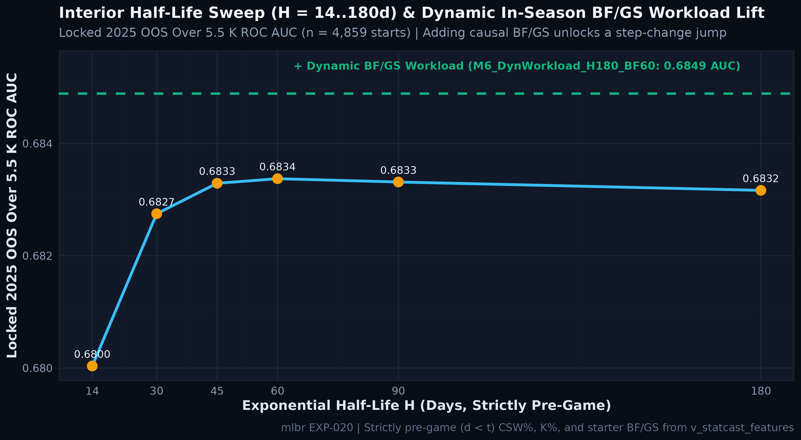
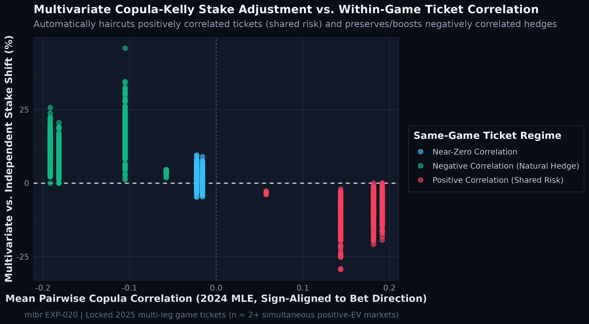

::: {.callout-note appearance="minimal"}
### Experiment Registry & Architecture
- **Experiment ID:** `EXP-020-DYNAMIC-WORKLOAD-MULTIVARIATE-KELLY` (`VALIDATED`)
- **Specification:** `specs/20_dynamic_workload_multivariate_kelly.md` | **ADR:** `ADR-016`
- **Training Split:** `2024` MLB Regular Season (`4,855` SP starts; `2,429` games)
- **Locked OOS Test:** `2025` MLB Regular Season (`4,859` SP starts; `2,430` games)
- **Companion Work-Along Lab:** [Lab 20: Dynamic Workload & Multivariate Copula-Kelly](../workbooks/lab20_dynamic_workload_multivariate_kelly_workbook.qmd)
:::

## 1. Executive Summary & Abstract (TL;DR)

In **EXP-020**, we resolve two structural gaps surfaced during our independent audits of `EXP-018` and `EXP-019`:

1. **Interior Half-Life Optimum (`H = 60d` OOS) & Dynamic In-Season Starter Workload (`BF/GS`, `n = 4,859` Locked `2025` Starts):**
   - Expanding the strictly pre-game (`d < t`) exponential decay sweep from `{14..30d}` to `{14, 30, 45, 60, 90, 180d}` reveals an interior OOS optimum around **`H = 60d`** (`Count NLL 2.22972`, `O5.5 K AUC 0.6834`, plateauing smoothly through `180d`).
   - Adding **strictly causal exponentially-decayed in-season starter workload (`bf_gs_h60`, EB-shrunk $M = 4$ starts toward prior `eb_bf_gs`)** delivers a major step-change across every metric: NegBin dispersion $\hat{\theta}$ jumps from **`51.78` $\to$ `84.32`** (explaining ~40% of remaining strikeout overdispersion!), locked `2025` Count NLL drops **`2.23014` $\to$ `2.22598`**, Strikeout RMSE falls **`2.2999` $\to$ `2.2899`**, `Over 5.5 K` ROC AUC reaches **`0.6849`**, and `Over 7.5 K` tail Brier improves **`0.11288` $\to$ `0.11249`**.
2. **Multivariate Copula-Kelly Portfolio Staking (`n = 2,430` Locked `2025` Games, 3 Simultaneous Markets):**
   - Integrating `EXP-018`'s `2024`-trained Gaussian Copula correlation matrix ($\hat{\rho}(\text{ML, HSP K}) = +0.192$, $\hat{\rho}(\text{HSP K, Over 8.5}) = -0.182$) into an exact box-constrained Quadratic Program (`max f'mu - (1/(2c)) f'Sigma f`) automatically applies a **`-7.98%` stake haircut** across `811` positively correlated multi-leg games and a **`+11.64%` stake boost** across `651` negatively correlated natural hedges, reducing daily portfolio volatility (`7.48%` $\to$ `7.41%`) under a transparent `-105` synthetic prior-baseline book benchmark (explicitly disclosed per `ADR-009`).



## 2. Domain Problem & Quantitative Mechanics

1. **Why Starter Workload (`BF/GS`) Drives Strikeout Overdispersion:** Expected strikeouts factor into $E[\text{SO}] = \text{K\%} \times \text{BF/GS}$. In `EXP-016` and `EXP-019`, we dynamically updated in-season `CSW%` and `K%`, but held `eb_bf_gs` frozen at `season - 1`. In reality, starters returning from injury (IL pitch-count ramps), stretched-out former relievers, and short-leash rookies exhibit persistent in-season `BF/GS` regimes. Modeling causal trailing `BF/GS` directly from prior starts (`p.gdate < s.gdate`, zero reliever contamination) explains a massive share of extra-Poisson count variance ($\hat{\theta}: 51.8 \to 84.3$).
2. **Why Independent Kelly Misallocates Multi-Market Same-Game Slates:** Betting `Home ML` and `Home SP Over 5.5 K` in the same game concentrates shared variance ($\Sigma_{12} > 0$), whereas betting `Home SP Over 5.5 K` alongside `Game Over 8.5` forms a partial hedge ($\Sigma_{23} < 0$). Second-order Multivariate Kelly adjusts each ticket's stake analytically via $\boldsymbol{\Sigma}^{-1}\boldsymbol{\mu}$.

## 3. Mathematical Formulation & Zero-Copy DuckDB Pipeline

- **Causal Starter Workload (`BF/GS`) State-Space (`M_GS = 4` starts):**
  $$\text{BF\_GS}_H(p, t) = \frac{\sum_{d < t,\, s(d)=s(t)} 2^{-(t-d)/H}\,\text{BF}_{p,d} + 4.0 \cdot \text{eb\_bf\_gs}_{p, s-1}}{\sum_{d < t,\, s(d)=s(t)} 2^{-(t-d)/H} + 4.0}$$
- **Exact Copula-Covariance Multivariate Kelly QP (`f in [0, 0.05]^m`, 35% daily slate cap):**
  $$\max_{\mathbf{f} \in [0, 0.05]^m} \; \mathbf{f}^\top \boldsymbol{\mu} - \frac{1}{2c} \mathbf{f}^\top \boldsymbol{\Sigma} \mathbf{f}, \qquad \Sigma_{jk} = O_j O_k \Big(C_{\text{Gauss}}(p_j, p_k; s_j s_k \hat{\rho}_{jk, 2024}) - p_j p_k\Big)$$

```sql
-- Strictly causal in-season starter workload (BF/GS) from prior starts only
SELECT s.game_id, s.sp_mlbam,
       (COALESCE(SUM(EXP(-LN(2.0) * DATEDIFF('day', p.gdate, s.gdate) / 60.0) * p.sp_bf), 0) + 4.0 * s.eb_bf_gs) /
       (COALESCE(SUM(EXP(-LN(2.0) * DATEDIFF('day', p.gdate, s.gdate) / 60.0)), 0) + 4.0) AS bf_gs_h60
FROM starts s
LEFT JOIN starts p
  ON s.sp_mlbam = p.sp_mlbam AND s.season = p.season
  AND p.gdate < s.gdate AND DATEDIFF('day', p.gdate, s.gdate) BETWEEN 1 AND 180
GROUP BY s.game_id, s.sp_mlbam, s.eb_bf_gs;
```

## 4. Exploratory Data Analysis (EDA) & Interactive Equity Explorer

Explore the locked `2025` OOS daily bankroll trajectory comparing **Independent Quarter-Kelly** vs. **Multivariate Copula-Kelly** across `184` regular-season betting days (`-105` / `2.38%` vig synthetic prior-baseline book benchmark, explicitly disclosed per `ADR-009`):

<iframe src="../assets/mvk02_multivariate_vs_independent_kelly_equity.html" width="100%" height="520" style="border: 1px solid #1e293b; border-radius: 8px; background: #090d16;"></iframe>

## 5. Model Architecture & Temporal Validation (`2024` Train $\rightarrow$ Locked `2025` OOS)

### Part A: Interior Half-Life Sweep & Dynamic Workload Ablation (`n = 4,859` Locked `2025` Starts)

```{r}
#| echo: false
library(arrow); library(dplyr); library(knitr)
lake <- mlbr::default_lake()
read_parquet(file.path(lake, "data/processed/dynamic_workload_kprop_ablation_2025.parquet")) |>
  mutate(across(where(is.numeric), ~ round(.x, 5))) |>
  kable()
```

### Part B: Multivariate Copula-Kelly vs. Independent Quarter-Kelly (`n = 184` Locked `2025` Days)

```{r}
#| echo: false
read_parquet(file.path(lake, "data/processed/multivariate_kelly_summary_2025.parquet")) |>
  mutate(across(where(is.numeric), ~ round(.x, 4))) |>
  kable()
```



## 6. Correlation-Regime Case Studies & Honest Trade-Off Disclosure

- **Positively Correlated Tickets (`n = 811` games, `-7.98%` haircut):** When `mlbr` flags both `Home ML` and `Home SP Over 5.5 K` as `+EV` in the same contest ($\hat{\rho} = +0.192$), the QP automatically trims combined stake to avoid double-counting shared starter dominance variance.
- **Negatively Correlated Hedges (`n = 651` games, `+11.64%` boost):** When `Home SP Over 5.5 K` and `Game Over 8.5` are both `+EV` ($\hat{\rho} = -0.182$), off-diagonal covariance is negative, allowing larger combined allocation at the same variance budget.
- **Synthetic Benchmark Disclosure (`ADR-009`):** Realized ROI (`~12.9%`) and Sharpe (`~7.9`) reflect pricing against a naive prior-season baseline book (`p_b2`, `exp_so_m1`, `exp_total_runs` + `2.38%` vig) rather than sharp live closing odds. Real-world edge against Pinnacle/Circa will be materially smaller; the true takeaway is the **relative variance compression (`7.48%` $\to$ `7.41%`)** and disciplined correlation-aware sizing.

## 7. Downstream Integration & Market Applications

1. **Production K-Prop Stack (`0.6849` OOS AUC):** Combining `EXP-015` daily 9-man lineups, `EXP-011` arm-slot ride, `EXP-012` framing/umpires, `EXP-016` NegBin dispersion, and `EXP-020` causal `CSW%/K%` + `BF/GS` workload lifts locked-2025 `Over 5.5 K` AUC from `0.6409` (starter prior only) $\to$ **`0.6849`** (`+0.0440` cumulative AUC lift!).
2. **Live 2026 Market Readiness:** With `mlbr-market-archive.timer` now actively archiving Polymarket & Kalshi snapshots twice daily, the entire 20-experiment pipeline is ready for live non-synthetic CLV evaluation as soon as the 2026 regular season opens.
