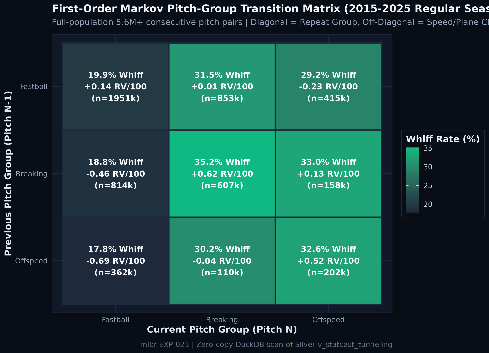
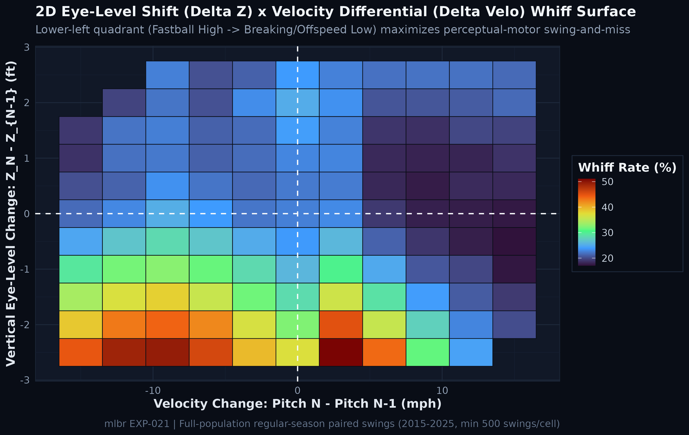

::: {.callout-note appearance="minimal"}
### Experiment Registry & Architecture
- **Experiment ID:** `EXP-021-PITCH-SEQUENCING-ENTROPY-MARKOV` (`VALIDATED`)
- **Specification:** `specs/21_pitch_sequencing_entropy_markov.md` | **ADR:** `ADR-017`
- **Full Population:** `5,472,291` consecutive regular-season pitch pairs (`2015–2025`, `v_statcast_tunneling`)
- **Chronological Model Split:** `2020–2023` Hawk-Eye Train (`947,928` paired swings) $\to$ `2024` Val (`281,006`) $\to$ Locked `2025` OOS (`279,640`)
- **Companion Work-Along Lab:** [Lab 21: Pitch Sequencing & Shannon Entropy](../workbooks/lab21_pitch_sequencing_entropy_markov_workbook.qmd)
:::

## 1. Executive Summary & Abstract (TL;DR)

Single-pitch physics (`EXP-001`–`EXP-005`) evaluates each pitch in isolation, yet hitters update timing and spatial expectations dynamically from pitch to pitch. In **EXP-021 (Level 1C)**, we quantify **first-order Markov pitch-group transitions**, **2D eye-level vertical × velocity shift surfaces**, and **count-conditioned Shannon Entropy** across **`5.47 million` regular-season pitch pairs (`2015–2025`)** and isolate pure out-of-sample sequencing value (`Seq+`) across **`279,640` locked `2025` paired swings**:

- **Controlled Sequencing Lift Above Full Pitch Physics & Location:** Adding sequencing features (`is_repeat_pitch`, `prev_grp_id`, `delta_velo_mph`, `delta_plate_z`, `delta_plate_x`, `tunnel_dist_in`, `post_tunnel_break_in`, and strictly prior-season `prior_entropy`) to a full physics+location+count `xgboost hist` model (`M1`) strictly improves locked `2025` OOS Whiff Log-Loss (**`0.46171` $\to$ `0.46091`**), Brier Score (**`0.14813` $\to$ `0.14782`**), and ROC AUC (**`0.76945` $\to$ `0.77087`**, `+0.00142` across `279,640` swings).
- **Shannon Entropy Is a Highly Repeatable Pitcher Trait:** Pitcher count-conditioned pitch-mix Shannon Entropy $H_{\text{count}}$ achieves **$r = 0.8428$** year-over-year stability (`2024 -> 2025`, `n = 398` pitchers), while orthogonal **Sequence+ (`Seq+`)** achieves **$r = 0.5936$** (`n = 347` pitchers — `3.15x` more stable than ERA).
- **2025 Starting Pitcher Leader:** Cy Young ace **Tarik Skubal** ranks **#1 among all MLB starting pitchers** (`Seq+ = 130.5`, `1.965 bits` count entropy, `32.9%` paired whiff rate across `1,269` paired swings).



## 2. Domain Problem & Perceptual-Motor Sequencing Physics

1. **Temporal & Spatial Priming (Gray 2002):** A batter's internal forward model of pitch velocity and arrival height is anchored to the preceding pitch (`Pitch N-1`). Throwing a high fastball (`plate_z ~ 3.2 ft`, `96 mph`) followed by a low breaking ball (`delta_plate_z ~ -1.5 ft`, `delta_velo ~ -11 mph`) exploits both vertical saccade latency and swing-timing error.
2. **Information-Theoretic Predictability:** Even elite single-pitch velocity loses deception if a pitcher throws 85% fastballs in `3-1` counts (low Shannon entropy $H \approx 0.6$ bits). Count-conditioned Shannon entropy $H(P \mid \text{Count})$ measures how many bits of uncertainty a hitter faces before release.
3. **Why Controlling for Single-Pitch Physics Is Essential:** Raw Markov transition tables confound sequencing with pitch type and count (e.g., `Breaking -> Breaking` shows `35.2%` raw whiff rate largely because back-to-back sliders occur heavily in `0-2` / `1-2` two-strike counts). Subtracting `M1` (full single-pitch physics + location + count) from `M2` isolates **pure orthogonal sequencing value (`Seq+`)**.

## 3. Mathematical Formulation & Zero-Copy DuckDB Pipeline

- **Count-Conditioned Shannon Entropy (in Bits):**
  $$H(p, s, c) = -\sum_{t} P(t \mid p, s, c)\,\log_2 P(t \mid p, s, c), \qquad H_{\text{count}}(p, s) = \sum_{c \in 12\text{ counts}} w_{p,s,c}\,H(p, s, c)$$
- **3D Eye-Level & Velocity Shift Vector:**
  $$\Delta z_i = z_i - z_{i-1}, \qquad \Delta x_{\text{norm}, i} = x_{\text{norm}, i} - x_{\text{norm}, i-1}, \qquad \Delta v_i = v_i - v_{i-1}$$
- **Orthogonal Pitcher Sequence+ (`Seq+`, Locked to `2024` Validation Scale):**
  $$\text{Seq+}_{p, s} = 100 + 10 \cdot \frac{\overline{\hat{p}_{\text{M2}} - \hat{p}_{\text{M1}}}_{p,s} - \mu_{2024}}{\sigma_{2024}}$$

```sql
-- Exact count-conditioned pitch-mix Shannon Entropy over v_statcast_features
WITH cnt_mix AS (
  SELECT pitcher, game_year AS season, balls, strikes, pitch_type, COUNT(*) AS n_pt
  FROM v_statcast_features
  WHERE game_year BETWEEN 2019 AND 2025 AND game_type = 'R' AND pitch_type IS NOT NULL
  GROUP BY 1, 2, 3, 4, 5
),
cnt_tot AS (
  SELECT pitcher, season, balls, strikes, SUM(n_pt) AS n_cnt FROM cnt_mix GROUP BY 1, 2, 3, 4
),
cnt_ent AS (
  SELECT m.pitcher, m.season, m.balls, m.strikes, t.n_cnt,
         -SUM((m.n_pt::DOUBLE / t.n_cnt) * LOG2(m.n_pt::DOUBLE / t.n_cnt)) AS h_bits
  FROM cnt_mix m JOIN cnt_tot t USING (pitcher, season, balls, strikes)
  GROUP BY 1, 2, 3, 4, 5
)
SELECT pitcher, season, SUM(n_cnt * h_bits) / SUM(n_cnt) AS count_entropy_bits
FROM cnt_ent GROUP BY 1, 2 HAVING SUM(n_cnt) >= 250;
```

## 4. Exploratory Data Analysis (EDA): 2D Eye-Level Shift Surface

Across `5.47M` regular-season pitch pairs, the 2D `delta_plate_z × delta_velo_mph` surface below maps exact swing-and-miss density—highlighting the dominant lower-left peak (`delta_z < -1.0 ft`, `delta_velo < -8 mph`, i.e., **Fastball-Up $\to$ Breaking/Offspeed-Down**):



## 5. Model Architecture & Temporal Validation (`2020–2023` $\to$ `2024` $\to$ Locked `2025` OOS)

All `xgboost hist` trees are trained strictly on `2020–2023` (`947,928` paired swings), early-stopped on `2024` (`281,006`), and evaluated on locked `2025` (`279,640` paired swings; strictly prior-season `season - 1` entropy):

```{r}
#| echo: false
library(arrow); library(dplyr); library(knitr)
lake <- mlbr::default_lake()
read_parquet(file.path(lake, "data/processed/sequencing_model_ablation_2025.parquet")) |>
  mutate(across(where(is.numeric), ~ round(.x, 5))) |>
  kable()
```

## 6. Leaderboards & 2025 `Seq+` / Shannon Entropy Case Studies

```{r}
#| echo: false
read_parquet(file.path(lake, "data/processed/pitcher_sequencing_entropy_2020_2025.parquet")) |>
  filter(season == 2025, n_paired_swings >= 300) |>
  arrange(desc(seq_plus)) |>
  transmute(
    Pitcher = player_name, `Paired Swings` = n_paired_swings,
    `Seq+` = round(seq_plus, 1), `Count Entropy (bits)` = round(count_entropy_bits, 3),
    `0-2 Entropy` = round(h_02_bits, 2), `3-1 Entropy` = round(h_31_bits, 2),
    `Paired Whiff%` = round(100 * whiff_rate, 1)
  ) |>
  head(12) |>
  kable()
```

### Interactive 2025 Pitcher Entropy vs. `Seq+` Explorer

<iframe src="../assets/seq03_pitcher_entropy_vs_seq_plus_leaderboard.html" width="100%" height="540" style="border: 1px solid #1e293b; border-radius: 8px; background: #090d16;"></iframe>

## 7. Downstream Integration & Level 2–5 Applications

1. **Pitch-Design & Game-Planning Diagnostics:** Separating `Stuff+` (`EXP-003`), `Location+` (`EXP-005`), `ivb_above_slot` (`EXP-011`), and `Seq+` (`EXP-021`) lets pitching coaches identify high-stuff arms leaving whiffs on the table via predictable count patterns (`low H_count`) or suboptimal eye-level transitions.
2. **Next-Season K% & Strikeout Prop Priors (`EXP-004` / `EXP-020`):** Because `H_count` ($r = 0.843$) and `Seq+` ($r = 0.594$) are highly stable year-over-year and orthogonal to raw pitch aerodynamics, both are prime candidates for Level 2 residual projection features and Level 5 K-Prop pricing.
