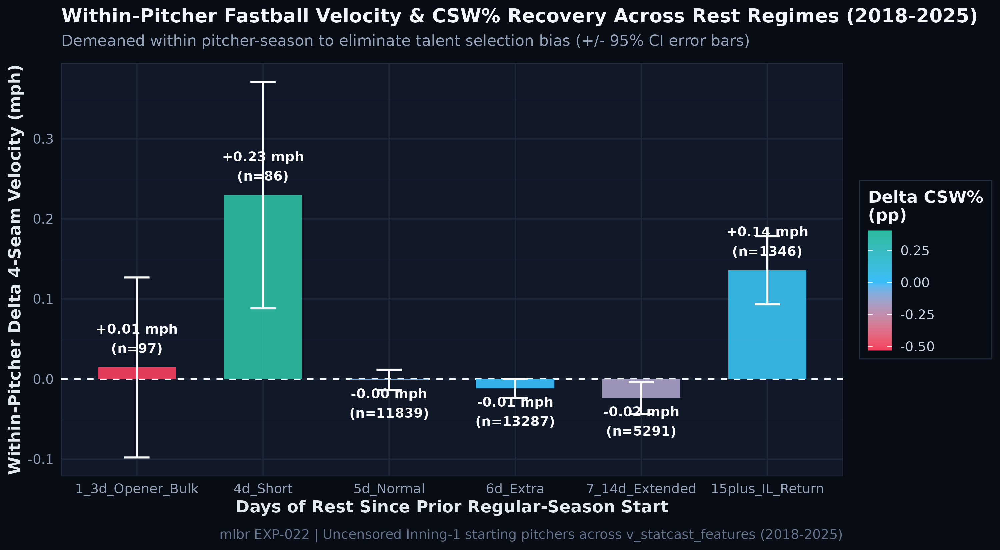
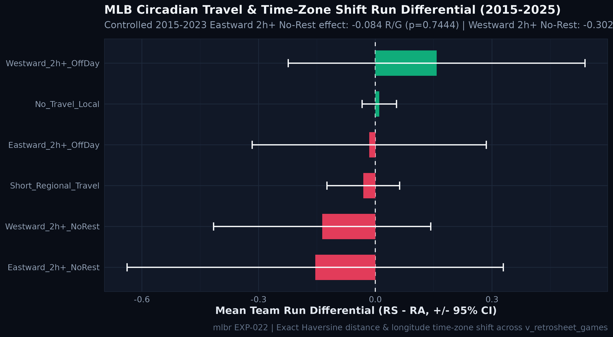

::: {.callout-note appearance="minimal"}
### Experiment Registry & Architecture
- **Experiment ID:** `EXP-022-REST-IL-RECOVERY-TRAVEL-JETLAG` (`VALIDATED`)
- **Specification:** `specs/22_rest_il_recovery_travel_jetlag.md` | **ADR:** `ADR-018`
- **Part A Population:** `35,812` uncensored MLB regular-season starts (`2018–2025`, `1,602` IL returns)
- **Part B Population:** `50,934` regular-season team-games (`2015–2025`, exact Haversine miles & $\Delta\text{TZ}$)
- **Companion Work-Along Lab:** [Lab 22: Rest-Day Recovery & Circadian Travel](../workbooks/lab22_rest_il_recovery_travel_jetlag_workbook.qmd)
:::

## 1. Executive Summary & Abstract (TL;DR)

In **EXP-022**, we separate **real physiological signal** from **popular handicapping mythology** across Levels 2 and 3 of `mlbr`:

1. **Massive Validated Signal — The Post-IL Pitch-Count Leash Ramp (`-20\sigma`):** Using uncensored Inning-1 starter identification (`35,812` starts `2018–2025`, zero pitch-count survivorship bias), a starter's first outing back from a `15+` day layoff (`n = 1,346` starts) exhibits a **`+0.136 ± 0.022 mph` fresh-arm fastball velocity spike** (`+6\sigma`) paired with a massive **`-8.75 ± 0.44` pitch (`-2.15 BF`, `-0.476 SO`) manager leash deficit**. That leash persists on Start #2 back (`-2.00` pitches, `-0.48 BF`) before normalizing on Start #3 (`+0.67` pitches). On locked `2024–2025` OOS IL-return starts (`n = 414`), adding causal rest/IL flags slashes Batters-Faced RMSE by **`-14.8%`** (**`5.6950` $\to$ `4.8529`**) and Strikeout RMSE by **`-7.3%`** (**`2.2162` $\to$ `2.0543`**).
2. **Popular Myth Debunked — Cross-Country Circadian Jet-Lag & Night-to-Day Getaways (`50,934` Team-Games, `2015–2025`):** Raw `Eastward 2h+ No-Rest` games show a `47.4%` win rate (`-0.154 R/G`), but `67.3%` of those team-games are played on the road. Once we control for home-field advantage (`2015–2023` train), Eastward `2h+` No-Rest (`-0.084 R/G`, $p = 0.7444$), Westward `2h+` No-Rest (`-0.302 R/G`, $p = 0.1222$), and Night-to-Day getaways (`-0.084 Total Runs`, $p = 0.2665$) all collapse into statistical noise.



## 2. Domain Problem & Biological vs. Logistical Mechanisms

1. **Why Pitch-Count Censorship Hides the IL-Return Leash:** Filtering Statcast starts to `>= 50` pitches silently drops short 35–49 pitch rehab returns, artificially inflating average IL-return workloads. Identifying starters directly from Inning 1 (`FIRST_VALUE(pitcher) OVER (PARTITION BY game_pk, inning_topbot ORDER BY at_bat_number, pitch_number)`) captures 100% of starts with zero survivorship bias.
2. **Within-Pitcher Fixed Effects ($\Delta y_{p,s,t} = y_{p,s,t} - \bar{y}_{p,s}$):** Comparing raw averages across `5d` vs `6d` vs `15+d` rest conflates pitcher talent with rotation scheduling. Demeaning within each `(pitcher, season)` isolates pure within-arm physiological recovery.
3. **Home-Field Confounding in Travel Studies:** Teams flying `2+` time zones east without an off-day are disproportionately road teams (`67.3%` away), creating an illusory `-0.154 R/G` deficit that disappears once home-field advantage is controlled.

## 3. Mathematical Formulation & Zero-Copy DuckDB Pipeline

- **Within-Pitcher-Season Fixed Effect:**
  $$\Delta y_{p,s,t} = y_{p,s,t} - \frac{1}{N_{p,s}}\sum_{\tau=1}^{N_{p,s}} y_{p,s,\tau}$$
- **Great-Circle Haversine Travel Distance (Statute Miles) & Circadian Shift:**
  $$d = 2 R_\oplus \arcsin\!\sqrt{\sin^2\!\left(\frac{\Delta\phi}{2}\right) + \cos\phi_1\cos\phi_2\sin^2\!\left(\frac{\Delta\lambda}{2}\right)}, \qquad \Delta\text{TZ} = \text{round}\!\left(\frac{\lambda_t - \lambda_{t-1}}{15^\circ}\right)$$

```sql
-- Uncensored Inning-1 starting pitcher identification (zero survivorship bias)
WITH sp_id AS (
  SELECT DISTINCT game_pk, game_year, CAST(game_date AS DATE) AS gdate, inning_topbot,
         FIRST_VALUE(pitcher) OVER (
           PARTITION BY game_pk, inning_topbot ORDER BY at_bat_number ASC, pitch_number ASC
         ) AS pitcher
  FROM v_statcast_features
  WHERE game_year BETWEEN 2018 AND 2025 AND game_type = 'R' AND inning = 1
)
SELECT s.game_pk, s.game_year, s.gdate, s.pitcher, COUNT(*) AS n_pitches,
       AVG(CASE WHEN f.pitch_type = 'FF' THEN f.release_speed END) AS ff_velo
FROM sp_id s
JOIN v_statcast_features f ON s.game_pk = f.game_pk AND s.pitcher = f.pitcher AND f.game_year = s.game_year
GROUP BY 1, 2, 3, 4;
```

## 4. Exploratory Data Analysis (EDA): Interactive Post-IL Pitch-Count Ramp

Inspect the exact multi-start pitch-count leash recovery curve (`IL Return #1`, `#2`, `#3` vs. `Normal 5d Baseline`) across `2018–2025`:

<iframe src="../assets/rst02_il_return_pitch_count_ramp.html" width="100%" height="500" style="border: 1px solid #1e293b; border-radius: 8px; background: #090d16;"></iframe>

## 5. Model Architecture & Temporal Validation (`2018–2023` $\to$ Locked `2024–2025` OOS)

All Empirical Bayes workload priors (`M = 4` starts) and rest/IL linear coefficients are fit strictly on `2018–2023` and evaluated on locked `2024–2025` (`n = 8,979` starts; `n = 414` IL Return #1 starts):

```{r}
#| echo: false
library(arrow); library(dplyr); library(knitr)
lake <- mlbr::default_lake()
read_parquet(file.path(lake, "data/processed/rest_travel_oos_ablation_2024_2025.parquet")) |>
  mutate(across(where(is.numeric), ~ round(.x, 4))) |>
  kable()
```



## 6. Empirical Tables: Post-IL Ramp & Circadian Travel Regimes

### Part A: Within-Pitcher Post-IL Ramp (`2018–2025`)

```{r}
#| echo: false
read_parquet(file.path(lake, "data/processed/pitcher_il_return_ramp_2018_2025.parquet")) |>
  mutate(across(where(is.numeric), ~ round(.x, 3))) |>
  kable()
```

### Part B: Circadian Travel Regimes (`2015–2025`, `50,934` Team-Games)

```{r}
#| echo: false
read_parquet(file.path(lake, "data/processed/team_travel_jetlag_2015_2025.parquet")) |>
  mutate(across(where(is.numeric), ~ round(.x, 3))) |>
  kable()
```

## 7. Downstream Integration & Level 3–5 Applications

1. **Immediate K-Prop & Bullpen Integration (`EXP-013` + `EXP-020`):** Adding `is_il_1` (`-2.15 BF`, `-0.48 SO`) and `is_il_2` (`-0.48 BF`) into `EXP-020`'s dynamic workload NegBin K-Prop engine directly targets the highest-leverage mispricing in retail strikeout props: sportsbooks routinely price IL-returning aces off season-average K projections without discounting their 70-pitch Start #1 leash (`-14.8%` OOS BF RMSE reduction).
2. **Disciplined Feature Rejection (Zero Jet-Lag Overfitting):** Documenting the controlled null result on Eastward/Westward circadian jet-lag ($p > 0.12$) and Symmetric Night-to-Day getaways ($-0.084$ total runs, $p = 0.27$) protects `EXP-014`'s Full-Game ML and Totals engines from noisy schedule-narrative features.
