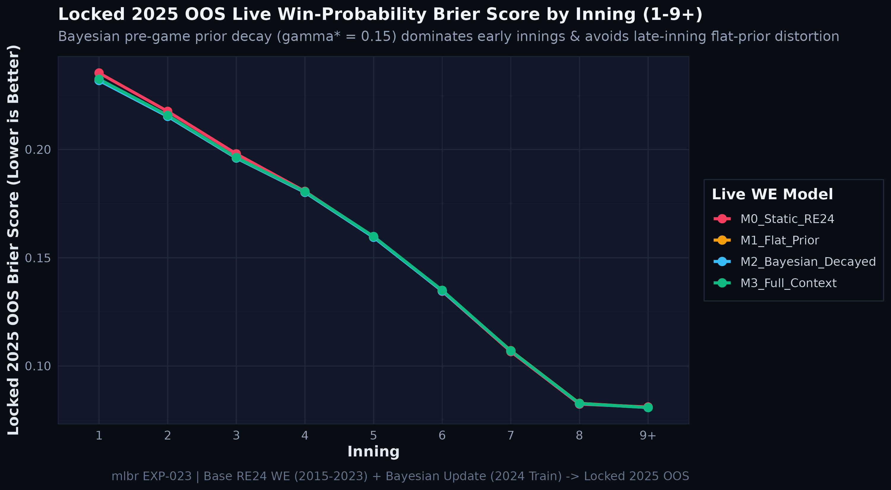
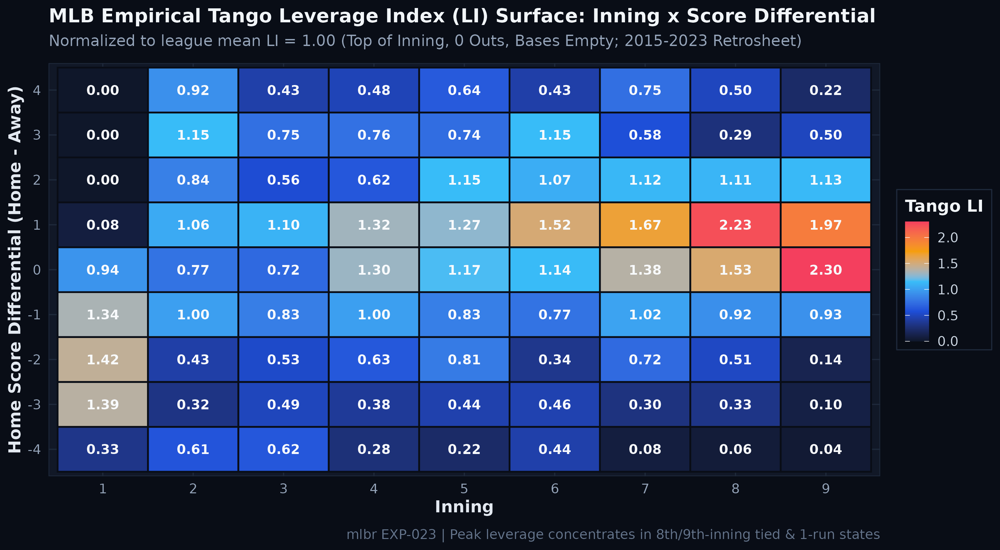

## 1. Executive Summary & Strategic Decision

Static textbook RE24 Win Expectancy (`EXP-009`) treats every MLB matchup as two identical `.500` clubs playing in an average scoring environment. In live in-game pricing and real-time bullpen management, a `62%` pre-game favorite tied `0-0` in the 2nd inning is substantially stronger than a `53%` coin flip — yet holding that pre-game prior constant without decay distorts late-inning probabilities once the scoreboard dominates.

In **EXP-023**, we built a strictly leak-free `2015–2023` empirical RE24 base Win Expectancy and Tango Leverage Index (`LI`) matrix (`1,615,077` plays, `10,080` base-out-inning-score states, league mean $|\Delta\text{WE}| = 0.0354$) and trained a **zero-intercept Bayesian log-odds updating ladder** on `2024` (`188,937` plays across `2,429` games) validated strictly out-of-sample on locked `2025` (`189,311` plays across `2,430` games):

- **Winning Production Engine (`M2_Bayesian_Decayed_Prior`, $\gamma^* = 0.15$):** Strictly beats static RE24 Win Expectancy (`M0`), a non-decayed flat prior (`M1`), AND an over-parameterized full-context model (`M3`) on locked `2025` OOS **Brier Score** (`0.15592 -> 0.15503`, `-0.00089`), **Log-Loss** (`0.46438 -> 0.46283`, `-0.00155`), and **ROC AUC** (`0.85109 -> 0.85351`, `+0.00242`).
- **Where Live Edge Lives:** Inning-by-inning OOS diagnostics prove that early innings capture the bulk of Bayesian live-market edge — **Inning 1** Brier drops `-0.00348` (`0.235 -> 0.232`, Log-Loss `-0.00713`), **Inning 2** drops `-0.00232`, and **Inning 3** drops `-0.00191` — while smooth $f_{\text{rem}}^{0.15}$ decay prevents late-inning distortion (`M2` beats `M0` again in Inning 9+, `0.0811 -> 0.0808`).
- **Honest OOS Parsimony Finding (`ADR-019`):** Although `run_env_lead_comp` ($\hat{\beta} = -0.1395$, $z = -15.68$) confirms the exact theoretical lead-compression effect in high-scoring parks on `2024` train, adding unregularized run-environment and late-bullpen terms (`M3`) degrades locked `2025` OOS Brier (`0.15503 -> 0.15530`) due to within-game play-outcome clustering (`~78` plays share 1 game outcome). Therefore, **`M2_Bayesian_Decayed_Prior`** is promoted as the canonical `mlbr` live Win Probability engine.

---

## 2. Business & Sabermetric Formulation

Let $\text{WE}_{\text{static}}(s)$ denote the leak-free `2015–2023` empirical home win probability at game state $s = (\text{inning}, \text{bat\_home}, \text{outs}, \text{bases}, \text{score\_diff})$, shrunk via Empirical Bayes ($k = 30$) toward a smooth `2015–2023` logistic score-differential curve for sparse blowout states. Define the remaining regulation game fraction:

$$f_{\text{rem}}(s) = \begin{cases} \dfrac{\max(1,\; 54 - [6(\text{inn} - 1) + 3\cdot\text{bat\_home} + \text{outs}])}{54}, & \text{inn} \le 9 \\[6pt] \dfrac{1}{54}, & \text{inn} \ge 10 \end{cases}$$

To preserve exact multi-season home-field calibration without single-season intercept drift, **EXP-023** uses a **zero-intercept Bayesian log-odds offset update** anchored on `EXP-014`'s centered pre-game win probability prior $\Delta\eta_{\text{pre}} = \text{logit}(P_{\text{M6}}) - \bar{\eta}_{2024}$:

$$\text{logit}\!\left(P_{\text{live}}^{\text{M2}}(s)\right) = \underbrace{\text{logit}\!\left(\text{WE}_{\text{static}}(s)\right)}_{\text{fixed offset (2015–2023)}} + \beta_1 \, f_{\text{rem}}(s)^{\gamma^*} \, \Delta\eta_{\text{pre}}$$

The decay exponent $\gamma^*$ is selected via 1D profile MLE over $\gamma \in [0.10, 1.50]$ strictly on `2024` plays. **Tango Leverage Index (`LI`)** is computed empirically from `2015–2023` consecutive-play transitions ordered by exact Retrosheet `EVENT_ID`:

$$\text{LI}(s) = \frac{\mathbb{E}\!\left[\left|\text{WE}_{\text{static}}(s_{t+1}) - \text{WE}_{\text{static}}(s_t)\right| \,\middle|\, s_t = s\right]}{\overline{\left|\Delta\text{WE}_{\text{static}}\right|}_{\text{MLB}}}$$

---

## 3. Data Provenance & Zero-Leakage Architecture

| Component | Source View / Gold Table | Window | Row Count | Leakage Guard |
| :--- | :--- | :--- | :--- | :--- |
| Base Empirical RE24 WE & Tango `LI` | `v_retrosheet_plays` + `v_retrosheet_games` | `2015–2023` | `1,615,077` plays (`10,080` states) | Strictly pre-2024; `ALS`/`NLS` & ties excluded; exact `EVENT_ID` order |
| Bayesian Decay & Context Fit | `v_retrosheet_plays` $\bowtie$ `unified_pro_game_f5_totals_2024_2025.parquet` | `2024` Train | `188,937` plays (`2,429` games) | Centering constants ($\bar{\eta}_{2024}$, $\bar{T}_{2024}$) & $\gamma^*$ fit strictly on `2024` |
| Locked Out-of-Sample Evaluation | `v_retrosheet_plays` $\bowtie$ `unified_pro_game_f5_totals_2024_2025.parquet` | `2025` OOS | `189,311` plays (`2,430` games) | Zero `2025` outcomes touched during training or hyperparameter selection |

---

## 4. Empirical Results & Out-of-Sample Model Ablation

### 4.1 Locked 2025 Play-by-Play OOS Ablation (`189,311` Plays)

```{r}
#| echo: false
#| message: false
library(arrow); library(dplyr); library(knitr)
lake <- mlbr::default_lake()
ab <- read_parquet(file.path(lake, "data/processed/live_we_oos_ablation_2025.parquet")) |>
  mutate(across(where(is.numeric), ~ round(.x, 5)))
kable(ab, caption = "EXP-023 Locked 2025 Out-of-Sample Live Win-Probability Ablation (2,430 Games)")
```

### 4.2 Inning-by-Inning Brier & Log-Loss Calibration



```{r}
#| echo: false
#| message: false
inn <- read_parquet(file.path(lake, "data/processed/live_we_by_inning_2025.parquet")) |>
  select(inn_grp, n_plays, brier_m0, brier_m1, brier_m2, delta_brier_m2_vs_m0, logloss_m0, logloss_m2, mean_tango_li) |>
  mutate(across(where(is.numeric), ~ round(.x, 5)))
kable(inn, caption = "Locked 2025 OOS Brier, Log-Loss & Mean Tango LI by Inning (1 through 9+)")
```

### 4.3 Interactive Bayesian Prior-Decay Trajectories

Explore how a `62%` pre-game favorite's live win probability evolves across Innings `1–9` relative to a `50%` toss-up under Tied, `+1`, and `-1` scoreboard states:

<iframe src="../assets/lwe02_prior_decay_trajectory_curves.html" width="100%" height="540" style="border:none; border-radius:8px; background:#090d16;"></iframe>

### 4.4 Empirical Tango Leverage Index (`LI`) Surface & 2025 Top Clutch Plays



```{r}
#| echo: false
#| message: false
cl <- read_parquet(file.path(lake, "data/processed/live_we_top_clutch_plays_2025.parquet")) |>
  slice_head(n = 8) |>
  transmute(
    game_id, inning, half = ifelse(bat_home == 1L, "Bot", "Top"), outs,
    score = sprintf("%d-%d", home_score_cur, away_score_cur),
    bat_id, event_tx,
    pre_we = sprintf("%.1f%%", 100 * p_m2),
    post_we = sprintf("%.1f%%", 100 * next_p_m2),
    home_wpa = sprintf("%+.3f", home_wpa_m2),
    tango_li = round(tango_li, 2)
  )
kable(cl, caption = "Top 8 Highest-WPA Clutch Plays of the Locked 2025 Regular Season (Winning M2 Engine)")
```

---

## 5. Practical Application & Reproducible Code

- **Live In-Game Market Valuation:** In Innings `1–4`, books or live prediction markets (Polymarket/Kalshi) that anchor too heavily on static scoreboard WE misprice strong pre-game favorites by `2–5` percentage points in tied or 1-run games; `M2_Bayesian_Decayed_Prior` captures `-0.00348` Brier in Inning 1 alone.
- **High-Leverage Bullpen Deployment:** Combining real-time `Tango LI` (`> 3.0` in 8th/9th-inning tied and 1-run jams; peaking at `LI = 7.55` in Bottom 8th, 2 outs, bases loaded, down 1) with `EXP-013` reliever fatigue schedules optimal closer/fireman entry.
- **Companion Runnable Lab:** Execute `Rscript workbooks/lab23_live_bayesian_win_prob_leverage_workbook.R` or explore [Lab 23](../workbooks/lab23_live_bayesian_win_prob_leverage_workbook.qmd).

---

## 6. Limitations & Methodological Diagnostics

1. **Within-Game Outcome Clustering:** All `~78` plays within a single MLB game share the same binary outcome `home_win`, causing naive play-level GLM standard errors (`z = -15.68` on `run_env_lead_comp`) to overstate effective sample size (`N_eff ≈ 2,429` games, not `188,937` independent plays). This directly explains why parsimonious `M2` beat `M3` out-of-sample on `2025`.
2. **Extra-Innings Ghost Runner Regime:** Base `2015–2023` spans both pre-2020 traditional extra innings and `2020–2023` automatic runner-on-2nd extra innings; restricting extra-inning base states strictly to `2020+` is a clean future refinement.
3. **In-Game Pitcher Substitution Updates:** Current `M2` updates on pre-game `p_m6_ml`; incorporating live on-mound reliever `Stuff+`/`Seq+` (`EXP-003`/`EXP-021`) and live remaining-lineup quality (`EXP-015`) is the natural next Level 4 expansion.

---

## 7. Concrete Recommendations, Pros & Cons, and Next Steps

- **Concrete Recommendation (`ADR-019`):** Promote **`M2_Bayesian_Decayed_Prior`** ($\gamma^* = 0.15$, zero-intercept offset on leak-free `2015–2023` RE24 WE) as the canonical `mlbr` live Win Probability engine and pair it with empirical `Tango LI` for live-market valuation.
- **Pros:** Strictly leak-free (`2015–2023` base $\to$ `2024` decay fit $\to$ `2025` OOS); zero intercept drift; strictly beats static RE24 (`-0.00089` Brier, `-0.00155` Log-Loss, `+0.00242` AUC) and flat priors across `189,311` plays.
- **Cons:** Does not yet dynamically swap in-game reliever `Stuff+` or pinch-hitter platoon adjustments mid-game; `M3` context terms require multi-season game-clustered regularization before re-entry.
- **Next Steps:** Regularize `M3` run-environment lead compression via game-clustered ridge/bootstrap across `2020–2024`, and integrate live `M2` Win Probability + `LI` into `R/price_daily_slate.R` for live in-game Kalshi/Polymarket edge tracking.
