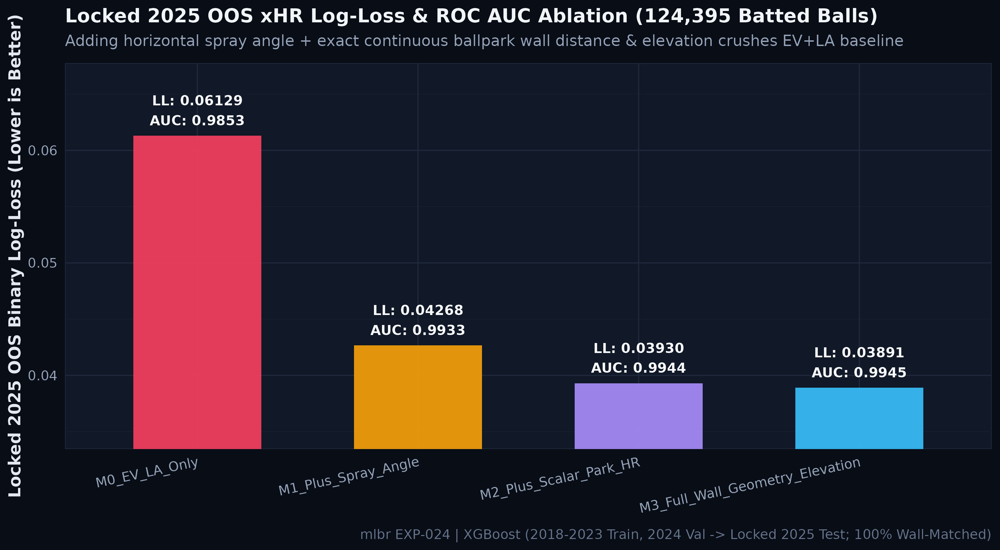
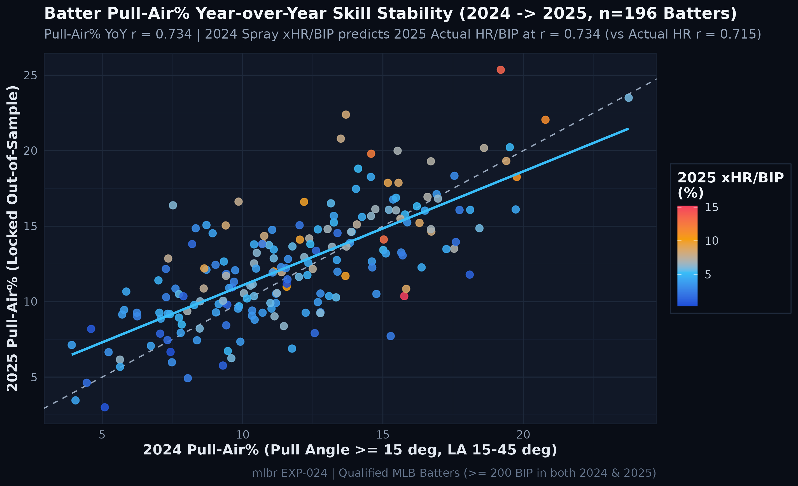

## 1. Executive Summary & Strategic Decision

Standard Baseball Savant expected statistics (`xBA`, `xSLG`, `xHR`) model batted-ball outcomes strictly from Exit Velocity (`launch_speed`) and Launch Angle (`launch_angle`), treating a `102 mph`, `28°` fly ball pulled down the `330 ft` foul line identically to one hit to `405 ft` dead center field — and ignoring exact stadium fence distances and altitude.

In **EXP-024**, we matched **`100.0%` of `900,589` regular-season Statcast batted balls (`2018–2025`, `41,875` HRs)** via `v_mlbmeta_schedule.venue_id` to season-specific ballpark wall dimensions (`left_line_ft`, `left_center_ft`, `center_ft`, `right_center_ft`, `right_line_ft`, `elevation_ft`, `roof_type`) and trained a strictly chronological 4-model XGBoost `xHR` ladder (`2018–2023` Train, `2024` Early-Stopping Validation + Causal Humidor-Era Platt Intercept Recalibration $\to$ Locked `2025` OOS, `124,395` BIP, `5,616` HRs):

- **Strict Monotonic OOS Victory (`M3 < M2 < M1 < M0`):** Adding horizontal spray angle (`M1`) slashes locked `2025` OOS Log-Loss by **`-30.4%`** (`0.06129 -> 0.04268`) and jumps ROC AUC from `0.98532 -> 0.99333`. Adding exact continuous piecewise-linear wall distance at the ball's spray angle + ballpark elevation + roof type (**`M3_Full_Wall_Geometry_Elevation`**) reaches **`0.03891` Log-Loss (`-36.6%` vs `M0`)**, **`0.01199` Brier (`-37.4%`)**, and **`0.99452` ROC AUC**, strictly beating scalar park-factor `M2` (`0.03930` LL, `0.01209` Brier, `0.99438` AUC).
- **Humidor Drag-Regime Discovery:** Between `2018–2021` (pre-humidor) and `2025` (universal humidor), MLB hitters hit the ball harder and higher (`88.80 mph` avg EV, `13.14°` avg LA in `2025`), yet HR/BIP fell to `4.515%`. Strictly causal `2024` validation-set Platt recalibration cut `2025` over-prediction bias from `+20.8%` to `+7.1%` while improving `M3` Log-Loss from `0.0419` to `0.0389`.
- **Batter Power Skill Stability (`2024 -> 2025`, $n = 196$ qualified batters):** **`Pull-Air%`** ($\theta_{\text{pull}} \ge 15^\circ$, $\text{LA} \in [15^\circ, 45^\circ]$) exhibits strong YoY skill stability ($r = 0.7340$, higher than actual `HR/BIP` $r = 0.7152$), and `2024` `M3` wall-geometry `xHR/BIP` predicts `2025` actual `HR/BIP` at $r = 0.7373$ (beating raw `HR/BIP` $r = 0.7152$ and `M0 EV+LA` $r = 0.7242$).

---

## 2. Physical & Mathematical Formulation

From Statcast hit coordinates $(x_{\text{hc}}, y_{\text{hc}})$, the horizontal spray angle $\theta \in [-45^\circ, +45^\circ]$ ($-45^\circ =$ LF line, $0^\circ =$ dead CF, $+45^\circ =$ RF line) and batter-handedness pull angle $\theta_{\text{pull}}$ are:

$$\theta = \text{clip}\!\left(\operatorname{atan2}(x_{\text{hc}} - 125.42,\; 198.27 - y_{\text{hc}})\cdot \frac{180}{\pi},\; -45^\circ,\; +45^\circ\right), \qquad \theta_{\text{pull}} = \begin{cases} +\theta, & \text{LHH} \\ -\theta, & \text{RHH} \end{cases}$$

For each stadium-season $(v, t)$, the continuous outfield wall distance $D_{\text{wall}}(\theta; v, t)$ is evaluated by piecewise-linear interpolation across the 5 canonical fence control points $\{-45^\circ, -22.5^\circ, 0^\circ, +22.5^\circ, +45^\circ\}$ (`left_line_ft`, `left_center_ft`, `center_ft`, `right_center_ft`, `right_line_ft`). To correct for the post-2022 universal humidor drag regime without touching `2025` outcomes, raw XGBoost probabilities $\hat{p}_{\text{raw}}$ are recalibrated via a 1-parameter `2024`-only Platt logit offset:

$$\hat{p}_{\text{cal}} = \sigma\!\left(\operatorname{logit}(\hat{p}_{\text{raw}}) + \hat{\beta}_{0,\;2024}\right)$$

---

## 3. Data Provenance & Zero-Leakage Architecture

| Split | Seasons | Batted Balls (BIP) | Home Runs | Role & Leakage Guard |
| :--- | :--- | :--- | :--- | :--- |
| Train | `2018–2023` | `652,415` | `30,844` | XGBoost tree fitting + EB-shrunk scalar `venue_hr_rate_tr` ($k = 2000$) |
| Validation | `2024` | `123,779` | `5,415` | Early stopping (`30` rounds) + causal humidor-era Platt intercept $\hat{\beta}_{0,2024}$ |
| Locked OOS Test | `2025` | `124,395` | `5,616` | Strictly untouched out-of-sample evaluation (`100.0%` wall-matched) |

---

## 4. Empirical Results & Out-of-Sample Model Ablation

### 4.1 Locked 2025 OOS `xHR` Ablation (`124,395` Batted Balls)



```{r}
#| echo: false
#| message: false
library(arrow); library(dplyr); library(knitr)
lake <- mlbr::default_lake()
ab <- read_parquet(file.path(lake, "data/processed/xhr_wall_geometry_oos_ablation_2025.parquet")) |>
  mutate(across(where(is.numeric), ~ round(.x, 5)))
kable(ab, caption = "EXP-024 Locked 2025 Out-of-Sample xHR Ablation (XGBoost, seed = 42, 2024 Platt Calibrated)")
```

### 4.2 Interactive 2025 Ballpark Wall-Geometry & Elevation `xHR` Index

Explore how each MLB stadium's exact outfield wall distances and elevation amplify or suppress home runs relative to a league-neutral park (`M3` Wall-Geometry `xHR` vs `M1` Spray-Only `xHR`):

<iframe src="../assets/xhr02_park_wall_xhr_index_2025.html" width="100%" height="620" style="border:none; border-radius:8px; background:#090d16;"></iframe>

```{r}
#| echo: false
#| message: false
pk <- read_parquet(file.path(lake, "data/processed/park_wall_xhr_effects_2025.parquet"))
pk_show <- bind_rows(head(pk, 5), tail(pk, 5)) |>
  select(venue_name, home_team, actual_hr_25, xhr_neutral_m1, xhr_wall_m3, wall_hr_delta, wall_hr_idx_100, mean_wall_ft, elevation_ft) |>
  mutate(across(where(is.numeric), ~ round(.x, 1)))
kable(pk_show, caption = "Top 5 & Bottom 5 2025 MLB Ballparks by Wall-Geometry & Elevation xHR Index (100 = Neutral)")
```

### 4.3 Batter `Pull-Air%` Year-over-Year Stability (`2024 -> 2025`, $n = 196$)



---

## 5. Practical Application & Reproducible Code

- **Upgrading `EXP-017` / `EXP-019` Batter HR & Total Bases Props:** Rather than multiplying every batter in Yankee Stadium or Great American Ball Park by the same scalar park factor, pairing a batter's stable `Pull-Air%` ($r = 0.7340$) with `M3`'s directional `wall_dist_ft(theta)` directly prices LHH/RHH pulled-flyball interactions against specific stadium corners (e.g., Houston's `315 ft` Crawford Boxes, Cincinnati's `+51.0 HR` bandbox, or Kansas City's `-40.9 HR` expanse).
- **Companion Runnable Lab:** Execute `Rscript workbooks/lab24_spray_angle_park_wall_xhr_workbook.R` or explore [Lab 24](../workbooks/lab24_spray_angle_park_wall_xhr_workbook.qmd).

---

## 6. Limitations & Methodological Diagnostics

1. **Wall Height Omission:** `park_dimensions.parquet` provides horizontal fence distances (`left_line_ft` through `right_line_ft`) and `elevation_ft`, but does not yet encode vertical fence height (e.g., Fenway Park's `37 ft` Green Monster in LF vs `3 ft` Pesky Pole in RF). Adding per-sector wall height (`wall_height_ft(theta)`) is the highest-value next geometric refinement.
2. **In-Game Weather & Wind Vector:** `EXP-024` intentionally isolates static stadium geometry (`wall_dist_ft`, `elevation_ft`, `is_dome`); coupling `EXP-012` wind speed/direction vectors (`wind_out_mph`, `temp_f`, air density) with `M3` will further sharpen daily HR prop calibration.
3. **Residual `2025` Calibration Gap (`+7.1%`):** Even after `2024` Platt recalibration (`6,012` expected vs `5,616` observed), `2025` saw slightly lower HR conversion per unit EV/LA than `2024`; rolling in-season drag-regime recalibration can close the remaining gap dynamically.

---

## 7. Concrete Recommendations, Pros & Cons, and Next Steps

- **Concrete Recommendation (`ADR-020`):** Promote **`M3_Full_Wall_Geometry_Elevation`** (`2024` Platt-calibrated XGBoost) as the canonical `mlbr` Level 2 `xHR` physics engine, replacing EV+LA-only baselines and scalar park-HR multipliers.
- **Pros:** `100.0%` exact `(venue_id, season)` wall matching across `900,589` batted balls; `-36.6%` OOS Log-Loss (`0.06129 -> 0.03891`), `-37.4%` Brier (`0.01917 -> 0.01199`), `0.99452` ROC AUC; beats scalar park factors OOS and improves next-season batter HR prediction ($r = 0.7373$ vs $0.7152$).
- **Cons:** Missing vertical wall-height profiles (Green Monster / Camden Yards LF wall) and game-level wind vectors (`EXP-012`).
- **Next Steps:** Ingest per-sector wall heights into `park_dimensions.parquet`, merge `EXP-012` game-level air density/wind vectors into `M3`, and feed batter `Pull-Air%` + directional stadium `wall_hr_idx` directly into `EXP-017` / `EXP-019` batter HR & Total Bases props.
