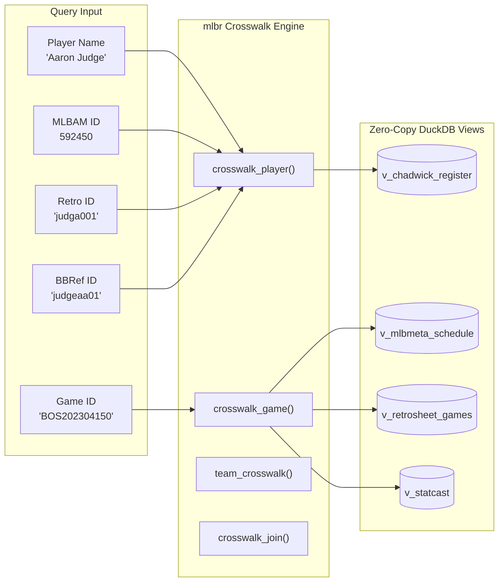

## Overview

The `mlbr` crosswalk engine provides bidirectional resolution across all major baseball entity identifier systems. It is grounded directly in the **Chadwick Bureau Register** (527,000+ historical persons) and official **MLB schedule metadata** (55,000+ games).



## Quick Start

```{r}
#| message: false
#| warning: false
library(mlbr)
library(dplyr)
library(gt)
```

### 1. Player Resolution (`crosswalk_player`)

Look up any player by fuzzy name, exact name, or system ID. Results prioritize Major League careers:

```{r}
# Lookup by name
judge <- crosswalk_player("Aaron Judge")
judge |> 
  select(key_mlbam, key_retro, key_bbref, key_fangraphs, full_name, mlb_played_first, mlb_played_last) |>
  gt() |>
  tab_header(title = "Player Crosswalk: Aaron Judge")
```

```{r}
# Lookup Shohei Ohtani
ohtani <- crosswalk_player("Ohtani")
ohtani |> 
  select(key_mlbam, key_retro, key_bbref, key_fangraphs, full_name, mlb_played_first, mlb_played_last) |>
  gt() |>
  tab_header(title = "Player Crosswalk: Shohei Ohtani")
```

### 2. Team Code Translation (`team_crosswalk`)

Bridges the 3-letter discrepancies between Retrosheet (e.g. `CHA`, `CHN`, `NYA`, `LAN`), Statcast (e.g. `CWS`, `CHC`, `NYY`, `LAD`), and Baseball-Reference:

```{r}
teams <- team_crosswalk()
head(teams, 10) |>
  gt() |>
  tab_header(title = "Team Crosswalk Reference Table")
```

### 3. Game ID Bridging (`crosswalk_game`)

Resolve Retrosheet `GAME_ID` $\leftrightarrow$ Statcast MLBAM `game_pk`:

```{r}
# Resolve Retrosheet GAME_ID to Statcast game_pk
crosswalk_game("BOS202304150") |>
  gt() |>
  tab_header(title = "Game Crosswalk: BOS202304150 -> game_pk")
```

```{r}
# Resolve Statcast game_pk to Retrosheet GAME_ID
crosswalk_game(718576) |>
  gt() |>
  tab_header(title = "Game Crosswalk: game_pk 718576 -> Retrosheet")
```

### 4. Automatic Data Frame Enrichment (`crosswalk_join`)

Pipe any arbitrary baseball dataframe with an ID column (`pitcher`, `batter`, `playerID`, `retro_id`, etc.) directly into `crosswalk_join()`:

```{r}
sample_statcast <- tibble(
  pitcher = c(592450, 660271, 545361),
  pitch_count = c(102, 98, 115)
)

enriched <- crosswalk_join(sample_statcast)
enriched |> 
  gt() |>
  tab_header(title = "Automated Data Frame Enrichment via crosswalk_join()")
```

### 5. Invariant Validation Suite (`proof_crosswalks`)

Every build runs a 5-stage invariant verification suite:

```{r}
proofs <- proof_crosswalks()
proofs |>
  gt() |>
  tab_header(title = "Crosswalk Invariant Verification Suite")
```
