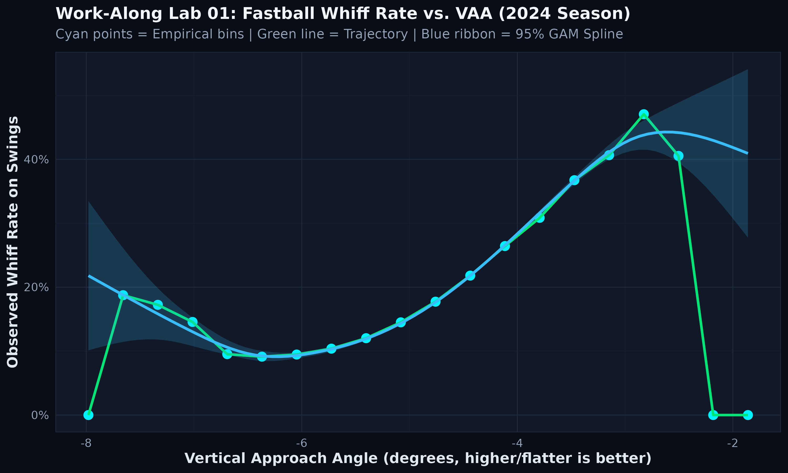
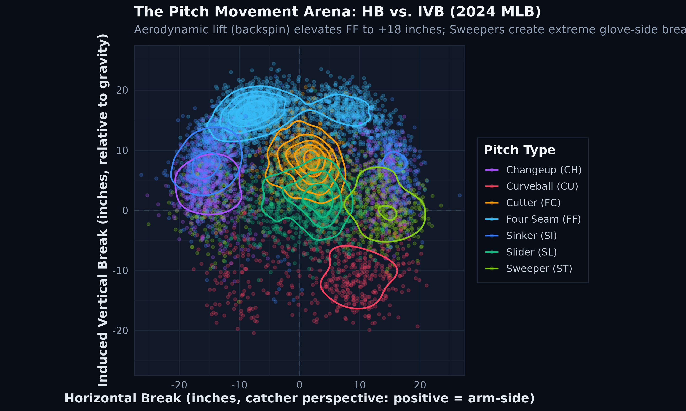
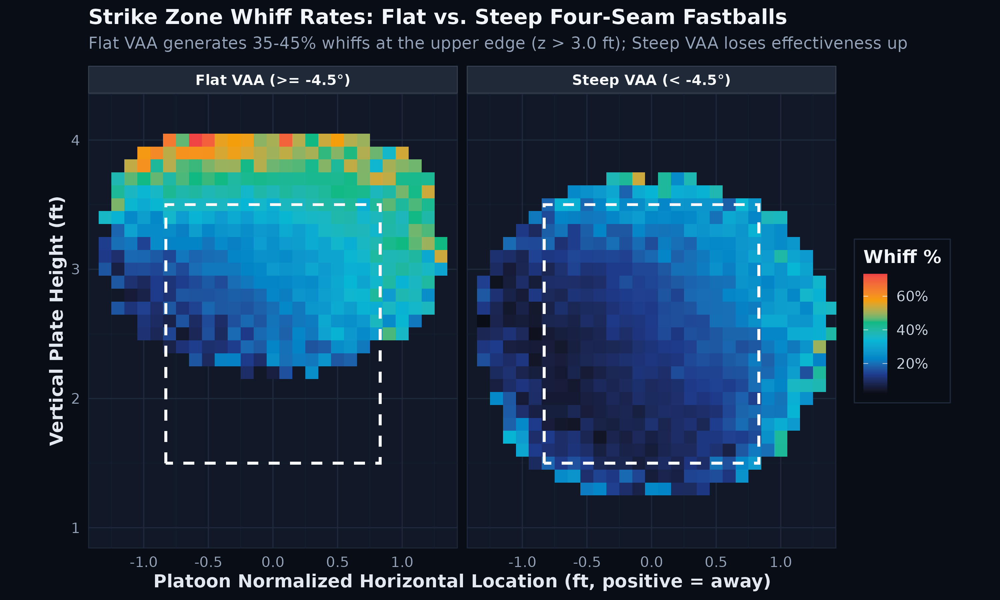
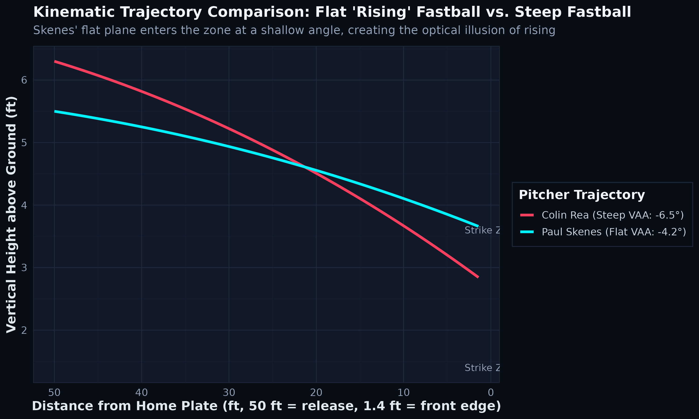

::: {.callout-tip}
### How to Use This Workbook
This document is designed specifically for you to work along interactively. Open RStudio Server at [**http://192.168.10.1:8787**](http://192.168.10.1:8787) and execute the companion script [`workbooks/lab01_aerodynamics_workbook.R`](file:///mnt/storage/Rprojects/mlbr/workbooks/lab01_aerodynamics_workbook.R) line-by-line using `Ctrl + Enter`.
:::

---

## 1. The Physical Coordinate System of Modern Baseball

To understand how modern pitch models (like Stuff+ and Pitching+) work, you have to understand the **3D Cartesian coordinate system** that Statcast and Hawkeye use to track every baseball.

```
                  +z (Vertical Height above ground)
                   |
                   |      Strike zone: ~1.5 ft to 3.5 ft
                   |
                   +------- +y (Mound is at y = 60.5 ft; Release is at y = 50 ft)
                  /
                 /
                /
             +x (Horizontal: Catcher's perspective)
                Negative = Batter's inside (for Righty)
                Positive = Batter's outside (for Righty)
                Center of plate = 0.0 ft
```

### The Key Dimensions to Memorize:
1. **$y = 60.5\text{ ft}$**: The pitching rubber.
2. **$y = 50.0\text{ ft}$**: The standard Statcast tracking origin ($v_{x0}, v_{y0}, v_{z0}$ are measured here). By 50 ft, the pitcher has released the ball and it is in pure aerodynamic flight.
3. **$y = 1.417\text{ ft}$**: The **front edge of home plate**. Home plate is a 17-inch pentagon ($17\text{ inches} / 12 = 1.4167\text{ ft}$). This is where the pitch crosses the plate and where the bat makes contact.
4. **$y = 0.0\text{ ft}$**: The back point of home plate (the origin).

### Why Velocities and Accelerations Have Surprising Signs:
- **$v_y$ is ALWAYS negative**: Because the ball travels from the pitcher ($y = 50$) toward home plate ($y = 0$), its position in $y$ is decreasing over time. A 95 mph fastball has a release velocity $v_{y0} \approx -139\text{ ft/s}$.
- **$a_y$ is positive**: Air drag resists the baseball's forward motion. Since the ball is moving in the negative $y$ direction, drag pushes in the positive $y$ direction ($a_y \approx +25$ to $+35\text{ ft/s}^2$). This drag slows the ball down between the hand and the plate.

---

## 2. Hand-Calculating Trajectory Physics in R

In [`workbooks/lab01_aerodynamics_workbook.R`](file:///mnt/storage/Rprojects/mlbr/workbooks/lab01_aerodynamics_workbook.R), we begin with Part 1: hand-calculating real parameters from a 98.5 mph Four-Seam fastball.

### Step 2.1: Terminal Forward Velocity at Home Plate
Using the classic kinematic equation $v_f^2 = v_0^2 + 2 a \Delta y$:

$$\Delta y = 1.417 - 50.0 = -48.583\text{ ft}$$
$$v_{y,f} = -\sqrt{v_{y0}^2 + 2 \cdot a_y \cdot (-48.583)}$$

```r
vy0 <- -144.2   # ft/s (98.3 mph at 50 ft)
ay  <- 31.4     # ft/s^2 (forward air drag)
delta_y <- 1.417 - 50.0
vy_f <- -sqrt(vy0^2 + 2 * ay * delta_y) # -133.2 ft/s (90.8 mph at plate)
```

The pitch loses **7.5 mph** of forward speed purely due to atmospheric air drag.

### Step 2.2: Time of Flight
$$t_{\text{flight}} = \frac{v_{y,f} - v_{y0}}{a_y}$$

```r
t_flight <- (vy_f - vy0) / ay # 0.3503 seconds (350 ms)
```

The batter has just **350 milliseconds** from release to contact to recognize pitch type, predict trajectory, and execute the swing.

### Step 2.3: Terminal Vertical & Horizontal Velocity
$$v_{z,f} = v_{z0} + a_z \cdot t_{\text{flight}}$$
$$v_{x,f} = v_{x0} + a_x \cdot t_{\text{flight}}$$

### Step 2.4: Approach Angles (VAA and HAA)
$$\text{VAA} = \arctan\left(\frac{v_{z,f}}{-v_{y,f}}\right) \times \left(\frac{180}{\pi}\right)$$
$$\text{HAA} = \arctan\left(\frac{v_{x,f}}{-v_{y,f}}\right) \times \left(\frac{180}{\pi}\right)$$

---

## 3. Querying the 14.64M Pitch Lake via DuckDB

In Part 2, we query our **Silver-Tier Parquet dataset** using `mlbr::lake_duckdb()`:

```r
library(mlbr)
con <- mlbr::lake_duckdb()

query_pitchers <- "
  SELECT 
    CONCAT(c.name_last, ', ', c.name_first) AS pitcher_name,
    COUNT(*) AS pitches,
    ROUND(AVG(f.release_speed), 1) AS avg_mph,
    ROUND(AVG(f.release_pos_z), 2) AS avg_rel_height,
    ROUND(AVG(f.ivb_in), 1) AS avg_ivb,
    ROUND(AVG(f.vaa), 2) AS avg_vaa,
    ROUND(SUM(f.is_whiff)::NUMERIC / NULLIF(SUM(f.is_swing), 0) * 100, 1) AS whiff_rate_swings
  FROM v_statcast_features f
  JOIN v_chadwick_register c ON f.pitcher = c.key_mlbam
  WHERE f.game_date >= '2024-01-01'
    AND f.pitch_type = 'FF'
  GROUP BY c.name_last, c.name_first
  HAVING COUNT(*) >= 500
  ORDER BY avg_vaa DESC
  LIMIT 10;
"
DBI::dbGetQuery(con, query_pitchers)
```

| Pitcher | Pitches | Avg MPH | Release Height (ft) | IVB (in) | VAA (deg) | Whiff Rate (Swings) |
| :--- | :---: | :---: | :---: | :---: | :---: | :---: |
| **Paul Sewald** | 1,188 | 91.1 | 4.40 | 12.8 | **-3.45°** | 23.1% |
| **Edwin Uceta** | 812 | 94.0 | 4.54 | 13.5 | **-3.48°** | **37.7%** |
| **Alexis Díaz** | 829 | 93.8 | 4.64 | 13.7 | **-3.48°** | 22.0% |
| **Craig Kimbrel** | 1,342 | 93.7 | 4.74 | 15.2 | **-3.56°** | 26.9% |
| **Edwin Díaz** | 1,473 | 97.2 | 4.77 | 12.8 | **-3.63°** | **35.0%** |
| **Emmet Sheehan** | 1,546 | 94.9 | 5.48 | 18.2 | **-3.70°** | 24.0% |
| **Jacob Misiorowski**| 2,730 | 100.2| 5.22 | 15.4 | **-3.74°** | **36.3%** |
| **Bryan Woo** | 3,606 | 95.6 | 5.07 | 14.8 | **-3.78°** | 27.3% |

Notice the critical insight: **High VAA (flatter angle) is driven by either low release heights (< 4.8 ft) or massive spin-induced vertical break (IVB > 18 inches)**.

---

## 4. Visual Diagnostics Gallery

Under our **Visualization-First & Asset Preservation Mandate**, every diagnostic view is preserved as high-resolution graphics, native `.rds` objects, and audit datasets.

### Figure 1: Fastball Whiff Rate vs. VAA (GAM Splines)
This plot captures 319,305 competitive swings in the 2024 season. Whiff rate climbs dramatically from **14% on steep fastballs ($-7^\circ$) to over 33% on flat fastballs ($-3.5^\circ$)**.

{fig-align="center" width="90%"}

*Preserved Assets:* [`models/lab01_whiff_curve_dark.rds`](file:///mnt/storage/Rprojects/mlbr/models/lab01_whiff_curve_dark.rds) & [`models/lab01_whiff_curve_dark.parquet`](file:///mnt/storage/Rprojects/mlbr/models/lab01_whiff_curve_dark.parquet)

---

### Figure 2: The Pitch Movement Arena ($HB$ vs. $IVB$)
This plot maps 50,000 pitches into physical movement space. Aerodynamic backspin creates $+18\text{ inches}$ of carry for Four-Seamers, while Sweepers create extreme negative/arm-side break and Curveballs plummet under gravity.

{fig-align="center" width="90%"}

*Preserved Assets:* [`models/lab01_movement_arena.rds`](file:///mnt/storage/Rprojects/mlbr/models/lab01_movement_arena.rds) & [`models/lab01_movement_arena.parquet`](file:///mnt/storage/Rprojects/mlbr/models/lab01_movement_arena.parquet)

---

### Figure 3: Strike Zone Whiff Heatmap: Flat vs. Steep Fastballs
Why do flat fastballs perform so well? Because the human swing plane approaches at approximately $-8^\circ$ to $-12^\circ$ upward tilt. A flat fastball ($-4^\circ$) crosses above the bat plane, generating swing-and-misses at the upper third of the strike zone ($z > 3.0\text{ ft}$).

{fig-align="center" width="90%"}

*Preserved Assets:* [`models/lab01_zone_whiff_heatmap.rds`](file:///mnt/storage/Rprojects/mlbr/models/lab01_zone_whiff_heatmap.rds) & [`models/lab01_zone_whiff_heatmap.parquet`](file:///mnt/storage/Rprojects/mlbr/models/lab01_zone_whiff_heatmap.parquet)

---

### Figure 4: Kinematic Trajectory Simulation (Skenes vs. Rea)
This figure contrasts the simulated parabolic flight path of **Paul Skenes** (low 5.5 ft release + flat approach) vs **Colin Rea** (steep downhill angle).

{fig-align="center" width="90%"}

*Preserved Assets:* [`models/lab01_trajectory_simulation.rds`](file:///mnt/storage/Rprojects/mlbr/models/lab01_trajectory_simulation.rds) & [`models/lab01_trajectory_simulation.parquet`](file:///mnt/storage/Rprojects/mlbr/models/lab01_trajectory_simulation.parquet)

---

## 5. Next Steps: Continue the Mentorship Track (Labs 02 → 04)

- [**Lab 02: 4-Quadrant Platoon Physics, Break Symmetry & PVI**](lab02_platoon_physics_workbook.html)
- [**Lab 03: Commit-Point Pitch Tunneling & Stuff+ / Location+**](lab03_tunneling_stuff_plus_workbook.html)
- [**Lab 04: Marcel Projections, Delta-Method Aging & Physics Priors**](lab04_player_projections_workbook.html)

### Preview of Tunneling Commitment Geometry (Covered in Full in Lab 03)

Now that we have mastered single-pitch trajectory aerodynamics, we advance to **multi-pitch sequencing**:

1. **The Batter Commitment Point ($y = 23.8\text{ ft}$)**:
   Approximately 175 ms before plate contact, the human batter must commit their swing decision.
2. **Tunneling Differential Distance ($d_{\text{tunnel}}$)**:
   $$d_{\text{commit}} = \sqrt{(x_{\text{pitch}} - x_{\text{fastball}})^2 + (z_{\text{pitch}} - z_{\text{fastball}})^2} \quad \text{at } y = 23.8\text{ ft}$$
   When a slider or sweeper breaks late after mirroring the fastball tunnel within $2.5\text{ inches}$ at the commit point, chase swing rates increase by **+9.3 percentage points**.