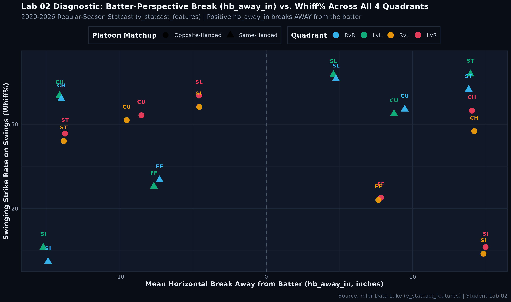

::: {.callout-tip}
### How to Use This Workbook
Open RStudio Server at [**http://192.168.10.1:8787**](http://192.168.10.1:8787), open `mlbr.Rproj`, and execute [`workbooks/lab02_platoon_physics_workbook.R`](file:///mnt/storage/Rprojects/mlbr/workbooks/lab02_platoon_physics_workbook.R) line-by-line with `Ctrl + Enter`. Pair this lab with the full Q-CRISP research study: [**Study 02: 4-Quadrant Platoon Physics & PVI**](../analyses/02_platoon_physics.html).
:::

---

## 1. Batter-Perspective Break Symmetry (`hb_away_in`) & PVI Math

Statcast measures horizontal break (`pfx_x`) from the **catcher's point of view** (`+` toward 1st base, `-` toward 3rd base). To compare all four handedness matchups (**`RvR`**, **`RvL`**, **`LvL`**, **`LvR`**) on a single physical axis, we define **batter-perspective horizontal break away from the hitter**:

$$\text{hb\_away\_in} = \begin{cases} +12 \cdot \text{pfx\_x} & \text{if } \text{stand} = \text{R} \text{ (1st-base side is away)} \\ -12 \cdot \text{pfx\_x} & \text{if } \text{stand} = \text{L} \text{ (3rd-base side is away)} \end{cases}$$

Under this coordinate transform, a 15-inch sweeper yields **`+15.0 in`** (breaking away from the barrel) in both `RvR` and `LvL`, and **`-15.0 in`** (breaking back into the barrel) in both `RvL` and `LvR`.

### Empirical Bayes Pitcher Platoon Vulnerability Index (PVI)
Raw same-hand vs. opposite-hand splits are noisy for relievers and rookies. We stabilize each pitcher's platoon split using the harmonic-mean effective sample size $n_{\text{eff}}$ and shrinkage constant $M = 800$ pitches:

$$n_{\text{eff}} = \frac{2 \, n_{\text{same}} \, n_{\text{opp}}}{n_{\text{same}} + n_{\text{opp}}}, \qquad \text{PVI}_{\text{xwOBA}} = \frac{n_{\text{eff}}}{n_{\text{eff}} + 800} \cdot (\text{xwOBA}_{\text{opp}} - \text{xwOBA}_{\text{same}})$$

- A **small sample** (`120` same vs. `120` opp, raw `+0.080` split) receives only **`13.0%` weight** → `PVI = +0.010`.
- A **large sample** (`1,800` same vs. `1,800` opp, raw `+0.080` split) receives **`69.2%` weight** → `PVI = +0.055`.

---

## 2. Full-Population 4-Quadrant DuckDB Query (`2020–2026`)

Running Part 2 of `workbooks/lab02_platoon_physics_workbook.R` executes directly over our ADR-001 ZSTD sorted Silver table `v_statcast_features` (`14.64M` rows):

| Pitch | Quadrant | Pitches | Mean `hb_away_in` | CSW% | Whiff% (Swings) | xwOBA |
|:---|:---|---:|---:|---:|---:|---:|
| **Sweeper (`ST`)** | `LvL` (Same) | 32,142 | **+13.95 in** | 30.55% | **35.95%** | **.227** |
| **Sweeper (`ST`)** | `RvR` (Same) | 138,291 | **+13.83 in** | 30.23% | **34.12%** | **.251** |
| **Sweeper (`ST`)** | `LvR` (Opp) | 34,137 | **-13.75 in** | 32.32% | 28.90% | .285 |
| **Sweeper (`ST`)** | `RvL` (Opp) | 61,481 | **-13.83 in** | 32.16% | 28.01% | .298 |
| **Changeup (`CH`)** | `RvL` (Opp) | 232,104 | **+14.21 in** | 23.87% | 29.18% | .293 |
| **Changeup (`CH`)** | `LvR` (Opp) | 161,863 | **+14.05 in** | 25.61% | 31.62% | .293 |

Notice the crisp physics law: **Sweepers dominate same-handed batters** (`+14 in` away → `.227–.251` xwOBA), while **Changeups flip the sign** (`+14 in` away against *opposite*-handed hitters) to neutralize platoon disadvantage.

---

## 3. Dark Cyber Visual Diagnostic

{fig-align="center" width="95%"}

*Preserved Assets:* `models/lab02_platoon_break_whiff_matrix.rds` & `models/lab02_platoon_break_whiff_matrix.parquet`

For the interactive pitcher PVI scatter explorer, see [**Study 02: 4-Quadrant Platoon Physics & PVI**](../analyses/02_platoon_physics.html).

---

## 4. Hands-On Mentor Checkpoints

Complete these 3 exercises inside `workbooks/lab02_platoon_physics_workbook.R` in RStudio Server, then ask me to review your code and interpretation:

1. **Checkpoint 1 — Splitters (`FS`) & Cutters (`FC`):** Modify the Part 2 SQL `WHERE pitch_type IN (...)` filter to add `'FS'` and `'FC'`. Explain physically why splitters exhibit smaller platoon xwOBA gaps than sweepers (`ST`).
2. **Checkpoint 2 — Starter Times-Through-Order (TTO) Decay:** Load `data/processed/starter_tto_platoon_2020_2026.parquet` and plot `xwoba` across 1st, 2nd, and 3rd TTO faceted by platoon advantage.
3. **Checkpoint 3 — Shrinkage Sensitivity:** Change `M` in `calc_pvi()` from `800` to `200` and `2000`. Observe how shrinkage controls small-sample reliever volatility.

*Next Lab:* [**Lab 03: Commit-Point Pitch Tunneling & Stuff+ / Location+**](lab03_tunneling_stuff_plus_workbook.html)
