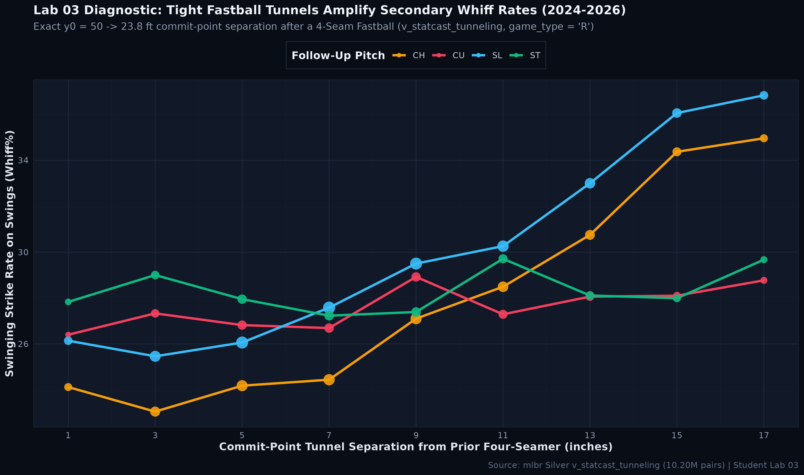

::: {.callout-tip}
### How to Use This Workbook
Open RStudio Server at [**http://192.168.10.1:8787**](http://192.168.10.1:8787), open `mlbr.Rproj`, and run [`workbooks/lab03_tunneling_stuff_plus_workbook.R`](file:///mnt/storage/Rprojects/mlbr/workbooks/lab03_tunneling_stuff_plus_workbook.R) line-by-line with `Ctrl + Enter`. Companion Q-CRISP study: [**Study 03: Commit-Point Pitch Tunneling & Stuff+ / Pitching+**](../analyses/03_tunneling_stuff_plus.html).
:::

---

## 1. Exact `y₀ = 50 ft → 23.8 ft` Commit-Point Tunneling Math

A batter must commit their swing roughly **175 ms before plate arrival**, corresponding to **$y_{\text{commit}} = 23.8\text{ ft}$** from home plate (front edge $y_{\text{plate}} = 1.417\text{ ft}$). Because Statcast velocity/acceleration vectors (`vx0, vy0, vz0, ax, ay, az`) are anchored at **$y_0 = 50.0\text{ ft}$**, we propagate each pitch forward from `50.0 ft` using exact constant-acceleration kinematics:

$$\Delta y = y_{\text{target}} - 50.0, \qquad v_y(y_{\text{target}}) = -\sqrt{v_{y0}^2 + 2 a_y \Delta y}, \qquad t = \frac{v_y(y_{\text{target}}) - v_{y0}}{a_y}$$
$$x(t) = x_0 + v_{x0} t + \tfrac{1}{2} a_x t^2, \qquad z(t) = z_0 + v_{z0} t + \tfrac{1}{2} a_z t^2$$

From sequential same-PA pitch pairs $(p_{k-1}, p_k)$ we compute **Commit-Point Tunnel Separation** ($d_{\text{tunnel}}$ at `23.8 ft`), **Home-Plate Separation** ($d_{\text{plate}}$ at `1.417 ft`), and the **Pavlidis/Judge Break-to-Tunnel Ratio (BTR)**:

$$d_{\text{tunnel}} = 12 \sqrt{(x_k - x_{k-1})^2 + (z_k - z_{k-1})^2}\Big|_{y=23.8}, \qquad \text{BTR} = \frac{d_{\text{plate}}}{\max(d_{\text{tunnel}},\, 0.5\text{ in})}$$

In Part 1 of `lab03_tunneling_stuff_plus_workbook.R`, a 96 mph Four-Seamer (`361.0 ms` flight) followed by an 86 mph Gyro Slider (`402.6 ms` flight) separates by only **`1.50 inches`** at the commit point (`23.8 ft`) before diverging to **`9.93 inches`** at home plate — a **`6.63×`** late-break tunnel ratio!

---

## 2. Full-Population `v_statcast_tunneling` & Out-of-Sample `Stuff+` (`2025`)

Part 2 queries our ADR-001 Silver tunneling table (`10.20M` sequential pairs) and inspects strictly out-of-sample (`eval_split == 'test_oos'`) `2025` Regular-Season pitchers from Gold `data/processed/pitcher_stuff_plus.parquet`:

| Rank | Pitcher (`2025 test_oos`, ≥ 1,000 Pitches) | Pitches | `mlbr Stuff+` | `mlbr Location+` | `mlbr Pitching+` | `Pitching+Tunnel` |
|---:|:---|---:|---:|---:|---:|---:|
| 1 | **Griffin Jax** | 1,093 | 129.8 | 120.4 | **135.2** | **137.5** |
| 2 | **Jacob Misiorowski** | 1,164 | 123.6 | 96.6 | **128.2** | 125.5 |
| 3 | **Aaron Ashby** | 1,033 | 116.5 | 101.6 | **127.9** | 124.6 |
| 4 | **Jacob deGrom** | 2,614 | 122.1 | 112.9 | **126.9** | 126.3 |
| 5 | **Devin Williams** | 1,115 | 118.4 | 110.5 | **125.2** | 124.6 |
| 6 | **Jeremiah Estrada** | 1,236 | 113.9 | 106.1 | **124.2** | 125.6 |
| 7 | **Hunter Greene** | 1,748 | 124.7 | 104.5 | **124.1** | 121.9 |
| 8 | **Zack Wheeler** | 2,394 | 114.9 | 111.9 | **124.1** | 123.4 |
| 9 | **Tarik Skubal** | 2,849 | 112.0 | 100.1 | **123.7** | 121.1 |
| 10 | **Robert Suarez** | 1,076 | 119.0 | 110.9 | **123.6** | 123.8 |

*Zero-Leakage Guardrail:* Notice how Part 2 explicitly filters `eval_split == "test_oos"` (`2025–2026`). Study 03's XGBoost models trained on `2015–2023` (`train_insample`), so downstream evaluation MUST NEVER mix `2020–2023` rows into out-of-sample accuracy claims!

---

## 3. Dark Cyber Visual Diagnostic

{fig-align="center" width="95%"}

*Preserved Assets:* `models/lab03_tunnel_whiff_decay.rds` & `models/lab03_tunnel_whiff_decay.parquet`

Explore the interactive `Stuff+` vs. `Location+` scatter dashboard in [**Study 03: Pitch Tunneling & Stuff+**](../analyses/03_tunneling_stuff_plus.html).

---

## 4. Hands-On Mentor Checkpoints

1. **Checkpoint 1 — Release Tell Simulation:** In Part 1, drop the slider's release height `z0` from `5.78` to `5.40` (a 4.5-inch release-point tip). Quantify how much `tunnel_dist_in` expands and how fast `BTR` collapses.
2. **Checkpoint 2 — Sinker (`SI`) Tunneling:** Change `prev_pitch_type = 'FF'` to `'SI'` in Part 2 and re-plot the whiff curve. Which pitch pairs best off a Sinker: `SL`, `ST`, or `CH`?
3. **Checkpoint 3 — Stabilization Speed:** Load `data/processed/stuff_plus_stabilization_curve.parquet` and find the exact pitch count where `Stuff+` crosses $r = 0.95$ vs. `Location+`.

*Next Lab:* [**Lab 04: Marcel Projections, Delta-Method Aging & Physics Priors**](lab04_player_projections_workbook.html)
