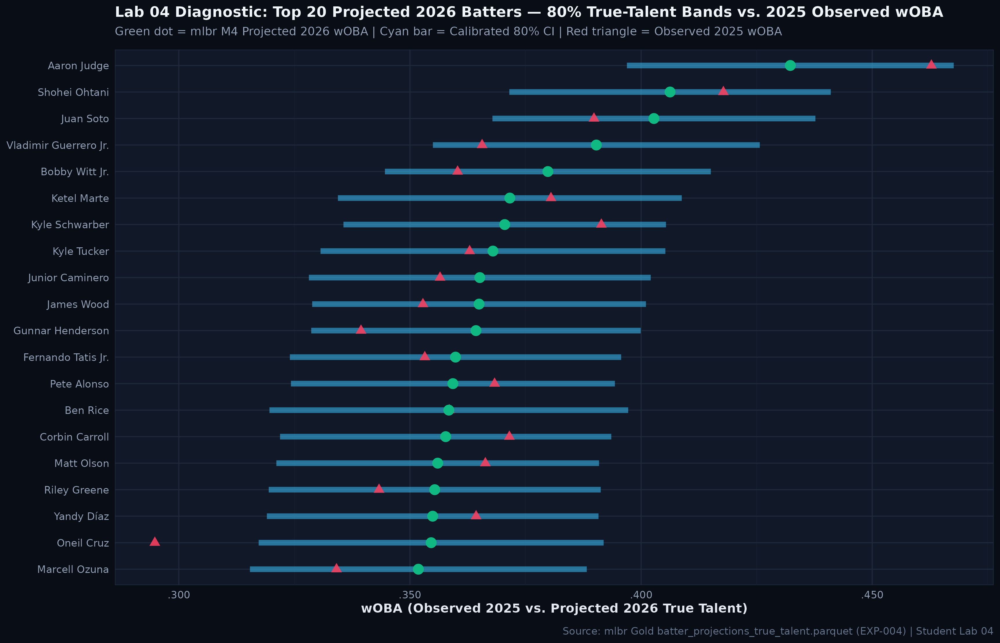

::: {.callout-tip}
### How to Use This Workbook
Open RStudio Server at [**http://192.168.10.1:8787**](http://192.168.10.1:8787), open `mlbr.Rproj`, and run [`workbooks/lab04_player_projections_workbook.R`](file:///mnt/storage/Rprojects/mlbr/workbooks/lab04_player_projections_workbook.R) line-by-line with `Ctrl + Enter`. Companion Q-CRISP study: [**Study 04: Player Projections, Aging Curves & Physics Priors**](../analyses/04_player_projections.html).
:::

---

## 1. First-Principles Projection Math: Outs, Marcel & Uncertainty

### Step 1.1: Never Treat Baseball Innings Pitched (`.1`/`.2`) as Decimals
FanGraphs and MLB box scores store 1 out as `.1` and 2 outs as `.2` (`186.2 IP` = `186.6667` decimal innings, NOT `186.20`!). Always convert before sum-before-divide rate calculations:

$$\text{IP}_{\text{true}} = \lfloor \text{IP} \rfloor + \frac{\text{round}\big(10 \cdot (\text{IP} - \lfloor \text{IP} \rfloor)\big)}{3}$$

### Step 1.2: Era-Adjusted Marcel Shrinkage & Tom Tango's Age Factor
Recency weights $(w_1, w_2, w_3)$ (`5/4/3` batters; `3/2/1` pitchers) pool multi-season excess skill above each season's league average and regress toward the `T-1` run environment using pre-backtest reliability denominator $M_r$:

$$\hat{r}^{\text{Marcel}}_{i,T} = \mu_{\text{lg},T-1,g} + \frac{\sum_{k=1}^{3} w_k \, N_{i,T-k} \, (r_{i,T-k} - \mu_{\text{lg},T-k,g})}{\sum_{k=1}^{3} w_k \, N_{i,T-k} + M_r}$$

Running Part 1B demonstrates why **sample-size shrinkage matters**:
- An **established 27-year-old star** (`1,730` weighted PA across 3 years, `.380/.365/.355` wOBA) earns **`76.0%` reliability weight** → `.355` regressed / `.360` Tango-aged.
- A **hot 23-year-old rookie** (`180` PA, `.380` wOBA) earns only **`29.0%` reliability weight** → `.332` regressed / `.344` Tango-aged!

### Step 1.3: Exposure-Calibrated 80% Uncertainty Bands
$$\text{CI}_{80\%}(i, T) = \hat{y}_{i,T} \pm 1.2816 \sqrt{\hat{\sigma}_{\text{skill}}^2 + \frac{\hat{\sigma}_{\text{noise}}^2}{\widehat{N}_{i,T}}}$$

As projected playing time grows from `150 → 350 → 600 PA`, the 80% wOBA half-width tightens from `±.048` → `±.039` → `±.036` (hitting **`82.8%`** pitcher FIP and **`81.4%`** batter wOBA empirical coverage on locked `2025` OOS!).

---

## 2. Live Statcast Spray Physics & Gold Tier 2 Backtests

Part 2 calculates **`Pulled Air-Ball%`** (`LA >= 10°`, spray `< -15°` RHB / `> +15°` LHB) directly from Bronze `v_statcast` (`2025`, `>= 250` BIP) and inspects our locked `2024 → 2025` OOS ablation ladder:

| Rank | Batter (`2025`, ≥ 250 BIP) | BIP | **Pulled Air%** | BIP `xwOBA` |
|---:|:---|---:|---:|---:|
| 1 | **Isaac Paredes** | 302 | **39.4%** | .328 |
| 2 | **Cal Raleigh** | 410 | **37.1%** | .467 |
| 3 | **Pete Crow-Armstrong** | 451 | **31.0%** | .401 |
| 4 | **José Ramírez** | 524 | **30.5%** | .355 |
| 5 | **Spencer Torkelson** | 399 | **30.3%** | .407 |
| 6 | **Kyle Schwarber** | 404 | **29.7%** | .499 |

Adding spray physics (`Pulled Air%`), `EV90`, and `Zone-Chase Selectivity (Z-O%)` slashes locked `2025` Batter `wOBA` wRMSE from `0.03215` (true Tango `B2`) to **`0.03121`** ($p_{\text{beat}} = 0.995$), while `M4_Component_FIP` slashes Pitcher `FIP` wRMSE from `0.80631` to **`0.77185`** ($p_{\text{beat}} = 0.995$).

---

## 3. Dark Cyber Visual Diagnostic

{fig-align="center" width="95%"}

*Preserved Assets:* `models/lab04_top20_batter_uncertainty_bands.rds` & `models/lab04_top20_batter_uncertainty_bands.parquet`

Inspect the interactive Pitcher & Batter Plotly frontiers (with Live `2027` hover projections) in [**Study 04: Player Projections & Aging**](../analyses/04_player_projections.html).

---

## 4. Hands-On Mentor Checkpoints

1. **Checkpoint 1 — Metric-Specific Reliability (`M`):** Change `M` in Part 1B from `2200` (`wOBA`) to `250` (`K%`). Compare the rookie's trust weight and explain why strikeout rates stabilize ~9× faster than overall batting value.
2. **Checkpoint 2 — Survivorship Bias in Aging Curves:** Load `data/processed/projections_aging_curves.parquet` and plot `cum_delta_smooth` vs. `naive_centered` for `group == "SP"`, `metric == "FBv (mph)"`. Verify the `-5.12 mph` vs. `-2.68 mph` survivorship gap at Age 38.
3. **Checkpoint 3 — Injured / Missed-2026 Retention (`played_2026 == 0`):** Filter `data/processed/pitcher_projections_true_talent.parquet` to `projection_year == 2027L & played_2026 == 0L` and examine how injured pitchers retain regressed aging-adjusted priors without double-counting.

*Next Lab:* [**Lab 05: Markov Decomposed Pitching+ & Swing Decisions**](lab05_decomposed_pitching_decisions_workbook.html)
