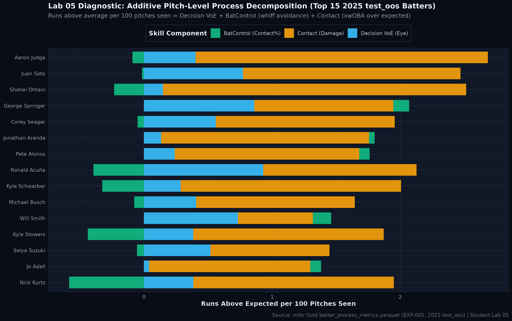

::: {.callout-tip}
### How to Use This Workbook
Open RStudio Server at [**http://192.168.10.1:8787**](http://192.168.10.1:8787), open `mlbr.Rproj`, and execute [`workbooks/lab05_decomposed_pitching_decisions_workbook.R`](file:///mnt/storage/Rprojects/mlbr/workbooks/lab05_decomposed_pitching_decisions_workbook.R) line-by-line with `Ctrl + Enter`. Companion Q-CRISP study: [**Study 05: Decomposed Pitching+ & Batter Process Engine**](../analyses/05_decomposed_pitching_decisions.html).
:::

---

## 1. First-Principles Markov Pitch Pricing & Zero-Mean Decision VoE

Instead of regressing directly on noisy base-out `delta_run_exp`, Study 05 predicts 5 clean transition probabilities (`p_sw`, `p_cs`, `p_wh`, `p_fl`, `xwOBA|BIP`) and prices them via exact `2015–2023` context-neutral 12-count linear weights ($\beta_{\text{xwOBA}} = 0.8593$):

$$\text{EV}_{\text{take}} = \hat{p}_{\text{cs}}\,\Delta\text{RV}_{\text{strike}} + (1 - \hat{p}_{\text{cs}})\,\Delta\text{RV}_{\text{ball}}, \qquad \text{EV}_{\text{swing}} = \hat{p}_{\text{wh}}\,\Delta\text{RV}_{\text{strike}} + (1 - \hat{p}_{\text{wh}})\,\text{EV}_{\text{contact}}$$
$$\text{decision\_voe}_i = (I_{\text{swing},i} - \hat{p}_{\text{sw},i})\big(\text{EV}_{\text{swing},i} - \text{EV}_{\text{take},i}\big)$$

Because we subtract the league-average swing probability $\hat{p}_{\text{sw},i}$, an average batter's expected `decision_voe` equals **`0.000`** identically across every pitch type and count—eliminating pitch-mix bias!

In Part 1 of `workbooks/lab05_decomposed_pitching_decisions_workbook.R`:
- **3-2 Full-Count Chase Slider** (`p_sw = 0.45`, `p_cs = 0.05`, `p_wh = 0.52`, `xwOBA = .220`): Taking earns a strong positive reward (`EV_take >> EV_swing`), while chasing incurs a steep run penalty because `3-2` has a **`0.6018` run** Ball-Strike spread!
- **1-0 Heart-Zone Fastball** (`p_sw = 0.78`, `p_cs = 0.96`, `p_wh = 0.14`, `xwOBA = .460`): Attacking generates positive run value (`EV_swing > EV_take`), whereas passively watching a strike costs expected runs.

---

## 2. Inspecting Gold `EXP-005` Pitchers, Batters & Benchmarks

Running Part 2 loads `data/processed/decomp_count_rv_table.parquet`, `pitcher_decomp_pitching_plus.parquet`, `batter_process_metrics.parquet`, and `decomp_benchmark_ablation.parquet`:

- **Locked `2024 → 2025` `SIERA` ($N = 329$):** **`Decomp Pitching+`** achieves **`w_r = -0.5040`** (beating Study 03 `-0.4984` and FanGraphs `Stuff+` `-0.4753`), while **`Decomp Location+`** leads `2025 BB%` command at **`w_r = -0.3273`** (nearly 2× FanGraphs `Pitching+` `-0.1801`!).
- **Locked `2024 → 2025` Batters ($N = 265$):** **`Decision+`** hits **`r_YoY = 0.8464`** and forecasts `2025 BB%` at **`w_r = +0.5583`** (vs. `Z-O%` proxy `+0.3994`), while **`BatControl+`** hits `r_YoY = 0.8179` (`-0.7240` on `2025 K%`) and **`BatterProcess+`** leads `2025 test_oos` with **Aaron Judge (`134.4`)**, **Juan Soto (`132.4`)**, and **Shohei Ohtani (`129.9`)**.

---

## 3. Dark Cyber Visual Diagnostic

{fig-align="center" width="95%"}

*Preserved Assets:* `models/lab05_batter_process_decomposition.rds` & `models/lab05_batter_process_decomposition.parquet`

Explore both interactive Plotly dashboards (`Decomp Stuff+` vs. `Location+` and `Decision+` vs. `Contact+`) in [**Study 05: Decomposed Pitching+ & Batter Process Engine**](../analyses/05_decomposed_pitching_decisions.html).

---

## 4. Hands-On Mentor Checkpoints

Complete these 3 exercises inside `workbooks/lab05_decomposed_pitching_decisions_workbook.R` in RStudio Server, then ask me to review your code:

1. **Checkpoint 1 — Zero-Mean Choice Weighting:** Change the 3-2 chase slider's `p_sw` from `0.45` to `0.05` (an obvious pitch in the dirt). Observe how `voe_if_take` shrinks toward `0` while `voe_if_swing` becomes massively negative—and explain why subtracting `p_sw` removes pitch-mix bias.
2. **Checkpoint 2 — Hawk-Eye vs. Full-Era `Stuff+`:** Compare `decomp_stuff_plus` (`2015–2023`) against `decomp_stuff_he_plus` (`2020–2023`) for `2025` pitchers with heavy sweeper (`ST`) usage or high release extension. Where do the two eras diverge most?
3. **Checkpoint 3 — Batter Archetype Out-of-Sample Test:** Segment `2025 test_oos` batters into **Free-Swinging Sluggers** (`decision_plus < 95 & contact_plus > 115`) vs. **Patient Table-Setters** (`decision_plus > 115 & contact_plus < 95`) and compare their `2026` `BatterProcess+` and `sc_bip_xwoba`.
