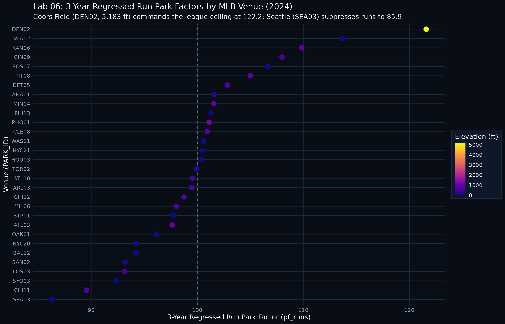

::: {.callout-tip}
### How to Use This Workbook
Open RStudio Server at [**http://192.168.10.1:8787**](http://192.168.10.1:8787), open `mlbr.Rproj`, and run [`workbooks/lab06_ballpark_factors_workbook.R`](file:///mnt/storage/Rprojects/mlbr/workbooks/lab06_ballpark_factors_workbook.R) line-by-line with `Ctrl + Enter`. Companion Q-CRISP study: [**Study 06: Empirical Ballpark Factors**](../analyses/06_ballpark_factors.html).
:::

---

## 1. First-Principles Ballpark Factor Math & Shrinkage Mechanics

### Step 1.1: Raw Scoring Ratio & League Symmetry Adjustment
Single-season park factors measure the scoring rate in home games (both teams) versus road games (both teams):

$$\text{Ratio} = \frac{R_{\text{home}} / G_{\text{home}}}{R_{\text{road}} / G_{\text{road}}}$$

Because road games are played across the other 29 parks in the league, the exact 30-team league symmetry correction is:

$$\text{PF}_{\text{raw}} = \frac{30 \cdot \text{Ratio}}{29 + \text{Ratio}} \times 100$$

### Step 1.2: 3-Year Weighted Regression & Empirical Bayes Shrinkage
$$\text{PF}_{\text{reg}} = 100 + (\text{PF}_{\text{3yr}} - 100) \times \frac{G_{\text{tot}}}{G_{\text{tot}} + M}$$

Where $M = 40$ games for runs, $M = 1500$ PA for home runs, and $M = 2000$ PA for strikeouts, walks, and BABIP.

---

## 2. 2024 MLB Ballpark Factor Leaderboard

Running Part 2 inspects `data/processed/ballpark_factors_2002_2025.parquet` for the 2024 season:

| Venue | Park ID | Elevation | Raw PF | **3-Yr Regressed Run PF** | Overall HR PF |
|:---|:---|---:|---:|---:|---:|
| **Coors Field** | DEN02 | 5,183 ft | 115.6 | **122.2** | 101.5 |
| **loanDepot park** | MIA02 | 15 ft | 127.6 | **114.1** | 98.4 |
| **Fenway Park** | BOS07 | 21 ft | 103.7 | **106.8** | 86.4 |
| **Great American Ball Park** | CIN09 | 490 ft | 108.2 | **106.2** | **132.7** |
| **Kauffman Stadium** | KAN06 | 886 ft | 107.5 | **105.8** | 94.2 |

---

## 3. Dark Cyber Visual Diagnostic

{fig-align="center" width="95%"}

*Preserved Assets:* `models/lab06_ballpark_factors_summary.rds` & `models/lab06_ballpark_factors_summary.parquet`

Inspect the interactive 3D and 2D Plotly explorers in [**Study 06: Empirical Ballpark Factors & Handedness Asymmetry**](../analyses/06_ballpark_factors.html).

---

## 4. Hands-On Mentor Checkpoints

1. **Checkpoint 1 — Shrinkage Denominator Sensitivity (`M`):** In Part 1B, change `M` from 40 to 120. Why does a smaller `M` respond faster to major stadium renovations (e.g. moving in the fences at Camden Yards or Comerica Park) while a larger `M` guards against flukes?
2. **Checkpoint 2 — Out-of-Time Stability:** Load `data/processed/ballpark_factors_2002_2025.parquet` and compute the year-over-year correlation `r(pf_runs[t], pf_runs[t+1])` across continuous venues. Compare that against the raw 1-year ratio correlation `r(pf_runs_raw[t], pf_runs_raw[t+1])`.
3. **Checkpoint 3 — Yankee Stadium vs Fenway Park Geometry:** Inspect `NYC21` (Yankee Stadium) vs `BOS07` (Fenway Park). Why does Fenway produce a high BABIP factor (`pf_babip > 105`) and modest HR factor, while Yankee Stadium produces an extreme left-handed home run factor and neutral BABIP?
