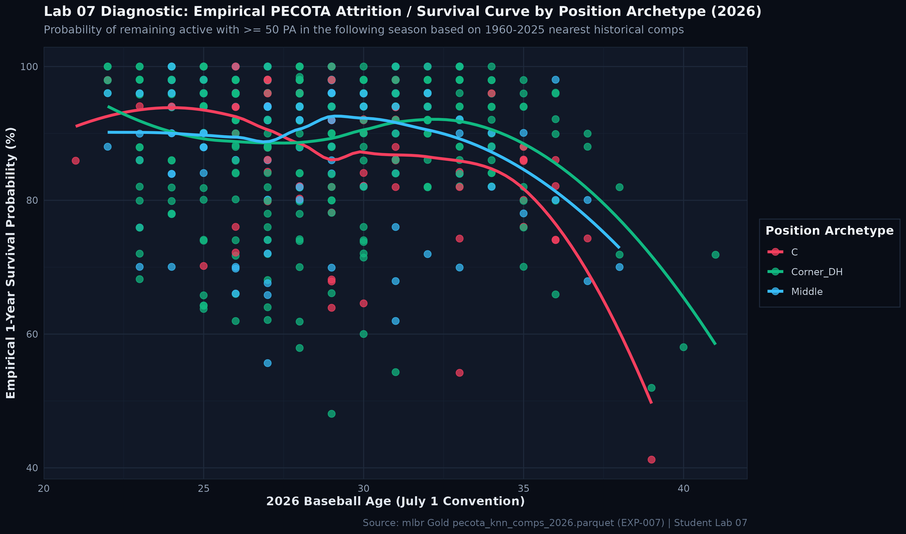

::: {.callout-tip}
### How to Use This Workbook
Open RStudio Server at [**http://192.168.10.1:8787**](http://192.168.10.1:8787), open `mlbr.Rproj`, and run [`workbooks/lab07_pecota_zips_ensemble_workbook.R`](file:///mnt/storage/Rprojects/mlbr/workbooks/lab07_pecota_zips_ensemble_workbook.R) line-by-line with `Ctrl + Enter`. Companion Q-CRISP study: [**Study 07: PECOTA k-NN, ZiPS Archetype Aging & Meta-Ensemble**](../analyses/07_pecota_zips_ensemble.html).
:::

---

## 1. First-Principles Era-Neutralized PECOTA Similarity Math

To compare players across different offensive eras (e.g., 1963 Mickey Mantle vs. 2025 Aaron Judge), we standardize each stat into a seasonal $z$-score and compute the weighted Euclidean distance:
$$d_{ij} = \sqrt{\sum_f \alpha_f \big(z_i^{(f)} - z_j^{(f)}\big)^2}, \qquad \text{Similarity} = 100 \cdot e^{-0.22 \cdot d_{ij}}$$

---

## 2. Empirical Non-Pitch Reliability & 5-Paradigm Shootout

Running Part 2 loads the Gold `EXP-007` tables to inspect:
1. **Non-Pitch YoY Reliability (`2002–2025`):** Statcast **OAA (`r = 0.506`)** beats **DRS (`r = 0.431`)** and **UZR/150 (`r = 0.374`)**.
2. **5-Paradigm OOS Shootout (`2024 -> 2025`):** Compares `B2_Marcel`, `M_ZiPS_Archetype`, `M_PECOTA_kNN`, `M4_Statcast_Physics`, and `M5_Consensus_Ensemble`.
3. **Top-3 Historical Pitcher Comps** (Paul Skenes → Noah Syndergaard '16 / José Fernández '15 / Clayton Kershaw '11) and **5-Year ZiPS Career Trajectories (`2026–2030`)**.

---

## 3. Diagnostic Chart: PECOTA Attrition & Survival Curves by Position Archetype

{width=100%}

---

## 4. Mentor Checkpoints (Hands-On Exercises)

1. **Checkpoint 1 (Defense Stabilization):** Compare the YoY $r$ of Statcast `OAA` (`0.506`) vs. `DRS` (`0.431`) vs. `UZR/150` (`0.374`). Why does tracking-based catch probability stabilize faster than legacy zone-grid fielding metrics?
2. **Checkpoint 2 (PECOTA Breakout Hunters):** Filter `pecota_knn_comps_2026.parquet` for young batters (`age_2026 <= 25`, `comp_rank == 1`) sorted by descending `breakout_prob`. Which young 2026 hitters have the strongest empirical breakout profiles?
3. **Checkpoint 3 (Point Estimate vs. Distributional Value):** Inspect how the exact KKT convex stacker blends `68.1% M4 + 31.9% PECOTA` on batters (highest `w_r = 0.5782`) and `81.8% M4 + 11.1% Marcel + 7.1% ZiPS` on pitchers (lowest `w_rmse = 0.71565`), demonstrating true orthogonal ensemble lift.
