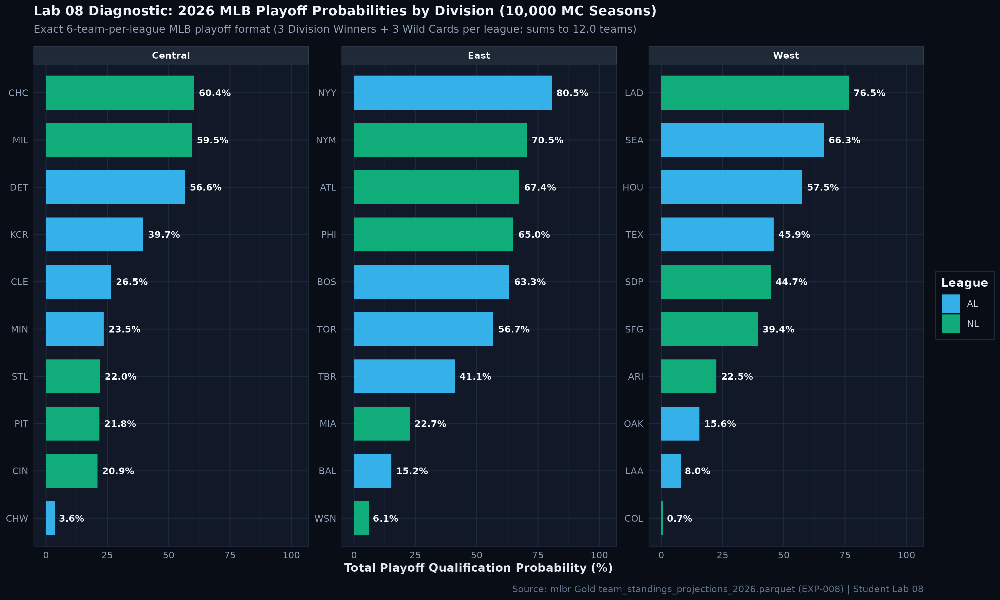

::: {.callout-tip}
### How to Use This Workbook
Open RStudio Server at [**http://192.168.10.1:8787**](http://192.168.10.1:8787), open `mlbr.Rproj`, and run [`workbooks/lab08_team_baseruns_pythagenpat_workbook.R`](file:///mnt/storage/Rprojects/mlbr/workbooks/lab08_team_baseruns_pythagenpat_workbook.R) line-by-line with `Ctrl + Enter`. Companion Q-CRISP study: [**Study 08: BaseRuns, Pythagenpat & 2026 Standings**](../analyses/08_team_baseruns_pythagenpat.html).
:::

---

## 1. First-Principles BaseRuns & Dynamic Pythagenpat Math

$$\text{BaseRuns} = \frac{A \cdot B}{B + C} + D, \qquad \gamma = \left(\frac{RS + RA}{G}\right)^{0.287}$$

---

## 2. Diagnostic Chart: 2026 MLB Playoff Odds by Division (10,000 MC Seasons)

{width=100%}

---

## 3. Mentor Checkpoints (Hands-On Exercises)

1. **Checkpoint 1 (BaseRuns vs. Sequencing Luck):** Query `hist_dt[season == 2024][order(-luck_wins)]`. Which 2024 clubs outperformed their BaseRuns expectation the most, and how did they regress in 2025?
2. **Checkpoint 2 (Dynamic Pythagenpat Exponent Across Eras):** Compare mean `pyth_gamma` in 2014 (low-scoring) vs. 2019 (high-scoring). Why is a $+100$ run differential worth more wins in a low-run era?
3. **Checkpoint 3 (Division Difficulty & Schedule Strength):** Compare the 2026 NL East (Phillies/Braves/Mets) vs. the AL West (Mariners). Why do the 87.2-win Mariners hold higher division odds (`40.9%`) than the 88.0-win Phillies (`28.9%`)?
