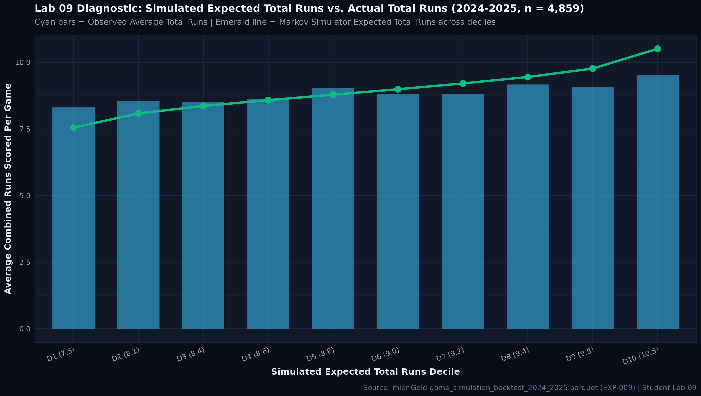

::: {.callout-tip}
### How to Use This Workbook
Open RStudio Server at [**http://192.168.10.1:8787**](http://192.168.10.1:8787), open `mlbr.Rproj`, and run [`workbooks/lab09_game_monte_carlo_simulator_workbook.R`](file:///mnt/storage/Rprojects/mlbr/workbooks/lab09_game_monte_carlo_simulator_workbook.R) line-by-line with `Ctrl + Enter`. Companion Q-CRISP study: [**Study 09: Level 4 Markov Game Simulator**](../analyses/09_game_monte_carlo_simulator.html).
:::

---

## 1. First-Principles Multi-Category Log5 & Park-Adjusted Event Probabilities

$$P_{ij}(E) = \frac{\big(P_{\text{bat}}(E) \cdot P_{\text{pit}}(E) / P_{\text{lg}}(E)\big) \cdot \text{PF}(E)}{\sum_k \big(P_{\text{bat}}(E_k) \cdot P_{\text{pit}}(E_k) / P_{\text{lg}}(E_k)\big) \cdot \text{PF}(E_k)}$$

---

## 2. Diagnostic Chart: Simulated Expected Total Runs vs. Actual Total Runs (`n = 4,859`)

{width=100%}

---

## 3. Mentor Checkpoints (Hands-On Exercises)

1. **Checkpoint 1 (Run-Line `-1.5` Pricing):** Compute the empirical cover rate of `home_score - away_score >= 2` when `p_m4_rl15 >= 0.45` vs. `< 0.30`. How closely does the Markov joint score matrix match actual 2+ run margins?
2. **Checkpoint 2 (Win Expectancy Leverage):** Compare `home_we` for Top 9th, 0 outs, bases empty, tied vs. Bottom 9th, 0 outs, bases loaded, tied. How much win probability is created by loading the bases with 0 outs?
3. **Checkpoint 3 (Brier Score Alpha in MLB):** Inspect why a `0.0045–0.0051` Brier Score reduction (`0.24897` → `0.24387`/`0.24451`) across `4,859` MLB games represents substantial predictive signal in a high-variance sport.
