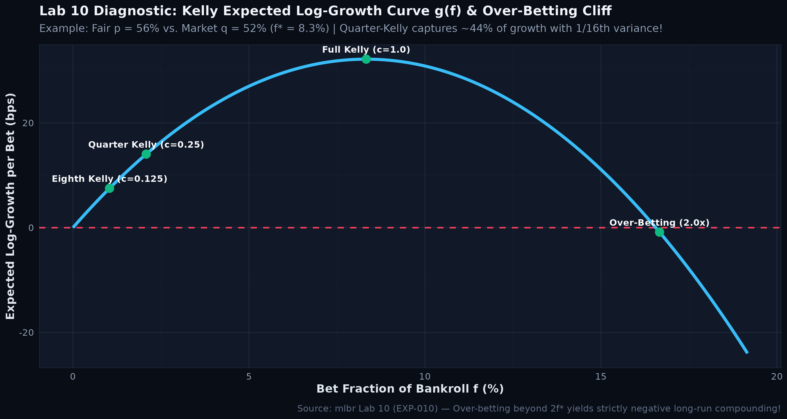

::: {.callout-tip}
### How to Use This Workbook
Open RStudio Server at [**http://192.168.10.1:8787**](http://192.168.10.1:8787), open `mlbr.Rproj`, and run [`workbooks/lab10_market_edge_prediction_valuation_workbook.R`](file:///mnt/storage/Rprojects/mlbr/workbooks/lab10_market_edge_prediction_valuation_workbook.R) line-by-line with `Ctrl + Enter`. Companion Q-CRISP study: [**Study 10: Level 5 Market Edge & Prediction Market Valuation**](../analyses/10_market_edge_prediction_valuation.html).
:::

---

## 1. First-Principles Binary Contract Math: EV, Fractional Kelly & CLV

For a binary market contract priced at implied probability $q = 1 / O$ (e.g., `55¢` on Kalshi/Polymarket $\Rightarrow O = 1.8182$) against a calibrated Level 4 fair probability $p$:

$$\text{EV} = p \cdot (O - 1) - (1 - p) = p \cdot O - 1$$

$$f^* = \min\!\left(f_{\max},\; c \cdot \max\!\left(0,\; \frac{p \cdot b - (1 - p)}{b}\right)\right), \quad b = O - 1$$

$$\text{CLV} = \frac{O_{\text{entry}}}{O_{\text{close}}} - 1$$

For example, buying a `55¢` contract with fair value `60%` that closes at `58¢` yields **`EV = +9.09%`**, **`CLV = +5.45%`**, **Full Kelly `11.11%`**, **Quarter Kelly (`c = 0.25`) `2.78%`**, and **Eighth Kelly (`c = 0.125`) `1.39%`**.

---

## 2. Diagnostic Chart: Expected Log-Growth Curve $g(f)$ & The Over-Betting Cliff

{width=100%}

Notice the asymmetric concavity of logarithmic utility: **Quarter-Kelly ($c = 0.25$)** and **Eighth-Kelly ($c = 0.125$)** sit on the steep left shoulder of $g(f)$, capturing substantial compounding growth while slashing variance by $16\times$ to $64\times$. Conversely, over-estimating edge and betting past $2 f^*$ pushes expected log-growth strictly **negative** even on positive-EV bets!

---

## 3. Mentor Checkpoints (Hands-On Exercises)

1. **Checkpoint 1 (Overround & Vig Stripping):** Inspect `sum(fut$pm_ws_mid)` vs. `sum(fut$pm_ws_novig)` in `data/processed/market_2026_futures_valuation.parquet`. Why does an early-season Polymarket World Series orderbook sum to `~191.7%` (`+91.7%` overround), and how does vig stripping change which clubs appear undervalued?
2. **Checkpoint 2 (Drawdown vs. Growth Trade-Off):** In `market_staking_summary_2024_2025.parquet` for Locked `2025` OOS (`Sportsbook -105`, `ev_min == 0.02`), compare `Full_Kelly` (`199.9u`, `ROI +0.88%`, `Max DD 78.4%`) vs. `Eighth_Kelly` (`131.9u`, `ROI +2.07%`, `Max DD 29.5%`). Why can Eighth-Kelly outperform Full-Kelly on dollar-weighted ROI% while cutting peak-to-trough drawdown by more than half?
3. **Checkpoint 3 (Transaction-Cost Sensitivity in Prediction Markets):** Compare `Quarter_Kelly` on Locked `2025` OOS at `ev_min == 0.02` between Sportsbook `-105` (`2.44%` overround $\rightarrow$ `152.9u`, Sharpe `0.93`) and Exchange `-102` (`0.99%` overround $\rightarrow$ `242.0u`, Sharpe `1.43`). Quantify how much compound bankroll growth is unlocked strictly by lowering execution friction by `1.38%`.
