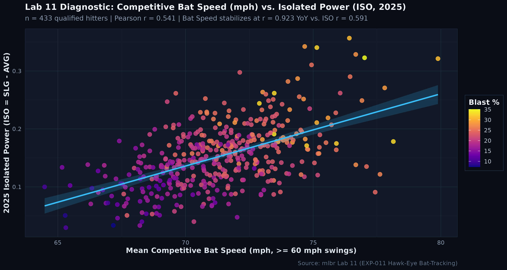

::: {.callout-tip}
### How to Use This Workbook
Open RStudio Server at [**http://192.168.10.1:8787**](http://192.168.10.1:8787), open `mlbr.Rproj`, and run [`workbooks/lab11_bat_tracking_arm_slot_biomechanics_workbook.R`](file:///mnt/storage/Rprojects/mlbr/workbooks/lab11_bat_tracking_arm_slot_biomechanics_workbook.R) line-by-line with `Ctrl + Enter`. Companion Q-CRISP study: [**Study 11: Hawk-Eye Bat-Tracking & Arm-Slot Biomechanics**](../analyses/11_bat_tracking_arm_slot_biomechanics.html).
:::

---

## 1. First-Principles Collision Physics: MaxEV, Squared-Up & Blast Rate

$$\text{MaxEV} = 1.23 \cdot v_{\text{bat}} + 0.2116 \cdot v_{\text{release}}$$

A batted ball is **Squared-Up** when $\text{SqUp} = \text{EV} / \text{MaxEV} \ge 0.80$, and is a **Blast** when $\text{SqUp} \ge 0.80$ **and** $v_{\text{bat}} + 100 \cdot \text{SqUp} \ge 164$.

---

## 2. Diagnostic Chart: Competitive Bat Speed vs. 2025 Isolated Power (ISO)

{width=100%}

---

## 3. Mentor Checkpoints (Hands-On Exercises)

1. **Checkpoint 1 (Compact vs. Long Power Swings):** Compare Juan Soto (`73.5 mph`, `7.03 ft` swing length, `32.9%` Blast Rate) against Giancarlo Stanton (`79.9 mph`, `8.76 ft`, `31.0%` Blast Rate). Compute `mean_bat_speed / mean_swing_length` across `b25` to identify MLB's highest angular-whip hitters.
2. **Checkpoint 2 (Why Arm Angle Matters for 4-Seam Whiffs):** In `pitcher_arm_angle_biomechanics_2020_2026.parquet` (`season == 2025`), compare mean `ff_whiff_rate` for pitchers with `ivb_above_slot >= +1.5"` vs. `<= -1.5"`.
3. **Checkpoint 3 (Process vs. Outcome Reliability):** Inspect `biomechanics_yoy_reliability_2024_2025.parquet`. Why does `bat_speed` (`r = 0.923` YoY) cut locked-2025 OOS ISO RMSE by `3.65%` even when prior-year ISO is already in the regression?
