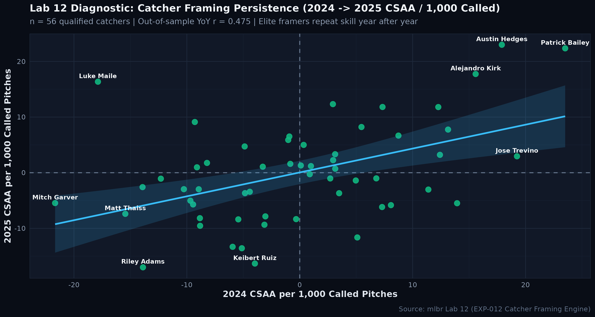

::: {.callout-tip}
### How to Use This Workbook
Open RStudio Server at [**http://192.168.10.1:8787**](http://192.168.10.1:8787), open `mlbr.Rproj`, and run [`workbooks/lab12_weather_umpire_catcher_framing_workbook.R`](file:///mnt/storage/Rprojects/mlbr/workbooks/lab12_weather_umpire_catcher_framing_workbook.R) line-by-line with `Ctrl + Enter`. Companion Q-CRISP study: [**Study 12: Weather/Wind Carry, Umpire Zones & Catcher Framing**](../analyses/12_weather_umpire_catcher_framing.html).
:::

---

## 1. First-Principles Weather Carry & Catcher Framing Run Value

$$\Delta R_{\text{weather}} = +0.0323 \cdot (\text{Temp}_F - 70) + 0.0132 \cdot \text{WindOut}_{\text{mph}}$$
$$\text{FramingRuns}_{c,t} = 0.125 \cdot \text{CSAA}_{c,t}$$

---

## 2. Diagnostic Chart: Catcher Framing Persistence (`2024 -> 2025`)

{width=100%}

---

## 3. Mentor Checkpoints (Hands-On Exercises)

1. **Checkpoint 1 (Wrigley Wind Swing):** Filter `game_weather_umpire_environment_2015_2025.parquet` to `park_id == "CHI11"` and compare mean `actual_total_runs` when `wind_out_mph >= 10` vs. `<= -10`.
2. **Checkpoint 2 (Zero-Sum Season Centering):** Explain why comparing 2025 called pitches to an uncentered 2021–2023 strike-zone grid produces a negative framing bias across all 2025 catchers as MLB tightened umpire strike zones.
3. **Checkpoint 3 (Umpire Empirical Bayes Shrinkage):** Compare `sd(raw_rpg_dev)` vs. `sd(ump_rpg_eb)` for veteran umpires (`>= 60` games) in `umpire_zone_factors_2015_2025.parquet`.
