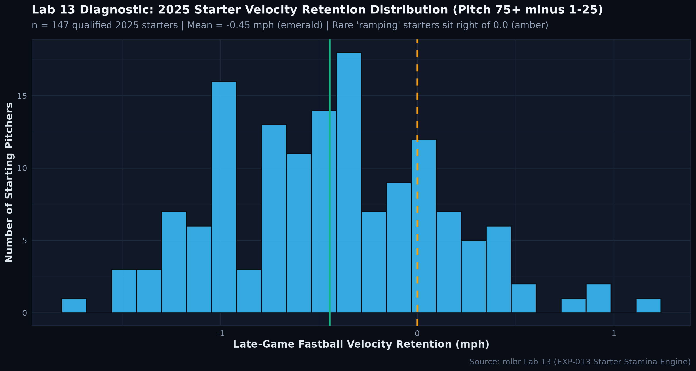

::: {.callout-tip}
### How to Use This Workbook
Open RStudio Server at [**http://192.168.10.1:8787**](http://192.168.10.1:8787), open `mlbr.Rproj`, and run [`workbooks/lab13_pitcher_stamina_bullpen_fatigue_workbook.R`](file:///mnt/storage/Rprojects/mlbr/workbooks/lab13_pitcher_stamina_bullpen_fatigue_workbook.R) line-by-line with `Ctrl + Enter`. Companion Q-CRISP study: [**Study 13: Pitcher Stamina & Bullpen Fatigue**](../analyses/13_pitcher_stamina_bullpen_fatigue.html).
:::

---

## 1. First-Principles Bullpen Fatigue Penalty

$$\Delta R_{\text{BP}}(c, t) = 0.0516 \cdot \frac{P_{c,t}^{(3d)} - \bar{P}^{(3d)}}{100}$$

---

## 2. Diagnostic Chart: 2025 Starter Late-Game Velocity Retention Distribution

{width=100%}

---

## 3. Mentor Checkpoints (Hands-On Exercises)

1. **Checkpoint 1 (Survivorship Bias Past Pitch 80):** In `starter_velocity_decay_curve_2018_2025.parquet`, explain why mean fastball velocity rebounds from `-0.43 mph` (`61–80`) to `-0.04 mph` (`101+`) while pitcher Run Value/100 simultaneously worsens to `+0.35`.
2. **Checkpoint 2 (Zero-Leakage Rolling Windows):** Why is `g2.game_date < g1.game_date` mandatory in the rolling 3-day DuckDB join to prevent same-day doubleheader look-ahead?
3. **Checkpoint 3 (Taxed vs. Light-Load Bullpens):** Compare `mean(late_runs_allowed)` for `Taxed (181+)` vs. `Light (61-100)` bullpens strictly in `2024–2025`.
