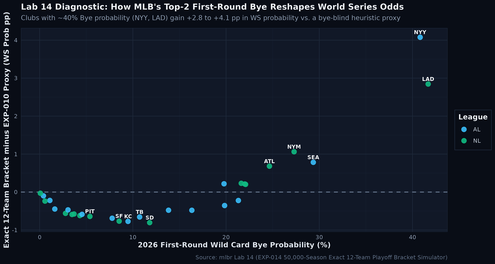

::: {.callout-tip}
### How to Use This Workbook
Open RStudio Server at [**http://192.168.10.1:8787**](http://192.168.10.1:8787), open `mlbr.Rproj`, and run [`workbooks/lab14_unified_pro_game_f5_totals_bracket_workbook.R`](file:///mnt/storage/Rprojects/mlbr/workbooks/lab14_unified_pro_game_f5_totals_bracket_workbook.R) line-by-line with `Ctrl + Enter`. Companion Q-CRISP study: [**Study 14: Unified Pro Multi-Market Engine & 12-Team Bracket**](../analyses/14_unified_pro_game_f5_totals_bracket.html).
:::

---

## 1. First-Principles Playoff Series Math: Best-of-3 vs. Best-of-7

For a `56.0%` favorite, winning a Best-of-3 Wild Card series is only `59.0%` ($p^2 + 2p^2(1-p)$), whereas a Best-of-7 series lifts the favorite to `62.9%` — making MLB's **Top-2 First-Round Bye** worth `+2.8` to `+4.1` percentage points in true World Series probability!

---

## 2. Diagnostic Chart: First-Round Bye Boost on 2026 World Series Odds

{width=100%}

---

## 3. Mentor Checkpoints (Hands-On Exercises)

1. **Checkpoint 1 (Why F5 Beats Full-Game on ROC AUC):** Compare locked-2025 OOS ROC AUC of `p_m6_f5` (`0.5846`) vs. `p_m6_ml` (`0.5742`). Why does isolating innings 1–5 sharpen starter-level discrimination?
2. **Checkpoint 2 (Weather + Umpire + Bullpen Fatigue Totals Lift):** Inspect `unified_pro_multi_market_metrics.parquet` and quantify the locked-2025 Total-Runs RMSE reduction (`4.5862` $\rightarrow$ `4.5732`).
3. **Checkpoint 3 (AL vs. NL Structural Pennant Value):** Explain why Seattle (`87.2 W`, `AL`, `29.4%` Bye) carries a higher Pennant probability (`13.9%`) than Atlanta (`88.7 W`, `NL`, `24.7%` Bye, `13.8%` Pennant).
