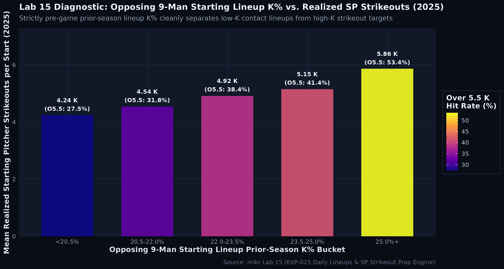

::: {.callout-tip}
### How to Use This Workbook
Open RStudio Server at [**http://192.168.10.1:8787**](http://192.168.10.1:8787), open `mlbr.Rproj`, and run [`workbooks/lab15_daily_lineups_platoon_k_props_workbook.R`](file:///mnt/storage/Rprojects/mlbr/workbooks/lab15_daily_lineups_platoon_k_props_workbook.R) line-by-line with `Ctrl + Enter`. Companion Q-CRISP study: [**Study 15: Daily 9-Man Lineups & Pitcher Strikeout Props**](../analyses/15_daily_lineups_platoon_k_props.html).
:::

---

## 1. First-Principles Poisson Strikeout Prop Pricing

For a starting pitcher with pre-game expected strikeouts $\lambda_i = \mathbb{E}[\text{SO}_i]$, exact binary Over/Under prop fair probabilities are:
$$P(\text{SO}_i > 5.5) = 1 - \sum_{k=0}^{5} \frac{e^{-\lambda_i}\lambda_i^k}{k!}$$
For an ace priced at $\lambda = 6.0$ K, fair probabilities are **`71.5%` Over 4.5 K**, **`55.4%` Over 5.5 K**, and **`39.4%` Over 6.5 K**.

---

## 2. Diagnostic Chart: Opposing 9-Man Starting Lineup K% vs. Realized SP Strikeouts (`2025`)

{width=100%}

---

## 3. Mentor Checkpoints (Hands-On Exercises)

1. **Checkpoint 1 (Poisson Overdispersion Check):** Compare `var(sp_actual_so)` vs. `mean(sp_actual_so)` in `sp_strikeout_prop_backtest_2024_2025.parquet` (`season == 2025L`). How does mild overdispersion affect tail probabilities (`Over 8.5 K`)?
2. **Checkpoint 2 (Why Prop AUC Exceeds Game-Winner AUC):** Inspect `sp_k_prop_ablation_metrics_2025.parquet`. Why does `M2_Pro_K_Prop_Engine` reach **`AUC = 0.6638`** on `Over 5.5 K` (a `+0.0228` jump over starter-prior-only!) while Full-Game ML AUC sits near `0.574`?
3. **Checkpoint 3 (Ballpark Handedness HR Asymmetry):** Inspect `models/kprop03_platoon_park_lineup_asymmetry.parquet` to identify the top 3 LHB-favored and RHB-favored HR parks in MLB.
