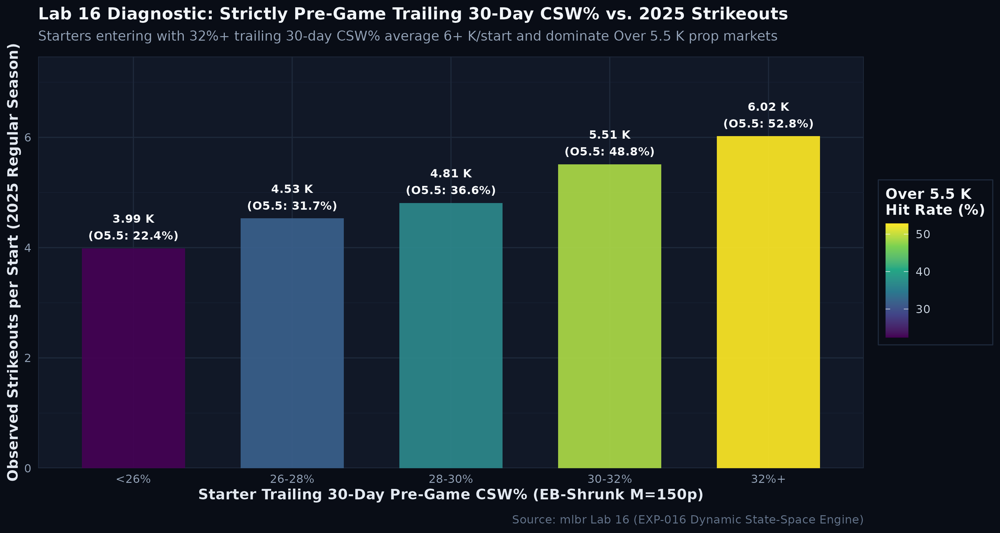

::: {.callout-tip}
### How to Use This Workbook
Open RStudio Server at [**http://192.168.10.1:8787**](http://192.168.10.1:8787), open `mlbr.Rproj`, and run [`workbooks/lab16_dynamic_statespace_negbin_k_props_workbook.R`](file:///mnt/storage/Rprojects/mlbr/workbooks/lab16_dynamic_statespace_negbin_k_props_workbook.R) line-by-line with `Ctrl + Enter`. Companion Q-CRISP study: [**Study 16: Dynamic State-Space & Negative Binomial K-Props**](../analyses/16_dynamic_statespace_negbin_k_props.html).
:::

---

## 1. First-Principles Poisson vs. Negative Binomial Overdispersion

$$\text{Var}_{\text{NB}}(\text{SO}) = \mu + \frac{\mu^2}{\theta}, \qquad P(\text{SO} > k + 0.5) = 1 - F_{\text{NB}}(k;\; \mu, \theta)$$

For a $\mu = 6.0$ K starter with $\theta = 46.9$, Negative Binomial widens both tails relative to Poisson: `Over 7.5 K` increases from `25.60%` $\rightarrow$ **`26.39%`**, and `Under 2.5 K` (early-hook/blowout tail) increases from `6.20%` $\rightarrow$ **`7.33%`**.

---

## 2. Diagnostic Chart: Strictly Pre-Game Trailing 30-Day CSW% vs. 2025 Strikeouts

{width=100%}

---

## 3. Mentor Checkpoints (Hands-On Exercises)

1. **Checkpoint 1 (Overdispersion Physics):** Verify `var(sp_actual_so) / mean(sp_actual_so) == 1.28` in `dynamic_statespace_negbin_kprops_2024_2025.parquet` (`season == 2025L`). Why is starter strikeout variance 28% wider than Poisson?
2. **Checkpoint 2 (Why 30d Pitcher CSW% Works While 30d Team xwOBA Adds Noise):** Compare the `+0.0141` `Over 5.5 K` AUC lift from trailing 30-day pitcher `CSW%`/`K%` against the `+0.00095` Full-Game ML Brier degradation from 30-day club `xwOBA`.
3. **Checkpoint 3 (Silver Tier Audit):** Confirm `mean_csaa == 0` across all 7 seasons (`2020–2026`, `4.55M` pitches) in `data/features/statcast_biomechanics/`.
