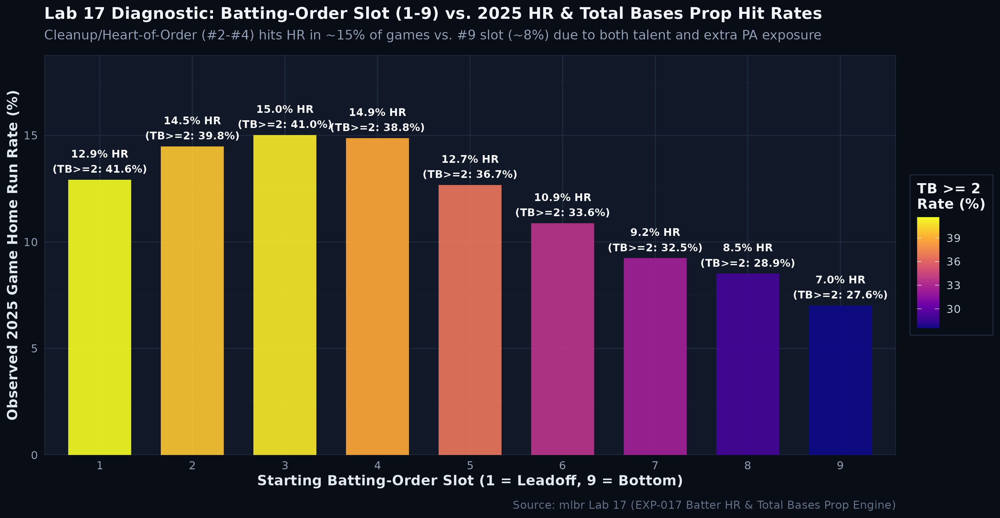

::: {.callout-tip}
### How to Use This Workbook
Open RStudio Server at [**http://192.168.10.1:8787**](http://192.168.10.1:8787), open `mlbr.Rproj`, and run [`workbooks/lab17_batter_hr_total_bases_props_workbook.R`](file:///mnt/storage/Rprojects/mlbr/workbooks/lab17_batter_hr_total_bases_props_workbook.R) line-by-line with `Ctrl + Enter`. Companion Q-CRISP study: [**Study 17: Batter Home Run & Total Bases Props**](../analyses/17_batter_hr_total_bases_props.html).
:::

---

## 1. First-Principles Home Run Prop Pricing

Using `mlbr::lake_duckdb()`, `v_statcast_biomechanics` is now mounted automatically as the **17th zero-copy DuckDB view** (`4,548,695` Silver pitches). Converting pre-game probabilities into Fair American Odds maps Aaron Judge (`32.1%` HR) to **`+212`** vs. a league-average starter (`11.7%` HR) at **`+755`**.

---

## 2. Diagnostic Chart: Batting-Order Slot (`1–9`) vs. `2025` HR & Total Bases Rates

{width=100%}

---

## 3. Mentor Checkpoints (Hands-On Exercises)

1. **Checkpoint 1 (Handedness Park + Weather HR Multiplier):** In `batter_hr_tb_prop_backtest_2024_2025.parquet` (`season == 2025L`), compare `mean(y_hr)` when `pf_hr_hand >= 115 & temp_f >= 80` vs. `pf_hr_hand <= 85 & temp_f <= 60`.
2. **Checkpoint 2 (Why Batting-Order Slot Matters Twice):** Explain why `slot` (`1..9`) remains highly predictive for `HR >= 1` and `TB >= 2` even after controlling for `ISO`, `SLG`, and `bat_speed`.
3. **Checkpoint 3 (Rare-Event Calibration):** Inspect `models/bprop01_hr_prop_calibration_2025.parquet` and check how closely the top decile matches observed HR rates across `4,374` locked-2025 starts.
